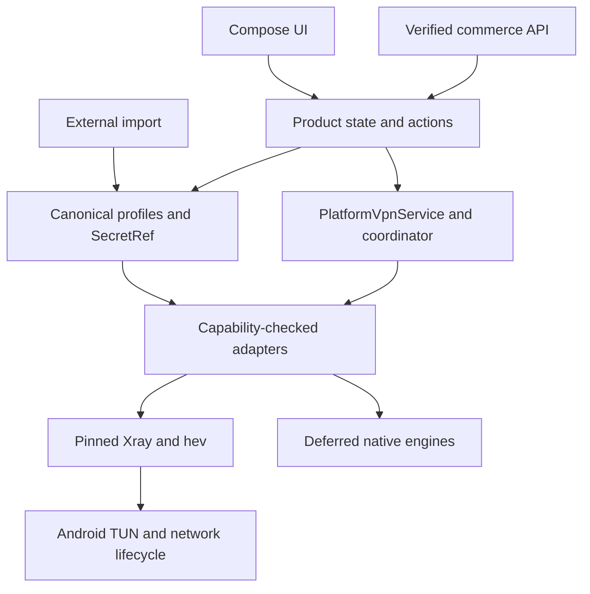

# PVNetwork — Integration Handoff and Six-Day Android Implementation Plan

**Date:** 2026-11-06 (Asia/Tehran). **Owner:** final preflight orchestrator, Chat 07.

**Scope:** evidence reconciliation, a fixed implementation decision, executable work allocation, and two developer prompts. This change is documentation only. It does not certify the application or merge any other PR.

**Goal:** produce a traceable, installable Android test build with one explicitly proven encrypted connection path, external-provider import, truthful state, and safe failure behavior. Six days is a bounded engineering target, not a promise of all protocols, commerce, all Android versions, or Store release.

**Architecture decision:** retain Kotlin Multiplatform (KMP), the existing product models and engine adapters, and Compose for Android. Do not rewrite in Flutter/Qt or fork another VPN application during this sprint.

**Tech stack:** the pinned repository baseline in §5; native Android `VpnService`; Xray and hev behind product/platform boundaries. Existing Windows code is a regression target, not a second six-day release target.

**Specification:** this document reconciles `app/PUBLIC_APP_MASTER_REQUIREMENTS.md`, `app/PUBLIC_APP_DECISIONS.md`, `app/CROSS_PLATFORM_ARCHITECTURE_RECOMMENDATION.md`, the actual source at the baseline below, and the coordination instructions in PR #2. The 2026-08-29 public-app plan remains background scope, not a reason to repeat completed work.

> Agentic implementation: execute the numbered tickets in dependency order with meaningful behavior tests and review. The user has already requested the handoff and PR; do not start another open-ended product/framework research cycle. Missing external evidence remains a blocker, never an invented PASS.

## 0. Delivery status and authority

| Item | Status at this handoff |
|---|---|
| Main inspected | `78dcd4511dbb830a999cc8c1796f2a38f88587e8` |
| Main commit date | 2026-09-23T17:44:29Z |
| Coordination branch | `docs/preflight-2026-11-06`, commit `ed21086e3e74772ab4dc31825eb87336f917fd67`, draft [PR #2](https://github.com/DashSaman/PVN-amirrezagol/pull/2) |
| Integration branch | `prep/2026-11-06/07-integration-handoff`, based on the inspected main, not on six unreviewed branches |
| Repository visibility | Public, observed via GitHub repository API |
| Six source-report PRs | **All six found and reviewed:** #3,#5,#6,#7,#8,#4 for workstreams01–06 respectively; pinned revisions and reconciliation in §15 |
| Research validator | **VERIFIED PASS** for V1/V2 research structure; not an application release gate |
| Product/device readiness | **NO-GO for a public production release**; no physical Android receipt established |
| Integration scope completion | Six complete source reports reviewed; contradictions normalized into this handoff. Implementation, device verification and external commercial/release gates remain open |

Evidence vocabulary throughout: **OBSERVED** = inspected source/API response; **VERIFIED** = executed check with a recorded result; **DOCUMENTED** = earlier repository report, not a fresh independent run; **DECIDED** = engineering decision made here; **PROPOSED CONTRACT** = exact implementation target, not a deployed API; **UNKNOWN/BLOCKED** = required proof or external input is absent.

The six reports were absent initially and arrived while this review was running. The final inventory satisfies PR #2's six-input precondition; initial absence is retained only as a dated audit observation. The coordinator's single-file ownership supersedes older instructions to edit shared `AGENTS.md`, state JSON and checkpoint files in this documentation PR. Those files remain unchanged.

For the sprint, a new contradictory fact must be tied to an exact source/commit/test and entered in the task receipt. Existing evidence wins over stale task pointers. A missing report does not authorize a framework rewrite, protocol marketing claim, or release waiver.

## 1. PR inventory and report reconciliation rule

Initial GitHub REST `GET /repos/DashSaman/PVN-amirrezagol/pulls?state=all&per_page=100`, plus all-state PR search and `prep/` branch search, returned only the two PRs below. The empty `prep/` remote search does not prove that other chats have no local work; it proves no corresponding remote branch was found at that inspection.

| Workstream | Required report | PR evidence at initial inspection | Treatment |
|---|---|---|---|
| 01 Repository Audit | `docs/preflight-2026-11-06/01-repo-truth.md` | Initially absent; later [#3](https://github.com/DashSaman/PVN-amirrezagol/pull/3) | Full report/diff reviewed at `3f1d2919be00b494466f85850c8dc7c62c9ab12c`; corrections below |
| 02 Reuse/Licenses | `docs/preflight-2026-11-06/02-reuse-licenses.md` | Initially absent; later [#5](https://github.com/DashSaman/PVN-amirrezagol/pull/5) | Full report reviewed at `01033f4d46902229d283968e40727fe6417a08a5`; single added file,468 lines |
| 03 Engines/Imports | `docs/preflight-2026-11-06/03-engines-imports.md` | Initially absent; later [#6](https://github.com/DashSaman/PVN-amirrezagol/pull/6) | Full report reviewed at `31f0e5fed1ccd0325806c436161465ec564e8dd3`; single added file,713 lines |
| 04 Product UX | `docs/preflight-2026-11-06/04-product-ux.md` | Initially absent; later [#7](https://github.com/DashSaman/PVN-amirrezagol/pull/7) | Full report reviewed at `bc53bd0aa3a6e4ff0b586cb89e7826f2193641ac`; single added file,1092 lines |
| 05 Backend/Commerce | `docs/preflight-2026-11-06/05-backend-commerce.md` | Initially absent; later [#8](https://github.com/DashSaman/PVN-amirrezagol/pull/8) | Full report reviewed at `d11471adfb1b4db676c4cf3cdc652eb85b44c496`; single added file,1276 lines |
| 06 QA/Security/Release | `docs/preflight-2026-11-06/06-platform-qa-release.md` | Initially absent; later [#4](https://github.com/DashSaman/PVN-amirrezagol/pull/4) | Full report reviewed, then 47-addition/12-deletion delta reviewed through `5c131bea2493605c4b95c9d9f6b17a572208dc0f`; source/CI/release cross-checks below |
| Coordination | `docs/preflight-2026-11-06/START_HERE.md` | [#2](https://github.com/DashSaman/PVN-amirrezagol/pull/2), draft/open, `ed21086…` | Assignment document only; not six completed reports |
| Earlier implementation | OpenConnect capability test | [#1](https://github.com/DashSaman/PVN-amirrezagol/pull/1), open, `13377c51b1cdd03d2ec39aafa55b1df2bd725fb8` | Unrelated to the six-report preflight; not merged here |

For a later source-report revision or new main delta, use this bounded intake procedure, owned solely by Codex as integration lead:

1. Record PR number, head SHA, base SHA, changed paths, author, review state, and report path. Read the full report and its diff. Do not substitute a chat summary or an unpushed local draft.
2. Compare its code claims against the baseline and any later main changes. Classify every material delta as supported, stale, duplicate, unsupported, or externally blocked.
3. Preserve unique valid requirements in the existing ticket IDs. Record contradictory claims with file/symbol and the evidence that resolves them. Missing receipts stay missing.
4. Check that the report changes only its authorized path and has no credentials or copied incompatible code/assets. Resolve conflict proposals in the integration handoff; never silently rewrite another team's evidence.
5. Do not merge a source PR merely to make a count reach six. Any later merge requires reviewed evidence, a clean diff, and current checks. This handoff PR itself makes no merge request for #1 or #2.

## 2. Evidence ledger: what actually exists

All repository file links below are immutable at the inspected baseline unless a different SHA is explicitly shown.

| ID | Evidence | Bounded conclusion |
|---|---|---|
| E01 | [main commit](https://github.com/DashSaman/PVN-amirrezagol/commit/78dcd4511dbb830a999cc8c1796f2a38f88587e8), GitHub branches/main response | Baseline includes later desktop UI/subscription commits; September prose is not a complete inventory |
| E02 | [coordination instructions](https://github.com/DashSaman/PVN-amirrezagol/blob/ed21086e3e74772ab4dc31825eb87336f917fd67/docs/preflight-2026-11-06/START_HERE.md) | Public repository, proprietary-product intent, report isolation and explicit evidence gates |
| E03 | [research state](https://github.com/DashSaman/PVN-amirrezagol/blob/78dcd4511dbb830a999cc8c1796f2a38f88587e8/docs/AGENT_RUN_STATE.json), `python scripts/agent_state.py verify --require-complete` | Fresh local exit 0; “PASS: agent state/tracker structure is consistent and strict completion gates pass.” V1/V2 are 93/93; no need to repeat protocol research |
| E04 | [settings](https://github.com/DashSaman/PVN-amirrezagol/blob/78dcd4511dbb830a999cc8c1796f2a38f88587e8/settings.gradle.kts), [foundation build](https://github.com/DashSaman/PVN-amirrezagol/blob/78dcd4511dbb830a999cc8c1796f2a38f88587e8/core/foundation/build.gradle.kts) | Foundation, Android, desktop, five adapter modules; foundation has JVM, Android, iosArm64 and iosSimulatorArm64 targets |
| E05 | [M4 run 35897687631](https://github.com/DashSaman/PVN-amirrezagol/actions/runs/35897687631) at baseline SHA; desktop job `107305599220` log independently inspected | Android assemble/upload and **Ubuntu** desktop tests succeeded. Desktop `packageDistributionForCurrentOS` reported **UP-TO-DATE**, with no packaging subtasks; it does not prove a package was produced. No physical-phone or Windows execution receipt |
| E06 | [release v0.1.0-preview](https://github.com/DashSaman/PVN-amirrezagol/releases/tag/v0.1.0-preview), release API ID `394742058` | Current asset inventory contains only `PVNetwork-Windows-0.3.0.zip`; release prose still mentions older Windows and Android artifacts. No current downloadable APK established here |
| E07 | [M-P2 historical validation](https://github.com/DashSaman/PVN-amirrezagol/blob/78dcd4511dbb830a999cc8c1796f2a38f88587e8/docs/M-P2_PUBLIC_APPS_VALIDATION.md) | Documents a local debug APK and six Windows data-path tests; explicitly excludes physical Android execution. Do not promote this to a fresh test |
| E08 | [Android service](https://github.com/DashSaman/PVN-amirrezagol/blob/78dcd4511dbb830a999cc8c1796f2a38f88587e8/apps/android/src/main/kotlin/com/pvnetwork/client/PvVpnService.kt) | Source for API-level mismatch, route exclusion, process/JNI startup, persistent transient config, and premature CONNECTED findings |
| E09 | [Android activity](https://github.com/DashSaman/PVN-amirrezagol/blob/78dcd4511dbb830a999cc8c1796f2a38f88587e8/apps/android/src/main/kotlin/com/pvnetwork/client/MainActivity.kt), [desktop controller](https://github.com/DashSaman/PVN-amirrezagol/blob/78dcd4511dbb830a999cc8c1796f2a38f88587e8/apps/desktop/src/main/kotlin/com/pvnetwork/desktop/DesktopVpnController.kt) | Android entry point imports VLESS only; desktop has later multi-link/subscription behavior. Product parity is not established |
| E10 | [broken-CI register](https://github.com/DashSaman/PVN-amirrezagol/blob/78dcd4511dbb830a999cc8c1796f2a38f88587e8/docs/BROKEN_CI_REGISTER.md) | REALITY and TUIC failures are documented separately from passing contract/other-protocol tests; closing them requires new receipts |
| E11 | [reuse matrix](https://github.com/DashSaman/PVN-amirrezagol/blob/78dcd4511dbb830a999cc8c1796f2a38f88587e8/app/CLIENT_SOURCE_REUSE_MATRIX.md), [architecture recommendation](https://github.com/DashSaman/PVN-amirrezagol/blob/78dcd4511dbb830a999cc8c1796f2a38f88587e8/app/CROSS_PLATFORM_ARCHITECTURE_RECOMMENDATION.md) | Existing clean product/adapter direction and component-specific obligations; these are historical reviews, not blanket legal approval |
| E12 | [Android official `excludeRoute` reference](https://developer.android.com/reference/android/net/VpnService.Builder#excludeRoute(android.net.IpPrefix)), verified 2026-11-06 | Method added in API **33**. Source guard at Q/API29 is insufficient; source-level defect, not a claim of a crash reproduced on a phone |
| E13 | [Xray run35877948152](https://github.com/DashSaman/PVN-amirrezagol/actions/runs/35877948152), jobs `107238663220` and `107238663604`, logs independently fetched | Contract suite30 tests/1 failure (`hostRuntimeValidatesStartsAndCleansProtectedConfig`, line81); real suite7/1 failure (REALITY, line113). Historical executions, not reruns at current candidate |
| E14 | [Mihomo run35868899981](https://github.com/DashSaman/PVN-amirrezagol/actions/runs/35868899981), job `107207477086`, log independently fetched | Real suite3 tests/1 failure (TUIC v5, line197); adapter/OpenConnect contract jobs succeeded separately |
| E15 | [official Xray v26.10.31 release](https://github.com/XTLS/Xray-core/releases/tag/v26.10.31), primary release API checked 2026-11-06 | Non-prerelease, published2026-10-31T13:37:42Z. Upstream describes an urgent MPTCP-related security update. Candidate exists; exact PVNetwork compatibility/provenance/advisory disposition remains unverified |
| E16 | [Android Builder API](https://developer.android.com/reference/android/net/VpnService.Builder#addDisallowedApplication(java.lang.String)), [VPN guide](https://developer.android.com/develop/connectivity/vpn), [protect API](https://developer.android.com/reference/android/net/VpnService#protect(int)), checked 2026-11-06 | A denied package uses underlying networking; it cannot be combined with an allowed-app list. Per-socket protection is the future narrower transport boundary. Lockdown behavior requires device validation |
| E17 | [desktop ProfileRepository](https://github.com/DashSaman/PVN-amirrezagol/blob/78dcd4511dbb830a999cc8c1796f2a38f88587e8/apps/desktop/src/main/kotlin/com/pvnetwork/desktop/ProfileRepository.kt), locally inspected | `cache = load()` precedes the `subscriptionIds` initializer; the map loaded by `load()` is then replaced by an empty map. Consequent refresh/data-loss behavior needs a regression test, C34 |

Additional fresh observations: M4 run's current artifacts API returned `[]`; retention is configured as 14 days, but deletion/expiry cause was not independently established. Recent scheduled [run 42265814098](https://github.com/DashSaman/PVN-amirrezagol/actions/runs/42265814098) passes the research-state workflow, not APK/device QA. `scripts/verify_agent_state.py` referenced by an older contract does not exist; the executable validator is `scripts/agent_state.py`. No new Android/Windows binary was built in this preflight.

The [comparison from the failed Xray run to main](https://github.com/DashSaman/PVN-amirrezagol/compare/6ddccb75a699f08d050d62901db2041b97072f11...78dcd4511dbb830a999cc8c1796f2a38f88587e8) changes only desktop controller/UI files. No Xray runtime/test/workflow fix appears after that failed receipt. Report06 additionally distinguishes cached foundation/Mihomo tasks from executed tests; cached or no-op tasks cannot close a fresh runtime gate.

## 3. Conflicts resolved for implementation

| Finding | Conflicting or incomplete material | Resolution / implementation consequence |
|---|---|---|
| F01 Research complete vs application complete | `run_status=COMPLETE`, old research instructions | COMPLETE describes only research. Runtime, device, Store, commerce states remain separate. Do not reopen 93 dossiers |
| F02 “Task 3/4 next” vs later app code | `PROJECT_STATE.md`, `AGENTS_LATEST.md`, public-app handoff | Keep account models and both app shells; implement missing coordinator/platform contracts without recreating them |
| F03 KMP “JVM only” | August architecture prose | Actual foundation has Android and iOS compile targets. iOS compile targets are not a host app or Packet Tunnel |
| F04 “VLESS only/no subscription” vs later additions | Early M-P2 prose, later desktop controller/ShareLinks | Inspect each platform separately: desktop gains multi-protocol links/subscriptions; Android MainActivity still uses `VlessShareLinkImporter` |
| F05 “Android 10+ works” | M-P2/release prose and Q guard | Route method needs API33. Six-day device acceptance is API33+ arm64; older devices must get explicit refusal before starting the tunnel. Broader support is a later tested ticket |
| F06 “truthful Connected” | M-P2 narrative | Service line 176 publishes CONNECTED after a JNI-start boolean, without a verified protected data path. Fix before acceptance; include failing peer, process death and stale callback tests |
| F07 “server excluded so no loop” | Single resolved address excluded at service lines 109–119 | Remove destination-wide exclusions. C06 uses self-package UID exclusion for the internal sprint, explicit control-plane exception, SOCKS/native readiness and a separate-UID physical TUN test. No leak-free/kill-switch claim follows without its own evidence |
| F08 “secrets encrypted” | Keystore storage description | Reusable references are encrypted, but generated `engine/config.json` contains credentials and stop code does not delete it. Transient config, backup exclusions, redaction and crash cleanup are separate gates |
| F09 APK exists in release | Release body/checksums | Current asset inventory lacks APK. Rebuild and retain a new SHA-addressed artifact. Do not give the obsolete filename as an available download |
| F10 Windows “VPN” | System proxy behavior vs whole-device claim | Existing WinINET proxy is not all-traffic TUN coverage. Preserve exact scope and defer Windows tunnel certification |
| F11 Xray stable/advisory blocker | Older stable-selection prose vs bundled `v26.7.28` | A newer official non-prerelease `v26.10.31` exists (E15). C02 evaluates that exact security candidate first, with packaged hashes and regression tests. Do not infer the older binary's vulnerability or the candidate's safety from version labels alone |
| F12 REALITY/TUIC “supported” | Adapter/parser presence vs open red interop register | Capability remains unverified until named real tests and target-device evidence pass. No test deletion, skip or timeout inflation to manufacture green |
| F13 “pinned download guarantees binary” | `fetchXrayCore` early return for existing target | Revalidate cached/extracted binary and archive, provenance and native alignment; existing file presence is insufficient |
| F14 “account data model means backend” | Account/entitlement classes | Models are real; deployed auth/plan/purchase API is not established in this repository. Use unavailable behavior and contract tests until API mapping is verified |
| F15 “private commercial product in public repo” | Product intent vs repository visibility | Publish this documentation here; verify a private product destination before pushing proprietary implementation. No automatic visibility change, code relocation or relicensing |
| F16 Latest Xray contract regression omitted from register | Submitted reports01/06 and independently fetched job107238663220 | Add C33: runtime config still exists at the stop-cleanup assertion. Cause is unproven; fix deterministic cleanup before claiming the shared runtime gate green |
| F17 Source-report task owners overlap | Report01 T08/T15/T16 proposes Z.ai edits to MainActivity/Storage/shared models; report06 also proposes broader Z.ai security/build work | This handoff's §6 allowlist wins: those implementation paths belong only to Codex; Z.ai owns new UI/presentation/tests only |
| F18 Import warning can hide semantic change | `ShareLinks.kt` VMess lines100–118 maps unknown transport to raw and REALITY to TLS | C08 must block incompatible security/transport semantics; generic warning is not user approval to downgrade |
| F19 Green aggregate packaging task vs produced artifact | M4 logs and source06's corrected revision | `packageDistributionForCurrentOS UP-TO-DATE` is not package creation. Use `createDistributable` with a real output assertion; configured installer task/output and Windows runner required for a Windows packaging claim |
| F20 Desktop source association and refresh safety | ProfileRepository declaration order, desktop delete-before-promote refresh, unprotected reusable source URL | Preserve as concrete C34/C35 defects, separate from future Windows full-tunnel work. Do not copy the desktop implementation into Android unchanged |
| F21 Runtime descriptor vs verified capabilities | Android `ValidationOnlyXrayRuntime` checks a Java path property, not a launched verified binary | C18 distinguishes parsing, validation, exact packaged artifact, runtime and device evidence. Descriptor presence cannot enable Android tuples automatically |

### 3.1 Cross-report decisions after all six submissions arrived

| Conflict or duplicated work | Final integration decision and ticket mapping |
|---|---|
| Reports01/02/03/06 propose overlapping Z.ai parser/model/build/storage/test ownership; report05 has a combined billing/UI owner | §6 is authoritative: Codex owns all runtime/models/parsers/storage/backend/platform billing/build/CI; Z.ai owns only its enumerated UI/presentation/string/test paths |
| Report02's optional Flutter experiment vs a fixed six-day decision | KMP selected; no comparison spike during this sprint; exact future exception in §4.1 |
| Report03 target socket protection vs current subprocess without that bridge | Explicit internal self-UID exception C06 with separate-UID TUN proof; C24-socket is required for narrower transport isolation/lockdown claims |
| Report03 import defaults2MiB/8MiB/10,000 entries vs narrower initial client | §6.3's1MiB decoded/import and1,000-candidate limits govern version1. Future larger formats need a versioned limit and fuzz/expansion tests; report05's2MiB transport envelope cannot override this client admission limit |
| Report03's20 lifecycle cycles / proposed repeated runs vs report06 production100 cycles/eight-hour soak | Internal gate uses30 cycles/20 handoffs/30-minute screen-off; previously failing gates require three clean non-cached repetitions before closure. Production100/eight-hour and C31's24-hour campaign remain separate |
| Report04 temporary30-second fixture deadline vs final runtime policy | §6.3 readiness15s after consent/network prerequisites; no server timeout while waiting for human OS permission; longer-stage hint is presentation only |
| Report04 Auto within one source vs an ambiguous global selector | SelectSource + selectedSourceId; Auto cannot switch providers, and authenticated path health is required (C10/C37), not TCP latency alone |
| Automatic refresh vs report04 review of sensitive changes | C09/C01 require revision-CAS, explicit security/destructive/partial diff approval, active-secret retention and transactional restore; Z04 renders CF08 |
| Report03 structured formats/composition absent from the early integration draft | C36/C37 preserve them as atomic required follow-up work; no JSON-generation→JSON-import or single-SOCKS→multi-engine inference |
| Report04 single/multi-service screens and product facets vs old account models | C01 adds services/pools/facets/offer identity, independent payment/fulfillment, price source, freshness and unknown expiry; C27/C28 preserve server authority |
| Report05 RFC3339/decimal-string wire values vs Kotlin Long/epoch fields | Strict adapter conversion in §9.1; one wire contract, no silent float/unit conversion |
| Report04 support thread/attachments vs report05 v1 limits | v1 supports deliberate safe text/allowlisted fields and account status only. Attachments/thread/list/reply remain disabled pending C27-support-thread; local diagnostic export is distinct from server upload |
| Deletion progress UI vs absent post-revocation status API | `privacy.status` UNMAPPED; C29-status defines safe recovery/status access, accepted request never paints Completed |
| Panel operational routes vs consumer commerce assumptions | Source inventory in §9.0, separate server-only facade, no admin secret in app. Real consumer transport remains UNCONFIGURED |
| Report05 proposed15-minute lease/5-minute revocation vs offline/net-melli resilience | B12: explicit commercial acceptance and real node enforcement before sale; external profiles unaffected, no silent outage promise |
| Source reports' green packaging summaries vs newest06 log correction | M4 desktop aggregate was UP-TO-DATE; no produced package inferred. Candidate core changes invalidate historical binary-specific proofs |

The six source reports remain independent unmerged evidence. This file resolves execution conflicts without rewriting or pretending to have executed their proposed tests. Their detailed matrices, original UX tokens/copy and bounded source inventories are adopted at the exact pins in §15; only the overrides above take precedence.

## 4. Final architecture and scope decisions

### 4.1 ADR-07: keep KMP and Compose

**DECIDED:** preserve `core/foundation`, the five existing adapter modules, the canonical profile/secret-reference model, and Android/desktop Compose direction. Continue the existing native Android VPN path while repairing its lifecycle/security gaps. No full Flutter rewrite, Qt rewrite, copied GPL app shell, or new white-label platform in the six-day sprint.

| Option | Actual reusable work | Cost/risk for this sprint | Decision |
|---|---|---|---|
| Existing KMP + Compose | Foundation models/tests, Android `VpnService`/Keystore, Xray translator, five adapters, desktop runtime | Must repair Android lifecycle/import/UI seams and validate native traffic | **Selected**; minimizes known replacement scope |
| Flutter shell over KMP | Could keep a domain/IPC boundary | New bridge, Dart state/UI, build integration; no measured repository spike proves a schedule win | Deferred; reconsider only after a specific measured blocking defect |
| Fork Karing/Hiddify/v2rayNG/Amnezia or Qt rewrite | Mature references, not automatically compatible proprietary source | License/provenance work plus product migration and native validation still required | Rejected for current commercial-private sprint |

This is a scope/risk decision, not an unsupported claim that KMP always performs better or finishes faster than Flutter.

Report02's proposed four-hour Flutter/plugin comparison is **not scheduled in D1–D6**. It can be reconsidered only for a specific measured integration blocker, with source/native provenance first, identical device/peer acceptance and a new explicit ADR. Its existence does not reopen this architecture decision.



UI does not parse core JSON, call engines, store credentials, decide entitlement, or publish CONNECTED. Android Activity owns permission UI and wiring only. Service/coordinator owns serialized lifecycle. Runtime config is generated transient data, never the profile database. Backend entitlement is separate from provider subscription metadata and measured session traffic.

**Android transport decision for the internal sprint:** retain the packaged Xray subprocess and hev bridge; replace global endpoint-route exclusion with `Builder.addDisallowedApplication(packageName)` for **PVNetwork only**, using the actual application ID including the debug suffix. Verify parent/child UID equality on the phone. Do not call `allowBypass()` or add an allowed-app list. Other apps, including traffic to the VPN server's own IP on another port, remain covered by the VPN. PVNetwork's bootstrap DNS and HTTPS control-plane requests are an explicit exception; keep arbitrary browsing/WebViews out of that UID. This is a scoped implementation decision, not a claim that all traffic from PVNetwork itself is protected. The future per-socket protect/binding bridge is C24-socket; neither IPC nor a route-table entry establishes it today. (E16).

Runtime readiness has three required parts in the same attempt: OS TUN established, native worker acknowledged ready/healthy, and an authenticated HTTPS marker through the local SOCKS engine path. A separate application UID proves actual TUN routing during device qualification. A request originating from PVNetwork's excluded UID is **not** a TUN test. OS always-on/lockdown compatibility remains off/unadvertised until tested; if it blocks the excluded engine, report that limitation and complete C24-socket before claiming that capability.

### 4.2 Fixed six-day product slice

- Android phone/tablet **arm64, API33+** is the device-test target. Existing install minSdk26 may remain for safe UI/import behavior; tunnel attempts below33 must return a clear unsupported-version reason. No Android8–12 connectivity claim until its separate compatibility ticket passes.
- Primary encrypted target: **VLESS + RAW/TCP + TLS with certificate validation**. **VLESS + REALITY + Vision remains a high-priority customer acceptance path but a separate gate**; the current red test must first be fixed. RAW/no-security is allowed only as an isolated CI diagnostic fixture, never marketed as the consumer secure path.
- Import can recognize a broader set than the release capability list. Recognized but unverified combinations remain visible with a reason and cannot auto-connect as supported. No silent loss of security/transport fields.
- External providers work without PVNetwork login. Initial sources: pasted/share text and HTTPS subscriptions of supported links/plain or base64 link lists. QR/file intake is explicitly prioritized in the backlog; unsupported proprietary/encrypted formats are rejected with a reason.
- Home, profiles/subscriptions, settings, help, optional PVNetwork account/store entry; Persian/English, RTL, light/dark/system. Unknown metrics render “unavailable,” not zero, unlimited, a simulated ping, or a fake plan.
- Commerce transport defaults to unavailable. Login/purchase/renew become functional only after real endpoint/auth/payment mappings and test credentials are supplied. An unavailable store must not block external-provider connection.
- The inspected PV-NativePanel source delivers Naive-oriented credentials/configuration. A TLS-only external-provider test build must **not** be described as supporting that first-party service; its acceptance additionally needs C19 and the verified backend delivery mapping.
- Six-day acceptance is an **internal test build**. Public release, full protocol parity, native iOS/macOS/Windows tunnels, TV, complete ruleset/DNS UI, and real payments are not silently included.

### 4.3 Engine / protocol disposition

| Family | Existing evidence boundary | Sprint or follow-up decision |
|---|---|---|
| VLESS/TLS | Xray importer/model/config and historical host paths; Android runtime source exists | First encrypted Android vertical slice, accepted only on exact physical-device receipt |
| REALITY/Vision | Source exists; dedicated interop failure documented | Fix and test independently; if red, excluded from verified support and explicitly report customer-scope gap |
| VMess/Trojan/Shadowsocks | Shared Xray link/config paths and documented Windows tests; Android UI not wired to generic importer | Import validation first; promote individual protocol/transport/security tuples only with Android evidence |
| Hysteria2/AnyTLS/TUIC | Mihomo JVM adapter; documented scoped Hysteria2/AnyTLS results, TUIC red | No Android bundling in sprint without license/native/runtime gates; follow-up C20 |
| WireGuard/AmneziaWG | WireGuard adapter/import and Linux evidence; not a mobile embedding receipt | Separate mobile integration C21; AWG is not automatically equivalent to WireGuard |
| OpenVPN | JVM system-process/isolated Linux evidence | Separate native integration C22 and license review; no automatic mobile support |
| OpenConnect | Existing adapter and old PR #1, JVM-scoped | Separate native/credential/lifecycle integration C22 |
| NaiveProxy | First-class customer requirement in decisions; no Android adapter demonstrated | Preserve P1 C19; no claim of a usable Naive tunnel from a URI parser |
| Hysteria v1, SSR, SSH, SSTP, IKEv2/IPsec, DNSTT and other DNS tunnels | Existing research/reference material, no demonstrated Android product paths in this review | C23 per-family adapters, import contracts, license gates and physical data-path tests |
| Other numbered entries | 93 registry entries include transports and infrastructure roles | C18 builds an exact capability ledger; do not advertise “93 VPN protocols supported” |

### 4.4 Reuse and commercial gates

Reuse PVNetwork-owned models/adapters and small approved dependencies first. The prior matrix's GPL/custom-license clients are architecture/UX references for this proprietary plan; Happ/official V2Box/NPV source rights have not been established here. An unrelated plugin named `v2box` is not proof of rights to the end-user V2Box application. No code/assets are copied in this PR.

Xray MPL-2.0, hev MIT, any native wrapper, transitive libraries, rulesets and fonts must each appear in the exact shipping inventory with notices/source obligations. A process boundary, IPC or permissive wrapper is **not** a blanket exemption for the engine/dependency licenses. GPL itself does not prohibit commercial use; the question here is compliance with the intended proprietary distribution and any additional revision-specific terms. Do not bundle sing-box/Mihomo/GPL application code into that distribution without a documented approved licensing path. Current exact-license/SBOM sign-off is blocker B06; historical component labels are inputs to that gate, not legal clearance.

Accepted targeted deltas from pinned report02, with key source files independently checked here:

| Component decision | Concrete implementation consequence |
|---|---|
| [OpenVPN3 dual license at `0b27d9d…`](https://github.com/OpenVPN/openvpn3/blob/0b27d9df493db8bc9dc459a2b1cb6b67037742b2/LICENSE.md) offers AGPL-3.0 or MPL-2.0 | C22 may evaluate the MPL route at an actual selected release; this does not relicense OpenVPN2 or unrelated wrappers. Native/TLS/crypto/compression dependencies remain separate |
| [JNA license](https://github.com/java-native-access/jna/blob/1a91122853f6ab6f1fb2a4a284a6cf2ed8af0a4d/LICENSE) permits Apache-2.0 or LGPL-2.1-or-later | Select Apache-2.0 for covered JNA5.19.1 files; inventory jnidispatch/libffi separately, not both alternative licenses simultaneously |
| [WireGuard Android native build](https://github.com/WireGuard/wireguard-android/blob/0856e2ecf7f3cce0e9c9014db3ad7665669adce5/tunnel/tools/CMakeLists.txt) builds `libwg.so`/`libwg-quick.so` as executables and a separate libwg-go payload | C21-artifact cannot approve the entire AAR from the root Apache label. Report02 pins GPLv2 tools `e2ecaaa739144997ccff89d6ad6ec81698ea6ced`; select/inventory the actually needed backend |
| [libXray `7fe8528…` module graph](https://github.com/XTLS/libXray/blob/7fe8528063e54343af8ba9a37431afc56000de21/go.mod) selects Xray `a4a3dff…` and Go1.27.3 | C24-socket/C25 may use this narrow bridge candidate only as a coherent pinned graph. Freeze gomobile/gobind and actual resolved dependencies; inspect allocation/free/global-state/concurrency. It is not an OS VPN service |
| Report02's hev2.19.3 `c5584feca8f6df70ee53eb2879e034b849a3d15a` and four pinned MIT/BSD submodules | Optional replacement input only; it does not authenticate the checked-in2.17.1 binary. C02 can reproduce2.17.1 or admit a tested replacement without an automatic upgrade |

C02/C15 must reconcile the **final per-target/ABI/flavor artifact inventory** with exact source/version/hash, license expression/selected branch, modifications, linking/bundling relationship, notices/copyright, required source/relink material and accessible source location, build recipe and reviewer/date. Canonical outputs are `LICENSES/DEPENDENCIES.lock.json`, `LICENSES/SOURCE_INDEX.md`, `LICENSES/**` and `NOTICE`, packaged with the app and visible in About. A dependency tree alone does not close this gate.

## 5. Dependency and artifact handoff

These values are **observed baseline pins**, not an instruction to substitute “latest,” and not a fresh security endorsement. If a pin is unavailable or fails a security gate, record the exact failure and one reviewed replacement, including checksum/license/test delta. Do not silently downgrade the build or change engines.

| Component | Baseline pin / configuration | Evidence |
|---|---|---|
| Kotlin / Kotlin JVM / Compose compiler plugin | `2.4.10` | root `build.gradle.kts` |
| Compose Multiplatform | `1.11.1` | root `build.gradle.kts` |
| Android Gradle plugins | `9.3.3` | root `build.gradle.kts` |
| Gradle / Java | Gradle `9.5.0`, Temurin JDK `21`; Java bytecode target17 | M4/M2 workflows and module builds; wrapper absent at baseline |
| Android app | compileSdk37, targetSdk36, minSdk26, `arm64-v8a`, `com.pvnetwork.client`, versionCode1/name0.1.0 | `apps/android/build.gradle.kts` |
| Foundation Android | compileSdk36/minSdk26, `withHostTest {}` | `core/foundation/build.gradle.kts` |
| Android Compose BOM | `2026.09.00` | Android build |
| Android Activity / core / lifecycle | `1.13.0` / `1.19.0` / `2.9.4` | Android build |
| Desktop JNA / JNA platform | `5.19.1` / `5.19.1` | Desktop build; selected license branch and native transitive inventory above |
| Xray Android | `v26.7.28`, archive SHA256 `a442892c175fa648fc56866ec872aac441c5a6b8946a1b60f0258ae16a7fb402`; checked-in `libxray.so` SHA256 `0695fcf6b06fdf96071628224a7c6d52328cce94d26078b5cc977e9db281e4f3` | Archive pin from build; extracted checked-in bytes freshly hashed, not provenance-approved; verification must be added |
| Xray Linux CI fixture | `v26.7.28`, archive SHA256 `8195d909f1109b8f3d99eefe401a3c451d7bf4af71f24d3815420f77e5dd2a40` | `.github/workflows/m2-xray-adapter-ci.yml` |
| hev-socks5-tunnel | documented `2.17.1`, NDK r27c; freshly computed checked-in native SHA256 `0c26c47620d7a3c881650e2a8d0f35cf164dd680b3aa0db35e37d1e3b88707e0` | Hash matches M-P2 validation; source/submodule identity and reproducible build remain unproved |
| Mihomo host fixture | `v1.19.30`, archive SHA256 `cf06ce2c7d1421bdbda14ee4a5b6046672dc35ebf8eecd8e77504ec3c0ed9a84` | M3 workflow; not approved for Android shipping |
| sing-box test peer | `v1.13.19`, archive SHA256 `ef88a9e577d474210867bd708933d042e9b70106529df2656182c9db90106aa1` | M3 workflow; CI peer is not the Android engine |
| checkout / setup-java / setup-gradle Actions | `3d3c42e5aac5ba805825da76410c181273ba90b1` / `b6effb05e454b25005698d916606bdc6ffcbf961` / `9c971963bec38e04b3d30dcc455b5382be2fdbfb` | M4 workflow |
| upload-artifact Action | `ea165f8d65b6e75b540449e92b4886f43607fa02` | M4 workflow |

**Exact upstream security candidate, not an approved replacement:** Xray `v26.10.31` is the first C02 candidate. Official release API archive SHA256: Android arm64 `ee7878bb47ce28ff5b068e2d173ba1a9fab20ca1aec94191644919ec08ba5f1d`; Linux64 `e4bd9119f50ae7c41658b1abd0679ae06f98bd864a2907ff33f2f2cf7081b214`; Windows64 `2e04a9995a6f2ad1b28c0bb25c708ecb2695e43a1c9c7889c4b6ac2b48cf7a6a`. These identify archives, not extracted executable bytes. Update the admitted platform and CI fixture pins coherently; record source, transitive inventory and extracted hashes; rerun generator/contracts/REALITY and selected phone-path tests. The upstream notice warrants review; it does not establish exploitability of the old binary or approval of the new one. No framework/core search is needed for this candidate evaluation (E15).

Current release asset: `PVNetwork-Windows-0.3.0.zip`, API asset ID `584284338`, size **80,765,944 bytes**, server-reported SHA256 **`3683a3c4df7bb1ab7d4873a3b035b87b551f7c7f0f2492ff42e1c52ae5674e80`**. This is inventory metadata; no fresh binary installation or checksum recomputation was performed here. The release body's older Windows checksum is not this asset's digest.

Android expected build output is `apps/android/build/outputs/apk/debug/android-debug.apk`; Actions artifact name is `pvnetwork-android-debug-apk`. Those are build destinations, not proof that a retained download is currently available.

## 6. Implementation ownership and frozen interface

### 6.1 No overlapping writers

Use separate clones/worktrees and branches from one recorded integration baseline. Independent agents must never share a writable checkout. Codex is the only integration/merge owner. Z.ai opens PRs; it does not merge, edit build infrastructure, or change the shared contracts.

| Owner | Exclusive write paths |
|---|---|
| **Codex** | `core/**`, `engines/**`, `build.gradle.kts`, `settings.gradle.kts`, `gradle.properties`, `gradlew`, `gradlew.bat`, `gradle/**`, `gradle.lockfile`, `.github/**`, `scripts/**`, `LICENSES/**`, `NOTICE`; **`apps/android/**` excluding every Z.ai path below** (therefore MainActivity, service, storage, VpnHub, integration/platform/data, manifest, native bridge/binaries, build files, backup XML and non-UI tests are Codex only); `apps/desktop/**`, new `apps/{ios,macos,android-tv}/**`, proposed private `backend/commerce/**`, `app/**`, `AI_START_HERE.md`, `AGENTS.md`, `AGENTS_LATEST.md`, `AGENT_EXECUTION_CONTRACT.md`, `docs/{PROJECT_STATE.md,AGENT_RUN_STATE.json,IMPLEMENTATION_PHASE_STATE.json,AGENT_CHECKPOINT_LOG.md,BROKEN_CI_REGISTER.md}`, this `docs/preflight-2026-11-06/00-integration-handoff.md`, `docs/api/**`, `docs/implementation-2026-11-06/codex/**` |
| **Z.ai** | New `apps/android/src/main/kotlin/com/pvnetwork/client/ui/**`, new `apps/android/src/main/kotlin/com/pvnetwork/client/presentation/**`, exact `apps/android/src/main/res/values/strings.xml`, exact `apps/android/src/main/res/values-fa/strings.xml`, UI-only `apps/android/src/main/res/drawable/pvn_ui_*` resources, `apps/android/src/{test,androidTest}/kotlin/com/pvnetwork/client/{ui,presentation}/**`, `docs/implementation-2026-11-06/zai/**` |
| **Owner / authorized external operator** | Private destination, API and payment credentials, official brand asset, signing custody, physical phone, Store/legal accounts. No credentials in either agent's commits |

Any file outside a worker's allowlist is read-only to it. Future platform code is Codex-owned unless a later non-overlapping assignment explicitly changes ownership. No broad “both can edit Android” exception exists. Cross-owner needs go into that worker's own receipt as a change request; the owning agent applies them. Root Gradle, manifests, native bridge, shared model and integration wiring never move to Z.ai just to unblock a UI build.

The ownership matcher checks the exact Z.ai patterns first, then subtracts them from Codex's Android prefix. Thus a file can have **one** writer only. New paths under either prefix inherit that owner; moving/renaming a file across the boundary requires an explicit contract/ownership amendment before either worker writes it. Reports01–06 remain read-only inputs. The permissions above concern later implementation; this preflight change still modifies only the requested handoff file.

**Dependency handshake:** C01 freezes contract version 1 and its commit. Z.ai consumes that commit, then independently creates the UI entry point. Codex may not create placeholder files inside Z.ai's directories. Before the Z01 entry point exists, the old screen can continue compiling; Codex switches MainActivity in C14 after Z01 lands. Integration uses small serial merges/cherry-picks, reruns relevant tests at the resulting SHA, and checks the changed-file allowlist. Code review is not permission to edit the other stream's files.

### 6.2 Shared seam (proposed exact contract, implemented by C01)

Create these **new** files under `core/foundation/src/commonMain/kotlin/com/pvnetwork/core/client/`: `PublicClientState.kt`, `PublicClientAction.kt`, `PublicClientPort.kt`. Reuse existing `ConnectionSnapshot`, `ProfileId`, `Account`, `Entitlement`, `DeviceRegistration`, `RoutingMode` and `DnsMode`; do not clone these domain classes in UI code.

The interface has no Android, engine, JSON, HTTP or coroutine type. Android integration adapts callbacks to its existing StateFlow. All observation callbacks are delivered on the UI dispatcher by the Android adapter; `dispatch` must return promptly and do I/O off the UI thread.

```kotlin
interface PublicClientPort {
    fun snapshot(): PublicClientState
    fun observe(observer: (PublicClientState) -> Unit): ClientObservation
    fun dispatch(action: PublicClientAction)
}
fun interface ClientObservation { fun cancel() }
```

Version 1 state fields (exact names; all lists immutable snapshots):

| Type | Required fields / semantics |
|---|---|
| `PublicClientState` | `revision: Long`, `build: BuildInfo`, `diagnostics: DiagnosticPreview?`, `connection: ConnectionSnapshot`, `connectionAttemptId: String?`, `permission: VpnPermissionState`, `disclosure: VpnDisclosureView`, `effectiveCoverage: CoverageMode`, `blockingPolicy: BlockingPolicy`, `pathHealth: PathHealthView`, `profiles: List<ProfileSummary>`, `selectedSourceId: String?`, `selectedProfileId: ProfileId?`, `activeProfileId: ProfileId?`, `subscriptions: List<SubscriptionSummary>`, `subscriptionUpdate: SubscriptionUpdatePreview?`, `importPreview: ImportPreview?`, `session: SessionMetrics`, `account: AccountView`, `settings: SettingsView`, `capabilities: Set<ClientCapability>`, `operation: OperationView?`, `notice: ClientNotice?` |
| `BuildInfo` | `versionName: String`, `versionCode: Long`, `sourceRevision: String?`, `engineVersions: Map<String, String>`, `licenseNotices: List<LicenseNoticeView>`; values come from the packaged artifact/manifest, not simulated data. Version metadata is not runtime verification |
| `LicenseNoticeView` | `id: String`, `title: String`, `licenseExpression: String`, `noticeText: String`, `sourceUrl: String?`; packaged approved notices, readable offline |
| `DiagnosticPreview` | `id: String`, `createdAtEpochSeconds: Long`, `sanitizedText: String`, `byteCount: Int`; contains only C13-approved data, never raw engine/source content |
| `AccountDeletionView` | `requestId: String`, `state: DeletionState`, `acceptedAtEpochSeconds: Long?`, `statusAvailable: Boolean`, `retentionNoticeCode: String?`; `DeletionState = REQUESTED, PROCESSING, COMPLETED, REJECTED, UNKNOWN`. Accepted receipt means REQUESTED; completed requires authoritative evidence |
| `VpnPermissionState` | `UNKNOWN`, `REQUESTING`, `GRANTED`, `DENIED`, `CANCELLED`, `REVOKED`, `FAILED`; no silent loss of consent-launch errors |
| `VpnDisclosureView` | `version: String`, `acceptedVersion: String?`, `requiredBeforeConnect: Boolean`; local acceptance records version/time without a guest cloud identity. The test-build disclosure describes actual coverage/control-plane exception; public legal copy remains B07/B09 |
| `CoverageMode` | `UNKNOWN`, `ALL_APPS_EXCEPT_PVNETWORK`, `ALL_DEVICE_TRAFFIC`, `SELECTED_APPS`, `RULE_BASED`, `SYSTEM_PROXY`, `LOCAL_PROXY_ONLY`, `DIRECT`; describes effective behavior, not a pending preference. The sprint uses ALL_APPS_EXCEPT_PVNETWORK with an explicit control-plane exception |
| `BlockingPolicy` | `UNKNOWN`, `NO_LOCKDOWN`, `TUN_HELD_DURING_RECONNECT`, `OS_LOCKDOWN_VERIFIED`; only observed and tested behavior may be published |
| `PathHealthView` | `state: PathHealthState`, `method: HealthCheckMethod?`, `observedAtEpochSeconds: Long?`, `attemptId: String?`; `PathHealthState = UNKNOWN, CHECKING, VERIFIED, FAILED, UNAVAILABLE`; `HealthCheckMethod = SOCKS_HTTPS, EXTERNAL_UID_TUN`. Production self-check uses SOCKS_HTTPS, never labels itself EXTERNAL_UID_TUN |
| `ProfileSummary` | `id: ProfileId`, `displayName: String`, `protocolId: String`, `endpointLabel: String`, `providerKind: ProviderKind`, `sourceId: String`, `favorite: Boolean`, `lastUsedAtEpochSeconds: Long?`, `latencyMs: Long?`, `latencyKind: LatencyKind?`, `latencyStatus: ProbeStatus`, `latencyMeasuredAtEpochSeconds: Long?`, `latencyNetworkEpoch: Long?`, `support: SupportState`, `unavailableReasonCode: String?`; `LatencyKind = TCP_CONNECT, TUNNEL_HTTPS`; `ProbeStatus = UNTESTED, RUNNING, MEASURED, TIMEOUT, FAILED, UNAVAILABLE`. No credential or raw import payload |
| `ImportPreview` | `operationId: String`, `candidates: List<ImportCandidateSummary>`, `sourceLabel: String?`, `errorCodes: List<String>`; no raw payload or URL |
| `ImportCandidateSummary` | `candidateId: String`, `displayName: String`, `protocolId: String`, `endpointLabel: String`, `support: SupportState`, `warningCodes: List<String>`, `errorCodes: List<String>`, `duplicateOf: ProfileId?` |
| `SupportState` | `IMPORTED`, `BLOCKED`, `TEST_BUILD_ALLOWED`, `DEVICE_VERIFIED`; candidate/test support is visibly distinguished from device verification |
| `SubscriptionSummary` | `id: String`, `displayName: String`, `providerKind: ProviderKind`, `lastAttemptAtEpochSeconds: Long?`, `lastSuccessAtEpochSeconds: Long?`, `revisionId: String?`, `previousRevisionId: String?`, `lastErrorCode: String?`, `profileCount: Int`, `usage: UsageView?`. Never expose the reusable URL |
| `SubscriptionUpdatePreview` | `updateId: String`, `sourceId: String`, `baseRevisionId: String?`, `addedCount: Int`, `changedCount: Int`, `removedProfileIds: List<ProfileId>`, `reasonCodes: List<String>`, `requiresDisconnect: Boolean`; staged contents/credentials stay behind the port |
| `ProviderKind` | `EXTERNAL`, `PVNETWORK` |
| `SessionMetrics` | `downloadBytes: Long?`, `uploadBytes: Long?`, `downloadBytesPerSecond: Long?`, `uploadBytesPerSecond: Long?`, `startedAtEpochSeconds: Long?`, `elapsedSeconds: Long?`, `observedAtEpochSeconds: Long?`. Duration comes from the coordinator's monotonic clock. Null means unavailable; these never change purchased quota |
| `UsageView` | `quotaBytes: Long?`, `usedBytes: Long?`, `expiresAtEpochSeconds: Long?`, `expiryKind: ExpiryKind`, `quotaKnown: Boolean`, `isUnlimited: Boolean`, `observedAtEpochSeconds: Long?`, `providerTimeEpochSeconds: Long?`, `freshUntilEpochSeconds: Long?`, `authoritative: Boolean`; `ExpiryKind = UNKNOWN, FINITE, NEVER`. FINITE requires an expiry, UNKNOWN/NEVER require null but are distinct. Unknown quota is never unlimited; external metadata cannot authorize PVNetwork purchases |
| `AccountView` | `availability: BackendAvailability`, `account: Account?`, `selectedServiceId: String?`, `services: List<ServiceSummary>`, `deletion: AccountDeletionView?`, `entitlementId: String?`, `entitlement: Entitlement?`, `serviceAccess: ServiceAccessState`, `entitlementRevision: String?`, `serverTimeEpochSeconds: Long?`, `freshUntilEpochSeconds: Long?`, `graceUntilEpochSeconds: Long?`, `devices: List<DeviceRegistration>`, `usage: UsageView?`, `plans: List<PlanSummary>`, `orders: List<OrderSummary>`, `order: OrderSummary?`. Single entitlement/usage fields are a projection of selectedServiceId, never an account-wide restriction. Unknown quota cannot be translated to the legacy Entitlement null-means-unlimited representation |
| `ServiceSummary` | `id: String`, `displayName: String`, `entitlementId: String`, `access: ServiceAccessState`, `usage: UsageView?`, `facets: ProductFacets`, `poolIds: List<String>`, `selectedPoolId: String?`, `revision: String`, `observedAtEpochSeconds: Long?`; no reusable config or server credentials |
| `ServiceAccessState` | `UNKNOWN`, `PENDING_VERIFICATION`, `ACTIVE`, `EXHAUSTED`, `EXPIRED`, `REVOKED`, `GRACE`. ACTIVE/GRACE require server authority; GRACE also requires an explicit signed policy/end time. Cached state is labeled by freshness, never extended by client time |
| `BackendAvailability` | `UNCONFIGURED`, `SIGNED_OUT`, `AVAILABLE`, `OFFLINE`, `MAINTENANCE` |
| `PlanSummary` | `id: String`, `productId: String`, `revision: String`, `offerId: String?`, `offerRevision: String?`, `name: String`, `priceMinorUnits: Long?`, `currencyCode: String?`, `localizedPrice: String?`, `priceSource: PriceSource`, `billingKind: BillingKind`, `durationDays: Int?`, `quotaBytes: Long?`, `unlimited: Boolean`, `deviceLimit: Int?`, `concurrentSessionLimit: Int?`, `facets: ProductFacets`, `poolIds: List<String>`, `preferredPoolId: String?`, `capabilityIds: Set<String>`; `PriceSource = UNAVAILABLE, VERIFIED_DIRECT_QUOTE, NATIVE_STORE_PRODUCT`; `BillingKind = PREPAID, RECURRING`. Missing eligible offer/current price disables purchase; native Store display price comes from current Store product details, not a fabricated backend value |
| `ProductFacets` | `connectivityClass: ConnectivityClass`, `locationMode: LocationMode`, `serviceTier: ServiceTier`, `qualityPolicyId: String?`; `ConnectivityClass = STANDARD, DOMESTIC_CONTINGENCY`; `LocationMode = SINGLE, MULTI`; `ServiceTier = STANDARD, CIP`. These are independent catalog attributes; names do not promise availability, speed or an SLA |
| `OrderSummary` | `id: String`, `serviceId: String?`, `state: OrderState`, `paymentState: PaymentState`, `fulfillmentState: FulfillmentState`, `updatedAtEpochSeconds: Long`; `OrderState = PENDING, VERIFIED, ACTIVE, FAILED, CANCELLED, REFUNDED`; `PaymentState = PENDING, VERIFIED, FAILED, CANCELLED, REFUND_PENDING, REFUNDED`; `FulfillmentState = NOT_STARTED, PROVISIONING, ACTIVE, FAILED, REVOKED`. State is a validated summary, never the independent source of payment truth; verified payment plus failed activation stays VERIFIED/FAILED fulfillment |
| `SettingsView` | `language: LanguageChoice`, `theme: ThemeChoice`, `showStore: Boolean`, `autoReconnect: Boolean`, `connectOnLaunch: Boolean`, `routingMode: RoutingMode`, `dnsMode: DnsMode`, `advancedMode: Boolean`; `LanguageChoice = SYSTEM, FA, EN`, `ThemeChoice = SYSTEM, LIGHT, DARK` |
| `ClientCapability` | `CONNECT`, `EXTERNAL_IMPORT`, `SUBSCRIPTION_REFRESH`, `SUBSCRIPTION_RESTORE`, `QR_IMPORT`, `FILE_IMPORT`, `SHARE_IMPORT`, `SHARE_EXPORT`, `LATENCY_PROBE`, `SESSION_METRICS`, `AUTO_SELECT`, `ROUTING_PRESETS`, `PER_APP_ROUTING`, `CUSTOM_DNS`, `LOGIN`, `CATALOG`, `COMMERCE`, `RESTORE_PURCHASES`, `ACCOUNT_DELETION`, `ACCOUNT_DELETION_STATUS`, `SUPPORT_TICKETS`, `DIAGNOSTIC_EXPORT` |
| `OperationView` | `id: String`, `kind: OperationKind`, `phase: OperationPhase`, `completedCount: Int`, `totalCount: Int?`; `OperationKind = IMPORT, REFRESH, PROBE, AUTH, CHECKOUT, SYNC, EXPORT, DELETE_ACCOUNT`; `OperationPhase = RUNNING, SUCCEEDED, FAILED, CANCELLED` |
| `ClientNotice` | `code: String`, `severity: NoticeSeverity`, `recovery: RecoveryAction?`; `NoticeSeverity = INFO, WARNING, ERROR`; `RecoveryAction = RETRY, OPEN_IMPORT, SELECT_SERVER, OPEN_SETTINGS, OPEN_SUPPORT, SIGN_IN`. Display text is localized by code, not raw engine exceptions |

`PublicClientAction` is a sealed interface with these exact variants (Kotlin `data object` for parameterless variants, `data class` otherwise):

- `AcceptVpnDisclosure(version: String)`, `Connect(profileId: ProfileId?)`, `Disconnect`, `SelectSource(sourceId: String)`, `SelectProfile(profileId: ProfileId)`, `SetFavorite(profileId: ProfileId, favorite: Boolean)`, `RenameProfile(profileId: ProfileId, displayName: String)`, `RemoveProfile(profileId: ProfileId, disconnectActive: Boolean = false)`.
- `ImportText(payload: CharArray)`, `AddSubscription(url: CharArray, displayName: String?)`, `ConfirmImport(operationId: String, candidateIds: List<String>)`, `RefreshSubscription(id: String)`, `RefreshAllSubscriptions`, `ApplySubscriptionUpdate(updateId: String, disconnectActive: Boolean = false)`, `DiscardSubscriptionUpdate(updateId: String)`, `RestoreSubscriptionRevision(id: String, revisionId: String, disconnectActive: Boolean = false)`, `RenameSubscription(id: String, displayName: String)`, `RemoveSubscription(id: String, disconnectActive: Boolean = false)`, `Probe(profileIds: List<ProfileId>)`, `CancelOperation(operationId: String)`.
- `RequestQrImport`, `RequestFileImport`, `RequestShareExport(profileId: ProfileId)`: platform performs permission/picker/export; the latter requires SHARE_EXPORT, distinct from incoming SHARE_IMPORT and safe DIAGNOSTIC_EXPORT. Unsupported capabilities yield structured refusal.
- `SetLanguage(value: LanguageChoice)`, `SetTheme(value: ThemeChoice)`, `SetShowStore(value: Boolean)`, `SetAutoReconnect(value: Boolean)`, `SetConnectOnLaunch(value: Boolean)`, `SetRoutingMode(value: RoutingMode)`, `SetDnsMode(value: DnsMode)`, `SetAdvancedMode(value: Boolean)`.
- `RequestLogin`, `RequestRegistration`, `Logout`, `RefreshAccount`, `SelectService(serviceId: String)`, `SelectServicePool(serviceId: String, poolId: String)`, `Purchase(planId: String, offerId: String, expectedPlanRevision: String)`, `Renew(entitlementId: String, offerId: String)`, `RefreshOrder(orderId: String)`, `RestorePurchases`, `OpenSubscriptionManagement(serviceId: String)`, `RevokeDevice(deviceId: String)`, `RequestAccountDeletion`, `RefreshDeletionStatus`, `ExportDiagnostics`, `ShareDiagnostics(previewId: String)`, `DismissDiagnosticPreview`, `OpenSupport`, `DismissNotice`.

`ImportText`/`AddSubscription` transfer ownership of mutable secret-bearing input to the port; it copies only as necessary, clears the array when consumed, excludes it from action/state logs and from persisted UI saved-state. A default data-class `toString()` must not be logged. UI clears its text after completion/cancellation and does not retain it across process death. Lifecycle action results carry sanitized reason codes.

Both initial import actions create a sanitized preview; only `ConfirmImport` commits the selected validated candidates. Cancel/expiry clears staged secret material. An ordinary validated source refresh may commit atomically; changed security/ownership, partial parse, removed active profile or an empty revision requires `SubscriptionUpdatePreview` and explicit Apply/Discard. Restoration is a validated transaction, not an unchecked file copy. A stale updateId/base revision cannot apply; active removal/change requires explicit disconnect consent and confirmed teardown before deleting credentials. `UsageView` invariants: unknown implies `quotaKnown=false,isUnlimited=false,quotaBytes=null`; unlimited implies `quotaKnown=true,isUnlimited=true,quotaBytes=null`; a known limit is nonnegative. `Connect(null)` means Auto **within selectedSourceId** only if AUTO_SELECT is advertised; missing source or eligible candidate yields a structured refusal, never a cross-provider fallback.

`activeProfileId` identifies the profile owned by the current attempt while starting, connected or reconnecting; it clears only after teardown. Selecting another row/source changes selection, not the existing session identity. Home labels these separately. `providerKind` is explicit because `PVProfile.origin` describes import mechanism, not commercial ownership. Manual external profiles have providerKind=EXTERNAL and the persisted local collection ID `local:manual`; subscription/service sources use their stable opaque IDs. Paid-policy checks cannot restrict external sources. Existing `ConnectionSnapshot.reasonCode` is populated only with the approved sanitized code vocabulary, never an exception message.

`ExportDiagnostics` prepares the sanitized local preview only. `ShareDiagnostics(previewId)` is the separate explicit user action that invokes platform sharing; stale/unknown preview IDs are refused. Dismiss clears it. Account deletion status is requested only when ACCOUNT_DELETION_STATUS is advertised and the protected recovery mechanism exists; neither an accepted request nor a successful HTTP submission is COMPLETED.

Z.ai produces exactly `@Composable fun PVNetworkApp(state: PublicClientState, onAction: (PublicClientAction) -> Unit)` in `apps/android/src/main/kotlin/com/pvnetwork/client/ui/PVNetworkApp.kt`. UI navigation/form state may be local; connection/account truth stays in the supplied state. No public `ClientState` singleton storage access from UI. Test fixtures are compiled only in tests/previews, never registered in the production graph.

### 6.3 Product policy values fixed for this sprint

Engineering defaults, not measured performance claims:

- Import/expanded response ceiling **1 MiB UTF-8**, at most **1,000 candidates**; reject beyond bounds before mutating storage. Maximum **3 redirects**, HTTPS only, **10-second connection / 20-second whole fetch** budgets; reject HTTPS downgrade and unconsented local/link-local targets. A manually requested local-provider exception is deferred, never implicit.
- Subscription refresh is single-flight per subscription; minimum scheduled interval **6 hours**, jitter **0–15 minutes**, metered behavior user-controlled. Manual refresh is allowed with **30-second** per-source debounce and a Retry-After-aware backoff. Periodic scheduling can defer without blocking manual-refresh acceptance.
- Probe concurrency **4**, timeout **3 seconds**, at most **20 profiles per explicit user action**, cancel when leaving/cancelling the test. Label method/time/network epoch; invalidate freshness on network change. TCP dial time is latency only. Auto stays within the explicitly selected source and selects the lowest recent **authenticated through-path** successful candidate, ties by stable profile ID. If that check is not implemented, AUTO_SELECT stays off; a TCP-open but auth-broken endpoint cannot qualify. No provider switching or mid-session switch without the explicit C37 policy.
- Reconnect retries after network availability: **1, 2, 4, 8, 16, 30 seconds**, at most **6 attempts** per outage; cancel immediately on manual Disconnect, permission revoke or invalid credentials. Offline waiting is not repeated socket creation.
- Runtime readiness deadline **15 seconds** after consent/network prerequisites. CONNECTED requires OS TUN establishment, explicit native-worker readiness and a controlled HTTPS marker requested **through the local SOCKS proxy**, all for the same attempt. Ordinary direct access to that fixture marker must fail. This proves the engine path; a separate-UID C06/C16 test proves TUN routing. Health after connection uses worker/process failure signals and a bounded opt-in check, not arbitrary browsing inspection.
- No new privacy-sensitive analytics SDK. Diagnostics are local/sanitized unless the user explicitly shares/uploads. No customer traffic, production credentials or real subscription URLs in test fixtures or public receipts.

## 7. Executable ticket catalogue

**Priority:** P0 = Android acceptance/security dependency; P1 = required product feature with an explicit bounded/deferred delivery; P2 = later platform/breadth work. An “after sprint” task is still required product work, not silently deleted scope. Effort estimates are planning ranges and do not override test gates.

**Per-ticket execution and DoD (applies to every ticket below):**

- [ ] Verify its dependencies and exclusive file ownership at the current SHA; mark blocked dependencies explicitly.
- [ ] For changed behavior, add the named failing behavior test/fixture or device reproduction, then implement the smallest scoped change. Documentation/provenance tickets use an inspection/validation receipt instead of artificial unit tests.
- [ ] Run the named test, inspect exit code **and executed/skipped counts**, then run impacted existing regression tests. A test that returns early because a fixture variable is absent is NOT a data-path pass.
- [ ] Record acceptance, limits, exact commit, command, versions/hashes and redacted evidence at the path below; create a small reviewable commit/PR. No ticket is PASS merely because its code exists.

Receipt `R-Cnn` means `docs/implementation-2026-11-06/codex/Cnn/receipt.md`; `R-Znn` means `docs/implementation-2026-11-06/zai/Znn/receipt.md`. Adjacent `results/` holds sanitized JUnit/JSON/log/screenshot summaries. Private sensitive captures are referenced by an access-controlled artifact ID and hash; never commit them to the public research repo. Required receipt fields are defined in §12.

Path abbreviations (expand literally, not new directories): **F**=`core/foundation/src/commonMain/kotlin/com/pvnetwork/core`; **FT**=`core/foundation/src/commonTest/kotlin/com/pvnetwork/core`; **A**=`apps/android/src/main/kotlin/com/pvnetwork/client`; **AT**=`apps/android/src/test/kotlin/com/pvnetwork/client`; **AD**=`apps/android/src/androidTest/kotlin/com/pvnetwork/client`; **X**=`engines/xray-adapter/src/commonMain/kotlin/com/pvnetwork/engine/xray`; **XT**=`engines/xray-adapter/src/commonTest/kotlin/com/pvnetwork/engine/xray`; **XJ**=`engines/xray-adapter/src/jvmTest/kotlin/com/pvnetwork/engine/xray`.

### C00 — Establish the executable baseline and intake gate

**Owner/priority/window:** Codex / P0 / D1, 1–2 h. **Depends:** none; external B01/B02 may limit the result. **Files:** `docs/implementation-2026-11-06/codex/C00/receipt.md`; no shared runtime change.

Verify private product destination, baseline tree/remote/branch, source-report inventory, toolchain, Android SDK and phone availability. Record any newer main delta before applying this plan. Pin two implementation branches (`impl/2026-11-06/codex-core`, `impl/2026-11-06/zai-ui`) to the same approved base in the verified private product repository. Preserve this public research repository as evidence.

**Test/acceptance:** read-only branch/visibility/API checks, `git status --short`, strict research validator and source tree diff. No proprietary push to a public remote. C00 may finish with external blockers documented; it does not authorize release. **Evidence:** R-C00 with exact base SHA and both branch names, not credentials.

### C01 — Freeze version1 product/platform contracts

**Owner/priority/window:** Codex / P0 / D1, 2–4 h. **Depends:** C00. **Files:** new `F/client/{PublicClientState,PublicClientAction,PublicClientPort}.kt`, `F/platform/PlatformVpnService.kt`, `F/connection/ConnectionCoordinator.kt`; new `FT/client/PublicClientContractTest.kt`, `FT/connection/ConnectionCoordinatorTest.kt`.

Implement §6.2 exactly. Add `data class PlatformConnectionEvent(val attemptId: String, val snapshot: ConnectionSnapshot)` and `PlatformVpnService.start(profileId: ProfileId, attemptId: String): Unit`, `stop(attemptId: String): Unit`, `snapshot(): PlatformConnectionEvent?`, `observe(observer: (PlatformConnectionEvent) -> Unit): ClientObservation`; no current attempt yields null. Coordinator owns one active attempt and rejects stale events by ID. Do not expose `Context`, engine types or credentials. Keep existing domain classes and allowed connection transitions.

**Test/acceptance:** common contract tests: initial DISCONNECTED/UNCONFIGURED/unknown metrics/access; observer cancellation; immutable revisions; selected versus active profile identity; consent denial/cancel/failure; manual stop wins against delayed CONNECTED; unavailable commerce cannot activate an entitlement or convert unknown quota to unlimited. JVM and Android host tests compile the same contract. Publish the frozen contract commit in R-C01 before Z.ai wiring; subsequent contract changes require a versioned Codex change request. **Evidence:** R-C01 plus JUnit and signature diff.

### C02 — Reproducible build and native provenance

**Owner/priority/window:** Codex / P0 / D1–2, 3–5 h bounded. **Depends:** C00, B06 for shipping clearance. **Files:** root `build.gradle.kts`, `settings.gradle.kts`, `gradle.properties`; new `gradlew`, `gradlew.bat`, `gradle/wrapper/*`, dependency verification/locks under `gradle/`; `apps/android/build.gradle.kts`; `src/main/jniLibs/arm64-v8a/*`; new `scripts/verify-native-artifacts.py` and native provenance in R-C02.

Keep §5 toolchain pins unless a specific incompatibility justifies a recorded change. For Xray, perform the bounded `v26.10.31` security-candidate evaluation specified in §5; either admit the exact tested replacement or record a concrete blocker, without silently approving the old pin. Generate a Gradle 9.5.0 wrapper with official distribution checksum and reviewed wrapper provenance. Make Xray fetch validate both archive and extracted binary on every relevant input change, including a pre-existing target; use generated build output instead of silently trusting a stale source-directory executable. Record hev exact source/submodule commits, NDK/build flags, license notices and hashes; do not fabricate a rebuild receipt.

**Test/acceptance:** clean build and deliberately corrupted cached target must either refetch/verify or fail before packaging. Inspect each native ELF and APK alignment for 16 KiB support with the installed Android/LLVM tools; archive output and tool versions. A successful debug assemble alone does not pass native/Store compatibility. **Evidence:** R-C02 manifest, hash verification, clean-build log and alignment report; unresolved provenance is BLOCKED, not waived.

### C03 — Correct Android version, permission and foreground behavior

**Owner/priority/window:** Codex / P0 / D1–2, 2–3 h. **Depends:** C01. **Files:** `A/PvVpnService.kt`, `A/MainActivity.kt`, `AndroidManifest.xml`, new `A/platform/AndroidVpnCompatibility.kt`; new `AT/platform/AndroidVpnCompatibilityTest.kt`, `AD/platform/VpnPermissionTest.kt`.

Remove the API29 assumption. Gate the sprint tunnel to API33+ before permission/start; evaluate API34 specialUse foreground-service handling at its proper API boundary and use the older supported overload where required. Permission requested only on user Connect; denial/revocation returns a persistent actionable reason. Activity recreation cannot lose or replay a pending connect. Notifications must reflect current state rather than always say “VPN is active.”

Before the first relevant Connect, show and persist explicit acceptance of the versioned VPN disclosure (ON02), then request OS permission. No launch-time permission/clipboard/camera/account prompt. A changed disclosure version requires renewed acceptance; locale changes alone do not. Decline/cancel preserves profiles and creates no tunnel or account. C05 persists this local preference; Z01 renders the approved text, C03 owns enforcement.

**Test/acceptance:** API26/29/32 refuse safely with `ANDROID_REQUIRES_API_33`, API33 and API34+ execute correct branches; grant/deny/back/revoke cases do not crash or leave a foreground service. FGS and notification behavior checked on device. **Evidence:** R-C03 API matrix, instrumentation result and sanitized state timeline.

### C04 — Serialize lifecycle and prove connection readiness

**Owner/priority/window:** Codex / P0 / D2–3, 3–5 h. **Depends:** C01, C03, C06, C18-admission. **Files:** `F/connection/ConnectionCoordinator.kt`, `A/PvVpnService.kt`, `A/VpnHub.kt`, new `A/platform/{AndroidPlatformVpnService,AndroidXrayRuntimeFactory}.kt`, `AT/platform/AndroidPlatformVpnServiceTest.kt`, `AD/platform/VpnLifecycleTest.kt`.

Replace independent start threads/shared mutable flags with one cancellation-aware lifecycle owner. Use attempt IDs; one process/TUN/forwarder only; stop is idempotent. CONNECTED requires established OS VPN, live native forwarder and successful upstream data-path readiness under the final C06 policy. Preserve ERROR cause until dismissed or a new attempt starts; cleanup cannot erase it with a misleading DISCONNECTED event. Engine death triggers cleanup/reconnect policy, not merely a UI error.

Implement the existing `XrayRuntimeFactory`/`PreparedConnection` boundary for Android and make service ownership converge there; do not validate with `ValidationOnlyXrayRuntime` and then bypass preparation with a separate unmanaged launch. Select credentials by the admitted application's secret role, not the first available reference. JVM C33 passing does not certify this distinct Android runtime. Basic server selection is independent of C10's optional probe/Auto enhancements.

**Test/acceptance:** invalid credential, multiple secret roles, unreachable peer, delayed native start, occupied port, peer that accepts TCP but never tunnels, duplicate Connect, rapid Connect→Disconnect→Connect, and late callbacks cannot yield false CONNECTED or two tunnels. Hold start A on a latch, stop A, then release it: no late spawn/TUN/event may affect attempt B. Process/JNI true alone fails. Deadline15s and cleanup behavior use controlled clocks in unit tests, then device receipts. **Evidence:** R-C04 transition traces and process/TUN counts.

### C05 — Atomic profiles, encrypted secrets and cleanup

**Owner/priority/window:** Codex / P0 / D2–3, 3–5 h. **Depends:** C01. **Files:** `A/Storage.kt`, new `A/data/ProfileRepository.kt`, `F/importing/ImportTransaction.kt`, Android backup rules `res/xml/{backup_rules,data_extraction_rules}.xml`, manifest; `AT/data/ProfileRepositoryTest.kt`, `AD/data/SecretStorageTest.kt`.

Implement `ProfileRepository.snapshot()`, atomic `commitImport(batchId, profiles, stagedSecretRefs)`, `remove(profileId)` and schema migration. Freeze their internal typed result/snapshot signatures in R-C05 before callers use them; all callers are Codex-owned, so this does not change Z.ai's C01 seam. Persist basic manual selection and user language/theme settings here; optional Auto/probe work in C10 cannot block those required basics. Serialize all repository instances through one process-wide repository; fsync/atomic replacement plus a last-known-good snapshot. Parse failure must not turn a corrupt store into an empty overwrite. Delete orphaned owned secrets on rollback/removal, retain references shared by surviving profiles. Delete transient engine config on stop/failure/startup recovery; restrict permissions while it exists. Exclude secrets/config from backups; clear mutable plaintext buffers where possible without claiming guaranteed JVM memory erasure.

**Test/acceptance:** injected write failure, process interruption before commit, mixed valid/invalid imports, malformed stored JSON and Keystore loss preserve prior usable profiles or report a recovery state. Scan test app files/backups/logs for a unique synthetic canary secret after cleanup; no plaintext reusable URL/token/config survives. **Evidence:** R-C05 failure-injection results and redacted file audit.

Persist and round-trip the canonical schema version; the baseline Android serializer omits it. Test migration from its existing unversioned records without discarding valid user data. Import warnings/admission reasons must also survive persistence, so reopening a profile cannot make a blocked conversion connectable.

### C06 — Tunnel routing, DNS and native data path

**Owner/priority/window:** Codex / P0 / D2, first physical smoke within one day. **Depends:** C02, C03; B04 phone and controlled peer. **Files:** `A/PvVpnService.kt`, new `A/platform/{AndroidRoutePolicy,AndroidTunnelProbe}.kt`, `A/platform/AndroidPlatformVpnService.kt`, `X/XrayClientConfig.kt`, `apps/android/src/main/kotlin/hev/**`, new `engines/native/hev/**` only if the reviewed bridge requires a source change; `AT/platform/AndroidRoutePolicyTest.kt`, `AD/platform/TunnelDataPathTest.kt`, `scripts/qa/android-*`.

Implement the fixed §4.1 self-package exclusion; remove endpoint-wide `excludeRoute` calls. Resolve the actual installed package name, verify Xray child UID, reject accidental exclusion of any other package, do not enable `allowBypass`, and do not mix allowed/disallowed lists. Preserve TLS server name/certificate validation; support endpoint address changes without broad IP exceptions. Bootstrap DNS and PVNetwork HTTPS control-plane traffic stay outside the VPN and are declared as such. Add native-worker readiness/health acknowledgment tied to the attempt; the JNI start return is insufficient. The app's bounded SOCKS/HTTPS marker proves engine readiness, not TUN routing. DNS and IPv6 traffic of covered apps must be tunneled or explicitly blocked; no silent fallthrough. C24-socket owns any later per-socket protect bridge and lockdown-compatible refinement.

The existing bridge already declares `TProxyIsRunning()` and `TProxyGetStats()`. Verify their exact pinned native semantics in C02, reuse them if they establish initialized/healthy forwarding, and add a narrow acknowledgment only if required. Do not invent a second tun2socks engine or count a thread-created flag as ready.

**Test/acceptance:** physical device sends an unpredictable marker from an ordinary browser or a controlled test app with a **different UID** through TUN→hev→Xray→origin. Record the test package/UID, parent/engine UID, native counters and endpoint observations; same-UID target instrumentation is not that proof. Direct-origin access is denied in the fixture. Exercise TCP/UDP, DNS UDP/TCP, IPv4, declared IPv6 behavior and the VPN server's own IP on a separate controlled port. Test wrong identity and stalled peer, native-worker exit and control-plane exception. Unexpected direct egress from covered apps, looping or certificate bypass is FAIL. A failed bounded implementation becomes an explicit six-day NO-GO. **Evidence:** R-C06, sanitized packet-flow summary/hash and exact app/core/ABI/device tuple.

### C07 — Network recovery, revocation and lockdown behavior

**Owner/priority/window:** Codex / P0 / D3–4, 3–5 h. **Depends:** C04, C06. **Files:** new `A/platform/{NetworkMonitor,ReconnectPolicy}.kt`, `A/PvVpnService.kt`; `AT/platform/ReconnectPolicyTest.kt`, `AD/platform/NetworkRecoveryTest.kt`.

Register/unregister Android network callbacks; bounded retry schedule from §6.3; manual stop/permission revoke invalidates every pending attempt. Resolve/rebind against the new underlying network, handle offline/captive portal explicitly, and avoid reconnect loops when entitlement/credentials are invalid. Implement honest always-on/OS lockdown status and a guide; no in-app boolean may pretend to enable OS enforcement. Explicitly test self-package exclusion under OS lockdown. Until compatible behavior is evidenced, opt the test service out of always-on using the documented service metadata and show that limitation. Do not label ordinary reconnection as a kill switch. Enabling that capability later requires C24-socket plus its device gate if package exclusion cannot meet it.

**Test/acceptance:** 20 Wi-Fi↔cellular transitions, airplane mode/offline, captive portal, sleep/wake, force stop/service death and peer restart. After network becomes usable, recover within30s or show a clear bounded error; after manual disconnect remain stopped for60s. For claimed lockdown behavior, prove no payload/DNS leaks during failure/restart using an external observer. **Evidence:** R-C07 counts/timelines and observed leak policy; not just screenshots of Connected.

### C08 — Canonical multi-link import without security downgrades

**Owner/priority/window:** Codex / P0 / D3, 3–4 h. **Depends:** C05. **Files:** `X/{ShareLinks,VlessShareLinkImporter,XraySecretTransaction,XrayModel,XrayClientConfig}.kt`, new `F/importing/ImportBatch.kt`, `XT/{ShareLinksTest,VlessShareLinkImporterTest,XrayClientConfigTest}.kt`, new `AT/data/ImportBatchTest.kt`.

Expose one `ImportBatch` pipeline over existing VLESS/VMess/Trojan/Shadowsocks parsers, with pure preview/validation before secret/storage commit. Use a real bounded JSON parser or strict existing decoder for VMess; no regex extraction that accepts nested/ambiguous payload as valid. Unsupported security/transport/plugin options must be blocked or explicitly retained as non-connectable; do not coerce to RAW, TLS or defaults and then connect. Preserve originals only encrypted. Enforce §6.3 limits and deterministic duplicates.

**Test/acceptance:** scheme case, UTF-8 percent-encoded names/credentials, IPv6 literals, malformed base64/JSON, port0/65536, duplicate query keys, unknown network/security, VMess nonzero `aid`/`alterId`, VMess REALITY, Trojan explicit none/unknown security, VLESS non-none encryption, missing outer security, Shadowsocks plugin/query options, XHTTP mode/mKCP options, long input, Unicode/Bidi labels, duplicate IDs and partial batches. Unsupported semantics cannot silently become RAW/TLS/none/defaults; unknown VLESS enums already rejected by the adapter must stay rejected. Existing valid fixtures remain equivalent; invalid batch writes zero profiles/secrets. Inject a failure on the second secret write for every importer and prove rollback. Plain `ImportCandidate.preservedSource: String?` must not escape the bounded import scope or be mistaken for a protected reference. **Evidence:** R-C08 fixture matrix and exact supported tuple inventory.

### C09 — External HTTPS subscriptions with safe refresh

**Owner/priority/window:** Codex / P0 / D3–4, 3–5 h. **Depends:** C05, C08. **Files:** new `F/subscription/{Subscription,SubscriptionRefresh}.kt`, `A/data/{AndroidSubscriptionRepository,HttpsSubscriptionFetcher}.kt`, tests `FT/subscription/SubscriptionRefreshTest.kt`, `AT/data/HttpsSubscriptionFetcherTest.kt`. Reuse behavior knowledge from desktop `SubscriptionSupport.kt`; do not transplant its weaknesses.

URL secrets stay behind SecretRef. Separate external-provider metadata from PVNetwork entitlements. Support bounded plain/base64 link lists, ETag/Last-Modified, atomic validated replace, last-good rollback, per-source single-flight and stable favorite/manual overrides. Invalid/empty/HTML/captive-portal/partial downloads must not delete the old set. HTTP redirects, local addresses, compressed/expanded limits and timeouts obey §6.3. Removal affects only that subscription's owned profiles.

Commit by source revision compare-and-swap; deletion invalidates pending refresh so a late response cannot resurrect the source. C01's sensitive-change preview is mandatory before destructive/security-changing/partial replacement. Retain secret references held by an active session until its lease is released, even after the profile snapshot changes. Apply URL/address policy at **every** redirect and resolution, block unconsented local/private/link-local/metadata destinations, and never forward URL auth/cookies/tokens across origins. Include controlled redirect/rebinding and delete-during-fetch tests.

**Test/acceptance:** 200/304/401/429/500, expiry metadata absent/unknown, redirects/downgrade, oversize/decompression expansion, duplicate nodes, deleted selected node, failing persistence and refresh while connected. No login dependency. No secret URL in ordinary store, logs or diagnostic export. **Evidence:** R-C09 fake-server receipts, old/new hashes and rollback assertion.

### C10 — Real server selection, favorites and telemetry

**Owner/priority/window:** Codex / P1 / D4 if P0 native gates pass, 2–4 h. **Depends:** C04, C05, C09. **Files:** new `F/profile/ServerSelection.kt`, `A/data/{LatencyProbe,SessionMetricsSource}.kt`, `FT/profile/ServerSelectionTest.kt`, `AT/data/LatencyProbeTest.kt`.

Implement stable selected profile/favorites/recents and §6.3 probe/Auto algorithm. Measure session counters from an actual engine/forwarder API with a documented method; if unavailable return null. Do not derive server quota from local traffic or label TCP dial time as full VPN latency. Deleting a selected profile selects a deterministic compatible fallback; active-session removal prompts/coordinates safe stop.

**Test/acceptance:** concurrency≤4, timeout3s, cancellation, monotonic counter deltas/reset, unknown values, ties, stale/failed probes and no usable server. Tests prove no synthetic values leak into production state. **Evidence:** R-C10 measured method and counter/probe fixtures. Omit Auto/metrics capability if its evidence is absent.

### C11 — Repair and explicitly gate REALITY/Vision

**Owner/priority/window:** Codex / P0 for PVNetwork REALITY customer scope / D3–5, timebox one reproducible diagnosis before escalation. **Depends:** C02, C08; C06/C07 for device promotion. **Files:** `XJ/RealityJvmHostXrayRealBinaryInteropTest.kt`, affected `X/{XrayClientConfig,XrayModel,VlessShareLinkImporter}.kt`, `.github/workflows/m2-xray-adapter-ci.yml`, `docs/BROKEN_CI_REGISTER.md`.

Reproduce the registered failure with exact fixtures; determine whether generator, fixture identity/decoy, upstream or lifecycle is wrong. Fix the cause without weakening assertions, disabling certificate/REALITY verification or converting the test to a skip. Preserve RAW/TLS regression cases. A repaired JVM test alone cannot promote Android support.

**Test/acceptance:** named REALITY class executes a real bidirectional marker plus wrong key/short-id/SNI negatives; count executed cases with fixture paths set. Then physical Android REALITY/Vision lifecycle and leak tests. If still failing, keep the tuple disabled and report that the main customer's REALITY path did not meet the sprint target even if TLS works. **Evidence:** R-C11 cause, before/after output, exact peer config hash (redacted), CI run and phone receipt.

### C12 — Commerce port and truthful unavailable implementation

**Owner/priority/window:** Codex / P0 boundary, real commerce later / D1–4, 2–3 h. **Depends:** C01. **Files:** new `F/commerce/{CommerceContract,CommerceResult}.kt`, `A/data/{CommerceRepository,UnavailableCommerceRepository}.kt`, `FT/commerce/CommerceContractTest.kt`; proposed mapping `docs/api/consumer-contract-v1.md`.

Implement §9 operations and data semantics with a production default returning `BACKEND_UNCONFIGURED`, no sample plans and no entitlement mutations. Test fixtures are test-only. Expiry/usage have server-time/freshness/trust metadata. External profile import/connect must remain independent of account login. Do not construct URLs from guesses about PVNaive or store production admin credentials in the app.

**Test/acceptance:** every unconfigured operation fails explicitly and leaves external profiles usable; unknown quota is not unlimited; local clock/storage changes cannot grant service. No production endpoint configuration exists without a verified mapping receipt. **Evidence:** R-C12 operation tests and API mapping marked PROPOSED/UNMAPPED. Real activation belongs to C27/C28.

### C13 — Sanitized diagnostics, privacy and support export

**Owner/priority/window:** Codex / P0 / D4, 2–3 h. **Depends:** C04, C05, C12. **Files:** `F/diagnostics/Diagnostics.kt`, new `A/data/DiagnosticExporter.kt`, `FT/diagnostics/RedactionTest.kt`, `AT/data/DiagnosticExporterTest.kt`, data inventory in R-C13.

Use reason-code/state timeline, build/engine versions and coarse network class. Strip URLs, UUID/password/private key/token/receipt values, IPs/customer identifiers where unnecessary and raw imported text before logging/export. Preview local export and require the user's share action; upload disabled until support API and consent exist. Record actual retention, backup, deletion and no-analytics behavior.

**Test/acceptance:** seed synthetic credentials in nested exceptions, URI query/userinfo, IPv6, Unicode and action toString paths; no canary survives output. Denied share/upload causes no network request. Help works offline. **Evidence:** R-C13 redaction corpus and privacy inventory, not raw sensitive logs.

### C14 — Wire the Android host to the independently built UI

**Owner/priority/window:** Codex / P0 / D4–5, 2–3 h. **Depends:** C01, C03–C09, C12–C13, Z01–Z07. **Files:** `A/MainActivity.kt`, new `A/integration/{AndroidClientGraph,AndroidPublicClientPort}.kt`, `AD/integration/ClientJourneyTest.kt`.

Replace the mixed Activity/ClientState UI boundary with §6.2 port and Z.ai's composable. Retain permission and platform intents in host adapters. Do not rewrite Z.ai files. Install the real repository/runtime/UnavailableCommerce implementations, never preview fixtures. Selection/import changes must publish observable revisions and survive process recreation; no Compose state is the source of tunnel truth.

**Test/acceptance:** fresh install→external import→select→permission→connection→disconnect→restart→profile persists; import/delete redraw without reopening; login unavailable does not block. Test denied permissions and stopped/error states in both locales. **Evidence:** R-C14 integrated journey video/screenshots with synthetic data and app SHA.

### C15 — CI gates, SBOM and retained Android build

**Owner/priority/window:** Codex / P0 / D1 setup, D5 final, 3–4 h. **Depends:** C02; final run C14/Z08. **Files:** `.github/workflows/{m0-foundation-ci,m2-xray-adapter-ci,m4-public-apps-ci}.yml`, new `.github/workflows/android-device-contracts.yml` where infrastructure exists, `apps/android/build.gradle.kts`, supply-chain scripts under `scripts/`.

Add Android unit/lint/instrumentation gates, no-fixture skip detection, changed-path ownership check, exact core license/SBOM/hash manifest and secret scan. Keep existing tests; affected known-red REALITY remains a visible blocker. Build `com.pvnetwork.client.test` via a debug-only applicationId suffix so test installs do not require destructive replacement of the historical app. Use one stable disposable test signing identity across D2–D6 in the isolated builder/CI secret store; record its fingerprint without committing its private key. Retain APK, test results, manifest, notices and checksum together. Pin actions and dependency verification; no release keystore in logs/repo.

**Test/acceptance:** clean PR run must actually execute Android tests and build from the current integrated SHA. Missing fixtures, binary tampering, signing mismatch or unreviewed dependencies fail their gate. `apksigner verify --verbose --print-certs` records debug certificate identity; debug signing is not release signing. **Evidence:** R-C15 CI run/job URLs, artifact ID/expiry, APK SHA256 and build manifest.

### C16 — Physical Android acceptance and six-day verdict

**Owner/priority/window:** Codex + owner phone operator / P0 / early D2, final D6, bounded 4–6 h plus soak. **Depends:** C03–C09, C13–C15, Z08, B04; C11 for REALITY claims. **Files:** new `docs/implementation-2026-11-06/codex/C16/{receipt,device-matrix,release-verdict}.md`, device automation `scripts/qa/android-*`; no edits to Z.ai tests.

Execute §11 on the built APK and preserve exact tuple evidence. Maintain separate outcomes: buildable, installable, physical data-path verified, lifecycle/security verified, production/Store ready. Record which properties were not exercised (for example no IPv6 network). Do not downgrade unavailable tests into PASS.

**Test/acceptance:** physical arm64 API33+ device, encrypted VLESS/TLS path, external subscription refresh/rollback, secret cleanup, failure states,20 network changes and30 connect/disconnect cycles; no observed leak/crash/ANR in the defined test window. Independent human/QA review of receipt required. A valid negative finding is recorded as NO-GO or PARTIAL, never hidden. **Evidence:** R-C16 signed-off verdict with exact unverified tuple list, artifact hash and install steps.

### C17 — QR, file, share-intent and export intake

**Owner/priority/window:** Codex / P1 / D4–6 only after P0 is green, otherwise next slice. **Depends:** C08/C09; Z04 UI. **Files:** new `A/platform/{ImportIntentRouter,QrImportLauncher,DocumentImportLauncher,ProfileShareExporter}.kt`, manifest, `AD/platform/ImportIntentsTest.kt`.

Feed QR/text/file/deep-link data into the same bounded preview/import pipeline. User-initiated clipboard read only; camera permission only for scan; Storage Access Framework without broad filesystem permission; exported share content warns about secrets and requires confirmation. Incoming external intents cannot auto-connect or run arbitrary URLs/commands.

**Test/acceptance:** permission denial, oversized/malformed QR/file, repeated intents/rotation, percent-encoded deep link, malicious scheme, secret-aware export cancellation. One preview and zero unauthorized side effects. **Evidence:** R-C17 intent matrix and real scanner/device receipt; absent dependency/approved scanner license leaves QR capability off.

### C18–C32 — Required follow-up work, explicitly outside an unconditional six-day promise

Each row inherits §7 DoD and has an independent receipt. **All are Codex-owned** unless a UI part explicitly references a Z ticket. Existing engine modules keep their current names; “new” paths are deliberate targets, not claims they already exist.

| ID / priority / dependencies | Exact primary files | Deliverable and Definition of Done | Test / acceptance / evidence |
|---|---|---|---|
| **C18 / P0 minimal admission, P1 full ledger / C01,C02; full mapping also C08** | New `F/adapter/CapabilityEvidence.kt`, `FT/adapter/CapabilityEvidenceTest.kt`, `docs/implementation-2026-11-06/codex/C18/capabilities.json` | First freeze the single sprint admission tuple, then model protocol+transport+security+engine-version+platform+ABI+receipt across all93 registry entries with explicit infrastructure/N/A roles; never use researched=true as runnable | Unknown tuple fails closed, version/platform mismatch invalidates proof; exact receipt required for DEVICE_VERIFIED; R-C18 |
| **C19 / P1 / C18,C02,B06** | New `engines/naive-adapter/{build.gradle.kts,src/commonMain/kotlin/com/pvnetwork/engine/naive/*,src/commonTest/kotlin/com/pvnetwork/engine/naive/*}`, settings, Android platform binding | NaiveProxy first-class path: independently implement `naive+https`/approved `sn://naive` parsing, credential protection, config and runtime using existing dossiers and approved exact binary | Positive/negative URI fixtures, no lossy conversion, TLS/cert negatives, Android data path and lifecycle; parser-only remains imported; R-C19 |
| **C20 / P1 / C18,C02,B06** | `engines/mihomo-adapter/**`, new `A/platform/MihomoPlatformBinding.kt`, M3 workflow | Exact Hysteria2/AnyTLS/TUIC mobile path only after documented GPL/commercial disposition; repair TUIC cause separately; do not conflate Hysteria1/2 | Existing real host classes with fixture presence + wrong credential/TLS/UDP tests, then physical Android per tuple; R-C20 |
| **C21 / P1 / C18,C02,B06** | `engines/wireguard-adapter/**`, new `A/platform/WireGuardPlatformBinding.kt`; separate new `engines/amneziawg-adapter/**` if approved | WireGuard and AWG separately pinned native integrations, secure keys, mobile TUN ownership and configuration mapping; one VPN owner at a time | Handshake plus payload, key rotation, endpoint roaming, IPv6/DNS and stop cleanup; AWG-specific parameters cannot be dropped; R-C21 |
| **C22 / P1 / C18,C02,B06** | `engines/{openvpn,openconnect}-adapter/**`, new `A/platform/{OpenVpn,OpenConnect}PlatformBinding.kt` | Native mobile bridges with cert/MFA/auth error model, approved component licenses, no reliance on desktop executable availability | Config/cert/key/password/unsupported-directive tests, TLS and network transition device receipts independently for each engine; R-C22 |
| **C23 / P2 / C18,B06** | New `engines/{ssh,sstp,ipsec,dnstt}-adapter/**`; existing approved modern-core adapter for SSR/Hysteria1/ShadowTLS/Snell; per-family tests | Use existing dossiers and report03's93-entry matrix. Extend a compatible approved core before adding a redundant engine; Snell needs an authorized compatible implementation. IKEv2/IPsec uses a suitable platform/native boundary; no custom crypto | Source/license→parser→runtime→bidirectional payload→DNS/IPv6/lifecycle gates per family; remaining numbered client roles each get C23-<entry> or evidence-backed N/A; R-C23 per child |
| **C24 / P1 / C18,C06** | `F/network/NetworkPolicy.kt`, new `F/network/{RoutingCompiler,DnsCompiler,RulesetUpdate}.kt`, Android route binding, `FT/network/*Test.kt`; UI Z09 | Global/direct/smart, domain/IP/ports/sets, Android app rules, DoH/DoT/split DNS, versioned rulesets with rollback; exact unsupported/lossy errors | Table-driven rule compilation plus live rule hit, direct/block action, DNS leak and mixed IPv6 tests; never silently drop rules; signed/verified remote-set provenance; R-C24 |
| **C25 / P2 / C01,C18,B08** | New `apps/ios/**`, `apps/macos/**`, foundation iOS exports | Apple host + Packet Tunnel/native extension, Keychain/App Group boundaries, lifecycle and entitlement/signing; KMP compilation does not count as a tunnel | Physical iPhone/iPad/macOS network, sleep, revoke, memory-pressure, signed/notarized build receipts; R-C25; Store review separate |
| **C26 / P2 / C18,B08** | `apps/desktop/**`, new `apps/android-tv/**`, packaging scripts/workflows | Windows true TUN/privileged service and safe updater; separate macOS/Linux distribution, TV remote/focus/pairing. Subtasks `C26-windows`, `-linux`, `-tv` | Proxy vs TUN scope tests, OS cleanup/upgrade/sleep, driver/signature/privilege evidence; TV D-pad/no-touch/full Back flow; R-C26 per platform |
| **C27 / P1 / C12,B03** | `F/commerce/CommerceContract.kt`, new `A/data/VerifiedCommerceRepository.kt`, `docs/api/consumer-contract-v1.md`, private backend paths identified from verified API mapping | Real register/login/logout, device list/revoke, plans, usage/entitlement/config sync, support; rate limits/authz/server time/token rotation. Backend repository files must be named in API mapping before edits | Contract suite against approved test environment:401/403/409/429/5xx, wrong user/device, revoked token, clock skew, stale revision, external profiles unaffected; R-C27 |
| **C28 / P1 / C27,B07** | New `F/commerce/{Order,PurchaseCoordinator}.kt`, `FT/commerce/PurchaseCoordinatorTest.kt`, verified private backend receipt/webhook handlers | Server-verified purchase/renew/restore/cancel/refund and idempotent activation; real plan IDs and selected distribution billing policy; no payment integration from guessed endpoints | Duplicate/out-of-order/replayed events, pending payment, wrong account/product, partial config activation and refund; exactly-once effective entitlement update; R-C28 |
| **C29 / P1 / C27,B07** | New `F/account/AccountDeletion.kt`, `FT/account/AccountDeletionTest.kt`, verified backend privacy handlers; `app/privacy/*` | Account deletion initiation/status, token/device revocation, data export/retention policy, policy URL and Store disclosure match actual data; external-provider records deleted only with explicit scope | Idempotent retry, partial failure, reauthentication, retained invoice reason, deleted token unusable, external profiles preserved by account-only logout; R-C29 |
| **C30 / P1 / C15,C27,B05** | New `F/update/{UpdatePolicy,RemoteConfig}.kt`, `FT/update/*Test.kt`, private release workflows, `app/runbooks/*` | Signed/versioned remote config, minimum version/maintenance, update rollback and incident runbooks; feature flags cannot weaken privacy silently | Forged/expired/replayed config, unavailable update, bad signature, interrupted upgrade, rollback preserving profiles; drill key compromise/billing/core outage; R-C30 |
| **C31 / P1 / C16** | `scripts/qa/android-soak-*`, `docs/implementation-2026-11-06/codex/C31/*` | Extended performance/battery/ANR/native crash tests and upgrade/migration/backups on representative phones/ISPs |24-hour controlled soak, memory/CPU/battery baseline and percentile timings reported with method, no unmeasured promises; regression budgets set from baseline; R-C31 |
| **C32 / P1 / C06,C07** | `A/platform/AndroidVpnCompatibility.kt`, service/native binding, `AD/platform/LegacyAndroidVpnTest.kt` | Broaden connectivity to API26–32 using a supported socket/route/foreground strategy; remove refusal only for tested APIs; additional ABIs separately gated | API26/29/32 real/emulated lifecycle plus at least one physical older device, permission/revoke/DNS/IPv6 regressions; no minSdk marketing inference; R-C32 |

### Atomic work units for the follow-up parents

C18–C32 above are scope/acceptance containers. **Do not implement one as a giant PR.** Execute the following child IDs, generally one 2–6-hour implementation unit plus its test; a larger discovery is split in the owning receipt before editing. Each child inherits its parent's owner (Codex), priority, external gates and §7 DoD. Its evidence lives at `docs/implementation-2026-11-06/codex/<child-id>/receipt.md`, with the exact paths, command/result and acceptance listed here. Dependencies below are additional to the parent prerequisites; `previous` means the immediately preceding child in that family's explicit sequence. None of these windows promises completion while a native/backend/signing/device input is blocked.

| Child ID / dependency | Small executable deliverable and primary path | Test / acceptance |
|---|---|---|
| **C18-admission / C01,C02; P0,D1–2** | `F/adapter/CapabilityEvidence.kt`: allow only the approved VLESS/RAW/TLS engine+ABI+OS test tuple; all others require an explicit evidence entry | Unknown/mismatched tuple denied; TEST_BUILD_ALLOWED differs from DEVICE_VERIFIED; consumed by C04 |
| **C18-ledger / C18-admission,C08** | `codex/C18/capabilities.json`: materialize pinned report03's existing93-entry matrix, preserving roles and adding exact implementation/test receipts | All93 IDs accounted for, no duplicate/missing ID; SSR/DNSTT use EX-SSR/EX-DNSTT extensions, not invented94/95 IDs; no infrastructure item advertised as a client protocol |
| **C20-tuic / C02,B06** | Mihomo real test and affected config translator: reproduce and fix the named TUIC v5 failure only | Non-skipped bidirectional TUIC fixture plus wrong-auth negative, no broader support promotion |
| **C24-model / C18** | `F/network/RoutingCompiler.kt`: canonical ordered domain/IP/port/set rules and global/direct/smart actions | Priority/conflict/default and unsupported-rule tables; DIRECT is explicitly outside VPN protection, never shown as protected |
| **C24-socket / C02,C06** | New `A/platform/ProtectedSocketBroker.kt`, reviewed `engines/native/xray/**` bridge and route policy: replace broad self-UID exception with authenticated descriptor handoff to `VpnService.protect`/network binding before connect | Failed protect closes socket; reject foreign UID/FD; endpoint rotation, UDP, underlying-network changes and lockdown captures; update source/hash/license inventory before enabling |
| **C24-apps / C24-model,C24-socket** | `A/platform/AndroidRoutePolicy.kt`: versioned per-app include/exclude policy with one builder mode | Rebuild tunnel atomically; installed/uninstalled app, opposite-list rejection, same-server-IP leakage negatives |
| **C24-dns / C24-model** | `F/network/DnsCompiler.kt` and Android binding: one explicit resolver mode per small commit, then split DNS | UDP/TCP, DoH/DoT certificate/hostname and bootstrap-loop tests; each admitted mode gets its own live receipt |
| **C24-rulesets / C24-model** | `F/network/RulesetUpdate.kt`: versioned authenticated bounded sets with last-good rollback | Bad signature/version/size/download fails without activating partial rules |
| **C25-ios-project / C01,B08** | New `apps/ios/` host, shared scheme and KMP framework linkage | Actual Xcode build/link receipt; explicitly no tunnel claim yet |
| **C25-ios-secrets / C25-ios-project** | New `apps/ios/Shared/KeychainSecretStore.swift` and App Group boundary | Key invalidation/locked-device/share scope and migration tests; no plaintext App Group credential file |
| **C25-ios-bridge / C25-ios-project,C02,B06** | New `apps/ios/Native/` pinned extension-safe engine binding | Start/stop/memory/FD ownership test; no subprocess assumption; source and exact binary receipts |
| **C25-ios-tunnel / C25-ios-bridge,C25-ios-secrets** | New `apps/ios/Tunnel/PacketTunnelProvider.swift` implementing the shared lifecycle seam | Packet flow, DNS/IPv6, stop/revoke/network change tests on physical iPhone |
| **C25-ios-release / previous,B08** | `apps/ios/` signing/export configuration and receipt | Authorized entitlements and signer; upgrade and iPad/iPhone matrix; Store acceptance stays separate |
| **C25-mac-project / C25-ios-bridge,B08** | New `apps/macos/` app/extension boundary for selected distribution channel | Build/entitlement/package receipt matching that channel, no iOS-extension substitution |
| **C25-mac-secrets / C25-mac-project** | `apps/desktop/.../DesktopSecretStore.kt` and new `apps/macos/Shared/KeychainSecretStore.swift` | Replace the current non-Windows owner-only plaintext fallback for a macOS release; migration and locked-keychain tests |
| **C25-mac-tunnel / previous,C25-mac-project** | `apps/macos/Tunnel/**` lifecycle/network binding | Real macOS routes/DNS/sleep/revoke and resource cleanup; channel signing/notarization receipt |
| **C26-win-service / C18,C35** | New `apps/desktop/src/main/kotlin/com/pvnetwork/desktop/platform/windows/**`: least-privilege service control boundary | Authenticated local IPC, wrong-caller refusal, stop/crash resource ownership; no credential in command line |
| **C26-win-tun / previous,C02,B06** | Same Windows package plus approved driver/native integration | Separate app TCP/UDP/DNS/IPv6 proof and privilege/driver evidence; WinINET result cannot pass it |
| **C26-win-package / previous,B05** | Desktop build and `scripts/release/windows-*`: exact app image/installer and updater | Real Windows output existence/hash/AuthentiCode approved signer, install/upgrade/uninstall/recovery |
| **C26-linux-service / C18,C02** | New desktop `platform/linux/**`: privileged TUN helper with bounded IPC | Wrong-caller refusal, actual routes/firewall ownership and cleanup; lab namespace pass not desktop-install proof |
| **C26-linux-package / previous** | `scripts/release/linux-*` and desktop distribution config | Supported-distribution package, launcher, privilege consent and uninstall recovery receipts |
| **C26-tv-shell / C01,C18** | New `apps/android-tv/**`: focus/D-pad Home, safe import/pairing and the existing product port | No-touch first launch/import/connect/back/settings journey; no independent tunnel or credential model |
| **C26-tv-device / previous,C06** | TV device tests and same-engine packaging | Physical TV lifecycle/network/remote-focus receipt, exact ABI/version, unsupported families disabled |
| **C27-map / C12,B03** | `docs/api/consumer-contract-v1.md`: bind each §9 operation to supplied source/URL/schema/auth/test fixture and exact private backend files | Every operation VERIFIED or UNMAPPED; absent routes fail closed; no guessed endpoint |
| **C27-session / C27-map** | `A/data/VerifiedCommerceRepository.kt`, mapped auth handlers | Register/login challenge, refresh/logout in separate small commits; replay/rotation/401/429/device tests and no external-profile deletion |
| **C27-catalog / C27-session** | Same repository and mapped plan/usage handlers | Real prices, unknown/unlimited/limited/exhausted/freshness fixtures; client edits cannot grant access |
| **C27-devices / C27-session** | Same repository and mapped device handlers | List/revoke with cross-account negatives; revoked token loses future service |
| **C27-config / C27-catalog,C05,C09** | New `A/data/EntitlementConfigSync.kt` and mapped sync handler | Revision/ETag/schema validation; atomic activation and rollback; external sources preserved |
| **C27-support / C27-session,C13** | New `A/data/SupportRepository.kt` and mapped support handler | Explicit consent/idempotency, allowlisted diagnostic fields and text only; v1 rejects attachments/screenshots/raw logs/configs. Guest ticket creation has no automatic identity linkage; account ticket status is ownership-checked. Thread/list/message operations stay UNMAPPED until defined |
| **C27-support-thread / C27-support,B07; P1 later** | `backend/commerce/internal/support/**`, versioned client contract and repository | Define ownership-checked list/reply/thread schema before HE04 UI; pagination/idempotency/foreign-ticket and secret-bearing text tests. No inferred endpoint |
| **C27-support-attachments / C27-support-thread,B07; P2 later** | Same private support module and explicit upload contract | Requires a separately approved privacy/content/retention policy, strict type/size/access controls and secret detection; malicious/unauthorized upload tests. External configs remain prohibited; v1 has no enabled upload capability |
| **C28-order / C27-catalog,B07** | `F/commerce/Order.kt`, mapped quote/create handler | Server price/quote expiry/ownership/idempotency tests; one user intent yields one pending order |
| **C28-verify / C28-order** | Mapped private processor/Store verifier; `F/commerce/PurchaseCoordinator.kt` consumes results | Signature/product/account/replay negatives; UI callback cannot grant entitlement |
| **C28-events / C28-verify** | Mapped durable webhook/event inbox | Duplicate/out-of-order/refund/chargeback fixtures cannot double-grant or resurrect refunded access |
| **C28-renew-restore / C28-events,C27-config** | Purchase coordinator and mapped renew/restore handlers | Retry provision without recharging; renew idempotency, wrong-account restore and offline/pending cases |
| **C29-delete / C27-session,B07** | `F/account/AccountDeletion.kt` plus mapped deletion/status handler | Reauthentication, idempotent pending/completed state, immediate session revocation; no false completed UI |
| **C29-status / C29-delete,B07** | `backend/commerce/internal/privacy/**`, proposed `F/account/DeletionStatus.kt` and client repository | Define a narrowly scoped protected deletion-status/recovery mechanism after account revocation; possession/expiry/replay/foreign-request tests. It cannot restore account access. Keep privacy.status UNMAPPED until its route/auth/fixture exists |
| **C29-export-retention / C29-delete** | Mapped private export/retention handlers, `app/privacy/*` | Synthetic export excludes other users/secrets; retained invoice reason matches actual behavior; separate account-only and all-local-data choices |
| **C30-config / C27-map** | `F/update/RemoteConfig.kt` | Signature/key/version/expiry validation, replay rejection, failed update preserves last good; no hidden privacy downgrade |
| **C30-updater / C15,B05** | `F/update/UpdatePolicy.kt`, protected private release workflow | Approved signer/version/channel and interrupted-upgrade tests; no arbitrary binary downgrade promise |
| **C30-incident / previous,C28-events** | `app/runbooks/*`: separate core compromise, billing outage, privacy event and key-loss drills | Named owner/trigger/actions/evidence and performed dry-run; never claim an unperformed incident exercise |
| **C31-baseline / C16** | `scripts/qa/android-soak-*` | Measure cold start/connect/reconnect, CPU/memory/battery/ANR with method; set budgets only from data |
| **C31-endurance / C31-baseline** | Same scripts and device receipt | Separate100-cycle/eight-hour production prerequisite and24-hour extended run; retain failures and exact OEM/OS/network matrix |
| **C31-upgrade / C05,C15,B05** | Android migration/backup tests | Prior approved signer/schema to candidate, interrupted migration and backup/key loss; no destructive reinstall workaround |
| **C32-api26 / C06,C07** | `AndroidVpnCompatibility.kt`, `LegacyAndroidVpnTest.kt` | API26 permission/FGS/native/lifecycle gate; refusal removed only after evidence |
| **C32-api29 / C32-api26** | Same Codex-owned compatibility files | API29–32 matrix and physical older-phone receipt; do not infer untested minor/OEM behavior |
| **C32-abi / C02,C32-api29** | Android native build and verification manifest | One additional ABI per child receipt: exact source/hash/load/traffic evidence; no x86/32-bit promise from arm64 results |

**Engine-family expansion is deterministic, not a new research project.** Instantiate the four child steps below for `C19-naive`, `C20-hysteria2`, `C20-anytls`, `C20-tuic`, `C21-wireguard`, `C21-amneziawg`, `C22-openvpn`, `C22-openconnect`, and each `C23-<client-family>` already identified in §4.3/the 93-entry ledger. Reuse existing code where it passes the fixture; an already implemented step closes only after its receipt. All children are Codex-owned with the parent priority and B06; execute serially within a shared engine module. C20 TUIC's native/device steps additionally depend on C20-tuic above.

| Child suffix / dependency | Exact path rule and small deliverable | Test / acceptance |
|---|---|---|
| `-import` / C18-ledger | Corresponding `engines/<family>-adapter/src/commonMain/...` and common tests; Mihomo families share `engines/mihomo-adapter/**`: one canonical parser/mapper preserving every admitted field | Positive/negative/unsupported fixtures and transaction failure; no silent conversion, no raw secrets in model |
| `-artifact` / C02,B06 | Engine build/native manifest plus `scripts/build-<family>-*`: one exact licensed source/build/ABI package | Reproducible hash or explicitly unresolved provenance, tampered-cache failure, exact notice/transitive inventory |
| `-runtime` / `-import`,`-artifact`,C01 | New `A/platform/<Family>PlatformBinding.kt` and engine runtime/session tests | Auth/credential/cert/FD/TUN ownership, cancel/stop/restart and unsupported directive tests; one system VPN owner |
| `-device` / `-runtime`,C07 | `AD/platform/<Family>DataPathTest.kt`, own receipt | Physical bidirectional payload, declared TCP/UDP/DNS/IPv6, wrong identity, network change and cleanup; admit exact tuple only |

Full-store submission is a separate required child **C30-store** (P1, after C29/C30-updater/C31 and B05–B09). Codex owns `app/store/**`, channel release workflows and receipt; owner supplies Console/publisher/legal inputs; Z.ai supplies approved screenshots only from its own documentation path. DoD: actual VPN/FGS/privacy/deletion/billing declarations, valid signed AAB/APKs or Apple archive, real reviewer access without public credentials, channel-specific checks and recorded submission outcome. Test internal/closed track installation and rejection handling. A submitted build is not an approved listing. Direct distribution does not inherit Store approval requirements, but retains applicable artifact, privacy, license and device gates.

### C33 — Fix the independently verified Xray stop-cleanup contract regression

**Owner/priority/window:** Codex / P0 / D1–2, 1–3 h. **Depends:** C00, reproducible JVM toolchain from C02. **Files:** `engines/xray-adapter/src/jvmMain/kotlin/com/pvnetwork/engine/xray/JvmHostXrayRuntime.kt`, `XJ/JvmHostXrayRuntimeTest.kt`, `docs/BROKEN_CI_REGISTER.md`.

Reproduce `hostRuntimeValidatesStartsAndCleansProtectedConfig`: the retained CI log records30 cases/1 failure at line81, where the test checks that config no longer exists after stop. Inspect process/watcher/stop cleanup ownership; fix the cause so stop completion guarantees cleanup, retaining permission and lifecycle assertions. This is separate from REALITY protocol interoperability and must not be lost inside that investigation.

**Test/acceptance:** named regression passes repeatedly with the fake process fixture, including concurrent process exit/stop and cleanup error injection, without sleeps masking a race or deleted assertions. Run the complete Xray contract suite and fresh CI at the fixed SHA; record any remaining independent REALITY failure. **Evidence:** R-C33 reproduction, causal fix, executed case counts and exact stopped-file/permission assertions.

### C34 — Repair existing desktop subscription persistence and refresh

**Owner/priority/window:** Codex / P1 before any new desktop release / separate 2–4 h commits. **Depends:** C00; reuse C08/C09 validation contracts when available. **Files:** `apps/desktop/src/main/kotlin/com/pvnetwork/desktop/{ProfileRepository,SubscriptionSupport,DesktopVpnController,DesktopSecretStore}.kt`; matching new `src/test/kotlin/com/pvnetwork/desktop/*Test.kt`.

Execute three child commits: **C34-restart** initializes `subscriptionIds` before loading and preserves schema/source association; **C34-refresh** stages/validates before replacing old profiles/secrets and keeps stable source identities/manual overrides; **C34-source** migrates reusable subscription URLs behind the platform secret store and applies the bounded HTTPS policy. No Android critical-path delay is required to fix this later desktop scope.

**Test/acceptance:** persist→reconstruct→refresh→reconstruct retains source IDs, replaces once without duplicate nodes, preserves unrelated profiles, and deletes only unreferenced secrets. Inject failed writes, partial/empty downloads and second-secret-write failures; old working state survives. Verify protected source persistence and secret-free diagnostics. Each child has its own R-C34-… receipt. Non-Windows plaintext secret fallback cannot pass macOS Keychain acceptance in C25-mac-secrets.

### C35 — Durable Windows proxy ownership and recovery

**Owner/priority/window:** Codex / P1 before any new Windows preview / two 2–4 h commits plus Windows test. **Depends:** C00; actual Windows runner. **Files:** `apps/desktop/src/main/kotlin/com/pvnetwork/desktop/{SystemProxyController,DesktopVpnController}.kt`, new `ProxyOwnershipJournal.kt`, matching desktop tests.

**C35-journal** persists a protected prior-value/absence snapshot and ownership marker before mutation; **C35-recover** handles partial writes, startup recovery and crash rollback without overwriting a later external proxy change. Both stay within Codex ownership. Treat absent registry values and PAC configuration explicitly, not as empty strings.

**Test/acceptance:** synthetic existing proxy/PAC/absent values, fault at each registry write, hard kill/relaunch, user edits while app owns the proxy, and normal stop restore exactly when ownership still matches. Retain Windows API/registry fixture results and real-run receipt separately. Do not call this a whole-device VPN or UDP/DNS tunnel. Evidence: R-C35-journal and R-C35-recover.

If required proxy enabling fails, publish ERROR or explicitly LOCAL_PROXY_ONLY with the exact limited coverage; the current controller may otherwise remain Connected after a caught proxy error. The recovery ticket must test this state, not only registry restoration.

### C36 — Structured configuration, safe bundles and protected backups

**Owner/priority/window:** Codex / P1 after the six-day slice / one 2–6 h parser or transaction child per PR. **Depends:** C08,C18-ledger; policy graph features also C24/C37; B06 for any new parser dependency. **Files:** new `F/importing/{ImportDocument,ImportGraph,BundleResolver,ProtectedBackup}.kt`; new format-specific packages under `F/importing/formats/**`; `FT/importing/**`; platform file/key access stays under `A/platform/**`.

| Child | DoD and specific acceptance test |
|---|---|
| **C36-xray** | Parse bounded Xray/V2Ray JSON into canonical outbounds/dependencies and separate routing policy. Cycles, reserved tags, unsupported inbound/API/observatory settings and filesystem/exec references are rejected; generated JSON support alone cannot pass import |
| **C36-clash** | Separate full Clash/Mihomo YAML and provider-payload grammars. Preserve proxy groups/rules/DNS/provider links; forbid arbitrary tags and bound aliases/depth/expanded size. Missing graph members or lossy rules block activation |
| **C36-singbox** | Versioned sing-box JSON AST for outbounds/endpoints/selector/url-test/detour/route/DNS. Unsupported schema migrations or cycles fail with field diagnostics, never raw pass-through execution |
| **C36-bundle** | Explicit file/archive material resolver for OpenVPN/WireGuard/approved formats. Bound entry count/expanded bytes, deny absolute/traversal/symlink paths, resolve only user-selected materials; malicious archive creates no outside file |
| **C36-backup** | Versioned authenticated encrypted PVNetwork export/import with user-provided unlock material and atomic restore. Wrong password/tamper/version/cancel fails without partial writes or plaintext residue; keys/passwords never in URLs/logs |
| **C36-provider** | One independently documented provider dialect per child, including proprietary containers only with the exact public/authorized specification and legitimate key access. Unknown/locked formats remain unsupported; no remote converter, guessed universal key or forced decryption |

Every child records synthetic positive/negative fixtures, schema/version and lossless-field assertions in R-C36-… . QR/file/clipboard C17 are input channels and do not close any of these grammar tickets. Structured formats remain visibly unsupported in the six-day build unless their full gate actually passes.

### C37 — One-VPN composition, failover and selection beyond the first engine

**Owner/priority/window:** Codex / P1 after C16 / small child PRs. **Depends:** C01,C18,C24 and admitted component runtimes. **Files:** new `F/adapter/{EnginePort,ConnectionGraph}.kt`, `F/connection/{VpnLease,ConnectionGraphCompiler,FailoverPolicy,MultiHopPolicy,LoadBalancePolicy}.kt`, matching common tests and Codex-owned platform bindings.

Use report03 §5–7 as the detailed semantic input, mapped through the frozen product port. **C37-lease** models PROXY_FLOWS, PACKET_BACKEND, NATIVE_SESSION and SYSTEM_PROXY explicitly, with one system-VPN owner and deterministic rollback. **C37-graph** validates typed acyclic compatible legs, authentication and UDP/DNS properties; reject incompatible packet/native compositions. **C37-failover** routes new flows only within explicit source policy using authenticated path health and cancellable retries; inject auth failure, stale health and network change. Existing-flow continuity is not promised. **C37-multihop** composes approved legs with no direct fallback and proves entry/exit order using controlled markers. **C37-balance** selects eligible routes per new flow, preserves flow affinity and records per-leg limits; TCP-open alone cannot establish eligibility. **C37-multi** orchestrates multiple admitted engine processes under the single lease and proves all-or-nothing startup/cleanup.

Each child requires synthetic graph tests plus physical/data-path receipts for its admitted composition at R-C37-… . No claim of link bonding, summed bandwidth, universal UDP-over-any-chain, or several simultaneous Android VPN services follows. DNS/kill-switch/counter semantics must identify which leg owns the behavior. UI controls are Z09 only after the corresponding versioned port action exists.

### C38 — Typed local profile editing and persistent overlays

**Owner/priority/window:** Codex / P1 after C08 / separate 2–4 h children. **Depends:** C05,C08,C18; UI Z09. **Files:** new `F/profile/{ProfileEdit,ProfileOverlay}.kt`, `A/data/ProfileRepository.kt`, `FT/profile/*Test.kt`, `AT/data/*Test.kt`.

**C38-overlay** persists local names/favorites/tags and supported policy overrides separately from provider snapshots; refresh cannot erase them. **C38-edit** provides typed manual-create/edit forms and secret replacement for each admitted protocol/transport, validates before atomic commit and warns on changed security; there is no raw-config execute switch. **C38-source** implements explicit source grouping/reordering and safe profile move/copy with preserved ownership and secret reference counts. Test active-profile edits (next connection only unless explicit reconnect), cancel, duplicate IDs, failed secret write, refresh conflicts and unsupported fields. Each child has its own R-C38-… receipt. Z.ai consumes versioned editing actions; it never writes the profile store or core JSON.

### Z01 — Independent design system and navigation shell

**Owner/priority/window:** Z.ai / P0 / D1–2, 2–4 h. **Depends:** C01 for types; can prepare assets/specification before it. **Files:** new `A/ui/{PVNetworkApp,Navigation,Theme,Components}.kt`, `A/presentation/NavigationState.kt`, allowed `values*/strings.xml`; `AT/presentation/NavigationStateTest.kt`.

Implement the exact composable entry point. Adopt report04's route IDs and four compact root destinations **Connect, Configurations, Store, Account**; Settings is the root-toolbar entry and Help is reachable from Settings/Account/errors. Unconfigured builds omit Store; a transient outage never removes an otherwise enabled route. `showStore` can hide it without logout/deletion. Configurations is one source list and shared server picker, not duplicate server/subscription roots. Adopt report04 §9 tokens, §10 components and §12 original fa/en catalog as the design baseline, with actual rendered accessibility checks still required. One prominent connection control, calm state hierarchy, no copied competitor branding. Official logo only; if B09 missing, use an explicitly provisional test wordmark. **Test/acceptance:** back/navigation persistence, guest route access, no engine imports/raw HTTP, frozen C01 compilation; **Evidence:** R-Z01 screen map and synthetic light/dark layouts.

### Z02 — Truthful connection home

**Owner/priority/window:** Z.ai / P0 / D2, 2–3 h. **Depends:** Z01/C01. **Files:** new `A/ui/home/{HomeScreen,ConnectionControl,SessionSummary}.kt`, `AT/presentation/HomeStateTest.kt`, `AD/ui/HomeScreenTest.kt`.

Render all canonical states, selected server/protocol, latency method/timestamp, traffic/usage with unknown/stale labels, and localized reason/recovery. UI emits one action; it does not guess success or drive a timer to Connected. Disable duplicate attempts where appropriate, keep Disconnect/cancel reachable. **Test/acceptance:** every state incl.permission-denied/failed peer/reconnecting; unknown values never display0/unlimited; TALKBACK description includes state; **Evidence:** R-Z02 state-gallery and semantic action assertions.

### Z03 — Server/profile selection

**Owner/priority/window:** Z.ai / P0 / D2–3, 2–3 h. **Depends:** Z01/C01; live behavior C10. **Files:** new `A/ui/profiles/{ProfilesScreen,ServerPicker,ProfileRow}.kt`, `A/presentation/ProfileFilters.kt`, `AT/presentation/ProfileFiltersTest.kt`, `AD/ui/ProfilesScreenTest.kt`.

Search/filter, favorites/recent/source grouping, compatible Auto/manual selection, measured latency, disabled unverified/unavailable entries with reason, edit/display-name path when supported. Confirm destructive removal and show deterministic fallback. **Test/acceptance:** empty/large list, mixed Persian+technical labels, selected node removed, unsupported tuple, no forced account; **Evidence:** R-Z03 screenshot/semantics and selection tests. Source model mutations remain Codex-owned.

### Z04 — External imports and subscription management

**Owner/priority/window:** Z.ai / P0 / D3–4, 3–4 h. **Depends:** Z01/C01; live C08/C09, QR/file C17. **Files:** new `A/ui/importing/{ImportScreen,ImportPreview,SubscriptionsScreen}.kt`, `A/presentation/ImportFormState.kt`, `AT/presentation/ImportFormStateTest.kt`, `AD/ui/ImportScreenTest.kt`.

Paste/share/URL entry, import preview and structured validation, source name/count/refresh timestamps/error/usage, per-source refresh/remove/cancel and revision restore. CF08 reviews security/ownership changes, removed active profiles, empty or partial updates before explicit Apply/Discard; do not remove active secrets until confirmed teardown. QR/file buttons depend on capabilities. Do not store payloads in saveable state or display reusable URLs. **Test/acceptance:** empty/error/partial/refresh/429/unknown quota/cancel/stale-revision flows, failed restore preserves current data, action arrays consumed/cleared; no account prompt for external provider; **Evidence:** R-Z04 journeys and sensitive-text assertions.

### Z05 — Consumer settings with real capability gates

**Owner/priority/window:** Z.ai / P0 / D3–4, 2–3 h. **Depends:** Z01/C01; live C07/C18/C24. **Files:** new `A/ui/settings/{SettingsScreen,NetworkSettingsScreen}.kt`, `AD/ui/SettingsScreenTest.kt`.

System/fa/en, system/light/dark, auto reconnect, simple/advanced switch, available routing/DNS modes, explicit OS always-on/lockdown explanation. Hide or explain unavailable controls; never show an enabled switch for an unimplemented policy. No raw core JSON in normal flow. **Test/acceptance:** toggles emit typed actions, backend refusal reverts shown state, capabilities absent do not silently apply settings; **Evidence:** R-Z05 behavior matrix and locales.

### Z06 — Optional account/store UI without fabricated commerce

**Owner/priority/window:** Z.ai / P0 unavailable UX, P1 live commerce / D4, 2–3 h. **Depends:** Z01/C12; real flow C27/C28. **Files:** new `A/ui/commerce/{AccountScreen,PlansScreen,OrderScreen,DevicesScreen}.kt`, `AD/ui/CommerceScreenTest.kt`.

UNCONFIGURED/OFFLINE/SIGNED_OUT/AVAILABLE states, register/login/logout, multiple services, catalog facets/pools, real plan detail/purchase/renew/order history/status/restore/usage/device actions when supported. Show payment verification separately from provisioning/config activation, and cancellation separately from refund. No hardcoded live prices, sample quotas or success on navigation return. Keep external profiles reachable. **Test/acceptance:** verified payment plus failed activation offers provisioning retry without recharge; pending/refund-pending/refunded states differ; unconfigured cannot checkout; unauthorized service/device actions refused; **Evidence:** R-Z06 test-only state fixtures.

### Z07 — Help, diagnostics and privacy flows

**Owner/priority/window:** Z.ai / P0 / D4, 2–3 h. **Depends:** Z01/C13; deletion C29. **Files:** new `A/ui/support/{HelpScreen,DiagnosticPreview,PrivacyScreen}.kt`, `AD/ui/PrivacySupportTest.kt`.

Localized recovery steps from reason codes, offline Help, diagnostic preview/share consent, clear privacy summary/account-deletion status, support/maintenance entry only from verified configuration. Warn on secret-bearing profile export, not ordinary harmless UI actions. **Test/acceptance:** cancellation makes no share/upload request, diagnostic preview contains no synthetic secret, unavailable deletion says unavailable instead of succeeded; **Evidence:** R-Z07 privacy/support flows.

### Z08 — RTL, accessibility and integrated visual acceptance

**Owner/priority/window:** Z.ai / P0 / D5–6, 3–4 h. **Depends:** Z01–Z07/C14. **Files:** only Z.ai UI/presentation/string paths; new `AD/ui/{RtlAccessibilityTest,PublicClientJourneyTest}.kt`, `AT/presentation/CopyCoverageTest.kt`.

Check Persian/English, dark/light/system, 200% font scale, TalkBack labels/focus, touch targets≥48dp, non-color status cues and contrast≥4.5:1 for normal text (3:1 for large text). IP/URI/port/protocol/hash stay LTR isolated within RTL; no reversal of technical identifiers. Small phone/tablet and landscape layouts remain usable.

**Test/acceptance:** no clipped Connect/cancel/error action in the test matrix; strings cover all reason codes; text/contrast checks plus human visual inspection, and an integrated synthetic-data journey. Record device vs emulator/screenshot-only distinctions. **Evidence:** R-Z08 labeled screenshots, semantic results and exact unresolved UX defects.

### Z09 — Advanced product UX after its engine capabilities exist

**Owner/priority/window:** Z.ai / P1 / after sprint. **Depends:** Z05/C24, Z06/C27–C29. **Files:** new `A/ui/advanced/{RoutingRulesScreen,DnsPolicyScreen,BackupScreen}.kt`, corresponding `AD/ui/*Test.kt`.

Expose advanced routing/DNS rules, import/export/backup and full account privacy/billing recovery only through new versioned product contracts from Codex. Preview rule validation/unsupported fields; do not edit shared schema or translate core config in UI. **Test/acceptance:** unsupported policy cannot be saved as active, secret export confirmation, rollback/error/deletion/restore flows in fa/en; **Evidence:** R-Z09 per-feature acceptance. Cross-platform UX specifications may be written in Z.ai's docs; platform source ownership remains Codex until explicitly reassigned.

## 8. Six-day dependency plan and cutoffs

Day1 starts when an executable private checkout/toolchain is available (B01/B02). Phone/peer access must be arranged immediately and usable by Day2. Missing API/payment/signing/Store inputs do not justify fake implementations; they can remain explicitly unavailable while the external-provider Android slice advances. There is no guarantee that external blockers will clear within six calendar days.

| Day | Codex stream | Z.ai stream | Objective gate / decision |
|---|---|---|---|
| **D1** | C00, C01; C02/C03/C33 and C15 setup; C18-admission, C12 unavailable contract | Z01 after C01 contract; synthetic layout exploration within own paths | Frozen contract commit, disjoint diffs, reproducible toolchain, correct API guard and exact tuple admission. If pins cannot build, record exact blocker before UI expansion |
| **D2** | C06 early device datapath, C04 lifecycle, start C05 | Z02, Z03 | A real encrypted packet path on an arm64 phone, or explicit NO-GO risk. If no phone/protected path, stop breadth/polish expansion and spend remaining time on the blocker |
| **D3** | C05, C08, C07; reproduce C11 independently | Z03, Z04, start Z05 | Import does not downgrade or leak secrets; incorrect peer never reports Connected; schema failure preserves old profiles |
| **D4** | C09/C13; C10 only after P0; C12 finalized; C17 only if time remains | Z04–Z07 | External subscriptions refresh/rollback without login; optional commerce honestly unavailable; bounded recovery exercised |
| **D5** | C14 integration and C15 final CI; C11 if reproducible | Z08 and prioritized UX fixes | Current integrated-SHA APK + executed tests + SBOM/hash/notices. Unproven protocols remain disabled; no new engine additions |
| **D6** | C16 device matrix, bugfix-only, artifact/install/receipt packaging | Z08 acceptance and fixes only in owned paths | GO-INTERNAL-TEST / PARTIAL / NO-GO with exact evidence; public production release remains separate |

Critical DAG: `C00 → C01 → C03 → C06 → C04 → C07 → C14 → C15 → C16`; `C00 → C02 → C06`; `C01/C02 → C18-admission → C04`; `C02 → C33 → C15`; `C01 → C05 → C08 → C09 → C14`; `C01 → Z01 → Z02…Z07 → C14 → Z08 → C15/C16`; `C01 → C12 → C14`; `C04/C05 → C13 → C14`. C15 can prepare CI earlier but its final acceptance follows integrated code and Z08. REALITY customer acceptance additionally requires `C02 → C11 → C16`; a TLS-only pass must not be described as satisfying REALITY.

There is no circular contract dependency: C01 contains no UI import; Z01 consumes it; C14 wires the UI after it exists. Concurrent work never means concurrent writes to a file. Codex integrates finished Z.ai commits serially and attaches the integration SHA to test receipts.

**Scope-cut order when the target slips:** defer new engines, advanced routing/DNS, scheduled refresh, QR/file scanning, Auto/telemetry enhancements and live store in that order. Preserve one encrypted path, truthful states, external text/HTTPS subscription import, rollback, secret protection, network recovery, basic fa/en UX and physical evidence. If one of those cannot pass, report PARTIAL/NO-GO rather than relabeling a UI-only APK “VPN ready.”

## 9. Backend and commerce implementation contract

**PROPOSED CONTRACT — NOT A VERIFIED LIVE API.** The baseline has account/entitlement/device models and identifies PVNaive/PV-NativePanel as the intended backend in product documents. This preflight has not established real deployed URLs, schemas, auth grants, payment webhook handlers or credentials for it. Existing subscriber URLs are not evidence of a consumer-account or payment API. Every logical operation below must be mapped to a real, documented/tested endpoint in C27 before production transport is enabled.

### 9.0 Known panel source and selected backend boundary

Report05 inspected [PV-NativePanel at `0527e96100034ed13ca481976234648335551e93`](https://github.com/DashSaman/PV-NativePanel/tree/0527e96100034ed13ca481976234648335551e93). This integration independently read its route catalog, role/cookie/CSRF logic, plan/renew handlers and subscription-info handler. Source existence is not a live staging receipt.

| Source-supported surface | Integration decision |
|---|---|
| `POST /api/v1/auth/login`, refresh/logout/me; staff/reseller roles and session-cookie/CSRF authorization | Server-side operator adapter only; never consumer login and never operator credentials in the app |
| `GET/POST /api/v1/plans` | Operational quota/validity/reset presets; no retail price/currency/Store offer. Build a separate consumer catalog |
| `POST /api/v1/users`, `POST /api/v1/users/{id}/renew` | Privileged provisioning primitives. Renew's inspected handler lacks an idempotency-key check; ambiguous retry requires lookup/reconciliation, not another mutation |
| `GET /sub/{token}`, `/s/{token}`, `/api/v1/subscriptions/{token}/info` | Token is a credential; info can conditionally compose usage. Missing accounting stays unknown. Source delivers Naive-oriented config, not evidence of a working Android adapter |
| Declared `/api/v1/subscriptions/{token}/usage` | Report05's dispatcher analysis leaves it at501 because no handler binds it. This is a source-derived conclusion, not an observed HTTP response; do not map it as implemented |
| Plan reset flag and units | Endpoint says reset unavailable while the model constant differs; staging/node test must resolve this. `quota_gb` uses a GiB conversion in the panel, not automatically decimal GB |

Primary source: [routes](https://github.com/DashSaman/PV-NativePanel/blob/0527e96100034ed13ca481976234648335551e93/internal/httpapi/routes.go), [role/cookie/CSRF](https://github.com/DashSaman/PV-NativePanel/blob/0527e96100034ed13ca481976234648335551e93/internal/httpapi/auth.go), [plan/renew handlers](https://github.com/DashSaman/PV-NativePanel/blob/0527e96100034ed13ca481976234648335551e93/internal/httpapi/customer_product.go), [subscription info](https://github.com/DashSaman/PV-NativePanel/blob/0527e96100034ed13ca481976234648335551e93/internal/httpapi/subscription_info.go). Full source/route evidence and boundaries are in pinned report05 §2/§15.

**DECIDED:** use a consumer commerce facade with one transactional ledger/database and durable inbox/outbox workers; keep panel adapters server-only and least-privileged. Do not embed admin access in mobile or replace the panel wholesale. Reuse the existing Go/SQL backend ecosystem; freeze exact Go/database/dependency versions from the approved deployment in C27-map. Proposed private module root is `backend/commerce/`, with `internal/{auth,catalog,billing,entitlement,provisioning,support,privacy}` and `internal/adapters/{panel,payments}`. Codex owns these new paths only after the private destination is verified; they are not claimed to exist in this public repository. Separate deployable microservices are not part of this implementation decision.

### 9.1 Data and trust model

`User(userId)` may own/member an `Account(accountId)`; `DeviceRegistration(deviceId)` belongs to that account; Product/PlanVersion/Offer are distinct from a customer's ServiceInstance and Entitlement. An order records payment and fulfillment independently. Preserve report05 §4's transaction-to-service assignment, quota-period and device-binding identities. Create opaque random install/device identifiers only when account enrollment requires them; guest import/connect creates no PVNetwork account, telemetry identifier or cloud inventory. Keep raw payment credentials/receipts out of client state; no IMEI or invasive fingerprinting.

`ProviderSubscription(subscriptionId, providerKind, sourceSecretRef, revision)` is separate from the paid entitlement. External provider metadata may supply reported usage/expiry but cannot grant PVNetwork service, authorize a purchase or establish identity. Deleting/logging out of the PVNetwork account must not delete or disable independently imported external profiles unless the user explicitly chooses that broader deletion.

**Domain/wire boundary:** Kotlin uses checked Long values for bytes/money and UTC epoch seconds internally. The proposed consumer wire contract adopts report05's decimal-string money/byte/revision fields and RFC3339 UTC `Z` timestamps. Parse at the transport boundary, reject overflow/fractional bytes/malformed timestamps, compare revisions numerically and preserve provider monetary units/source. Never parse a JSON number through floating point. Display decimal GB versus GiB explicitly; panel units and any IRR/toman conversion require exact mapping fixtures. Native Store prices come from current Store product details and eligible offer mappings. Unknown price disables purchase.

`quotaKnown=false` means unknown, not unlimited; expiry UNKNOWN, FINITE and NEVER are distinct. Server time, observation, revision and freshness accompany authority. Offline operation grants **zero new entitlement** by default. A signed provider policy may preserve already verified grace; transient network loss does not invent revocation. External profiles have no PVNetwork authorization lease and continue independently when its control plane is down.

Catalog facets are orthogonal: STANDARD/DOMESTIC_CONTINGENCY connectivity, SINGLE/MULTI locations and STANDARD/CIP tier, with real opaque pool IDs and optional measured quality policy. These cover ordinary, net-melli, multi-location and their CIP combinations without inventing prices, countries, speed or national-outage availability. Keep registered-device and concurrent-session limits separate. Unknown retail pools/offers are unavailable, not sample inventory.

### 9.2 Logical API operation map

Normalized internal result envelope: `requestId: String`, `serverTime: Long`, `revision: String?`, `data` **or** `error{code: String,retryAfterSeconds: Int?,recoverable: Boolean}`. The wire Envelope/Problem conversion follows pinned report05 §5, not a second competing HTTP schema. Unknown security/state discriminators fail unavailable; secrets never enter errors. Access/refresh secrets stay behind SecretRef and authenticated resources are authorized server-side for that account/device. Mutations preserve one user-intent idempotency key through retry; durable economic uniqueness outlives the HTTP replay cache.

| Operation ID | Request contract | Successful result contract | Required negatives / integrity rules |
|---|---|---|---|
| `register.begin` | approved identity method + identifier + consentVersion + device public metadata + idempotencyKey | challengeId, allowed next methods, expiresAt | duplicate identity safely handled, rate limit, no account created by a UI click alone |
| `register.complete` | challengeId + proof + idempotencyKey | account + protected session + device + serverTime | expired/replayed proof rejected; no password/OTP logging |
| `login.begin` / `login.complete` | identity method/identifier; then challengeId/proof/deviceId | challenge or rotated access/refresh credentials, account, device | wrong/expired proof, locked/rate-limited identity, wrong device; auth method is mapped to actual backend, not guessed |
| `session.refresh` | refresh secret + deviceId + requestId | rotated session and expiry | replayed/revoked refresh rejected; one rotation at a time; logout invalidates pending refresh |
| `logout` | current session/device scope + idempotencyKey | revoked session IDs/status | clear local PVNetwork secrets immediately; offline remote revocation stays unconfirmed. Do not retain a reusable refresh token just to retry logout; approved server lease/revocation policy bounds residual access. External profiles/sessions remain |
| `plans.list` | channel + region/currency context + known revision | actual PlanSummary list, revision, freshness | no hardcoded prices/availability; unsupported channel/maintenance explicit |
| `purchase.quote` | planId + plan/offer revision + eligible offerId + account/device + selected channel | quoteId, verified price/currency/source, tax/total if applicable, expiresAt | unavailable native product/offer or expired revision disables checkout; never trust client-supplied price |
| `purchase.create` | quoteId + idempotencyKey + channel | orderId, PENDING, verified checkout instruction/transaction handle | repeated request returns same order; wrong account/quote/channel refused; redirect callback is not success |
| `renew.create` | entitlementId + quoteId + idempotencyKey | orderId, PENDING and reconciliation state | ownership validation, no client-set expiry, no duplicate renewal |
| `orders.get` / `purchase.restore` | orderId or protected Store transaction proof + account context | server-verified OrderSummary and entitlement reference if active | proof is verified on backend; replay/cross-account/refund/out-of-order events handled |
| `usage.get` | entitlementId + known revision | quotaKnown/isUnlimited/quotaBytes/usedBytes/expiresAt/serverTime/revision | stale/offline not zero usage; usage may exceed quota; do not clamp away overuse evidence |
| `entitlements.list` | account + device context + known revision | owned grants with entitlementId/status/limits/revision | revoked/expired/device-limit state explicit; unauthorized account receives no data |
| `config.sync` | entitlementId/deviceId + revision/ETag | authenticated versioned configuration envelope, expiry and source metadata | validate all profiles before atomic activation; 304 leaves cache; invalid/old/replayed revision cannot replace good config |
| `devices.list` / `devices.revoke` | account context; target deviceId + idempotencyKey | list or revocation status | per-account authorization; revoked device loses future access; unrelated external profiles remain usable |
| `support.create` | category + deliberate sanitized text + allowlisted safe diagnostic fields + explicit consent + idempotencyKey | ticketId/status | no attachment/screenshot/raw log/config upload in v1; external source names/hosts/hashes/URLs/usage/latency excluded. Thread/list/reply API is UNMAPPED |
| `privacy.deleteAccount` / `privacy.status` | authenticated confirmation + idempotencyKey; then a separately designed recovery/status credential if needed | accepted deletion request, revocations and retained-record explanation | report05 supplies no post-revocation deletion-status route. `privacy.status` stays UNMAPPED until C29 defines safe recovery access; acceptance is not proof of completion |

These operation IDs define the port and tests; **none is a claim about an existing URL or HTTP route**. C27 must record an explicit table `operationId → verified method/URL/schema/auth/response fixture/test environment`, with `UNMAPPED` for anything absent. Endpoint discovery is limited to the named backend's actual documentation/source, not general research or invented `/api/...` paths.

### 9.3 Purchase → configuration activation

1. Obtain a real quote; create one idempotent order. UI shows pending.
2. User completes approved checkout. A browser/Store callback only triggers server reconciliation.
3. Backend verifies the processor/Store transaction using the configured provider, signature and account/product association; persists a durable idempotent event. Duplicate/out-of-order delivery must not double-grant or resurrect refunded access.
4. Client receives server VERIFIED/ACTIVE status and fetches entitlement+configuration via authenticated sync.
5. Stage secrets/profiles, validate schema, permissions, capabilities and server version. Atomically activate only the validated set; preserve user external subscriptions and last good configuration.
6. If payment is verified but config activation fails, show `CONFIG_ACTIVATION_FAILED` with order still VERIFIED, retain old working configuration, and retry **provisioning**, not charging again. No local “refund” fiction.
7. Renew/refund/revoke events reconcile by server revision and ownership. Expiry/device limits apply to the corresponding PVNetwork service only.

### 9.4 Required financial, provisioning and accounting invariants

Implement report05 §7/§12 acceptance AT01–AT28 through C27/C28/C29; these are proposed tests, not performed payment evidence:

- C28-order keeps a durable `(account, clientPurchaseId)` intent beyond HTTP replay retention. Provider message ID, purchase ownership lineage, economic payment/renewal event, and benefit grant have separate unique keys. One transaction is assigned to one service; changing serviceId cannot grant another funded benefit.
- C28-events captures reconciliation generation **before** the provider read and compare-and-swaps it at commit. A delayed old GRACE read cannot overwrite a newer HOLD/refund. Commit financial facts, grant/reversal, current projection, desired access revision and outbox atomically.
- C27-config fences the **downstream** mutation/credential generation by desired revision. A local queue or pre-write reread alone does not stop a delayed remote grant after revocation. Ambiguous create/renew requires stable lookup/reconciliation; if unavailable, return NEEDS_REVIEW and block automatic sale instead of retrying blindly.
- Adding a device/pool or refreshing a lease never resets consumed quota or gives each pool an independent full allowance. Dedupe authenticated meter events by source/epoch/sequence at one nominated accounting boundary; late events belong to their original period. Client session counters are never billing inputs.
- Store-managed renewals use verified provider periods/ownership and the approved native management flow; generic Renew cannot make a duplicate purchase. Cancellation of future renewal preserves paid-through access. The proposed direct prepaid start `max(currentExpiry, verifiedPaidAt)` and no-carryover/no-reset rule must be ratified and shown equivalent to panel behavior before sale. Top-ups/upgrades/rollover/partial-refund benefit changes need explicit offers/policies.
- A finite server/node-enforced paid authorization with service/device/period/revision binding is required. Report05's **15-minute maximum lease / 5-minute connected revocation target** remains a proposed commercial policy pending product acceptance and node tests for both new and existing tunnels. Its outage tradeoff is material to net-melli service; an app-only timer cannot enforce it. B12 blocks live sale until this is ratified and measured. External profiles never acquire this lease.

Backend child paths are now concrete: C27-session→`backend/commerce/internal/auth/**`; C27-catalog→`internal/catalog/**`; C27-devices/config→`internal/{entitlement,provisioning}/**`; C28 children→`internal/billing/**` and `internal/adapters/payments/**`; panel binding→`internal/adapters/panel/**`; C29→`internal/privacy/**`; support→`internal/support/**`. These are **proposed private-repository paths**. Freeze deployment/source/toolchain and map observed routes before editing; never inject guessed panel URLs into Android.

## 10. External blockers and their owners

| ID | Missing evidence/input | Owner and concrete unblock action | Impact / independent work allowed |
|---|---|---|---|
| **B01** | Verified private implementation destination | Product owner supplies/creates a private repo; Codex verifies visibility, access, base/history and rules before proprietary pushes | Blocks publishing proprietary code into this public repository. Local isolated preparation and this public documentation can proceed; do not auto-change visibility |
| **B02** | Reproducible build/network runner for implementation | Codex/environment owner supplies JDK21, Gradle 9.5.0 or verified wrapper, SDK37 and approved dependency access | This preflight environment has Java but no gradle/kotlinc/adb on PATH. That limits fresh local builds here; it does not negate recorded GitHub CI or require general re-research |
| **B03** | Real backend contract/base URL/auth/test tenant | Backend owner supplies source/OpenAPI or equivalent exact schemas, staging access and nonproduction credentials through secrets | Blocks live account/sync/commerce integration. C12 unavailable port, UI/tests and external provider use continue |
| **B04** | Physical arm64 Android phone, controlled peer and observable network | Owner/test operator provides API33+ phone with adb/test installation and Wi-Fi+cellular; QA arranges test origin/capture | Blocks physical tunnel/lifecycle/leak acceptance. Emulator/unit tests are useful but cannot substitute |
| **B05** | Production signing identity and custody | Release owner provides keystore/certificate fingerprint, passwords through secret store, backup/rotation policy and authorized CI signing | Blocks production release and proven upgrade identity. Debug/test APK can be built; do not invent or publish a production key |
| **B06** | Exact shipping license/provenance/security sign-off | Product/legal owner + Codex supply-chain owner review component/source/NOTICE/SBOM/transitive/native build, approve obligations | Blocks distribution of unapproved components. Pure product code and synthetic tests may proceed; subprocess/FFI does not waive obligations |
| **B07** | Billing channel, merchant/Store credentials and privacy/legal decisions | Product/backend owner chooses approved distribution/billing model and supplies test processor/Store setup; policy owner supplies URLs/retention rules | Blocks real purchase/renew, public commerce and deletion-policy completion; unavailable UI remains honest |
| **B08** | Apple/Play publisher accounts, entitlements and platform signing | Owner completes verified publisher enrollment and target-specific entitlement/signing requirements | Blocks respective Store/native-platform release; not prerequisite for Android internal test slice. Current official policies must be verified at submission |
| **B09** | Authentic official PVNetwork asset and rights/identifiers | Owner confirms exact source asset, brand/publisher/package identity and public support/privacy endpoints | Existing logo files are not proof of final ownership-approved artwork; use test wordmark until confirmed; no invented replacement |
| **B10 — CLOSED at this snapshot** | Source-report intake | All six reports are present, fully reviewed and pinned in §15; later revisions require the same bounded delta review | No missing-report blocker remains; none was merged automatically |
| **B11** | Actual customer protocol/transport fixtures | Owner supplies sanitized staging profile semantics and private test credentials; QA verifies server versions and expected egress | A generic TLS pass is not a REALITY/Naive customer pass. No production credential may be placed in GitHub or a public receipt |
| **B12** | Paid-service lease/outage, renewal, quota and compensation decisions plus node enforcement | Product/backend owner ratifies report05's finite access policy (proposed15-minute lease/5-minute connected revocation), prepaid/reset terms and failure/refund policy; supplies node/staging evidence | Blocks live sale of those promises, especially domestic-contingency offers. C27/C28 contract tests proceed; external-provider Android slice is independent |

Repository-controlled defects (API guard, false CONNECTED, unsafe imports, missing cleanup/tests) are **implementation work**, not external blockers. Do not use API/signing delays to avoid fixing independent code defects.

## 11. QA matrix and release decision

### 11.1 Required matrix for the six-day claim

| Axis / case | Required observation | Owner ticket / pass rule |
|---|---|---|
| Artifact identity | app commit, dependency/core/ABI hashes, signer, version, output checksum | C02/C15; exact artifact installs and opens; no stale output or untraceable binary |
| Physical device | at least one arm64 API33+ phone; record model/API/build/ABI; one API33 and one34+ device/emulator for compatibility branches | C03/C16; physical datapath is mandatory, emulator coverage separately labeled |
| IPv4/IPv6/dual-stack | tunneled payload and DNS, or explicit blocked unsupported family | C06; unexpected outside egress fails. Missing IPv6 test means IPv6 unverified, not passed |
| DNS | controlled authoritative resolver, UDP/TCP queries, configured DNS path, lookup during disconnect/reconnect | C06/C07; no DNS destination surprises or undocumented fallback; encrypted DNS not claimed unless separately exercised |
| TLS/identity | intended peer, valid certificate/SNI, wrong key/cert/SNI/credential and TCP-only fake peer | C04/C11; no false CONNECTED, no verification bypass; REALITY tested separately |
| Lifecycle |30 connect/disconnect cycles;20 rapid action/rotation cases; process/engine/native exit; reboot/revoke | C04/C16; one tunnel/engine, all owned FDs/processes/files cleaned; failure reason preserved |
| Network changes |20 Wi-Fi↔cellular transitions, airplane/no network, captive portal, changed endpoint address | C07; bounded reconnect or explicit failure; manual stop never reconnects |
| Sleep/wake |10 sleep/wake cycles and≥30-minute screen-off session | C07/C16; state and actual traffic agree; no unbounded loop or visible ANR |
| Lockdown/fail policy | server death/app kill/network loss while external observer probes DNS and payload | C07; only documented/observed policy can be claimed. OS lockdown setting alone is not a measurement |
| External providers | paste/HTTPS refresh, invalid/empty/oversize update, refresh while active, selected node removed | C08/C09; no account required, old working state retained on failure |
| Storage/privacy | canary credentials, interrupted write, deletion, crash residue, backup/export/log check | C05/C13; no plaintext reusable secret after teardown; sensitive data never in public artifacts |
| Consumer UX | fa/en, RTL/LTR mixed technical text, light/dark,200% scale, TalkBack, denial/retry/empty states | Z08/C14; useful controls visible and no invented metrics or success |
| Commerce | unconfigured + test-fixture failure paths; actual staging payment only if B03/B07 resolved | C12/C27/C28; no fake purchase grant; external-provider path still works |

### 11.2 Outcome vocabulary

- **GO-INTERNAL-TEST:** retained signed-as-debug/test APK at an exact SHA; selected encrypted tuple has a physical-device marker receipt; mandatory lifecycle/security/import/UI cases passed on the declared matrix; no known critical leak/secret/false-state defect. Precise limitations and unsupported families included. This is not Store approval or production certification.
- **PARTIAL:** APK builds/installs, but device, network family, protocol or lifecycle/security acceptance is missing. Deliver the artifact only with its exact limitations; do not call it a validated VPN beta.
- **NO-GO:** secret exposure, unexpected traffic bypass, false CONNECTED, untrusted native artifact, broken signing/provenance, repeatable crash, missing controlled encrypted datapath, or billing-integrity defect in enabled commerce. Preserve failing evidence and next action.
- **PUBLIC/STORE RELEASE:** separate later gate requiring expanded device matrix, legal/license/privacy and signed release-channel review. Six-day debug success does not unlock it automatically.

No “all tests passed” summary may hide skipped real-binary tests, unavailable IPv6/phone fixtures, known REALITY/TUIC failures, or nonexecuted Store tests. Known failing optional families stay disabled; failures in shared runtime required for the selected path block its acceptance.

## 12. Commands, fixtures and evidence package

### 12.1 Baseline checks (actual commands, not `./gradlew` at a baseline with no wrapper)

Run from repository root. Before C02 use installed Gradle 9.5.0; after the verified wrapper commit use `./gradlew` in its place. Do not run the obsolete nonexistent `scripts/verify_agent_state.py`.

```bash
git rev-parse HEAD
git status --short
python scripts/agent_state.py verify --require-complete
git diff --check
java -version
gradle --version
gradle --no-daemon :core:foundation:jvmTest :core:foundation:testAndroidHostTest
gradle --no-daemon :engines:xray-adapter:jvmTest
gradle --no-daemon :engines:wireguard-adapter:jvmTest :engines:openvpn-adapter:jvmTest
gradle --no-daemon :engines:mihomo-adapter:jvmTest :engines:openconnect-adapter:jvmTest
gradle --no-daemon :apps:desktop:test
gradle --no-daemon -Dorg.gradle.jvmargs=-Xmx4g :apps:android:assembleDebug --stacktrace
```

These commands are an implementation runbook. Only the strict research validator and documentary checks were run locally by this integration preflight. Missing Gradle/SDK/network access must be reported as such; do not replace a real build with a synthetic PASS. Existing adapter `jvmTest` jobs may contain fixture-dependent tests; inspect both the XML and test source for early-return behavior.

Native test fixture setup must reuse the exact checked-in workflow steps and archive hashes, not download an arbitrary latest binary. After setup, set these variables using secure **paths**, never echo secret file contents:

- Xray fixture: `PVNETWORK_XRAY_TEST_EXECUTABLE`, `PVNETWORK_XRAY_TEST_TLS_CERT`, `PVNETWORK_XRAY_TEST_TLS_KEY`; copy the trusted ephemeral certificate setup in `.github/workflows/m2-xray-adapter-ci.yml` into an isolated runner only.
- Mihomo peer tests: `PVNETWORK_MIHOMO_TEST_EXECUTABLE`, `PVNETWORK_SING_BOX_TEST_EXECUTABLE`, `PVNETWORK_MIHOMO_TEST_TLS_CERT`, `PVNETWORK_MIHOMO_TEST_TLS_KEY`; use `.github/workflows/m3-mihomo-adapter-ci.yml`.
- Do not install a test CA on a user's daily workstation/phone without an explicit dedicated test setup; prefer isolated test fixtures and remove temporary trust afterward.

The real-binary groups below fail before Gradle if required fixture paths are absent. Run them in the isolated fixture shell after the pinned setup; do not enable shell tracing or print private-key contents. Fresh execution is mandatory. Preserve each run's JUnit XML and sanitized logs before rerunning the same Gradle test task, because subsequent invocations can replace its reports.

```bash
set -eu
gradle --no-daemon --rerun-tasks --no-build-cache :engines:xray-adapter:jvmTest --tests 'com.pvnetwork.engine.xray.JvmHostXrayRuntimeTest' --stacktrace
```

```bash
set -eu
: "${PVNETWORK_XRAY_TEST_EXECUTABLE:?Set the pinned executable path}"
: "${PVNETWORK_XRAY_TEST_TLS_CERT:?Set the isolated fixture certificate path}"
: "${PVNETWORK_XRAY_TEST_TLS_KEY:?Set the isolated fixture key path}"
test -x "$PVNETWORK_XRAY_TEST_EXECUTABLE"
test -s "$PVNETWORK_XRAY_TEST_TLS_CERT"
test -s "$PVNETWORK_XRAY_TEST_TLS_KEY"
gradle --no-daemon --rerun-tasks --no-build-cache :engines:xray-adapter:jvmTest --tests 'com.pvnetwork.engine.xray.JvmHostXrayRealBinaryInteropTest' --tests 'com.pvnetwork.engine.xray.RealityJvmHostXrayRealBinaryInteropTest' --stacktrace
```

```bash
set -eu
: "${PVNETWORK_MIHOMO_TEST_EXECUTABLE:?Set the pinned Mihomo executable path}"
: "${PVNETWORK_SING_BOX_TEST_EXECUTABLE:?Set the pinned peer executable path}"
: "${PVNETWORK_MIHOMO_TEST_TLS_CERT:?Set the isolated fixture certificate path}"
: "${PVNETWORK_MIHOMO_TEST_TLS_KEY:?Set the isolated fixture key path}"
test -x "$PVNETWORK_MIHOMO_TEST_EXECUTABLE"
test -x "$PVNETWORK_SING_BOX_TEST_EXECUTABLE"
test -s "$PVNETWORK_MIHOMO_TEST_TLS_CERT"
test -s "$PVNETWORK_MIHOMO_TEST_TLS_KEY"
gradle --no-daemon --rerun-tasks --no-build-cache :engines:mihomo-adapter:jvmTest --tests 'com.pvnetwork.engine.mihomo.JvmHostMihomoRealBinaryInteropTest' --stacktrace
```

Do not infer that a wildcard, GREEN task, or empty tests directory ran the intended cases. Assert the expected class/case counts from JUnit, fixture readiness and marker evidence. Baseline Android has **no** `src/test` or `src/androidTest` suite; C03/C15 create/configure these. Then confirm task names with `gradle :apps:android:tasks --all` and run:

```bash
gradle --no-daemon :apps:android:testDebugUnitTest :apps:android:lintDebug
gradle --no-daemon :apps:android:connectedDebugAndroidTest
```

The latter requires a connected authorized device/emulator. It is not claimed to have run in this preflight. Kotlin/Native compile targets can be checked using the documented foundation commands; they do not substitute for iOS app/signing/device work.

### 12.2 APK identity and installation

Use Android build-tools from the pinned build environment. Tool presence/version must be recorded. The following assumes C15's `.test` applicationId suffix has been applied.

```bash
sha256sum apps/android/build/outputs/apk/debug/android-debug.apk
apksigner verify --verbose --print-certs apps/android/build/outputs/apk/debug/android-debug.apk
zipalign -c -P 16 -v 4 apps/android/build/outputs/apk/debug/android-debug.apk
adb devices -l
adb install -r apps/android/build/outputs/apk/debug/android-debug.apk
adb shell am start -n com.pvnetwork.client.test/com.pvnetwork.client.MainActivity
```

`zipalign` proves APK ZIP alignment only; ELF PT_LOAD alignment and 16 KiB-device behavior remain C02 checks. Never uninstall an existing user app or clear its data just to overcome a signing mismatch. Diagnose/record package and signing identity; use the separate test package or an owner-approved migration.

### 12.3 Required per-task receipt schema

Each receipt must include:

1. `task_id`, `status` (`OPEN`, `IN_PROGRESS`, `PASS`, `FAIL`, `BLOCKED_EXTERNAL`, `DEFERRED`), acceptance clauses and remaining limitations.
2. `source_repo`, `base_sha`, `tested_sha`, `integration_sha` if different, changed paths, PR URL, reviewer and UTC+Asia/Tehran timestamp.
3. Exact commands, exit codes, executed/pass/fail/skip counts, fixture presence and sanitized failure reason. PASS without actual executed coverage is invalid.
4. OS/toolchain/dependency/core/source pins, binary/fixture hashes, device model/API/ABI and network type as applicable; synthetic test IDs instead of customer identifiers.
5. APK version/applicationId/hash/signing-certificate fingerprint, CI run/job/artifact IDs and expiry, or reason no artifact exists.
6. Data-path marker method, expected vs observed egress, DNS/IPv6/lockdown scope, redacted packet/log/screenshot references and hashes where relevant.
7. Blocker ID/owner/unblock action, regression assessment and exact next task/command.

**Delivery package for implementation:** this handoff + pinned source-report links in §15 + baseline commit + C01 contract commit + per-task receipts + capability matrix + sanitized test outputs + SBOM/NOTICE/license inventory + APK/checksum/signer/build manifest + installation/rollback instructions. Keep each item at the paths above; do not produce an untraceable ZIP of binaries from different SHAs.

### 12.4 Required feature coverage index

| Product requirement | Execution tickets |
|---|---|
| One-click connect, true state, network/reconnect/permission/crash recovery | C01,C03,C04,C06,C07,C14,C16; Z01,Z02 |
| Servers/Auto/manual/favorites/recents/latency/traffic/quota/expiry | C09,C10,C12,C27; Z02,Z03,Z06 |
| External import without login; URI/QR/file/clipboard/deep link; subscriptions/rollback/migration | C05,C08,C09,C17; Z03,Z04 |
| PVNetwork register/login/logout/devices/service/plan/order/purchase/renew/restore/support | C12,C27,C28; Z06,Z07 |
| Privacy/deletion/export/redaction/no traffic analytics | C05,C13,C29,C30; Z07,Z09 |
| Routing/DNS/global/smart/direct/per-app/rulesets/IPv6/lockdown | C06,C07,C18,C24; Z05,Z09 |
| Structured Xray/sing-box JSON, Clash full/provider YAML, safe bundles/protected backup | C36 children; Z04/Z09 capability-gated flows |
| One-VPN multi-connection, source-scoped failover, multi-hop, per-flow balance | C37 children plus C18/C24; Z09; no link-bonding promise |
| Typed manual profile editor and durable names/tags/routing overlays | C38 children; Z03/Z09 |
| Existing desktop subscription/restart/privacy and proxy recovery defects | C34/C35; separate from C26 future full tunnel |
| Broad protocol families, exact engine/version/platform claims | C11,C18–C23,C32 and their atomic child IDs; Z03 unsupported-state UI |
| Persian/English/RTL, theme, accessibility, brand, help | C13,C14,B09; Z01–Z08 |
| Reproducible builds/signing/SBOM/supply chain/device matrix/update/incident/performance | C02,C15,C16,C30,C31,B05–B08 |
| Windows/macOS/iOS/iPad/Android TV/Linux future targets | C25,C26,C32; later explicitly assigned UI work |

## 13. Ready-to-run prompt — Codex

```text
You are PVNetwork's implementation and integration lead (Codex).

Research repository: https://github.com/DashSaman/PVN-amirrezagol
Handoff branch: prep/2026-11-06/07-integration-handoff
Authoritative handoff: docs/preflight-2026-11-06/00-integration-handoff.md
Audited main: 78dcd4511dbb830a999cc8c1796f2a38f88587e8

Read AI_START_HERE.md, AGENTS.md, AGENTS_LATEST.md, the handoff in full,
and only its cited source/contract/test sections needed for the next ticket.
Fetch the exact handoff branch/PR before implementing. Follow the user-approved
implementation scope; old research pointers do not reopen V1/V2, both 93/93.
Do not redo broad competitor/framework/protocol research. Recheck only new
main/report deltas, exact dependency security/license facts, and actual blockers.
All six reports are reviewed at the immutable revisions in §15. Recheck only
new deltas; never automatically merge any source PR.

Architecture is fixed: KMP foundation + Compose Android + canonical product
contracts + native VpnService/engine boundaries. No Flutter/Qt rewrite or
third-party GUI fork. Target a six-day INTERNAL Android test build, initially
arm64/API33+, with one encrypted VLESS/TLS data path. REALITY/Vision is a
separate customer-scope gate, currently failing. All other protocols require
their own tuple evidence. RAW/no-security fixtures are lab-only.

Start C00: verify a private product destination before any proprietary code
push, capture baseline/toolchain/device access. The research repository is
public. Do not change visibility, publish keys, or put product secrets in it.
If private remote/API/signing/device access is absent, record the exact blocker
and continue independent authorized local/code/test work; do not invent access.
Use branch impl/2026-11-06/codex-core in an isolated checkout.

Execute P0 tickets C00–C09, C12–C16, C18-admission and C33 in §8 order;
C11 is required for a REALITY claim. C10/C17 are bounded P1 additions only
after the native P0 gate passes. Keep the remaining C18–C38 child tickets as
the explicit follow-up backlog; execute small child PRs, not giant parent tasks.
Implement §6.2 contract version 1 first and publish its commit for Z.ai. Keep
your writes strictly in §6.1 Codex paths. Never edit Z.ai ui/presentation/string
or UI-test files. You alone own MainActivity, shared models, storage, VPN,
build, manifest, native files, CI and integration. Request cross-owner changes
in your own receipt rather than writing the other stream's files.

Fix API33 compatibility, lifecycle generation/races, premature Connected,
native routing/DNS/IPv6 policy, config/secret cleanup, transaction rollback,
unsafe import downgrades, cached-binary validation and Xray stop-cleanup
regression. Do not remove tests or accept fixture-less green as interoperability.
Reuse the exact pins/hashes and fixture setup in §5/§12. A process-start boolean
is not a traffic proof. Observe the fixed import/probe/retry limits in §6.3.

For C02 evaluate the exact Xray v26.10.31 security candidate recorded in §5;
it is not automatically approved and historical tests do not certify it.
For C06 remove destination-wide exclusions, exclude only the actual PVNetwork
package UID, and disclose its control-plane exception. Require same-attempt
native/TUN readiness plus an authenticated SOCKS/HTTPS marker. Prove TUN
routing separately from a different UID on the phone; do not call a request
from the excluded app a TUN test. No always-on/kill-switch claim until its
specific gate passes. Keep active vs selected profile, permission and
authoritative entitlement/freshness semantics from §6.2 intact.

Commerce remains UNCONFIGURED until §9 operations map to real verified APIs.
No fake plans, usage, purchases, endpoints or entitlement grants. External
provider profiles/import/connection must work without PVNetwork login.

Integrate Z.ai's finished UI commits serially after the frozen contract,
then wire its exact PVNetworkApp(state,onAction) in C14. Run meaningful tests
and the current-SHA CI/device gates in §11/§12. No production/store deployment
or merging research PRs without reviewed evidence. Debug signing is not release
signing; no destructive uninstall to bypass signing conflicts.

For each ticket commit a receipt under docs/implementation-2026-11-06/codex/
with source/tested SHA, commands/exits/executed/skipped counts, device and core
versions/hashes, sanitized evidence, PR link, blockers and exact next action.
Push only to the verified appropriate destination. Deliver APK+SHA256+signer+
SBOM/notices+install instructions+capability matrix+GO-INTERNAL-TEST/PARTIAL/
NO-GO verdict. Never claim all protocols or production readiness from a build.
Continue until all independently executable sprint tasks are handled; if a gate
is blocked, finish the remaining independent tickets and preserve a precise
handoff instead of restarting general research or silently lowering acceptance.
```

## 14. Ready-to-run prompt — Z.ai

```text
You are PVNetwork's Android product UI implementer (Z.ai).

Research repository: https://github.com/DashSaman/PVN-amirrezagol
Handoff branch: prep/2026-11-06/07-integration-handoff
Authoritative file: docs/preflight-2026-11-06/00-integration-handoff.md
Audited main: 78dcd4511dbb830a999cc8c1796f2a38f88587e8

Read repository operating instructions, the handoff, §6 frozen contracts,
Z01–Z09 and their acceptance tests. Use the actual C01 contract commit from
Codex. No general competitor/framework/protocol research or Flutter rewrite.
Do not merge the six research reports; their pinned reviewed state is §15.

Architecture is fixed: Compose Android over PVNetwork's KMP product port.
External-provider use is free of mandatory PVNetwork login. The six-day goal
is an internal tested Android slice, not all protocols/commerce/platforms.
Verify the private product destination before publishing proprietary UI code;
the linked research repository is public. Use an isolated checkout and branch
impl/2026-11-06/zai-ui from the same baseline/contract commit as Codex.

Your exclusive writes are the §6.1 Z.ai paths: NEW Android ui/**,
presentation/**, res/values/strings.xml, res/values-fa/strings.xml,
UI-only drawable/pvn_ui_* resources, ui/presentation test directories and
docs/implementation-2026-11-06/zai/**. MainActivity, Storage, VpnHub,
VpnService, shared/core/engine source, Gradle, manifests, native binaries,
CI and all other reports are READ-ONLY to you. Put dependency requests in
your own receipt; Codex implements them. Never both edit a shared file.

Execute Z01–Z08 in dependency order. Export exactly:
@Composable fun PVNetworkApp(state: PublicClientState,
                             onAction: (PublicClientAction) -> Unit)
from com.pvnetwork.client.ui/PVNetworkApp.kt. Codex performs host wiring.
Do not create a competing ClientState, credential store, engine controller,
HTTP client, quota calculator or entitlement authority. Use test-only synthetic
fixtures to develop independently; never bind them into a production graph.

Deliver Home/one-click connect, full truthful states/errors/recovery,
server/manual/Auto/favorites/latency where enabled, external imports and
subscriptions with preview/refresh/rollback/error states, settings, help and
optional account/store screens. Unsupported actions are hidden or explained.
Unknown traffic/quota/expiry are unavailable, not zero or unlimited; no fake
ping, plan, purchase success or Connected state. Keep a separate signed-out/
unconfigured backend state and no-login external-provider journey.

Persian/English first-class, proper RTL with LTR technical strings, system/
light/dark themes, 200% text, 48dp targets, TalkBack/focus and stated contrast
gates. Use the authentic owner asset only; an explicitly provisional test
wordmark is acceptable while ownership-approved artwork is missing. No copied
competitor identity. Clear secret-bearing forms/actions after use; never log
raw imports/subscription URLs or save them in UI restoration state.

Run the semantic/navigation/state and integrated visual tests defined per
ticket; document screenshots with synthetic data and actual device/emulator
status. Backend failures, permission denial and interrupted refresh must be
usable flows. Z09 is a follow-up after its real backend/routing contracts exist.

Commit small isolated UI PRs and R-Znn receipts with exact SHA, paths, tests,
results, screenshots and blockers. Do not merge: Codex integrates serially and
runs whole-app/device gates. Continue independent UI work when a backend/native
gate is blocked; report contract/build requests explicitly instead of editing
Codex files or inventing product behavior. Deliver your ready-to-review PRs,
fa/en screen matrix, accessibility results and remaining concrete limitations.
```

## 15. Submitted-input review ledger and preflight verification

This section records the final intake snapshot and documentation checks. Source-report reviews do not merge those branches; this PR changes only the requested integration file.

| Input | Pinned reviewed revision | Reconciliation |
|---|---|---|
| Chat01 [PR #3](https://github.com/DashSaman/PVN-amirrezagol/pull/3) / [report](https://github.com/DashSaman/PVN-amirrezagol/blob/3f1d2919be00b494466f85850c8dc7c62c9ab12c/docs/preflight-2026-11-06/01-repo-truth.md) | `3f1d2919be00b494466f85850c8dc7c62c9ab12c` | Accepted actual-module/build/API33/lifecycle/storage findings. Independently verified Xray contract+REALITY and Mihomo job/log failures. Added C33. Source T08/T15/T16 owner overlap resolved by §6; no Z.ai writes to MainActivity/Storage/shared models |
| Chat02 [PR #5](https://github.com/DashSaman/PVN-amirrezagol/pull/5) / [report](https://github.com/DashSaman/PVN-amirrezagol/blob/01033f4d46902229d283968e40727fe6417a08a5/docs/preflight-2026-11-06/02-reuse-licenses.md) | `01033f4d46902229d283968e40727fe6417a08a5` | Complete report/diff reviewed. KMP retained; optional Flutter spike deferred. Exact component/legal-route deltas and final artifact/source inventory adopted in §4/§5/C02/C15; no blanket native clearance |
| Chat03 [PR #6](https://github.com/DashSaman/PVN-amirrezagol/pull/6) / [report](https://github.com/DashSaman/PVN-amirrezagol/blob/31f0e5fed1ccd0325806c436161465ec564e8dd3/docs/preflight-2026-11-06/03-engines-imports.md) | `31f0e5fed1ccd0325806c436161465ec564e8dd3` | Complete report/diff and 93-entry matrix reviewed. Capability/format/engine distinctions retained; C36 structured import, C37 composition and engine-specific gates added. Limits, cycle counts, socket strategy and writer conflicts explicitly resolved in §3.1 |
| Chat04 [PR #7](https://github.com/DashSaman/PVN-amirrezagol/pull/7) / [report](https://github.com/DashSaman/PVN-amirrezagol/blob/bc53bd0aa3a6e4ff0b586cb89e7826f2193641ac/docs/preflight-2026-11-06/04-product-ux.md) | `bc53bd0aa3a6e4ff0b586cb89e7826f2193641ac` | Complete added report reviewed; single-file diff metadata verified. Route IDs, four-root navigation, tokens/components/fa-en catalog adopted. Source-scoped Auto, active vs selected identity, effective coverage/path health, disclosure, sensitive-refresh review/restore and Show Store added to the C01 seam; implementation ownership stays §6 |
| Chat05 [PR #8](https://github.com/DashSaman/PVN-amirrezagol/pull/8) / [report](https://github.com/DashSaman/PVN-amirrezagol/blob/d11471adfb1b4db676c4cf3cdc652eb85b44c496/docs/preflight-2026-11-06/05-backend-commerce.md) | `d11471adfb1b4db676c4cf3cdc652eb85b44c496` | Complete added report reviewed; single-file diff metadata verified. Operator-panel source independently spot-checked. Consumer facade, product/offer/service identities, safe units, payment/event/benefit fencing and accounting adopted; support/deletion gaps and lease/renewal decisions remain explicit gates |
| Chat06 [PR #4](https://github.com/DashSaman/PVN-amirrezagol/pull/4) / [report](https://github.com/DashSaman/PVN-amirrezagol/blob/5c131bea2493605c4b95c9d9f6b17a572208dc0f/docs/preflight-2026-11-06/06-platform-qa-release.md) | `5c131bea2493605c4b95c9d9f6b17a572208dc0f` | Full earlier report plus latest 47-addition/12-deletion delta reviewed. Cached/no-op CI distinctions and desktop restart bug retained; production NO-GO remains. Internal vs production endurance scopes separated; all build/security infrastructure assigned to Codex |

**Final source inventory:** checked 2026-11-06T20:20:13Z (23:50:13 Asia/Tehran). All six reports are open, non-draft, unmerged, target main and retain the reviewed heads above. Main remains `78dcd4511dbb830a999cc8c1796f2a38f88587e8`. #2 is coordination; #1 is unrelated OpenConnect work. No seventh implementation report is silently counted as one of the six.

**Review boundary:** integration review covered all six complete reports, actual baseline source and submitted-path diffs/metadata. Independent final review examined the contract, exclusive ownership and P0 dependency path; its remaining SHARE_EXPORT capability gap was corrected. Selected panel/native/license claims were independently checked against their primary source; dated Store-policy details remain the source reports' snapshots and must be refreshed for the actual submission channel. No new product build, dependency install, physical-device, signing or payment test was run locally.

**Publication receipt:** the final integration PR body records the committed file, exact upload commit and GitHub read-back verification. Its only changed path is this requested handoff. Source reports are linked at immutable revisions and need not be merged to read them. Local documentary verification and limits are recorded below; implementation receipts must use §12's stronger per-ticket evidence schema.

**Local documentary verification (2026-11-06 UTC): PASS.** `python scripts/agent_state.py verify --require-complete` passed against the audited source. The final document has all 16 numbered sections, 39 Codex parent tickets (C00–C38), nine Z.ai parent tickets (Z01–Z09), their listed atomic follow-ups, and two ready implementation prompts. Structural checks confirmed balanced fenced blocks, all six immutable report revisions, explicit real-binary fixture guards and forced fresh targeted test commands. A targeted credential/private-key literal scan found no match; this is not a full secret or security audit. Staged-path and `git diff --cached --check` verification cover only this added document. A second bounded independent review found no remaining material contradiction in the prompts, ownership, P0 gates or completion claims. These are documentation checks; no application or device test is credited by them.

**Handoff is ready for review, not a release declaration.** Later source-report deltas, device/API/signing/license blockers and implementation tickets stay open until their precise evidence exists. Do not merge source reports or advertise product completion to erase these distinctions.
