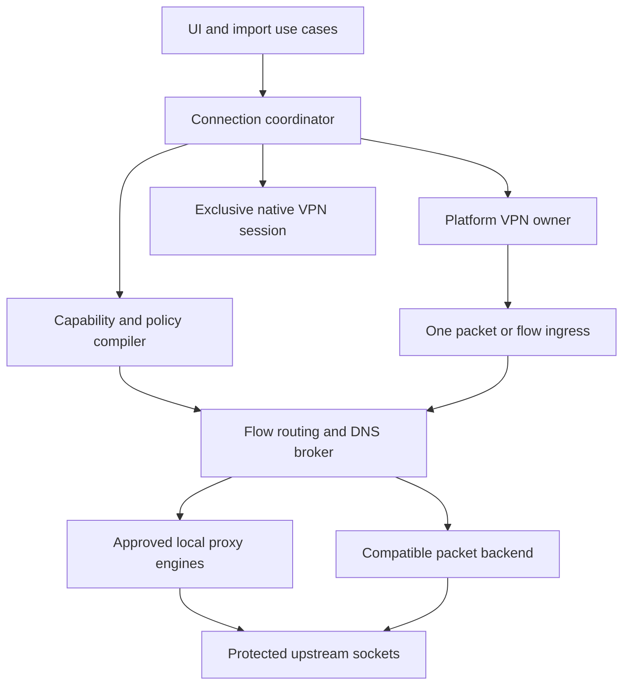

# 03 — Universal engines, imports and one-VPN orchestration

Date: **2026-11-06 (UTC)**. Workstream: **CHAT 03**.

Repository baseline: [`78dcd4511dbb830a999cc8c1796f2a38f88587e8`](https://github.com/DashSaman/PVN-amirrezagol/commit/78dcd4511dbb830a999cc8c1796f2a38f88587e8).
Branch: `prep/2026-11-06/03-engines-imports`. PR target: `main`; no merge authorized by this workstream.
Coordination baseline: [`docs/preflight-2026-11-06` at `ed21086e3e74772ab4dc31825eb87336f917fd67`](https://github.com/DashSaman/PVN-amirrezagol/blob/ed21086e3e74772ab4dc31825eb87336f917fd67/docs/preflight-2026-11-06/START_HERE.md).

**Scope:** evidence audit and implementation contracts only. This report is the sole repository change. It does not approve a public VPN release, import upstream code, change production code, update shared state, or reopen the completed 93-entry research campaign.

## 1. Decision and current truth

**Keep the product-owned canonical model and adapter boundaries, repair the existing Xray/Android path, then add narrowly gated engines. A successfully parsed profile is never a connection capability.** The user can manage PVNetwork and external-provider profiles without an account requirement on the latter. The proposed contracts work with the existing KMP foundation; they do not require a UI rewrite. [S-ARCH] [S-CORE] [S-PRODUCT]

The immediate findings are:

1. **No physical-device protocol receipt was found at this revision.** Android build success and a Windows packaging report exist; neither establishes device/lifecycle/DNS/UDP coverage. Public capability approval is therefore **NO-GO** for every unproven cell below. This is a release conclusion, not a claim that all existing code is unusable. [S-VALIDATION] [C-APPS]
2. The consumer Android and desktop connection paths select **Xray only**. **Android's current text-import UI calls only `VlessShareLinkImporter`; desktop calls the four-family `ShareLinkParser` (VLESS/VMess/Trojan/Shadowsocks).** Other engine modules do not automatically become selectable app backends. Desktop subscriptions currently import plain/base64 lists of those four URI families; Clash and sing-box configurations are not universal imports today. [S-ANDROID-UI] [S-ANDROID] [S-DESKTOP] [S-SUB] [S-LINKS]
3. WireGuard has a parser/adapter boundary and a successful independent Linux kernel fixture, **without a production runtime implementation behind its factory**. OpenVPN has a real Linux host runtime/TLS-peer test and a separate namespace traffic fixture. OpenConnect has an `anyconnect` runtime slice and contract tests; other enterprise protocols remain explicitly rejected. [S-WG] [S-OVPN] [S-OC] [C-WG] [C-OVPN] [C-MIHOMO]
4. Mihomo has host-runtime implementations for **Hysteria2, TUIC v5 and AnyTLS**, but no consumer importer/UI wiring. The latest inspected exact-core test has Hysteria2/AnyTLS evidence and a TUIC failure. Xray has six successful scoped interop cases alongside a failing REALITY case and a separate failing runtime contract. Never summarize these workflows as all green. [S-MIHOMO] [C-MIHOMO] [C-XRAY]
5. Android checks `SDK_INT >= 29` before calling `VpnService.Builder.excludeRoute`, which Android documents as **API 33**. It excludes one resolved server address, then the engine resolves/uses its own connection; that is not a demonstrated socket-protection strategy for all A/AAAA records, address rotation or concurrent engines. This is a source/API mismatch and a design risk, not a newly executed device failure. [S-ANDROID] [U-ANDROID-API]
6. The repository's August Xray release-gate reason is partly stale. On this inspection, `v26.7.28` remains a prerelease, but upstream offers stable **`v26.10.31`**. Availability of a stable candidate does not pass provenance, vulnerability, translation, device or distribution gates. Review that candidate instead of waiting indefinitely for a stable release. [S-XRAY-GATE] [U-XRAY-OLD] [U-XRAY-NEW]

### 1.1 What was reused, and how evidence is labeled

Read/reused: startup/agent contracts, completed V1/V2 trackers, the 93-entry matrix, R5/R6 architecture, public-app decisions/requirements, cross-platform recommendation, source-reuse matrix, validation records, relevant upstream family dossiers, actual engine/app source, and CI jobs/logs. Old research-only headings and old next-task pointers were not treated as current implementation inventories. The coordination instruction to edit only this report takes precedence over older instructions to update global state files.

Evidence vocabulary:

| Term | Meaning in this report |
|---|---|
| **OBSERVED** | Read in source/configuration at the baseline; not an execution claim. |
| **VERIFIED** | A check was executed in this preflight, or a specific retained CI result/log was independently inspected. Historical CI remains dated and scoped to its original SHA. |
| **DOCUMENTED** | A previous repository narrative reports the result; this run did not independently execute it. |
| **PROPOSED** | Engineering contract for Codex/Z.ai; not present or approved as shipped behavior. |
| **UNKNOWN** | Required evidence was not found or could not be established. |
| **BLOCKED** | A concrete failed gate or missing external prerequisite prevents promotion. |

Keep import and execution as **separate dimensions**, not one Boolean or a misleading linear ladder:

- **Parser-only:** input can become a model, but the required app/platform runtime is absent or rejects that model.
- **Runtime-only:** a manually constructed typed profile can enter a backend, but an end-user import route is absent. Runtime readiness, traffic proof and device proof remain separate fields.
- **Device-verified:** a retained receipt identifies device/OS/architecture, app/core hashes, exact protocol/transport/security/format and required lifecycle/data-path tests. **No cell presently qualifies.**
- **Unsupported:** no PVNetwork parser/runtime path for the requested semantics; an upstream candidate does not change this status.

### 1.2 Independently inspected CI and verification ledger

| ID | Evidence inspected on 2026-11-06 | Result and exact scope |
|---|---|---|
| C-STATE | `python scripts/agent_state.py verify --require-complete` at baseline | **PASS in this preflight**: research tracker/state structure, V1 93/93 and V2 93/93. Not a protocol runtime test. |
| C-APPS | [run 35897687631][C-APPS], SHA `78dcd45…`; jobs `107305599220`, `107305599562` | **SUCCESS**: Linux-host desktop tests/distributable and Android debug APK assembly. No device test job. Artifact enumeration returned an empty list at inspection; workflow retention is 14 days. |
| C-XRAY | [run 35877948152][C-XRAY], SHA `6ddccb7…`; jobs `107238663220`, `107238663604` | **FAILURE**: contract suite `30 tests, 1 failed` at `JvmHostXrayRuntimeTest.kt:81`; real-core suite `7 tests, 1 failed` at `RealityJvmHostXrayRealBinaryInteropTest.kt:113`. The other six cases are scoped host fixtures, not Android receipts. |
| C-MIHOMO | [run 35868899981][C-MIHOMO], SHA `2f7ae22…`; jobs `107207476636`, `107207477086`, `107207477203` | Contract/config-validation steps **PASS**; real-core suite `3 tests, 1 failed`, TUIC at `JvmHostMihomoRealBinaryInteropTest.kt:197`. OpenConnect contract job **PASS**, not gateway interoperability. |
| C-WG | [run 35868899899][C-WG], SHA `2f7ae22…`; job `107207475753` | **SUCCESS**: adapter tests and independent Linux namespace handshake/ping. The shell fixture does not implement `WireGuardRuntimeFactory` for the application. |
| C-OVPN | [run 35868899934][C-OVPN], SHA `2f7ae22…`; jobs `107207475341`, `107207801276`, `107207801374` | **SUCCESS**: importer/contracts; product runtime reaches connected against real TLS peer and cleans up; independent namespace tunnel/ping. Do not combine these into an unexecuted full consumer-app end-to-end test. |
| D-WINDOWS | [M-P2 validation][S-VALIDATION] | **DOCUMENTED**: Windows 11/Xray `v26.7.28`, six host interop cases and distributable smoke. No new Windows execution in this preflight. |

`git diff 6ddccb7…HEAD -- core engines apps/android` was empty. The relevant Mihomo/OpenConnect/OpenVPN/WireGuard/core trees also have no changes between `2f7ae22…` and this baseline. This establishes source continuity, **not** a fresh rerun. Application-only CI succeeding does not erase engine CI failures hidden by workflow path filters.

No Gradle or `kotlinc` executable/wrapper was available in this preflight environment. No JVM, native, server, emulator or physical-device execution is claimed here. The documentation-only task does not install a new toolchain or contact production VPN endpoints.

### 1.3 Source defects that must survive the handoff

These are source observations, not newly reproduced device failures. They are separate from the recorded red CI tests.

| Component | Concrete finding | Required repair / proof |
|---|---|---|
| Android coordinator | Each start intent creates a raw thread sharing process/TUN state. JNI startup success immediately emits `CONNECTED`; the process watcher reports an exit without releasing the TUN/service, and an early exit can precede the `running` flag. | E05/T10/T13: serialize commands, reject stale generations, distinguish process/backend/platform readiness, and converge every exit on cleanup. [S-ANDROID] |
| Android transient secrets | `filesDir/engine/config.json` contains materialized runtime credentials; `stopTunnel` does not remove it. Saved-profile Keystore storage does not cover that file's lifetime. | E03/E05/T15: private transient material, deletion on stop/failure and recovery after process death. [S-ANDROID] |
| Windows proxy transaction | Enable may partially write settings and then discard its snapshot. Restore clears the snapshot before writes succeed, does not delete a previously absent `ProxyServer`, and read failures become default values. The desktop controller still reports the engine as connected if proxy enable fails. | E05/T10/T15: journal actual values/absence, rollback partial writes, retain retry state, compare owned values before restoration, and expose scope failure. [S-PROXY] [S-DESKTOP] |
| OpenConnect platform readiness | The runtime uses a CSTP log marker plus a grace interval; its command has no explicit application route/DNS broker contract. | E11/T09/T12: prove product traffic, interface/route/DNS ownership and cleanup against a real gateway; contract CI does not establish this. [S-OC-RUNTIME] |
| Routing/DNS model | Existing `RoutingPolicy`/`DnsPolicy` types do not establish native enforcement or coherent behavior across engines. | E10/T11/T12: typed compiler, one owner and captured policy witnesses before any routing/split/kill-switch claim. [S-NETWORK] |
| Subscription replacement | `refreshInto` persists removal of old profiles, deletes their secrets, then separately persists replacements. The fetcher accepts any response with at least one parsable node; its callback discards import warnings. A failed final write or partial parse can lose working nodes. | E03/E04/T05: one candidate snapshot transaction; retain old profiles/secrets on any failure or unaccepted partial result; garbage-collect credentials only after successful commit and session release. [S-DESKTOP] [S-SUB] |
| Subscription ownership after restart | `ProfileRepository.cache = load()` runs before the later `subscriptionIds = linkedMapOf()` initializer; `load()` assigns ownership that the later initializer overwrites. This is a strong static initialization-order finding, not a reproduced restart test. | E04/T05: restart/reload test must preserve ownership, then refresh/remove without duplicates or unrelated deletion. [S-DESKTOP-STORE] |
| Lossy share-link conversion | Unknown VMess/Trojan transports become RAW with warnings; VMess REALITY becomes TLS; Trojan security values other than REALITY become TLS. Shadowsocks drops the query, including SIP002 plugin options, without a blocking diagnostic. The shared percent decoder converts each escaped byte to a character instead of decoding UTF-8 bytes together. | E03/T02: preserve exact semantics or block activation; real JSON and strict UTF-8/duplicate-key tests; warnings cannot authorize a different protocol/security/transport. [S-LINKS] |
| Profile/secret transaction | VMess/Trojan/SS write secrets directly. Parse-level transactions elsewhere end before app persistence. Desktop profile deletion removes secrets before saving removal. | E03/T02/T15: stage credentials through the profile commit, rollback every failed path, and make deletion recoverable. [S-LINKS] [S-VLESS] [S-DESKTOP] |
| Stored schema and recovery | Desktop has its own line-format v1/v2, but neither desktop nor Android stores `PVProfile.schemaVersion`. Android treats a read failure as an empty list and directly rewrites the JSON file. A line-format version is not a canonical-profile migration contract. | E03/E04/T15: explicit stored model version, unknown-version rejection, atomic/recoverable writes and corruption recovery without empty-store overwrite. [S-DESKTOP-STORE] [S-ANDROID-STORE] |

For the **Xray host cleanup CI failure**, the failed assertion requires the protected config to be absent when `stop()` returns. Both stop and process-monitor paths call `cleanupRuntimeDirectory`; that method clears the shared directory reference under a lock, then deletes outside it and suppresses deletion errors. Concurrent cleanup is an investigation target: one caller could observe no owned directory while the other is still deleting it. **The root cause and permanent retention are not established.** Preserve the synchronous cleanup contract and reproduce the race/error path before selecting a fix. This is distinct from the observed Android stop path that never deletes its runtime config. [S-XRAY-RUNTIME] [S-XRAY-TEST] [C-XRAY]

## 2. Platform × protocol × engine × import × evidence

### 2.1 Read this matrix correctly

Platform columns are **current PVNetwork integration**, not upstream availability. `A` = Android phone/tablet; `W` = Windows; `L` = Linux; `M` = macOS; `I` = iOS/iPadOS; `TV` = Android TV/Google TV.

Cell codes:

| Code | Meaning |
|---|---|
| `U` | No implemented product runtime for this platform/path. |
| `P` | Parser/adapter-only code; not a usable platform runtime. |
| `R` | Runtime source exists; no relevant traffic/device receipt. |
| `H` | Scoped host traffic evidence inspected in historical CI. |
| `HD` | Host traffic reported by historical documentation only. |
| `C` | Runtime/contract/start evidence only; no product traffic proof. |
| `F` | Known failing relevant test; cannot promote. |
| `B` | Built implementation with unresolved source/platform blockers. |
| `HF` | Standalone host protocol fixture; not product runtime integration. |
| `—` | Layer/infrastructure item; no independent consumer VPN claim. |

`R`, `H`, `HD` and `C` do not imply consumer UI wiring. Only the Xray backend is selected by current app connection controllers. Android has source/config/credential branches for four Xray families, but its import UI exposes **VLESS only**; VMess/Trojan/Shadowsocks remain unavailable through the current Android import flow. `B` on those Android rows describes built runtime source, not a complete import-to-connect feature. `B` is deliberately weaker than “Android supported.” `P` for non-Android engine modules does not promise those JVM-only modules build for mobile.

<!-- PRIMARY_MATRIX -->

| Protocol / exact scope | A | W | L | M | I | TV | Existing engine / necessary adapter | Import format now | Evidence / limiting fact |
|---|---|---|---|---|---|---|---|---|---|
| VLESS + RAW/TCP, security=none | B | HD | H | R | U | U | Xray `v26.7.28`; native mobile lifecycle still required | `vless://`; desktop plain/base64 URI subscription | S-XRAY, S-LINKS, C-XRAY; unencrypted fixture is not a secure public launch profile |
| VLESS + Vision + TLS | B | HD | H | R | U | U | Xray | `vless://…security=tls&flow=xtls-rprx-vision` | Six-case host suite and D-WINDOWS; exact fields only |
| VLESS + REALITY + Vision | B | R | F | R | U | U | Xray | VLESS URI REALITY fields | C-XRAY REALITY failure; zero device promotion |
| VLESS + XHTTP | B | HD | H | R | U | U | Xray | VLESS URI subset; generated XHTTP mode is `auto` | H is the tested fixture, not all XHTTP modes/extra options/TLS combinations |
| VMess + RAW, account security=`auto` | B | HD | H | R | U | U | Xray | Desktop VMess base64-JSON link; no Android UI import | S-LINKS parses flat fields; not general JSON configuration |
| Trojan + TLS, RAW | B | HD | H | R | U | U | Xray | Desktop `trojan://` subset; no Android UI import | C-XRAY / D-WINDOWS; unknown URL options require new tests |
| Shadowsocks AEAD, RAW, `aes-128-gcm` | B | HD | H | R | U | U | Xray | Desktop `ss://` subset; no Android UI import | Only tested cipher/credential/transport; not SSR or SS2022 |
| Xray WebSocket / gRPC / mKCP variants | B | R | R | R | U | U | Xray config generation | URI subsets | Source generation exists; no protocol×transport traffic receipt found for these variants |
| Shadowsocks 2022 | B | R | R | R | U | U | Xray explicitly permits three SS2022 methods; exact key/schema tests missing | Desktop `ss://` common importer can retain cipher/key; no Android UI import or proven SS2022 dialect path | S-XRAY cipher allowlist + S-XRAY-CONFIG only; no SS2022 real traffic/device receipt |
| Hysteria v1 | U | U | U | U | U | U | Proposed Mihomo capability or dedicated versioned backend | None | Distinct from Hysteria2; no automatic conversion |
| Hysteria2 | U | U | H | R | U | U | Existing POSIX Mihomo host adapter; app/platform wiring missing | Runtime-only typed profile; no URI/YAML importer | C-MIHOMO: scoped TCP-through-SOCKS interop only; QUIC carrier does not prove user UDP |
| TUIC v5 | U | U | F | R | U | U | Existing POSIX Mihomo host adapter | Runtime-only typed UUID/password profile | C-MIHOMO TUIC failure; v4 token profiles rejected |
| AnyTLS | U | U | H | R | U | U | Existing POSIX Mihomo host adapter | Runtime-only typed profile | Basic TLS case only; advanced wrappers rejected |
| NaiveProxy | U | U | U | U | U | U | Proposed `naive-adapter` over canonical Naive runtime; optional sing-box only after license/variant gate | None | First-class P1 customer requirement; not implemented by HTTP CONNECT label |
| WireGuard | U | P | P + HF | P | U | U | Existing `WireGuardRuntimeFactory` boundary; concrete native runtime missing | Module `.conf` parser; no consumer import wiring | C-WG fixture is kernel tools, not PVNetwork app runtime |
| AmneziaWG | U | U | U | U | U | U | Proposed separate versioned AWG backend | No AWG parser; do not silently downgrade `.conf` to WG | AWG fields/version must survive import or block execution |
| OpenVPN TCP/UDP | U | P | C + HF | P | U | U | Existing Linux system OpenVPN 2.x runtime; mobile/native adapters missing | Module `.ovpn` importer; not current consumer picker | C-OVPN separates product handshake/interface from standalone payload fixture |
| OpenConnect / ocserv / Cisco-compatible anyconnect | U | U | C | R | U | U | Existing POSIX OpenConnect `anyconnect` runtime | Runtime-only typed gateway/user/password | No SSO/MFA/posture/gateway payload receipt; no importer |
| GlobalProtect, Fortinet, Pulse/Ivanti, Juniper NC, F5, Array | U | U | U | U | U | U | Candidate OpenConnect sub-adapters per exact gateway/auth mode | None | Known upstream names are deliberately rejected by current adapter |
| SSR | U | U | U | U | U | U | Proposed Mihomo SSR adapter, exact protocol/obfs/cipher gate | None; proposed `ssr://` and vetted Clash SSR nodes | Outside original 93 registry; U-MIHOMO-SSR is upstream documentation only |
| SSH | U | U | U | U | U | U | Proposed OpenSSH/native or audited mobile library adapter | None; proposed structured/recognized `ssh://` dialects | Host-key validation and forwarding mode required; TCP dynamic forwarding is not UDP VPN |
| SSTP | U | U | U | U | U | U | Windows native RAS candidate; Linux sstp-client/PPP candidate; mobile unselected | None | Certificate/PPP/auth/platform gates from prior dossier |
| IKEv2/IPsec | U | U | U | U | U | U | Native OS VPN or approved strongSwan backend | None; proposed explicit profile/cert adapter | Native system-session mode is exclusive, not nested inside a second mobile VPN |
| DNSTT | U | U | U | U | U | U | Proposed `dnstt-adapter` plus an authenticated remote proxy/SSH leg | None; proposed versioned typed DNS-tunnel profile | TCP forwarder, not TUN/SOCKS; DNS delegation/resolver/server are prerequisites |
| Clash/Mihomo YAML and sing-box JSON documents | U | U | U | U | U | U | Proposed import adapters; choose engine by normalized semantics | No full document importer | These are formats/graphs, not protocols; having Mihomo installed does not implement YAML import |

<!-- END_PRIMARY_MATRIX -->

**Matrix guardrails:** no `Device-verified` or `Release-approved` cell is populated. macOS `R/C` only denotes permissive POSIX host code paths, without a signed app, native VPN or macOS test receipt. Windows uses WinINET system proxy for the selected Xray path; applications/UDP/DNS outside that proxy are not covered. Android TV and iOS need their own platform/packaging receipts even when sharing Kotlin source.

### 2.2 All 93 registered entries, including non-protocol items

The registry is a taxonomy of VPNs, proxy protocols, vendor compatibility families, layers and infrastructure. The following coverage map accounts for every existing ID once. It reuses the numbered dossiers rather than reproducing them. `All U` means A/W/L/M/I/TV are unsupported by PVNetwork for that **entry as a complete feature**, regardless of native/upstream candidates. Expanded rows in §2.1 control when more specific evidence exists. SSR and DNSTT are task extensions `EX-SSR`/`EX-DNSTT`, not fabricated research IDs 094/095.

<!-- TAXONOMY_MATRIX -->
| Registry ID / entry | Platform × evidence state | Present engine or proposed family adapter | Import format / disposition | Existing research |
|---|---|---|---|---|
| 001 — OpenVPN | A/W/M/I/TV U; L C + HF; module parser | Existing Linux OpenVPN 2; native/mobile candidate | Module .ovpn subset; consumer flow proposed | [D001](../../research/protocols/001-openvpn/README.md) |
| 002 — WireGuard | All product runtimes U; L HF; module parser | Official WG concrete runtime proposed | Module .conf subset; consumer flow proposed | [D002](../../research/protocols/002-wireguard/README.md) |
| 003 — AmneziaWG | All U | Versioned AmneziaWG backend proposed | AWG-aware .conf; never WG downgrade | [D003](../../research/protocols/003-amneziawg/README.md) |
| 004 — IKEv2/IPsec | All U | Native IKEv2 or approved strongSwan | Typed native/certificate profile proposed | [D004](../../research/protocols/004-ikev2-ipsec/README.md) |
| 005 — IKEv1/IPsec | All U; legacy explicit scope | Native/strongSwan if separately permitted | Typed IKEv1 profile deferred | [D005](../../research/protocols/005-ikev1-ipsec/README.md) |
| 006 — IPsec ESP | —; no independent feature | IPsec component; AH not automatically covered | Parent IPsec policy | [D006](../../research/protocols/006-ipsec-esp/README.md) |
| 007 — IPsec AH | —; no independent feature | IPsec component; AH not automatically covered | Parent IPsec policy | [D007](../../research/protocols/007-ipsec-ah/README.md) |
| 008 — L2TP/IPsec | All U; legacy | Native IPsec + L2TP/PPP | Typed composed profile proposed | [D008](../../research/protocols/008-l2tp-ipsec/README.md) |
| 009 — L2TPv3 | All U; router/peer role | Kernel/SoftEther/IPsec candidate by role | Infrastructure peer configuration | [D009](../../research/protocols/009-l2tpv3/README.md) |
| 010 — L2TPv3/IPsec | All U; router/peer role | Kernel/SoftEther/IPsec candidate by role | Infrastructure peer configuration | [D010](../../research/protocols/010-l2tpv3-ipsec/README.md) |
| 011 — SSTP / MS-SSTP | All U | Windows RAS / Linux sstp-client+PPP candidates | Typed SSTP/cert/auth profile proposed | [D011](../../research/protocols/011-sstp/README.md) |
| 012 — PPTP | All U; public default disabled | Legacy native only if separately justified | Legacy profile deferred | [D012](../../research/protocols/012-pptp/README.md) |
| 013 — SoftEther VPN Protocol | All U | SoftEther native client candidate | Native profile compatibility deferred | [D013](../../research/protocols/013-softether/README.md) |
| 014 — EtherIP | All U; router/peer role | Kernel/SoftEther/IPsec candidate by role | Infrastructure peer configuration | [D014](../../research/protocols/014-etherip/README.md) |
| 015 — EtherIP/IPsec | All U; router/peer role | Kernel/SoftEther/IPsec candidate by role | Infrastructure peer configuration | [D015](../../research/protocols/015-etherip-ipsec/README.md) |
| 016 — Cisco AnyConnect | A/W/I/TV U; L C; M R | Existing POSIX OpenConnect anyconnect slice | Runtime-only typed profile; importer absent | [D016](../../research/protocols/016-cisco-anyconnect/README.md) |
| 017 — OpenConnect / ocserv-compatible | A/W/I/TV U; L C; M R | Existing POSIX OpenConnect anyconnect slice | Runtime-only typed profile; importer absent | [D017](../../research/protocols/017-openconnect-ocserv/README.md) |
| 018 — Palo Alto GlobalProtect | All U; rejected by current adapter | Per-gateway OpenConnect sub-adapter candidate | Documented gateway/auth profile proposed | [D018](../../research/protocols/018-globalprotect/README.md) |
| 019 — Fortinet FortiGate SSL VPN | All U; rejected by current adapter | Per-gateway OpenConnect sub-adapter candidate | Documented gateway/auth profile proposed | [D019](../../research/protocols/019-fortinet-ssl-vpn/README.md) |
| 020 — Pulse Secure | All U; rejected by current adapter | Per-gateway OpenConnect sub-adapter candidate | Documented gateway/auth profile proposed | [D020](../../research/protocols/020-pulse-secure/README.md) |
| 021 — Ivanti Connect Secure | All U; rejected by current adapter | Per-gateway OpenConnect sub-adapter candidate | Documented gateway/auth profile proposed | [D021](../../research/protocols/021-ivanti-connect-secure/README.md) |
| 022 — Juniper Network Connect | All U; rejected by current adapter | Per-gateway OpenConnect sub-adapter candidate | Documented gateway/auth profile proposed | [D022](../../research/protocols/022-juniper-network-connect/README.md) |
| 023 — F5 BIG-IP SSL VPN | All U; rejected by current adapter | Per-gateway OpenConnect sub-adapter candidate | Documented gateway/auth profile proposed | [D023](../../research/protocols/023-f5-bigip-ssl-vpn/README.md) |
| 024 — Array Networks SSL VPN | All U; rejected by current adapter | Per-gateway OpenConnect sub-adapter candidate | Documented gateway/auth profile proposed | [D024](../../research/protocols/024-array-networks-ssl-vpn/README.md) |
| 025 — Check Point VPN / SNX | All U | Standards/vendor route; snx-rs reference needs legal decision | Vendor profile not inferred from URL | [D025](../../research/protocols/025-check-point-vpn/README.md) |
| 026 — SonicWall NetExtender / SSL VPN | All U; vendor-specific | Official/vendor interoperability; no generic OSS assumption | Proprietary profile unsupported until specified | [D026](../../research/protocols/026-sonicwall-netextender/README.md) |
| 027 — SonicWall Global VPN / IPsec | All U; exact standard mode required | Native/strongSwan IPsec candidate | Versioned gateway/IKE profile proposed | [D027](../../research/protocols/027-sonicwall-global-vpn-ipsec/README.md) |
| 028 — Sophos SSL VPN | All U for vendor certification | OpenVPN only for proven standard subset | Module .ovpn is not vendor certification | [D028](../../research/protocols/028-sophos-ssl-vpn/README.md) |
| 029 — Sophos IPsec Remote Access | All U; exact standard mode required | Native/strongSwan IPsec candidate | Versioned gateway/IKE profile proposed | [D029](../../research/protocols/029-sophos-ipsec-remote-access/README.md) |
| 030 — WatchGuard IKEv2 VPN | All U; exact standard mode required | Native/strongSwan IPsec candidate | Versioned gateway/IKE profile proposed | [D030](../../research/protocols/030-watchguard-ikev2/README.md) |
| 031 — WatchGuard SSL VPN | All U for vendor certification | OpenVPN only for proven standard subset | Module .ovpn is not vendor certification | [D031](../../research/protocols/031-watchguard-ssl-vpn/README.md) |
| 032 — WatchGuard L2TP VPN | All U; legacy | Native L2TP/IPsec candidate | Gateway profile deferred | [D032](../../research/protocols/032-entry/README.md) |
| 033 — Aruba VIA | All U; vendor-specific | Official/vendor interoperability; no generic OSS assumption | Proprietary profile unsupported until specified | [D033](../../research/protocols/033-aruba-via/V1_RESEARCH.md) |
| 034 — Citrix Secure Access / Gateway VPN | All U; vendor-specific | Official/vendor interoperability; no generic OSS assumption | Proprietary profile unsupported until specified | [D034](../../research/protocols/034-citrix-secure-access/V1_RESEARCH.md) |
| 035 — Barracuda TINA VPN | All U; vendor-specific | Official/vendor interoperability; no generic OSS assumption | Proprietary profile unsupported until specified | [D035](../../research/protocols/035-barracuda-tina/V1_RESEARCH.md) |
| 036 — Juniper Secure Connect | All U; exact standard mode required | Native/strongSwan IPsec candidate | Versioned gateway/IKE profile proposed | [D036](../../research/protocols/036-entry/README.md) |
| 037 — VLESS | See §2.1; A B/W HD/L H or F/M R | Xray present | vless:// subset; desktop URI subscription | [D037](../../research/protocols/037-entry/README.md) |
| 038 — VMess | A B; W HD; L H; M R; I/TV U | Xray present | vmess:// flat JSON subset | [D038](../../research/protocols/038-entry/README.md) |
| 039 — Trojan | A B; W HD; L H; M R; I/TV U | Xray present | trojan:// subset | [D039](../../research/protocols/039-entry/README.md) |
| 040 — Shadowsocks | A B; W HD; L H; M R; I/TV U | Xray selected AEAD cipher | ss:// subset; plugins not implicitly supported | [D040](../../research/protocols/040-entry/README.md) |
| 041 — Shadowsocks 2022 | A B; W/L/M R; I/TV U | Xray allowlist/config path present; no exact interop receipt | ss:// cipher/key preservation needs SS2022-specific validation | [D041](../../research/protocols/041-entry/README.md) |
| 042 — Hysteria | All U | Mihomo or dedicated Hysteria v1 candidate | Versioned v1 importer proposed | [D042](../../research/protocols/042-entry/README.md) |
| 043 — Hysteria2 | A/W/I/TV U; L H; M R | Mihomo host slice present | Runtime-only; hy2/hysteria2/document decoder proposed | [D043](../../research/protocols/043-entry/README.md) |
| 044 — TUIC | A/W/I/TV U; L F; M R | Mihomo v5 slice; v4 rejected | Runtime-only UUID/password; versioned decoder proposed | [D044](../../research/protocols/044-entry/README.md) |
| 045 — AnyTLS | A/W/I/TV U; L H; M R | Mihomo basic AnyTLS slice | Runtime-only; URI/document decoder proposed | [D045](../../research/protocols/045-entry/README.md) |
| 046 — ShadowTLS | All U | Approved core/shadow-tls wrapper candidate | Typed inner/outer graph proposed | [D046](../../research/protocols/046-entry/README.md) |
| 047 — NaiveProxy | All U; P1 required | Canonical Naive adapter; optional approved sing-box | naive+https/native JSON/provider dialects proposed | [D047](../../research/protocols/047-entry/README.md) |
| 048 — Snell | All U | Authorized compatible versioned Snell implementation | Versioned settings proposed | [D048](../../research/protocols/048-entry/README.md) |
| 049 — SOCKS4 | All U as external outbounds | Approved core capability; no dedicated engine | SOCKS4 and 4a semantics distinct | [D049](../../research/protocols/049-entry/README.md) |
| 050 — SOCKS4a | All U as external outbounds | Approved core capability; no dedicated engine | SOCKS4 and 4a semantics distinct | [D050](../../research/protocols/050-entry/README.md) |
| 051 — SOCKS5 | Local ingress exists; external outbound U | Xray/Mihomo listeners; external proxy adapter proposed | No external SOCKS/HTTP profile importer | [D051](../../research/protocols/051-entry/README.md) |
| 052 — HTTP Proxy | Local ingress exists; external outbound U | Xray/Mihomo listeners; external proxy adapter proposed | No external SOCKS/HTTP profile importer | [D052](../../research/protocols/052-entry/README.md) |
| 053 — HTTPS / HTTP CONNECT | All U as external proxy feature | Approved HTTP CONNECT + TLS capability | Explicit proxy auth format proposed; not Naive | [D053](../../research/protocols/053-entry/README.md) |
| 054 — SSH Tunnel | All U | OpenSSH/native or audited mobile library | Typed forwarding/host-key import proposed | [D054](../../research/protocols/054-entry/README.md) |
| 055 — Tor SOCKS | All U | Tor/Arti plus SOCKS integration candidate | Bridge/auth/transport decoder required | [D055](../../research/protocols/055-entry/V1_RESEARCH.md) |
| 056 — Tailscale | All U; enrollment separate | Tailscale client/control-plane candidate | Official versioned enrollment; no WG downgrade | [D056](../../research/protocols/056-entry/V1_GATE_RECONCILIATION.md) |
| 057 — ZeroTier | All U; membership separate | ZeroTier client/controller candidate | Official versioned membership profile | [D057](../../research/protocols/057-entry/V1_GATE_RECONCILIATION.md) |
| 058 — NetBird | All U; enrollment separate | NetBird client/control-plane candidate | Official versioned enrollment; no WG downgrade | [D058](../../research/protocols/058-entry/V1_GATE_RECONCILIATION.md) |
| 059 — Netmaker | All U; management role | Netmaker managed WG candidate | Official managed-network profile | [D059](../../research/protocols/059-entry/V1_GATE_RECONCILIATION.md) |
| 060 — Nebula | All U; PKI/enrollment separate | Nebula client candidate | Certificate/lighthouse/native profile | [D060](../../research/protocols/060-entry/V1_GATE_RECONCILIATION.md) |
| 061 — Tinc | All U; membership separate | Tinc client candidate | Native mesh profile | [D061](../../research/protocols/061-entry/V1_GATE_RECONCILIATION.md) |
| 062 — innernet | All U; management role | innernet native/WG management candidate | Native enrollment; no WG-only downgrade | [D062](../../research/protocols/062-entry/V1_GATE_RECONCILIATION.md) |
| 063 — GRE | All U; infrastructure/peer role | Kernel/netlink/XFRM/IPsec/routing stack by dossier | Router/site-to-site policy; no consumer URI claim | [D063](../../research/protocols/063-entry/V1_GATE_RECONCILIATION.md) |
| 064 — GRE over IPsec | All U; infrastructure/peer role | Kernel/netlink/XFRM/IPsec/routing stack by dossier | Router/site-to-site policy; no consumer URI claim | [D064](../../research/protocols/064-entry/V1_GATE_RECONCILIATION.md) |
| 065 — IP-in-IP / IPIP | All U; infrastructure/peer role | Kernel/netlink/XFRM/IPsec/routing stack by dossier | Router/site-to-site policy; no consumer URI claim | [D065](../../research/protocols/065-entry/V1_GATE_RECONCILIATION.md) |
| 066 — IPIP over IPsec | All U; infrastructure/peer role | Kernel/netlink/XFRM/IPsec/routing stack by dossier | Router/site-to-site policy; no consumer URI claim | [D066](../../research/protocols/066-entry/V1_GATE_RECONCILIATION.md) |
| 067 — VTI/IPsec | All U; infrastructure/peer role | Kernel/netlink/XFRM/IPsec/routing stack by dossier | Router/site-to-site policy; no consumer URI claim | [D067](../../research/protocols/067-entry/V1_GATE_RECONCILIATION.md) |
| 068 — XFRM/IPsec | All U; infrastructure/peer role | Kernel/netlink/XFRM/IPsec/routing stack by dossier | Router/site-to-site policy; no consumer URI claim | [D068](../../research/protocols/068-entry/V1_GATE_RECONCILIATION.md) |
| 069 — VXLAN | All U; infrastructure/peer role | Kernel/netlink/XFRM/IPsec/routing stack by dossier | Router/site-to-site policy; no consumer URI claim | [D069](../../research/protocols/069-entry/V1_GATE_RECONCILIATION.md) |
| 070 — VXLAN over IPsec | All U; infrastructure/peer role | Kernel/netlink/XFRM/IPsec/routing stack by dossier | Router/site-to-site policy; no consumer URI claim | [D070](../../research/protocols/070-entry/V1_GATE_RECONCILIATION.md) |
| 071 — DMVPN | All U; infrastructure/peer role | Kernel/netlink/XFRM/IPsec/routing stack by dossier | Router/site-to-site policy; no consumer URI claim | [D071](../../research/protocols/071-dmvpn/V1_RESEARCH.md) |
| 072 — Cisco FlexVPN | All U; exact gateway IKEv2 mode | Native/strongSwan interoperability candidate | Vendor/auth/proposal profile proposed | [D072](../../research/protocols/072-flexvpn/V1_RESEARCH.md) |
| 073 — GETVPN | All U; managed group VPN | Vendor key-management/group-policy interoperability | No generic consumer import | [D073](../../research/protocols/073-entry/V1_GATE_RECONCILIATION.md) |
| 074 — REALITY | VLESS+Vision L F; A B; others §2.1 | Xray REALITY fields present | VLESS pbk/sid/security; no standalone REALITY URI | [D074](../../research/protocols/074-entry/V1_GATE_RECONCILIATION.md) |
| 075 — XTLS | All U for removed legacy security=xtls | No legacy backend; Vision is entry 076 | Reject legacy mode; no silent translation | [D075](../../research/protocols/075-entry/V1_GATE_RECONCILIATION.md) |
| 076 — XTLS Vision | TLS host H/HD; REALITY F; A B | Xray flow capability | VLESS flow in typed parent | [D076](../../research/protocols/076-entry/V1_GATE_RECONCILIATION.md) |
| 077 — TLS | —; scoped parent TLS tests only | Engine/platform TLS backend | TLS/cert settings in typed parent | [D077](../../research/protocols/077-entry/V1_GATE_RECONCILIATION.md) |
| 078 — uTLS / TLS Fingerprinting | —; Xray fingerprint source only | Engine-specific TLS fingerprint capability | fp/fingerprint in exact parent schema | [D078](../../research/protocols/078-entry/V1_GATE_RECONCILIATION.md) |
| 079 — Cloak | All U | Cloak wrapper candidate; license/composition gate | Typed wrapper graph proposed | [D079](../../research/protocols/079-cloak/README.md) |
| 080 — TLS Fragmentation | All U as exposed feature | Selected core transport feature | Versioned fragmentation policy proposed | [D080](../../research/protocols/080-entry/V1_GATE_RECONCILIATION.md) |
| 081 — TCP | —; tested inside parent paths | OS/core TCP | Parent transport field | [D081](../../research/protocols/081-entry/V1_GATE_RECONCILIATION.md) |
| 082 — UDP | —; carrier/user UDP separate | OS/core UDP; per-leg evidence | Parent transport plus user-UDP capability | [D082](../../research/protocols/082-entry/V1_GATE_RECONCILIATION.md) |
| 083 — QUIC | —; Hysteria2 host carrier only | Selected mature QUIC core | Parent QUIC/auth/congestion fields | [D083](../../research/protocols/083-entry/V1_GATE_RECONCILIATION.md) |
| 084 — WebSocket | Parent config R; no traffic receipt | Xray websocket branch | URI path/host subset | [D084](../../research/protocols/084-entry/V1_GATE_RECONCILIATION.md) |
| 085 — HTTP/1.1 | —; no standalone VPN support | Mature engine HTTP stack | Exact parent HTTP-version semantics | [D085](../../research/protocols/085-entry/V1_GATE_RECONCILIATION.md) |
| 086 — HTTP/2 | —; no standalone VPN support | Mature engine HTTP stack | Exact parent HTTP-version semantics | [D086](../../research/protocols/086-entry/V1_GATE_RECONCILIATION.md) |
| 087 — HTTP/3 | —; no standalone VPN support | Mature engine HTTP stack | Exact parent HTTP-version semantics | [D087](../../research/protocols/087-entry/V1_GATE_RECONCILIATION.md) |
| 088 — gRPC | Parent config R; no traffic receipt | Xray grpc branch | URI serviceName subset | [D088](../../research/protocols/088-entry/V1_GATE_RECONCILIATION.md) |
| 089 — mKCP | Parent config R; no traffic receipt | Xray mkcp branch | Options incomplete; block lossy imports | [D089](../../research/protocols/089-entry/V1_GATE_RECONCILIATION.md) |
| 090 — KCP | —; no standalone VPN support | Mature KCP library in selected engine | Parent protocol settings | [D090](../../research/protocols/090-entry/V1_GATE_RECONCILIATION.md) |
| 091 — XHTTP | Selected host H/HD; A B | Xray xhttp branch; mode auto only | URI host/path subset; full settings proposed | [D091](../../research/protocols/091-entry/V1_GATE_RECONCILIATION.md) |
| 092 — RAW | Scoped Xray host H/HD; A B | Xray RAW stream transport | tcp/raw aliases under explicit normalization | [D092](../../research/protocols/092-entry/V1_GATE_RECONCILIATION.md) |
| 093 — DTLS | —; no certified DTLS traffic | OpenConnect parent data-channel candidate | Parent enterprise profile | [D093](../../research/protocols/093-dtls/README.md) |
<!-- END_TAXONOMY_MATRIX -->

## 3. Engine selection and integration boundaries

These are **engineering recommendations**, subject to CHAT 02's component-specific legal/distribution decision. A subprocess or IPC boundary is not automatic GPL/AGPL clearance. Root licenses, wrapper licenses, dependencies, native binaries, corresponding-source/notices and distribution channel must be reviewed separately. Do not copy a competitor application to acquire its engine glue. [S-REUSE] [S-ENGINE-SET]

| Family | Recommended implementation direction | Required adapter work / explicit limit |
|---|---|---|
| Xray family | Retain existing Xray adapter/config generator and introduce exact capability/version gates | Preserve protocol/security/flow/transport separately; repair red tests, import losses and mobile socket/lifecycle handling before promotion. |
| Hysteria2 / TUIC / AnyTLS | Reuse current Mihomo host implementation first for engineering evidence; mobile distribution is conditional | Add typed import/compiler adapters and per-platform runtime. Do not bundle a GPL core into the closed product on an unreviewed assumption. Dedicated official Hysteria/AnyTLS/TUIC implementations are alternatives only if they solve a measured legal/platform/capability gap. |
| SSR / Hysteria v1 / ShadowTLS / Snell | Existing modern core is the candidate, not four new engines | Explicit protocol-version, SSR cipher/protocol/obfs, or inner/outer wrapper models; no inheritance from Hysteria2/SS/TLS tests. Snell requires an authorized compatible implementation/version. |
| NaiveProxy | Add `engines/naive-adapter` for canonical `klzgrad/naiveproxy` or an independently approved equivalent | Support native settings and documented URI dialects; own Chromium/Cronet build footprint and exact native variants. A generic HTTPS proxy cannot reproduce Naive semantics. |
| Optional sing-box | Keep as a candidate/import dialect; it is not an existing PVNetwork backend | Current docs document Naive since 1.13.0 and specific platform/build requirements. A config importer must be version-aware. A broad upstream feature list never substitutes for PVNetwork adapter, license and device receipts. [U-SING-NAIVE] |
| WireGuard | Official native/userspace implementation appropriate to each OS | Implement current factory boundary, complete per-peer model, install routes/DNS through one coordinator. Independent kernel CI fixture is useful infrastructure, not completed app integration. |
| AmneziaWG | Separate `amneziawg-adapter`, reusing only compatible WG product structures | Match the exact AWG generation and all obfuscation fields. Do not strip them and report success as WireGuard. |
| OpenVPN | Retain unbundled Linux OpenVPN 2 host path; select a legal native backend per mobile/Apple platform | Explicit external-material resolver and vetted directives; no arbitrary `up/down`, plugins, executable paths or shell expansion. OpenVPN 3 embedding is not pre-approved. |
| OpenConnect | Retain selected `anyconnect` runtime; add one gateway family/auth flow at a time | Certificate, cookies, MFA, browser SSO and posture are separate capabilities. No execution of imported host-check scripts. |
| IKEv2/IPsec | Native platform VPN APIs when they meet semantics; strongSwan candidate for gaps | Full profile/auth/certificate/proposal model, native-session lifecycle and privileged routing. Native OS mode uses the single session exclusively. |
| SSTP | Windows native RAS; Linux sstp-client/PPP is a candidate | Android/Apple need separately selected maintained implementations. RAS/PPP/native APIs are not universal subprocess or SOCKS interfaces. |
| SSH | Mature OpenSSH/native or audited library implementation | Trusted host-key store, key/password references, local/dynamic/remote forwarding distinctions; no universal UDP claim. |
| DNSTT | Dedicated official userspace forwarder as one transport leg | Server public key, delegated DNS name, approved resolver transport and remote authenticated service. Add TCP proxy/SSH composition explicitly; no fabricated generic UDP/IP support. [U-DNSTT] |
| Mesh / vendor-only / router technologies | Native/official integration or defer per existing dossier | Do not force membership control planes, routing appliances or proprietary containers into a share-link parser. |

### 3.1 Pin policy and the bounded upstream delta

The committed implementation/fixture pins remain historical evidence:

| Component | Recorded version / identity | What it proves |
|---|---|---|
| Xray in current Android build and host interop | `v26.7.28`, commit `5ca6f4b7d4dc20a881d4330e498892697627ec0c` | Matches repo code and CI fixture. Still prerelease in upstream metadata at inspection. |
| Android Xray archive | SHA-256 `a442892c175fa648fc56866ec872aac441c5a6b8946a1b60f0258ae16a7fb402` | Build-script archive pin matches official release metadata; not a fresh binary execution. |
| Linux Xray fixture archive | SHA-256 `8195d909f1109b8f3d99eefe401a3c451d7bf4af71f24d3815420f77e5dd2a40` | Exact historical CI asset. |
| Mihomo / sing-box server fixture | `v1.19.30` / `v1.13.19` | CI-only engine/server pairing; sing-box is not an application dependency. Digests remain in the workflow. |
| hev-socks5-tunnel | Repo validation records `2.17.1`, native SHA-256 `0c26c47620d7a3c881650e2a8d0f35cf164dd680b3aa0db35e37d1e3b88707e0` | DOCUMENTED native provenance; full platform/ABI/UDP lifecycle remains a separate gate. |

**New candidate, not approval:** official [`v26.10.31`][U-XRAY-NEW] is non-prerelease; tag points to `a4a3dff5b20c2faae567b742c172c7b95e75c083`. Official asset metadata returned Android arm64 archive digest `ee7878bb47ce28ff5b068e2d173ba1a9fab20ca1aec94191644919ec08ba5f1d` and Linux amd64 digest `e4bd9119f50ae7c41658b1abd0679ae06f98bd864a2907ff33f2f2cf7081b214`. These observations only unblock candidate review. No release binary was downloaded or tested, no claim of vulnerability clearance is made, and no production pin is changed by this report.

Future `EngineManifest` must lock upstream repository, tag, full commit, per-platform archive **and extracted binary** digests, wrapper/native ABI, build options, capabilities, license/SBOM approval reference and rollback version. Reject mismatched cached/extracted artifacts; the current Android `fetchXrayCore` early return when `libxray.so` exists must not be the production verification gate. [S-ANDROID-BUILD]

## 4. Import architecture

### 4.1 Inputs are not formats, and formats are not engines

`URL`, `QR`, `clipboard`, `share intent`, `file picker` and `manual form` are input channels. The same decoded bytes enter the same parser/validator. QR success must not bypass profile validation or invoke a browser/runtime. A subscription URL is a fetch source; its response can contain an entirely different grammar.

| Format / channel | Current state | Proposed contract and rejection boundary |
|---|---|---|
| VLESS URI | Implemented common importer and app text input | Preserve UUID, host/port, transport, TLS/REALITY, flow, SNI, fingerprint, path/host/service and dialect; reject unsupported semantic options before Connect. |
| VMess URI/base64 JSON | Common flat-field parser and desktop flow; not Android UI | Replace regex extraction with a real bounded JSON parser; document supported dialect/version, duplicate-key and escape policy; preserve fields such as alterId until validated, not silently ignore them. |
| Trojan URI | Common subset and desktop flow; not Android UI | Password via SecretRef; distinguish TLS/transport options and reject loss of security semantics. |
| Shadowsocks URI | Common subset and desktop flow; not Android UI | SIP002 and explicitly recognized legacy dialects; cipher/key lengths and plugin options require exact support. `ss://` does not imply verified SS2022 or SSR. |
| Plain/base64 URI subscriptions | Desktop only | Bounded decode; mixed valid/unsupported entries produce structured per-entry results and an atomic update proposal. Base64 is encoding, not encryption. |
| HTTP(S) subscription URL | Desktop fetch/storage only | Credential-bearing URL stored protected; controlled redirects/size/time limits; conditional GET; source-aware rollback. Android fetch is not already implemented. |
| WireGuard `.conf` | Module parser, not app flow; no original-file preservation; unknown values dropped with warnings | Preserve multiple peers, addresses, AllowedIPs, DNS, MTU and keepalive; strictly validate 32-byte keys and IPv6; reject unsupported semantics. Current client normalization requires a peer endpoint; no hooks/scripts. |
| AmneziaWG `.conf` | Unsupported | Detect AWG-specific fields before WG normalization; require exact AWG-generation schema and backend. |
| OpenVPN `.ovpn` | Module parser, Linux runtime subset | Inline/external cert/key material via an explicit safe bundle resolver; unresolved/unknown directives block runtime. Never read arbitrary absolute paths. |
| Clash/Mihomo full YAML | Unsupported | Safe YAML AST, validate `proxies`, groups, DNS/rules/providers independently. No arbitrary tags, unbounded aliases, scripts, controller/listener exposure or filesystem paths. |
| Clash provider payload | Unsupported | Separate grammar from full Clash config; provider fetches inherit bounded source policy; group/rules linkage must not disappear. |
| sing-box full JSON | Unsupported | Versioned AST: outbounds/endpoints, selector/url-test/detours, route/DNS/rule sets. Reject unsupported endpoint migrations or reserved tags; never pass the document directly to a runtime. |
| Xray/V2Ray full JSON | Unsupported despite JSON generation | Parse selected outbounds and dependency graph; inbound/API/observatory/routing features need explicit policy compilation and capability gates. |
| Hysteria/Hysteria2/TUIC/AnyTLS links | Unsupported | Distinct dialect adapters (`hy2://`/`hysteria2://` etc. only when specified); typed auth/ALPN/obfs/congestion/UDP fields; connect only to matching available backend. |
| Naive native JSON / `naive+https://` | Unsupported, P1 | Exact upstream URI/native semantics and authenticated server fixture. `sn://naive?...` is a separate provider dialect, enabled only from a documented fixture/spec, not guessed. |
| SSH / SSTP / IKEv2 / OpenConnect profiles | Unsupported import | Typed forms or documented platform/provider formats; cert/key selection and auth flow explicit. A URL-shaped string is not a complete enterprise profile. |
| DNSTT profile | Unsupported | Versioned product schema including resolver, DNS suffix, server public key and service composition; no invented claim of a standard `dnstt://` URI. |
| QR image/camera and share intents | Not wired as universal import | Decode text, preserve MIME/origin, preview sanitized result; test the identical fixtures via QR and text. Reject unsupported multipart/vendor payloads. |
| File/archive | No universal picker/bundle resolver | Sniff bytes/schema rather than extension; explicit manifest, bounded entries/expanded bytes, no traversal/symlink extraction. |
| Protected PVNetwork backup | Proposed | Versioned authenticated-encryption envelope with user-provided unlock material, metadata preview only, no password in URL/log. No unsupported provider decryption. |
| Proprietary/encrypted/locked provider containers | Unsupported/blocked on specification and authorized access | Explain the exact missing grammar/key/permission. Offer export to a documented interoperable format; no guessing, brute force, embedded universal key or remote converter. |

Do not advertise NPV/Happ/V2Box/Amnezia application backups as importable simply because a standard protocol might be inside. Recognizable base64/JSON is not proof of a public schema. Public format compatibility can be implemented independently only when syntax, cryptographic envelope and permitted key access are established. A login URL, SAML workflow, expiring token and device-bound license are distinct import outcomes, not malformed generic VPN links.

### 4.2 Deterministic pipeline and privacy boundaries

**PROPOSED pipeline:** capture bytes -> envelope/decompression limits -> identify grammar/version -> parse to a secret-staging draft -> validate semantics -> normalize profiles/connection graph -> match platform/engine capabilities -> show warnings/diff -> commit profile+secret+subscription revision atomically.

1. **Capture:** include channel, MIME, source identity, charset, byte length and payload digest. Preserve technical strings byte-faithfully; only trim allowed surrounding whitespace. Display internationalized/Persian names safely without reversing IPs/URIs. Never infer a missing password, cipher, port, TLS mode or flow unless the chosen grammar defines that default.
2. **Detect:** distinguish URL-to-fetch from content URI and a native configuration. Bounded decoding and parser confidence are explicit. If two incompatible grammars match, return an ambiguous-format result; do not pick the first convenient engine.
3. **Parse without durable side effects:** secrets go to a disposable staging vault. A failed line, invalid profile, canceled preview or failed database commit must leave no new secret refs. Unknown fields stay in encrypted source/typed extension storage with a path and severity; unknown secret-bearing values must not enter `PVProfile.extensions`.
4. **Validate and compile:** fail closed on security/routing/auth/transport changes. Cosmetic fields may generate warnings; semantic loss requires an explicit edit or rejection. `UnsupportedFeature(path, reason, alternatives)` is a first-class result. The original encrypted payload is preservation evidence, not executable fallback configuration.
5. **Match capability:** require protocol version, transport, security/flow, IPv4/IPv6, application TCP/UDP, DNS/routing features, platform/architecture and exact engine manifest to intersect. No selected runtime means **saved but unavailable**, with Connect disabled and a reason.
6. **Commit:** one source revision, normalized profiles and staged secrets commit as a unit. Failure restores the last-known-good revision. Migration from current stores must retain user names/favorites/overrides, credentials and stable identity without persisting raw URLs in the new metadata store.

Proposed bounded parser policy (testable defaults, not measured performance claims): 2 MiB fetched bytes, 8 MiB expanded text, 10,000 entries, nesting depth 64, at most two recognized decoding/envelope steps, three redirects and no arbitrary YAML tags. Make limits explicit in `ImportLimits` and reject with stable error codes. A legitimate larger provider can use a reviewed limit change; silent truncation is forbidden.

### 4.3 Subscription ownership and refresh transaction

Use `SourceId` + provider node identity when documented; otherwise a deterministic local keyed fingerprint of normalized connection semantics. A node's display name is not its identity, and credential material must not appear in a logged hash preimage. Maintain user overrides separately from provider fields. Different subscriptions can contain equivalent endpoints without sharing deletion/refresh ownership.

`fetch -> candidate revision -> semantic diff -> transaction -> publish revision`:

- Store URL/auth/cookie/token in `SecretStore`; retain only a masked display origin and opaque reference in metadata. HTTPS by default; an explicitly entered cleartext source is a visible insecure-source exception, never an automatic redirect downgrade.
- Enforce response size while streaming, connect/request timeouts, cancellation, redirects and address policy on **every hop and resolution**. Block metadata/link-local/loopback/private targets from remotely supplied URLs by default; an intentionally selected local provisioning source requires an explicit local-source policy. Do not scan LANs or forward credentials to unrelated origins.
- Use ETag/Last-Modified and 304 without rewriting profiles/secrets. Validate compression/content type/schema, but do not trust content type alone. An HTML error page or unsupported encrypted response cannot delete working profiles.
- By default, any parse error or unsupported semantic loss prevents automatic destructive replacement. Preserve the previous revision and show the candidate diff. An intentionally accepted partial import is separate from unattended refresh.
- Track add/change/remove per source; preserve favorites/user overrides/selection. Keep tombstones and session-owned secret refs until an active connection releases them. Do not delete the active session's credentials while a new revision commits.
- Serialize refresh per source using revision compare-and-swap; use cancellation/generation tokens. A late response must not overwrite a newer refresh or a deleted source. Retry with bounded backoff and jitter; user deletion/disable cancels retries.
- Provider quota/expiry/`subscription-userinfo` metadata is display information with source provenance. It does not grant a PVNetwork entitlement or impose PVNetwork-login checks on external connections.
- Never send subscriptions or credentials to a public conversion website. Redact fetch errors, redirects and diagnostic exports before persistence.

## 5. Several engines, one system VPN

### 5.1 Chosen architecture

Android permits one active VPN service per user/work profile. The product invariant on **all** platforms is one active `VpnLease` owner and one routing/DNS authority. Multiple internal proxy connections are possible without asking each engine to establish another system VPN. [U-ANDROID]



The native-session branch is **mutually exclusive** with packet/flow ingress, not a second simultaneously active VPN. UI talks to the coordinator, not directly to a core JSON schema.

**Approaches considered:** (A) one broad core can reduce routing integration but creates a core dependency and does not solve legal/platform/unsupported-family gaps; (B) an independently started system VPN per engine conflicts with mobile session ownership and coherent DNS/routes; (C) a single platform owner with typed engine ports preserves current work and permits incremental coverage. **Recommendation: C**, initially single-engine exclusive execution; activate concurrent paths only after the dedicated composition tests pass. This is a proposal for synthesis, not a claim the user approved a specific new runtime implementation.

### 5.2 Explicit data-plane modes

| Mode | OS owner and engine boundary | Allowed composition |
|---|---|---|
| `PROXY_FLOWS` | One TUN/PacketTunnel/Wintun ingress feeds a userspace TCP/UDP stack and routing broker; engines expose authenticated/local-only SOCKS/HTTP or in-process dialers | Concurrent compatible proxy outbounds, per-flow selection and verified chains. Current hev path has one fixed SOCKS target; it is not already a multi-engine broker. |
| `PACKET_BACKEND` | One backend consumes a packet interface provided by the platform owner; it does not create a second mobile VpnService | WireGuard/OpenVPN/AWG only when the chosen API can consume/provide the required packet port. Otherwise run exclusively. |
| `NATIVE_SESSION` | OS IKEv2/SSTP/native VPN session is the owner; coordinator observes and controls it | Exclusive connection/switch. No assumption that a native system session can be embedded as a proxy node. |
| `SYSTEM_PROXY` | Explicit desktop proxy configuration; not full-device VPN | Current Windows Xray mode. Show its scope accurately; no general UDP/ICMP/DNS/kill-switch promise. |

Do not give the same TUN descriptor to multiple independent readers: packets would be consumed competitively, not duplicated into valid sessions. The owner or a single dispatcher reads it. A packet-backend implementation needs a real packet-port/virtual-stack contract; “wrap every engine in SOCKS” is not an implementation.

On Android, protect every engine upstream socket before connect through a native callback/FD broker and bind it to the selected underlying network where required. A protected-FD bridge must authenticate its caller and own descriptor lifetime. The present subprocess integration cannot magically call `VpnService.protect` for unknown sockets; this requires a supported wrapper/engine integration or a separately validated platform-specific routing strategy. Do not exempt an entire endpoint address or the whole app and advertise per-socket leak isolation. API-33 route exclusion can be an explicitly bounded interim mode, not a substitute for proving all endpoints/IPv6/re-resolution cases.

For Apple, the future Packet Tunnel provider owns packet I/O through `NEPacketTunnelFlow`; host app state is not extension state. Packaged native libraries and extension-safe lifecycle are required; desktop process spawning cannot be assumed to work inside iOS. Signing, entitlements, background/memory behavior and device validation remain external/platform gates. [U-APPLE]

Windows/Linux/macOS need one privileged route/DNS owner, authenticated least-privilege IPC where applicable and crash reconciliation. Restore only the settings this session owns, using a journal and compare-and-swap against the installed value; do not overwrite changes made by the user or another administrator during the session.

### 5.3 Coordinator invariants

One serialized reducer owns `sessionId`, `generation`, desired state and realized state. Commands from UI, OS callbacks, runtime events and subscription changes carry that generation. Late `CONNECTED` from a canceled session is ignored and its resources are reclaimed. Permission denial, engine exit, TUN failure, route failure and DNS failure are distinct reasons.

Connection progression is `PREPARING -> REQUESTING_PERMISSION -> STARTING_ENGINE -> ESTABLISHING_TUNNEL -> VERIFYING_DATA_PATH -> CONNECTED`; reconnect/disconnect/error are explicit. `CONNECTED` requires platform readiness plus the selected engine/backend readiness and no fatal policy error. Mandatory QA proves the traffic path. A product reachability probe, if enabled, is bounded and privacy-reviewed; a third-party connectivity URL being blocked must not be confused with failed tunnel authentication. Backend billing health is not tunnel health.

Acquire resources in order and release in reverse: staged secrets -> engine resources -> one VPN lease/policy transaction -> readiness. Startup failure, cancellation, revocation, network change and user stop converge on idempotent cleanup. User stop increments generation and cancels all retry jobs. Runtime configs are private transient files/buffers, removed on normal stop, failure and recovery after process death.

## 6. Typed module/interface contract for implementation

**PROPOSED only.** Extend `core/foundation` first rather than creating many new Gradle modules during the short sprint. Existing `CoreAdapter`, `PreparedConnection`, `PVProfile`, `SecretStore`, `RoutingPolicy` and `DnsPolicy` remain the migration anchors. Keep `commonMain` free of JVM/Android types. Platform native handles live in their platform source set or opaque lease object. Do not weaken old tests to fit the new abstraction.

### 6.1 Capability and evidence contracts

Add under `core/foundation/src/commonMain/kotlin/com/pvnetwork/core/`:

```kotlin
// capability/CapabilityContract.kt — API sketch, not executable implementation
data class CapabilityKey(
    val platform: PlatformId, val osRange: OsRange, val arch: CpuArch,
    val engine: EnginePin, val protocol: ProtocolVersion,
    val transport: TransportSpec, val security: SecuritySpec,
    val features: Set<NetworkFeature>
)
data class CapabilityEvidence(
    val key: CapabilityKey, val sourceRevision: String,
    val importReceipts: List<ReceiptRef>, val runtimeReceipts: List<ReceiptRef>,
    val trafficReceipts: List<ReceiptRef>, val deviceReceipts: List<ReceiptRef>,
    val openBlockers: Set<BlockerId>, val distributionApproval: ApprovalRef?
)
interface CapabilityResolver {
    fun match(request: ConnectionIntent, target: PlatformTarget): CapabilityMatch
}
interface ReleaseCapabilityGate {
    fun evaluate(key: CapabilityKey, evidence: CapabilityEvidence): ReleaseDecision
}
```

`PlatformTarget` includes OS/API/CPU/build channel; `EnginePin` includes manifest digest; `ProtocolVersion` distinguishes WG/AWG and TUIC generations; `TransportSpec` and `SecuritySpec` retain complete typed parameters. `CapabilityMatch` is `Available(plan)` or `Unavailable(reasons)`; it is not a list of upstream protocol names. A host executable probe only establishes availability/version. Default release decision is denied when any required receipt is absent/stale, a blocking failure exists, or a pin/schema/policy changes. Import-dialect receipts attach to the normalized intent and capability; they cannot certify unrelated inputs.

### 6.2 Import and subscription contracts

```kotlin
// importing/ImportPipeline.kt, subscription/SubscriptionRefresh.kt
interface ImportDecoder {
    val format: FormatId
    fun detect(envelope: InputEnvelope): FormatMatch
    fun decode(envelope: InputEnvelope, secrets: SecretStaging): ImportDraft
}
interface ImportValidator {
    fun validate(draft: ImportDraft, target: PlatformTarget): ImportPreview
}
interface ImportCommitter {
    suspend fun commit(preview: ImportPreview, expected: Revision): CommitResult
}
interface SubscriptionTransport {
    suspend fun fetch(source: SubscriptionSource, policy: FetchPolicy): FetchResult
}
interface SubscriptionRefresher {
    suspend fun preview(id: SourceId, expected: Revision): RefreshPreview
    suspend fun apply(preview: RefreshPreview, expected: Revision): CommitResult
}
```

`ImportDraft` contains typed profiles, optional graph/rules/DNS, source provenance, encrypted original reference, structured unsupported fields and staged-secret handles. `ImportPreview` is immutable and identifies exactly what will be committed. `FetchResult` distinguishes `NotModified`, bounded body and typed failure. `Revision` is compare-and-swap; `CommitResult` distinguishes success/conflict/cancel/error. `SecretStaging` supports commit/rollback and does not expose secret strings through `toString`, serializers or diagnostics.

Migrate `PVProfile` v1 through a compatibility layer to `ProfileBundle`/typed protocol settings. Do not attempt a string-map-only encoding for multiple WG peers, OpenVPN remotes/material, wrappers, groups, rules or native auth state. Keep imported payload, user intent, generated engine config and session state separate. Storage version migration must be reversible until the new commit succeeds.

### 6.3 Engine ports, policy and one VPN lease

```kotlin
// connection/ConnectionCoordinator.kt; platform/PlatformVpnService.kt
enum class VpnMode { PROXY_FLOWS, PACKET_BACKEND, NATIVE_SESSION, SYSTEM_PROXY }
interface PlatformVpnService {
    suspend fun acquire(plan: PlatformNetworkPlan, session: SessionId): VpnLease
    suspend fun release(lease: VpnLease): CleanupResult
}
interface EngineDriver {
    val manifest: EngineManifest
    suspend fun prepare(plan: EnginePlan, context: RuntimeContext): EngineHandle
}
interface EngineHandle {
    val port: EnginePort
    val events: Flow<EngineEvent>
    suspend fun start(): StartResult
    suspend fun stop(): CleanupResult
}
interface PolicyCompiler {
    fun compile(intent: ConnectionIntent, match: CapabilityMatch): PlanResult
}
interface ConnectionCoordinator {
    val state: StateFlow<ConnectionSnapshotV2>
    suspend fun connect(intent: ConnectionIntent): CommandResult
    suspend fun disconnect(): CommandResult
    suspend fun onNetworkChanged(network: UnderlyingNetwork): CommandResult
}
```

`Flow`/`StateFlow` require an explicitly pinned coroutine dependency; the existing callback-based `PreparedConnection` can be wrapped during migration. `EnginePort` is sealed: `LocalProxy(endpoint, authRef, tcp, udp, dnsSemantics)`, `PacketPort(opaqueHandle, mtu, families)` or `NativeSession(opaqueHandle)`. `RuntimeContext` contains a scoped secret resolver, protected-socket/dialer bridge, session generation, cancellation and sanitized diagnostics. None of these contracts grants an engine arbitrary OS route ownership.

`PlanResult` returns a validated acyclic `ConnectionGraph` plus compiled route/DNS policy and required mode, or structured unsupported/conflicting fields. Compiler rejects loops, invalid detours, incompatible port types, an unresolved group target, native-session concurrency and a requested UDP path through a TCP-only leg. One lease cannot be acquired twice. Stop is idempotent; an untrusted child cannot own a public control listener.

## 7. Connection features: semantics, limits and gates

All entries below are **PROPOSED** beyond the current single-Xray path. Existing latency code measures a TCP endpoint connect; it does not implement Auto Select, authenticated tunnel probing, bandwidth aggregation or failover.

| Feature | Architecture decision | Reproducible acceptance / dependencies |
|---|---|---|
| Multi-Connection | Several backend sessions/outbounds inside one OS VPN owner; resource budget and compatible port types mandatory | Two controlled exit servers, two tagged test flows: each reaches intended exit, exactly one OS VPN lease, disconnect releases all children/FDs. No duplicate TUN readers. |
| Failover | Health-driven choice for **new** flows; pin existing flows or fail them explicitly; bounded retry/backoff | Drop active endpoint in isolated harness; new flows recover through healthy endpoint; no direct fallback/leak, no false session continuity claim, user stop cancels retry. |
| Auto Select | Protocol-aware handshake + through-path probe; latency/health score with hysteresis, cooldown and bounded concurrency | TCP-open but authentication-broken node must lose to healthy node; repeated equal scores do not flap. Use fake clock and controlled delayed/failing servers. |
| Multi-hop | Typed acyclic graph; the second hop's dial/resolve route goes through the first; no implicit security downgrade | Two exit servers and captures prove hop order, final exit, correct DNS placement; removing hop 1 fails closed; unsupported UDP/MTU/cert combination is rejected. |
| Load Balance | Per-flow consistent/weighted selection among healthy nodes; session affinity and UDP flow expiry | Fixed seed and many independent flows obey configured weights/tolerance; each flow stays pinned; failed members leave selection. This does not split one TCP connection across servers. |
| Link bonding / multi-WAN | Separate future protocol/server capability, not a synonym for load balance | Unsupported until both client/server reassembly/ordering/congestion and real device/network receipts exist. No speed-summing claim. |
| DNS | One canonical resolver policy with bootstrap and route-aware query paths; no hidden fallback | Controlled authoritative/resolver fixtures plus physical-interface capture show no unexpected DNS egress, correct A/AAAA/split-domain behavior, blocked resolver failure stays within policy. |
| Routing | Typed ordered rules: destination/domain/app where available, action/group target, default action | Golden match vectors and real traffic witnesses agree; unrepresentable rule returns an error, not a skipped rule. Ruleset fetches obey subscription safety policy. |
| Split tunneling | Android include/exclude application lists are mutually exclusive; desktop process routing needs native support; iOS capability separately gated | Included/excluded apps/targets reach intended exits, unavailable app handling is explicit, restart applies lists, lockdown behavior tested. WinINET proxy is not process-routing proof. |
| IPv4 / IPv6 / UDP | Separate capabilities through every graph leg | Dual-stack TCP + UDP echo/QUIC application fixtures, DNS behavior and MTU fragmentation/PMTU checked. An encrypted UDP carrier does not prove user UDP forwarding. |
| Kill switch / fail closed | OS-enforced block and one owner, with recovery journal; require a validated platform implementation | Kill engine/service, revoke network, crash UI: no prohibited direct packets; policy restore is correct. A dead local HTTP proxy alone cannot support a kill-switch claim. |
| Network change / reconnect | Session generation, underlying-network rebinding and exact socket protection | Wi-Fi/cellular/loss/sleep transitions on real device; no stale CONNECTED events, orphan tunnel or replayed user disconnect. |

## 8. Reproducible verification contract

### 8.1 Existing commands and their evidentiary limits

Use the repository-pinned JDK/Gradle and workflow fixture setup, not a guessed wrapper command (`gradlew` is absent at baseline):

```bash
python scripts/agent_state.py verify --require-complete
gradle --no-daemon :core:foundation:jvmTest :core:foundation:testAndroidHostTest
gradle --no-daemon :engines:xray-adapter:jvmTest
gradle --no-daemon :engines:mihomo-adapter:jvmTest
gradle --no-daemon :engines:openvpn-adapter:jvmTest
gradle --no-daemon :engines:wireguard-adapter:jvmTest
gradle --no-daemon :engines:openconnect-adapter:jvmTest
gradle --no-daemon :apps:desktop:test
gradle --no-daemon :apps:android:assembleDebug
```

The first command was executed here. The remaining commands are a rerun contract, **not newly passing results**. Use JDK 21 / Gradle 9.5.0 as pinned by current workflows unless the integrator deliberately changes the toolchain. Inspect the Gradle task list before changing the Android host-test task, since target naming is build-version specific.

For real-core tests, reuse the exact checksum/certificate setup in `.github/workflows/m2-xray-adapter-ci.yml` and `m3-mihomo-adapter-ci.yml`. They set the Xray/Mihomo/sing-box executable and TLS environment variables; without fixtures, conditional tests can return early. A release job must fail when fixtures are absent and report **executed** case counts.

```bash
gradle --no-daemon :engines:xray-adapter:jvmTest \
  --tests '*JvmHostXrayRealBinaryInteropTest' --stacktrace
gradle --no-daemon :engines:mihomo-adapter:jvmTest \
  --tests '*JvmHostMihomoRuntimeExactBinaryTest' --stacktrace
gradle --no-daemon :engines:mihomo-adapter:jvmTest \
  --tests '*JvmHostMihomoRealBinaryInteropTest' --stacktrace
gradle --no-daemon :engines:openvpn-adapter:jvmTest \
  --tests 'com.pvnetwork.engine.openvpn.JvmSystemOpenVpnRuntimeTest.realSystemOpenVpnRuntimePathReachesConnectedWhenCiFixtureEnabled'
```

`scripts/test-wireguard-real-link.sh` and `scripts/test-openvpn-real-link.sh` need an isolated privileged Linux runner with network namespaces, TUN/tools and no production interfaces. Follow their workflows for package installation and root execution. They are standalone fixture proofs; add a separate app-runtime traffic test before promoting the product.

### 8.2 Required test families and pass criteria

Proposed fixture location: `core/foundation/src/commonTest/resources/imports/` (loader wired explicitly per target) with synthetic credentials only. Golden fixtures record format/dialect, expected typed profile/graph, warnings, unsupported paths and zero-leak expectations. Add JVM/Android integration resources where the common test tooling cannot load files directly.

| Test ID | Coverage and repeatable setup | Acceptance criterion | Dependency |
|---|---|---|---|
| T01 | Capability matrix/gate unit tests with exact OS/ABI/pin combinations | Missing receipt, failing gate, unsupported semantic field or different binary digest cannot produce a public support flag. Parser success alone never enables Connect. | Pure common/JVM tests |
| T02 | All currently implemented URI dialects; valid/invalid UTF-8/IPv6/escaping, duplicate JSON/query keys, cipher/flow/transport/plugin options | Exact normalized values or structured error; unknown critical fields cannot disappear or become RAW/TLS silently; rollback leaves no secret refs on every failure. | Synthetic fixtures; no server |
| T03 | WG multi-peer and AWG differentiation; OVPN remotes/inline/external-material/script fixtures | No lossy WG/AWG fallback; no arbitrary file/script access; unsupported profile remains non-runnable; transaction integrity verified. | Safe temporary bundle fixture |
| T04 | Clash/sing-box/Xray native configuration AST/graph/rule fixtures | Round-trip semantic equivalence for accepted subset; graph cycles, unknown rules/detours, privileged listeners and schema mismatch rejected. | Versioned synthetic corpora |
| T05 | Subscription test HTTP server: 200/304/4xx, redirects, oversized/compressed/truncated bodies, partial parse, concurrent refresh/delete; restart and persistence-failure injection | Bounded resources, no secret exposure or unsolicited private-network fetch; old snapshot survives failure; ownership survives restart; refresh creates no duplicate nodes; stable IDs/overrides and active-session refs survive. | Isolated HTTP/TLS fixture; fake clock; fault-injectable store |
| T06 | Same fixture through paste, QR text/image, file, share/deep link | Same preview/normalized result and warnings; no network/engine side effect before intended import step; malformed image/URI handled. | Host UI tests + Android camera/picker test device |
| T07 | Generated config checked by exact selected engine (`xray run -test -c`, Mihomo `-t -f`) | Exact executable/hash and schema recorded; invalid config fails before long-lived launch. Config-check success is not traffic proof. | Pinned engine binaries |
| T08 | Real protocol/transport/security matrix with per-run authenticated endpoint and random echo nonce | Nonce reaches server/origin and returns through intended path; TLS/host-key/auth negative cases fail; TCP and UDP tested separately; no fixture skip. | Controlled server(s), ephemeral PKI; server build digests |
| T09 | Product runtime vs fixture distinction for WG/OVPN/OpenConnect | Connection started by PVNetwork coordinator/adapter, traffic verified, stop/crash clears owned interfaces/routes/DNS/configs. An external shell tunnel alone fails this gate. | Isolated privileged Linux or native platform runner |
| T10 | Single-lease reducer, delayed callbacks, double-connect, stop-during-start, engine exit, permission revocation | At most one lease/active generation; no stale success; idempotent cleanup; zero leaked processes/FDs/secrets; all retries canceled by user stop. | Fake platform/runtime + real Android lifecycle tests |
| T11 | Failover/auto/multihop/balance cases from §7 | Exit witnesses and captures match plan; no unsupported mixing or direct fallback; one VPN owner; flow affinity. | Two/three controlled endpoints and failure injection |
| T12 | DNS/routing/split/IPv6/UDP/MTU and crash leak suite | Zero prohibited egress in capture under declared policy; approved bootstrap exceptions documented; cleanup/restore exactly correct. | Capture on device/router/isolated host and controlled DNS |
| T13 | Android API/ABI and lifecycle matrix | API 26–28 rejected honestly until supported; 29–32 cannot call API-33 methods; 33+ still need all route/protect tests; no false CONNECTED. Repeat network transitions and 20 start/stop cycles per release cell. | Emulators for API gates; physical arm64 device for release |
| T14 | Native mode and packaging | Signed target artifact, pinned native components, appropriate platform APIs and permission lifecycle; no assumption from Linux/Android to Apple/Windows/TV. | CHAT 06 devices/accounts/toolchains |
| T15 | Migration, diagnostics and crash-recovery storage; corrupt/unknown schema and failed write/delete fixtures | Old stores migrate without data loss; corrupt reads cannot overwrite working data with empty state; credentials/URLs absent from logs/ordinary metadata; transient configs removed on stop/failure/relaunch; no plaintext production fallback. | Platform vault test doubles + real OS stores |

The family fixtures below instantiate T07–T09; each also needs T12–T14 on its intended release platform. Pin both peers and use per-run synthetic credentials. A family without its required server/device fixture remains unavailable in the release capability manifest.

| Protocol family | Repeatable peer / fixture requirement | Family-specific acceptance, in addition to the common nonce/cleanup tests |
|---|---|---|
| VLESS / VMess / Trojan / Shadowsocks | Reuse existing Xray test classes and ephemeral TLS setup; separate fixture for every cipher, transport, flow and stream-security combination | Six historical successful combinations rerun; REALITY failure resolved or disabled; wrong identity/password/cert fails. WS/gRPC/mKCP/SS2022 never inherit RAW/AEAD receipts. |
| REALITY / Vision / XHTTP | Exact pinned client/server, controlled REALITY target prerequisite and explicit XHTTP mode/options | Assert public key, short ID, SNI, flow and mode survive import/config generation; negative key/flow cases fail; reproduce the current REALITY red case before claiming repair. |
| Hysteria2 / TUIC v5 / AnyTLS | Reuse exact Mihomo/sing-box fixture with generated PKI, then add user-UDP fixtures separately | Wrong auth/cert fails; accepted ALPN/obfs/congestion options match generated config; TUIC failure remains blocking; no v4-to-v5 conversion. |
| Hysteria v1 / SSR / ShadowTLS / Snell | Separately pinned authorized peer for each selected version; wrapper fixtures include their inner protocol | Version/cipher/protocol/obfs/inner-leg mismatch fails; unknown options block import; upstream presence alone cannot pass. |
| NaiveProxy | Controlled PVNaive-compatible endpoint and exact canonical/approved client build; each claimed HTTP transport variant separately | Authenticated through-proxy traffic, certificate-negative test, exact native/URI import semantics and Android native socket/lifecycle behavior. |
| WireGuard / AmneziaWG | Isolated peers plus the actual product runtime; AWG peer of exactly the selected generation and obfuscation schema | Multiple peers/AllowedIPs, key and preshared-key behavior, keepalive, DNS/MTU, roaming and IPv6; wrong AWG parameters fail rather than falling back to WG. |
| OpenVPN | Existing generated CA/TLS peer fixture plus product-originated traffic; UDP/TCP and approved auth/cipher modes separately | Remote selection, inline material and safe bundle resolution survive; wrong cert/password fails; scripts/plugins/external paths remain blocked; interface/routes/DNS cleaned. |
| OpenConnect / enterprise variants | Controlled gateway for each claimed vendor/version and exact password/cookie/MFA/SSO flow; vendor lab access where required | User cancellation and expired/rejected auth stay explicit; route/DNS proof and cleanup; a successful `anyconnect` case never certifies another gateway or posture flow. |
| SSH | Isolated SSH server with pinned host key, bounded forwarding policy and separate auth fixtures | Changed host key fails; credentials never leak; dynamic TCP forwarding passes; UDP or packet tunneling remains unavailable unless a distinct implementation is tested. |
| SSTP | Controlled certificate-bearing SSTP gateway, selected PPP/auth backend and native platform integration | Certificate/auth negatives, actual payload, DNS/routes and disconnect restoration; no success inferred from TLS port reachability. |
| IKEv2/IPsec | Controlled native/IPsec gateway with approved auth/certificate/proposal fixtures and native-session event capture | Auth/proposal mismatch fails; expected protected traffic and DNS; exactly one native lease; network transition behavior tested for the selected configuration. |
| DNSTT | Controlled DNS delegation, resolver/DoH/DoT path as configured, exact client/server keys and authenticated remote service leg | DNS tunnel carries a nonce through the intended composed proxy/SSH service; wrong key/domain and resolver failure fail closed; unsupported user UDP remains unavailable. |
| Other registered / deferred entries | T01/T02 corpus includes every unimplemented registry ID, proprietary envelope and unsupported version | Return stable Unsupported/Unavailable reasons, preserve the original safely when requested, and never start an engine or silently translate to a different protocol. |

A release cell requires at least three consecutive clean data-path runs and the defined lifecycle suite on the **same candidate app/core pin**; this is a proposed repeatability gate, not a benchmark. Record connect/reconnect distributions, CPU/RAM/battery/throughput and sustained-run results, then agree measured budgets with CHAT 06. Do not invent speed/battery guarantees from upstream performance claims.

### 8.3 Receipt schema and public capability promotion

Each retained receipt needs: test ID; UTC timestamp plus display timezone; app commit/artifact SHA-256; adapter/core manifest/hash; server implementation/version/hash; platform/OS/API/CPU/device; import fixture ID and dialect; normalized protocol/transport/security/flow; TCP/UDP and IPv4/IPv6 coverage; route/DNS policy; exact command; fixture-present flag; executed/skipped/failure counts; sanitized traffic witness/capture digest; lifecycle/cleanup outcome; and known limitations.

Keep raw credentials, subscription links, customer traffic and identifying production logs out of this public repository. Store a sanitized receipt and private artifact reference where needed. A new engine pin, parser semantics, policy compiler or platform API range invalidates the affected approval cells and triggers targeted reruns. A failing result is retained and blocks promotion; tests must not be deleted, weakened or converted into silent skips.

## 9. Codex / Z.ai implementation handoff

All paths below are **future modifications**. This preflight changes none of them. The ordered work is an implementation DAG, not a promise that universal coverage or Store approval fits six days. One agent owns each shared file at a time.

Path templates below expand mechanically to exact repository paths; they are not new module names:

| Template | Exact expansion |
|---|---|
| `CORE(set)` | `core/foundation/src/<set>/kotlin/com/pvnetwork/core` |
| `ENGINE(family,set)` | `engines/<family>-adapter/src/<set>/kotlin/com/pvnetwork/engine/<family>` |
| `ANDROID(set)` | `apps/android/src/<set>/kotlin/com/pvnetwork/client` |
| `DESKTOP` | `apps/desktop/src/main/kotlin/com/pvnetwork/desktop` |

Use `commonMain`/`commonTest` for portable contracts, `jvmMain`/`jvmTest` for existing host runtimes, and `main`/`androidTest` for Android app/device code. A future native engine source set must first be declared in that module's `build.gradle.kts`; existing JVM-only adapters do not gain Android/Apple support by relocating imports.

| Ticket | Owner | Exact module/file targets | Depends on | Completion gate |
|---|---|---|---|---|
| E01 — Truthful capability registry | Codex | `CORE(commonMain)/capability/{CapabilityContract,EngineManifest,CapabilityResolver}.kt`; `CORE(commonMain)/adapter/CoreAdapter.kt`; `CORE(commonTest)/capability/CapabilityGateTest.kt` | This report + CHAT 07 integration decision | T01; import/runtime/device states independent; no broad protocol Boolean |
| E02 — Xray baseline repair/pin review | Codex | `ENGINE(xray,commonMain)/{XrayClientConfig,XrayAdapter}.kt`; `ENGINE(xray,jvmMain)/JvmHostXrayRuntime.kt`; existing `ENGINE(xray,jvmTest)/{JvmHostXrayRuntimeTest,RealityJvmHostXrayRealBinaryInteropTest}.kt`; `.github/workflows/m2-xray-adapter-ci.yml`; future integrator update of `docs/M2_XRAY_STABLE_RELEASE_GATE.md` | E01 + CHAT 02/06 pin/security review | Restore meaningful runtime contract, REALITY repro/fix and exact interop, or keep failing cell disabled; compare old/new pin explicitly |
| E03 — Shared import transactions | Z.ai | `CORE(commonMain)/importing/{ImportPipeline,ImportLimits,ImportPreview}.kt`; `CORE(commonMain)/security/SecretStaging.kt`; existing `ENGINE(xray,commonMain)/{ShareLinks,VlessShareLinkImporter}.kt`; `ENGINE(xray,commonTest)/ShareLinksTest.kt`; new `CORE(commonTest)/importing/{ImportPipelineTest,ImportRollbackTest}.kt`; schema/commit integration in `ANDROID(main)/Storage.kt` and `DESKTOP/ProfileRepository.kt` | E01 contract freeze | T02, T15; real JSON/UTF-8; stable structured losses; no orphan secret refs |
| E04 — Subscription domain/transport split | Z.ai | `CORE(commonMain)/subscription/{SubscriptionSource,SubscriptionRefresh,SubscriptionRepository}.kt`; `CORE(jvmMain)/subscription/JvmSubscriptionTransport.kt`; `CORE(jvmTest)/subscription/SubscriptionRefreshTest.kt`; migrate `DESKTOP/{SubscriptionSupport,ProfileRepository}.kt` and controller integration; new `apps/desktop/src/test/kotlin/com/pvnetwork/desktop/ProfileRepositoryTest.kt` | E03 | T05; atomic revision + protected URL + metadata/override preservation; Android transport implements the same common contract |
| E05 — Single VPN owner and platform repair | Codex | `CORE(commonMain)/platform/PlatformVpnService.kt`; `CORE(commonMain)/connection/{ConnectionCoordinator,ConnectionGraph}.kt`; `CORE(commonTest)/connection/ConnectionCoordinatorTest.kt`; `ANDROID(main)/{PvVpnService,VpnHub}.kt`; `ANDROID(androidTest)/VpnLifecycleTest.kt`; `apps/android/build.gradle.kts`; `DESKTOP/{SystemProxyController,DesktopVpnController}.kt` | E01/E02; CHAT 06 API/ABI/native socket-bridge contract | T10/T12/T13/T15; API-33 guard fixed; correct socket/underlay strategy; readiness, crash cleanup and transactional proxy restoration; physical-device receipt |
| E06 — Channel adapters | Z.ai | `ANDROID(main)/MainActivity.kt`; new `ANDROID(main)/importing/{QrInput,FileInput,ShareInput}.kt`; `DESKTOP/DesktopVpnController.kt`; `CORE(commonTest)/importing/ChannelParityTest.kt`; `ANDROID(androidTest)/ImportChannelsTest.kt` | E03/E04; CHAT 04 UI contract; sequence controller edits after E05 | T06; QR/file/URL/paste converge; external profiles need no PVNetwork account |
| E07 — Naive P1 vertical slice | Codex | new `engines/naive-adapter/build.gradle.kts`; `ENGINE(naive,commonMain)/{NaiveProfile,NaiveImporter,NaiveAdapter}.kt`; `ENGINE(naive,jvmMain)/JvmHostNaiveRuntime.kt`; `ENGINE(naive,jvmTest)/NaiveInteropTest.kt`; selected mobile runtime through E05; `settings.gradle.kts` | E01/E03/E05 + selected pin/license + PVNaive-compatible test server | T07/T08/T12/T13 for selected Naive dialect/transport; no generic CONNECT substitution |
| E08 — WG/OVPN native integration | Codex | `ENGINE(wireguard,commonMain)/{WireGuardAdapter,WireGuardConfImporter}.kt`; concrete platform factory in the selected source set; `ENGINE(openvpn,commonMain)/{OpenVpnImporter,OpenVpnMaterialResolver}.kt`; `ENGINE(openvpn,jvmMain)/JvmSystemOpenVpnRuntime.kt`; native build source sets only after backend decision | E01/E03/E05 + backend/license selection | T03/T09/T12/T13; product traffic and per-peer/material semantics, not only standalone fixtures |
| E09 — Modern imports / Mihomo integration | Z.ai parsers; Codex runtime | `CORE(commonMain)/importing/formats/{ClashDecoder,SingBoxDecoder,XrayJsonDecoder,ModernUriDecoder}.kt`; `CORE(commonTest)/importing/StructuredConfigTest.kt`; `ENGINE(mihomo,commonMain)/MihomoAdapter.kt`; `ENGINE(mihomo,jvmMain)/JvmHostMihomoRuntime.kt`; existing `ENGINE(mihomo,jvmTest)/JvmHostMihomoRealBinaryInteropTest.kt` | E01/E03/E05 + CHAT 02 decision | T04/T07/T08; Hysteria2/AnyTLS exact receipts; TUIC stays blocked until fixed |
| E10 — Policy and advanced composition | Codex | `CORE(commonMain)/network/{NetworkPolicy,PolicyCompiler,DnsPolicyV2,RoutingPolicyV2}.kt`; `CORE(commonMain)/connection/ConnectionGraph.kt`; `CORE(commonTest)/network/PolicyCompilerTest.kt`; `CORE(jvmTest)/connection/CompositionInteropTest.kt`; selected platform broker implementation | E05 plus at least two verified compatible ports | T11/T12; one owner, no unsafe fallback, no unsupported native mixing |
| E11 — Enterprise/SSH/SSTP/IPsec/DNSTT extensions | Codex runtimes; Z.ai documented decoders/fixtures | New `engines/<selected-family>-adapter` using the E07 package/source-set pattern; `ENGINE(openconnect,commonMain)/OpenConnectAdapter.kt` and `ENGINE(openconnect,jvmMain)/JvmHostOpenConnectRuntime.kt` for each approved gateway/auth increment | E01/E03/E05 and family server/license requirements; CHAT 07 selects exact backend before native module creation | T07–T14 relevant cells; defer anything lacking a real fixture/device path |

E03 owns shared import models and store-migration contract; E04 edits `ProfileRepository.kt` only after that contract merges. E09 extends import models only after E03 merges. E05 owns `ConnectionGraph.kt` until its contract merges; E10 extends that contract afterward. E04/E05/E06 changes to `DesktopVpnController.kt` must be queued, not developed concurrently against divergent controller state. Existing import/adapter tests remain regression gates; newly named files above are proposed additions, not claims they exist now.

**Merge order:** E01 first. E02 and E03 can proceed in parallel with explicit file ownership. E04 follows E03; E05 follows the stable core contract and selected runtime; E06 follows import/domain contracts. E07 is an explicit Naive P1 lane, not hidden behind all optional protocols. E08/E09 are bounded capability increments. E10 requires verified engine ports. E11 and additional platforms cannot hold up a narrowly proven Android slice, but may not be labeled supported to satisfy a deadline.

## 10. Handoff status and decisions

### DONE in this preflight

- Audited existing engines/import/platform code against retained CI and historical validation.
- Separated Parser-only, Runtime-only, scoped host evidence, Device-verified and Unsupported outcomes.
- Defined one-system-VPN orchestration, typed import/engine/policy contracts, safe subscription refresh and proprietary-format limits.
- Mapped all 93 registered entries plus SSR/DNSTT extensions; supplied family adapters, test gates and ordered implementation tickets.
- Kept production code and other workers' reports/shared state unchanged.

### OPEN implementation work

E01–E11 remain implementation work. Green parser/build tests do not close their network/device gates. The most valuable next tasks are:

1. E01: fail-closed capability/evidence registry and truthful UI availability.
2. E02/E05: fix the existing Xray/Android runtime path, red tests and socket/API/readiness defects.
3. E03/E04: shared transactional import and protected, atomic subscriptions.
4. E07: NaiveProxy P1 engine/import/server vertical slice.
5. E08/E09: connect one additional native/modern family with exact traffic and physical-device receipts.

### BLOCKED / decision-needed

- **CHAT 02:** approve exact engine/dependency licensing and distribution strategy, especially Mihomo/sing-box/OpenVPN/native wrappers. No process-boundary legal shortcut is assumed.
- **CHAT 06:** provide device/API/ABI matrix, controlled endpoint access, native build/signing inputs and security/Store artifact gates. Apple runtime/signing is not present here.
- **CHAT 07:** reconcile current source reality with old launch decisions and approve the smallest release capability set, per-file ownership and ordered work. Preserve Naive P1 and no-account external import requirements.
- **Provider-specific formats:** need a documented export grammar, authorized key or official interoperability path. Until supplied, keep an actionable Unsupported result.
- **Current failures:** Xray runtime contract/REALITY, Mihomo TUIC, Android API/socket/lifecycle gaps and unreviewed production pin must stay visible. The existence of a newer stable Xray candidate resolves only availability, not approval.

**Public release approval from this report: NO. Preflight deliverable completion is separate from product completion.**

## Evidence references

All `S-*` source links below are pinned to the inspected baseline, unless explicitly marked historical or upstream. Line/symbol locators in the audit refer to that revision. `C-*` links are retained GitHub Actions runs; this preflight inspected their metadata and the relevant failing job logs. Upstream links were checked only to fill concrete gaps, not to repeat the 93-entry research.

### Source locations used for actionable findings

| Source | Location / symbol at baseline | What to inspect before implementation |
|---|---|---|
| [S-CORE] | `AdapterDescriptor` lines 19–27; `CoreAdapter` 62–68; `CapabilityRegistry` 70–88 | Current protocol-name set has no platform/version/evidence approval model. |
| [S-XRAY] / [S-XRAY-CONFIG] | `validateStream`, capability/cipher allowlists; config lines 118–176 | Verify protocol×security×transport compatibility, actual upstream network names, omitted options and fixed XHTTP mode. |
| [S-XRAY-TEST] | `hostRuntimeValidatesStartsAndCleansProtectedConfig`, line 81 | Latest contract CI failure asserts transient config absence after stop; investigate cleanup/order before changing assertions. |
| [S-LINKS] / [S-VLESS] | `ShareLinkParser`, individual importers, flat JSON/URI/query helpers | Supported schemes are only VLESS/VMess/Trojan/SS; test semantic preservation, escaping and secret rollback. |
| [S-SUB] | `SubscriptionRepository` lines 20–99; `SubscriptionFetcher` 109–174; `LatencyTester` 177 onward | Raw URL metadata, unbounded string response, random node IDs, missing conditional GET/transaction, TCP-only latency. |
| [S-DESKTOP] | Xray-only factory lines 79–84; `importShareLinks`; `refreshInto`; `connect` | Bind capability checks before save/connect; source-aware refresh and coherent session ownership. |
| [S-ANDROID] | lines 49–65, 100–121, 129–176, 184–210 | Concurrent start threads, API mismatch, one-address exclusion, transient-config lifetime, readiness and crash cleanup. |
| [S-ANDROID-UI] | `importLink`, lines 89–94 | VLESS-only UI importer; four-family runtime branches do not expose four-family Android import. |
| [S-ANDROID-BUILD] | `fetchXrayCore`, lines 60–103 | Prerelease product pin and existing-extracted-binary shortcut require release-gate reconciliation. |
| [S-WG] / [S-WG-IMPORT] | `WireGuardRuntimeFactory`, importer normalization | An interface plus kernel shell fixture is not a product runtime; preserve/reject all input semantics. |
| [S-OVPN-IMPORT] / [S-OVPN] | original/inline material preservation, external-material and unsupported-directive gates | Preserve fail-closed behavior during UI/native integration. |
| [S-OC] | lines 29–35, 58–68, 98–103, 134–135 | `anyconnect` is the only enabled protocol; known names/SSO/script features are not implemented. |
| [S-MIHOMO] / [S-MIHOMO-RUNTIME] | `MIHOMO_PROTOCOLS`, protocol validators, host/proxy config writer | Three protocol slices only; no broad Clash import, TUN orchestration or full group/rule surface. |
| [S-PROXY] | Windows guard and registry save/restore | WinINET proxy scope is narrower than a full-system tunnel. |

### Linked source and receipt index

[S-ARCH]: https://github.com/DashSaman/PVN-amirrezagol/blob/78dcd4511dbb830a999cc8c1796f2a38f88587e8/docs/ARCHITECTURE_DECISIONS_R5.md
[S-CORE]: https://github.com/DashSaman/PVN-amirrezagol/blob/78dcd4511dbb830a999cc8c1796f2a38f88587e8/core/foundation/src/commonMain/kotlin/com/pvnetwork/core/adapter/CoreAdapter.kt
[S-PRODUCT]: https://github.com/DashSaman/PVN-amirrezagol/blob/78dcd4511dbb830a999cc8c1796f2a38f88587e8/app/PUBLIC_APP_MASTER_REQUIREMENTS.md
[S-VALIDATION]: https://github.com/DashSaman/PVN-amirrezagol/blob/78dcd4511dbb830a999cc8c1796f2a38f88587e8/docs/M-P2_PUBLIC_APPS_VALIDATION.md
[S-ANDROID]: https://github.com/DashSaman/PVN-amirrezagol/blob/78dcd4511dbb830a999cc8c1796f2a38f88587e8/apps/android/src/main/kotlin/com/pvnetwork/client/PvVpnService.kt
[S-ANDROID-UI]: https://github.com/DashSaman/PVN-amirrezagol/blob/78dcd4511dbb830a999cc8c1796f2a38f88587e8/apps/android/src/main/kotlin/com/pvnetwork/client/MainActivity.kt
[S-ANDROID-STORE]: https://github.com/DashSaman/PVN-amirrezagol/blob/78dcd4511dbb830a999cc8c1796f2a38f88587e8/apps/android/src/main/kotlin/com/pvnetwork/client/Storage.kt
[S-ANDROID-BUILD]: https://github.com/DashSaman/PVN-amirrezagol/blob/78dcd4511dbb830a999cc8c1796f2a38f88587e8/apps/android/build.gradle.kts
[S-DESKTOP]: https://github.com/DashSaman/PVN-amirrezagol/blob/78dcd4511dbb830a999cc8c1796f2a38f88587e8/apps/desktop/src/main/kotlin/com/pvnetwork/desktop/DesktopVpnController.kt
[S-DESKTOP-STORE]: https://github.com/DashSaman/PVN-amirrezagol/blob/78dcd4511dbb830a999cc8c1796f2a38f88587e8/apps/desktop/src/main/kotlin/com/pvnetwork/desktop/ProfileRepository.kt
[S-SUB]: https://github.com/DashSaman/PVN-amirrezagol/blob/78dcd4511dbb830a999cc8c1796f2a38f88587e8/apps/desktop/src/main/kotlin/com/pvnetwork/desktop/SubscriptionSupport.kt
[S-LINKS]: https://github.com/DashSaman/PVN-amirrezagol/blob/78dcd4511dbb830a999cc8c1796f2a38f88587e8/engines/xray-adapter/src/commonMain/kotlin/com/pvnetwork/engine/xray/ShareLinks.kt
[S-VLESS]: https://github.com/DashSaman/PVN-amirrezagol/blob/78dcd4511dbb830a999cc8c1796f2a38f88587e8/engines/xray-adapter/src/commonMain/kotlin/com/pvnetwork/engine/xray/VlessShareLinkImporter.kt
[S-XRAY]: https://github.com/DashSaman/PVN-amirrezagol/blob/78dcd4511dbb830a999cc8c1796f2a38f88587e8/engines/xray-adapter/src/commonMain/kotlin/com/pvnetwork/engine/xray/XrayAdapter.kt
[S-XRAY-CONFIG]: https://github.com/DashSaman/PVN-amirrezagol/blob/78dcd4511dbb830a999cc8c1796f2a38f88587e8/engines/xray-adapter/src/commonMain/kotlin/com/pvnetwork/engine/xray/XrayClientConfig.kt
[S-XRAY-RUNTIME]: https://github.com/DashSaman/PVN-amirrezagol/blob/78dcd4511dbb830a999cc8c1796f2a38f88587e8/engines/xray-adapter/src/jvmMain/kotlin/com/pvnetwork/engine/xray/JvmHostXrayRuntime.kt
[S-XRAY-TEST]: https://github.com/DashSaman/PVN-amirrezagol/blob/78dcd4511dbb830a999cc8c1796f2a38f88587e8/engines/xray-adapter/src/jvmTest/kotlin/com/pvnetwork/engine/xray/JvmHostXrayRuntimeTest.kt
[S-WG]: https://github.com/DashSaman/PVN-amirrezagol/blob/78dcd4511dbb830a999cc8c1796f2a38f88587e8/engines/wireguard-adapter/src/commonMain/kotlin/com/pvnetwork/engine/wireguard/WireGuardAdapter.kt
[S-WG-IMPORT]: https://github.com/DashSaman/PVN-amirrezagol/blob/78dcd4511dbb830a999cc8c1796f2a38f88587e8/engines/wireguard-adapter/src/commonMain/kotlin/com/pvnetwork/engine/wireguard/WireGuardConfImporter.kt
[S-OVPN]: https://github.com/DashSaman/PVN-amirrezagol/blob/78dcd4511dbb830a999cc8c1796f2a38f88587e8/docs/M2_OPENVPN_SLICE.md
[S-OVPN-IMPORT]: https://github.com/DashSaman/PVN-amirrezagol/blob/78dcd4511dbb830a999cc8c1796f2a38f88587e8/engines/openvpn-adapter/src/commonMain/kotlin/com/pvnetwork/engine/openvpn/OpenVpnImporter.kt
[S-OC]: https://github.com/DashSaman/PVN-amirrezagol/blob/78dcd4511dbb830a999cc8c1796f2a38f88587e8/engines/openconnect-adapter/src/commonMain/kotlin/com/pvnetwork/engine/openconnect/OpenConnectAdapter.kt
[S-OC-RUNTIME]: https://github.com/DashSaman/PVN-amirrezagol/blob/78dcd4511dbb830a999cc8c1796f2a38f88587e8/engines/openconnect-adapter/src/jvmMain/kotlin/com/pvnetwork/engine/openconnect/JvmHostOpenConnectRuntime.kt
[S-NETWORK]: https://github.com/DashSaman/PVN-amirrezagol/blob/78dcd4511dbb830a999cc8c1796f2a38f88587e8/core/foundation/src/commonMain/kotlin/com/pvnetwork/core/network/NetworkPolicy.kt
[S-MIHOMO]: https://github.com/DashSaman/PVN-amirrezagol/blob/78dcd4511dbb830a999cc8c1796f2a38f88587e8/engines/mihomo-adapter/src/commonMain/kotlin/com/pvnetwork/engine/mihomo/MihomoAdapter.kt
[S-MIHOMO-RUNTIME]: https://github.com/DashSaman/PVN-amirrezagol/blob/78dcd4511dbb830a999cc8c1796f2a38f88587e8/engines/mihomo-adapter/src/jvmMain/kotlin/com/pvnetwork/engine/mihomo/JvmHostMihomoRuntime.kt
[S-ENGINE-SET]: https://github.com/DashSaman/PVN-amirrezagol/blob/78dcd4511dbb830a999cc8c1796f2a38f88587e8/docs/ENGINE_SET_R6.md
[S-REUSE]: https://github.com/DashSaman/PVN-amirrezagol/blob/78dcd4511dbb830a999cc8c1796f2a38f88587e8/app/CLIENT_SOURCE_REUSE_MATRIX.md
[S-XRAY-GATE]: https://github.com/DashSaman/PVN-amirrezagol/blob/78dcd4511dbb830a999cc8c1796f2a38f88587e8/docs/M2_XRAY_STABLE_RELEASE_GATE.md
[S-PROXY]: https://github.com/DashSaman/PVN-amirrezagol/blob/78dcd4511dbb830a999cc8c1796f2a38f88587e8/apps/desktop/src/main/kotlin/com/pvnetwork/desktop/SystemProxyController.kt
[C-APPS]: https://github.com/DashSaman/PVN-amirrezagol/actions/runs/35897687631
[C-XRAY]: https://github.com/DashSaman/PVN-amirrezagol/actions/runs/35877948152
[C-MIHOMO]: https://github.com/DashSaman/PVN-amirrezagol/actions/runs/35868899981
[C-WG]: https://github.com/DashSaman/PVN-amirrezagol/actions/runs/35868899899
[C-OVPN]: https://github.com/DashSaman/PVN-amirrezagol/actions/runs/35868899934
[U-ANDROID]: https://developer.android.com/develop/connectivity/vpn
[U-ANDROID-API]: https://developer.android.com/reference/android/net/VpnService.Builder#excludeRoute(android.net.IpPrefix)
[U-APPLE]: https://developer.apple.com/documentation/networkextension/nepackettunnelflow
[U-XRAY-OLD]: https://github.com/XTLS/Xray-core/releases/tag/v26.7.28
[U-XRAY-NEW]: https://github.com/XTLS/Xray-core/releases/tag/v26.10.31
[U-SING-NAIVE]: https://sing-box.sagernet.org/configuration/outbound/naive/
[U-MIHOMO-SSR]: https://wiki.metacubex.one/en/config/proxies/ssr/
[U-DNSTT]: https://www.bamsoftware.com/software/dnstt/
