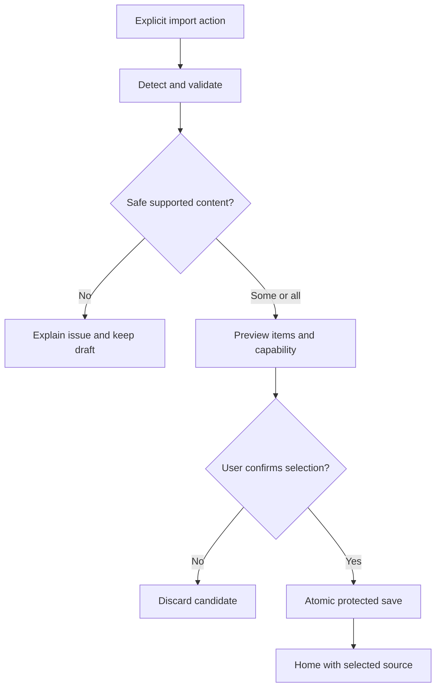
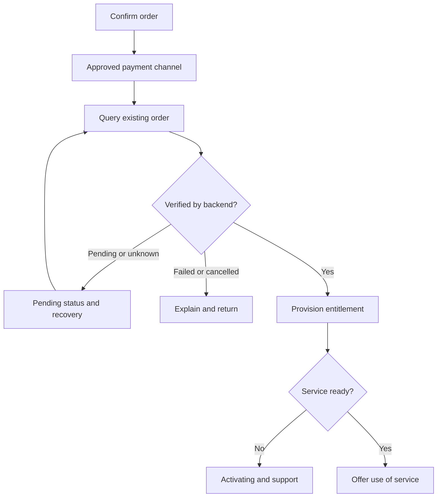

# PVNetwork — Product & UX Implementation Specification

**Workstream:** Chat 04 · Product design, UI, accessibility and Persian RTL  
**Date:** 2026-11-06 (Asia/Tehran)  
**Status:** PROPOSED implementation contract; source observations and historical evidence are labelled separately. This document does not certify an application build, physical device, protocol, purchase flow or Store release.  
**Exclusive deliverable:** docs/preflight-2026-11-06/04-product-ux.md  
**Branch:** prep/2026-11-06/04-product-ux · **PR base:** main  
**Source baseline:** 78dcd4511dbb830a999cc8c1796f2a38f88587e8  
**Coordination baseline:** ed21086e3e74772ab4dc31825eb87336f917fd67, docs/preflight-2026-11-06/START_HERE.md [R01]

## 1. Outcome, scope and evidence

### 1.1 Product outcome

A person can open PVNetwork, add an existing provider's configuration, choose a usable server and connect without creating a PVNetwork account or buying anything from PVNetwork. A PVNetwork customer can additionally discover plans, buy or renew through an approved distribution-specific purchase flow, and manage their service, quota, devices and support in the same application.

Android phone/tablet is the first implementation target. Preserve the existing Kotlin/Compose/domain investment while Chat 01/02/07 reconcile architecture. [R12] This specification describes responsive desktop and future Apple/TV behavior; it does not declare those platforms supported. Research coverage is not a public capability list. Only a release-approved platform/engine/protocol/transport/security combination may be offered as connectable. [R01] [R02] [R03]

This is a complete product specification with delivery tiers, not a promise to implement every screen in six days:

| Tier | Definition | Screens and gates |
|---|---|---|
| A — client critical path | First independently useful Android client | Guest onboarding, truthful connection, servers, supported imports, source refresh/recovery, Simple settings, Persian/English, both themes, local diagnostics and privacy |
| B — service integration | PVNetwork commerce/account product, conditional on real APIs and distribution approval | Catalog, account authentication, services/quota, purchase verification, renewal, restore, devices, support tickets, account deletion |
| C — expansion | Capability-dependent advanced/platform features | Custom routing/DNS, per-app rules, import/export formats, advanced engine options, desktop integration, Apple and TV-specific experiences |

Tier A includes every error and accessibility state for its enabled features. An unavailable Tier B/C dependency does not justify a fake button, fabricated value, forced sign-in or interruption of external-provider connections. If the selected release sells services, the corresponding Tier B integrity and privacy acceptance cases are release gates.

### 1.2 Inspection method and observed gaps

The actual pinned source, public-app requirements, decisions, implementation plan, historical validation and coordination instructions were read. Source inspection is OBSERVED, not a running-app inspection. No Android emulator, physical handset or desktop UI was launched in this workstream. Existing logo imagery was inspected from the repository, without replacement or alteration.

| Evidence state | Finding at baseline | Consequence for the specification |
|---|---|---|
| OBSERVED | Android MainActivity / PVNetworkApp is a single Compose screen: state card, Connect/Disconnect, pasted VLESS link, selectable/deletable profiles, Persian/English toggle. Theme is fixed to darkColorScheme; language starts Persian in remember state. [R04] | Reuse the working entry points behind product use cases; introduce a navigation shell, persistent preferences, resource strings and a proper Home. Do not describe the Android Store/account/subscription pages as existing. |
| OBSERVED | Android busy is every state except DISCONNECTED/ERROR; the busy branch includes CONNECTED and draws CircularProgressIndicator. [R04] | A stable connection must have a static connected indicator and a Disconnect action, not an indefinite loading indicator. |
| OBSERVED | Android selectedProfileId/profileList are ordinary properties on ClientState; import errors render failure.message. [R04] | Use an observable product snapshot, structured/localized failure codes and source redaction. Verify list/selection updates rather than assuming recomposition. |
| OBSERVED | Desktop Main.kt contains HOME, SERVERS, SUBSCRIPTIONS, DIAGNOSTICS and SETTINGS; gold/charcoal colors, an animated connection control, latency and duration, fa/en and theme preference. [R05] | Preserve useful product concepts and PVNetwork's existing direction. Consolidate navigation across sizes without cloning a competitor. |
| OBSERVED | Desktop light theme exists, but numerous cards/text fields still use hardcoded dark colors; Home contains a fixed 430 dp card and a 230 dp animated orb. [R05] | Replace hardcoded colors/sizes with semantic tokens; verify small windows, reduced motion and scaled text. |
| OBSERVED | Desktop subscription rows render sub.url, and SubscriptionRepository persists the URL as a regular text field; fetch supports HTTP(S) and plain/base64 share-link lists. LatencyTester measures TCP connect time. [R06] | Mask source secrets, move reusable URLs behind SecretRef, distinguish TCP reachability from tunnel latency, and provide safe preview/update transactions. These changes are tickets, not changes made by this PR. |
| OBSERVED | Desktop onEngineState keeps CONNECTED after a system-proxy enable failure; Home's proxy-active note depends on CONNECTED rather than proxy readback. [R13] [R05] | Render engine readiness and effective coverage separately; a disabled/failed proxy must not claim proxy coverage. |
| OBSERVED | Desktop outcomes contain partial-import counts/warnings that UI reduces to a count; refreshInto removes old profiles/secrets before inserting newly parsed profiles. [R13] [R05] | Expose partial results and make profile/secret/source replacement transactional; preserve stable identity. |
| OBSERVED | AndroidProfileStore.all returns an empty list on decoding failure, and writes use direct writeText. [R14] | Distinguish never-added data from unreadable storage. Block destructive initialization and offer recovery without erasing the original. |
| OBSERVED | ConnectionSnapshot currently exposes state, adapterId and reasonCode; it lacks traffic, coverage, detailed startup phase and source identity. Entitlement.hasUnlimitedTraffic treats null quota as unlimited. [R07] [R08] | Add explicit presentation contracts without a parallel UI-owned connection machine. Unknown external quota must not reuse null-means-unlimited. |
| DOCUMENTED | M-P2 records a built Android debug APK and Windows package, with physical Android testing explicitly absent. That historical document says no subscription URLs, while newer desktop source contains subscriptions. [R09] [R06] | Prefer current source for existence, historical receipts only for their exact tested scope. No new device claim. |
| OBSERVED in GitHub metadata | Main is the SHA above. M4 Public Apps CI and M1 Desktop Shell CI show success on that SHA; Agent State Validation also shows success. [R10] [R10b] [R10c] | Existing CI success does not validate the new UX, accessibility, commerce or mobile data path. No runtime tests were rerun for this documentation-only change. |
| DOCUMENTED / UNKNOWN | Launch decisions request the owner's exact logo and record final brand asset approval as blocked; logo files now exist. [R03] | Preserve existing assets for implementation review, but do not infer final approval or provenance solely from file presence. |
| DOCUMENTED | Research trackers mark V1/V2 93/93; startup/handoff task pointers are older than later app source. [R11] [R11b] | Reuse research and report relevant deltas. Do not restart the protocol campaign or edit shared state files in this isolated task. |

### 1.3 Decisions and alternatives

These are design recommendations, not new owner approvals or licensing decisions.

| Approach | Benefit | Cost | Decision |
|---|---|---|---|
| Client-first shell with four top-level destinations and optional commerce | Direct external-provider path; room for PVNetwork services; stable mobile/desktop information architecture | Requires careful account/source separation | **PROPOSED default** |
| Shop-led onboarding with mandatory account | Simple sales funnel | Conflicts with the explicitly required universal client | Rejected for this product |
| Expert dashboard with protocols, logs and raw options on Home | Dense technical visibility | Increases first-use burden; duplicates the Advanced layer | Keep its useful tools inside Advanced, not as the default Home |

Preserve the existing gold/charcoal direction; create original component arrangements and copy. Reuse behavioral lessons only. Do not copy competitor code, illustrations, icons, screenshots or distinctive layouts. Chat 02 owns code/asset licensing; Chat 03 owns engine/import capability truth; Chat 05 owns API and purchase contracts; Chat 06 owns platform/release proof; Chat 07 resolves their dependencies.


### 1.4 Reference UX lessons, with evidence limits

This bounded comparison reuses existing dossiers and checks official documentation/publisher listings. No reference app was installed or runtime-tested. Upstream public source/visual identity is not a copying license. Recommendations are original PVNetwork behavior; the cited observations do not establish PVNetwork support.

| Reference | Evidence and useful pattern | PVNetwork adaptation | Boundary |
|---|---|---|---|
| Karing | DOCUMENTED source analysis at upstream 9a0e3b7736f6c8f407985cb697f669c93087b909: link/file/QR entry points and separate backup/sync; the deeper source dossier maps routing controls. [C01] [C01b] | One Add sheet; Simple/Advanced over the same state; explain routing presets and source ownership. | Dossier/source structure is not device or sync validation. No copied code, rulesets, branding or artwork. |
| Hiddify | Official usage guide describes adding provider links via explicit clipboard/manual/QR actions, a prominent connection action and server/refresh recovery. The guide warns that screenshots are from an older UI. [C02] | Short provider-link-to-connection path; maintain versioned help and show only meaningful supported controls. | Do not present old screenshots/settings as a current pixel-level design or copy their layout. |
| Happ | Official routing documentation separates subscription-bound routing, deferred application and background asset preparation with visible download failures. [C03] | Show required routing assets as Preparing/Ready/Failed; retain current state until candidate is ready; preview source deletion effects. | Do not adopt provider-enforced overrides, name-based identity or automatic routing activation without review. |
| v2rayNG | DOCUMENTED menu/source map at e8a82d9810ca1cf97a3cc8a9b9525a9f21955807 includes clipboard/QR/file import, subscriptions, per-app/routing, diagnostics and distinct link/full-config sharing. [C04] | Keep these capabilities discoverable through source details and Advanced; export scope is explicit; support diagnostics are redacted. | Menu existence does not prove all workflows, RTL or lifecycle; redaction here is a PVNetwork requirement. |
| v2rayN | DOCUMENTED index at e01717d8326a4f5060b335523590c5fda943fe03 identifies desktop server/group/edit/update/backup views and separate service layer. [C05] | Separate selected profile, engine state and system-proxy/TUN coverage; useful desktop detail panes. | Existing dossier explicitly has evidence gaps; no assertion of audited behavior for every screen. |
| NPV Tunnel | PUBLISHER-DOCUMENTED iOS listing describes a unified saved-config/subscription collection, usage/expiry, import methods, connection groups and theme options. [C06] | Unified source management; clearly labelled refresh/usage/expiry and source-scoped connection choices. | Publisher claim only; no full-source or runtime assurance. Protected proprietary containers are not promised import formats or reusable code. |
| V2Box | PUBLISHER-DOCUMENTED version-history notes describe connection-progress feedback, group export compatibility and bounded layouts on wider windows. [C07] | Explain export compatibility and connection progress; constrain main content width; keep tap/keyboard alternatives to gestures. | Do not reproduce its distinctive slide control; similarly named public libraries are not proof of branded app source ownership. |
| Amnezia | Official split-tunneling instructions distinguish selected traffic through/bypassing VPN and show platform-specific availability. [C08] | Clear include/exclude labels, capability-gated app selectors and coverage preview before apply. | Its capabilities do not certify PVNetwork's; no parity promise from the reference documentation. |

External reference inspection date: 2026-11-06. No popularity, “best performance”, “no logs” or “all protocols work” claim is inferred from these pages. Existing reference research remains the source for deeper architecture; this report extracts only product behavior relevant to the requested screens.

## 2. Product concepts and non-negotiable UX rules

### 2.1 Terms and data ownership

| Product concept | Meaning | UI rule |
|---|---|---|
| Configuration / کانفیگ | A canonical saved connection profile | Never imply that its presence proves it can run on this build |
| Source / منبع | Manual collection, external subscription, or authenticated PVNetwork service | Every profile has stable sourceId; names and domains are not identity keys |
| Server / سرور | A selectable endpoint/profile within a source | Display user-facing name, source and actual capability; countries are optional metadata |
| Service / سرویس | A purchased PVNetwork entitlement | Account/backend-owned; may supply several servers |
| Subscription link / لینک اشتراک | A provider URL that refreshes a set of profiles | It is a reusable secret, not a public link or an account |
| Session usage / مصرف این اتصال | Counters observed from this device's current tunnel session | Never subtract it from the provider's account quota or sum it into billing |
| Provider usage / مصرف سرویس | Provider/backend-reported quota, consumption and expiry | Include source and last synchronization; unknown is neither zero nor unlimited |
| Advanced mode / حالت پیشرفته | Additional product controls and diagnostics | Same profiles, session, account and navigation as Simple; no paywall |

Required presentation inputs, proposed as extensions to existing shared domains:

| Input | Minimum fields | Owner |
|---|---|---|
| Connection view | canonical state, stage, requestId, activeProfileId, selectedProfileId, sourceId, connectedSinceMonotonic, coverage, blockingPolicy, recoverableFailure; separate pathHealth (unknown/checking/verified/failed/unavailable), checkMethod and checkObservedAt | Connection coordinator / platform adapter |
| Capability result | exact platform/build/core/transport/security key, canImport, canConnect, canEdit, reason, userSafeReason, evidence state | Chat 03 contract |
| Traffic observation | sessionId, rxBytes, txBytes, rxBytesPerSecond, txBytesPerSecond, observedAt, unavailableReason | Platform/engine statistics |
| Server observation | result: untested/testing/value/timeout/error; method; sampledAt; network epoch | Probe coordinator |
| Source view | sourceId, kind, displayName, protected URL reference, lastAttempt, lastSuccess, nextRefresh, revision, result, eligible/total count | Subscription use cases |
| Quota view | kind: UNKNOWN / UNLIMITED / METERED; used/limit/remaining where valid; observedAt; providerTime; stale flag; scope | Provider/account adapter |
| Commerce view | purchaseAvailability, plan/currency/price revision, orderId, transaction status, entitlement status, verification status | Chat 05 backend/billing adapter |

Coverage values are ALL_DEVICE_TRAFFIC, SELECTED_APPS, RULE_BASED, SYSTEM_PROXY, LOCAL_PROXY_ONLY or UNKNOWN. These describe actual effective behavior, not a user preference waiting to be applied. Existing Windows system-proxy operation must say that compatible applications using the proxy are covered; it must not promise all traffic or all browser traffic.

### 2.2 Required behavior

1. Home and Configurations work while signed out, while the Store is unavailable, and after a PVNetwork service expires.
2. No clipboard read, camera prompt, sign-in sheet, purchase prompt or VPN permission on launch. Read clipboard only after Paste. Request camera only after Scan QR. Ask for VPN permission after Connect.
3. Restore the selected source/server; never silently change providers. Auto selection is scoped to one source by default.
4. An active session and a pending server selection are separate. Browsing another source does not change the running connection.
5. No fake ping, signal bars, traffic, quota, percent progress, discount, country or success. Missing values have explicit states.
6. One primary connection action. Settings, imports and shopping cannot create a second hidden connection intent.
7. UI observes coordinator truth. A process, foreground notification, payment callback or green animation cannot establish connection truth.
8. Source/provider names are untrusted text. Render text, isolate bidirectional content, bound length, and never execute imported scripts or auto-open a link.
9. Favorites, local names, tags and routing overrides survive a source refresh using stable identifiers.
10. The user can hide the Store destination in Settings. Guest access remains equally visible when Store is shown; hiding it neither deletes a service nor signs the user out.

## 3. Screen Map and navigation

### 3.1 Top-level destinations

Compact layout uses a four-item labelled navigation bar in logical order: **Connect / اتصال**, **Configurations / کانفیگ‌ها**, **Store / فروشگاه**, **Account / حساب**. In Persian the first destination is at the right; in English it is at the left. Settings is a labelled-accessibility icon in the root app bar; Help is available from Settings, Account and connection errors.

The Configurations destination contains a source list, not two competing server/subscription tabs. A source opens its servers. Home's server selector opens the same server-selection experience. Account shows PVNetwork service management and a useful signed-out page, never a mandatory sign-in gate for the shell.

If Store is hidden or the build has no approved catalog experience, omit its destination and rebalance the other items; retain stable route IDs. Never change navigation because of a transient network error. A supported catalog outage uses an error state inside the Store.

### 3.2 Route inventory

Routes are internal navigation identifiers. They are not promises of external deep links or authorization by URL.

| ID | Internal route | Screen / surface | Entry and access | Tier |
|---|---|---|---|---|
| ON01 | onboarding/welcome | Language, brief value statement, start choices | First launch; guest | A |
| ON02 | onboarding/privacy | VPN/data disclosure and privacy details | First relevant connection; versioned acceptance | A |
| CN01 | connect | Home | Root; everyone | A |
| CN02 | connect/servers | Server picker | Home/server field or a source; everyone | A |
| CN03 | connect/details | Session and coverage details | Home metrics/status | A |
| CN04 | connect/recovery | Connection recovery sheet/page | Failure banner | A |
| CF01 | configs | Sources and manual profiles | Root; everyone | A |
| CF02 | configs/add | Add configuration method sheet | Add action, share/file intent | A |
| CF03 | configs/import/input | Link/text/file input | CF02; no login | A |
| CF04 | configs/import/scan | Camera QR / image QR | CF02; scoped camera consent | A when decoder approved |
| CF05 | configs/import/review | Import preview and compatibility | Successful detection | A |
| CF06 | configs/source/{sourceId} | Source details, metadata, servers | CF01 | A |
| CF07 | configs/profile/{profileId} | Profile details and local overrides | Server row overflow | A |
| CF08 | configs/source/{sourceId}/changes | Refresh diff and rollback | Source refresh result | A |
| CF09 | configs/export | Secret-aware share/export | CF06/CF07 overflow | C |
| ST01 | store | PVNetwork plan catalog | Root; browse without login | B |
| ST02 | store/plan/{planId} | Plan details | Catalog/service renewal | B |
| ST03 | store/checkout | Order review | Explicit buy/renew; auth if required | B |
| ST04 | store/order/{orderId} | Payment/verification/activation status | Checkout, return, order history | B |
| AC01 | account | Guest or signed-in account overview | Root; everyone | A shell / B data |
| AC02 | account/sign-in | Approved auth initiation | Explicit sign-in or checkout | B |
| AC03 | account/verify | Approved OTP/auth verification | AC02; verified flow type | B |
| AC04 | account/services | My PVNetwork services | Signed in | B |
| AC05 | account/services/{serviceId} | Service, quota, expiry and renewal | AC04 or contextual Home card | B |
| AC06 | account/devices | Devices and revoke | Signed in; step-up if required | B |
| AC07 | account/orders | Orders, receipts, restore purchases | Signed in / Store restore rules | B |
| AC08 | account/privacy | Privacy controls and local data | Settings/Account; guest allowed | A/B |
| AC09 | account/delete | Account deletion initiation/status | Signed in; explicit confirmation | B |
| SE01 | settings | Settings index; Simple/Advanced switch | Root toolbar or Account | A |
| SE02 | settings/appearance | Language, theme, numeral/calendar choices | SE01 | A |
| SE03 | settings/connection | Reconnect, launch behavior, coverage | SE01 | A, capability-gated |
| SE04 | settings/routing | Routing presets; advanced rule list | SE01 | A presets / C editor |
| SE05 | settings/dns | DNS mode and advanced resolvers | SE01 | A defaults / C editor |
| SE06 | settings/apps | Per-app include/exclude editor | SE04, supported platforms only | C |
| SE07 | settings/rules/{ruleId} | Domain/IP rule editor | SE04 in Advanced | C |
| SE08 | settings/advanced | Supported engine/transport overrides | SE01, Advanced only | C |
| SE09 | settings/about | Build, licenses, capabilities, update status | SE01 | A |
| HE01 | help | Help, incidents, troubleshooting topics | Settings/Account/error | A |
| HE02 | help/diagnostics | Sanitized local event timeline and checks | HE01/CN04, everyone | A |
| HE03 | help/report | Preview diagnostic bundle and support draft | HE02; explicit export/upload | A export / B ticket |
| HE04 | help/tickets/{ticketId} | PVNetwork support ticket thread | Account/HE03, signed in | B |
| OS01 | platform-owned | VPN permission, camera permission, billing, app settings | Relevant action only | By platform |
| TV01 | tv/pair | Expiring pairing code / phone-assisted import | Future TV build | C |

### 3.3 Navigation and persistence contract

- Each top-level destination retains its own scroll position and selected item. Returning Home must not restart a tunnel or refresh every source.
- Back closes the keyboard first where the OS consumes Back, then an active sheet/dialog, then the nested screen, then returns to the previous navigation context. At a root, follow platform exit/background behavior. Back never disconnects.
- A dirty editable form gets Save/Discard/Keep editing. Scan, import review and checkout keep a non-secret draft across rotation; secrets remain protected and are not serialized into navigation arguments.
- After dismissing a modal, restore focus to its invoker. After route changes, focus the new heading. Re-selecting a root tab returns to its root without resetting connection state.
- Desktop uses the same route IDs. Keyboard shortcuts: Ctrl/Cmd+1 Connect, +2 Configurations, +3 Store when present, +4 Account; Ctrl/Cmd+, Settings; Ctrl/Cmd+F local search. Do not capture these inside text editors when they conflict with native editing.
- Language/theme/mode changes preserve route, selected profile, active session and import draft. They do not recreate the platform VPN service.
- Internal route parameters are opaque IDs, never subscription URLs, UUID credentials, receipts, OTPs or tokens.
- Accepted import deep links enter CF05 after safe parsing, never auto-connect or auto-purchase. Pending auth/payment returns resume only a locally initiated, matching operation; unsolicited callbacks are rejected.
- Desktop window close follows the explicitly configured OS integration contract. Default until tray/service persistence is implemented: explain once that closing disconnects, then stop/restore proxy before exit. Do not silently leave an unobservable proxy running.

## 4. Wireframe Specifications

All placements use logical start/end. Dimensions are dp on Android, equivalent logical units on desktop, and platform points on Apple; typography uses scalable units. Reference phone viewport is 360 × 800 dp excluding OS insets. Layout is content-driven and scrollable: reference sizes are not absolute coordinates or fixed-height text boxes.

### 4.1 Common screen frame

| Region | Geometry | Content and behavior |
|---|---|---|
| Top app bar | Minimum 64 high; 16 start/end padding | Root: approved logo/name and Settings; nested: mirrored Back, heading, contextual action. Heading can wrap at large text. |
| Body | 16 horizontal padding compact; 24 medium; 32 expanded | 16 between sections, 12 inside related rows; safe drawing and IME insets |
| Root navigation | Minimum 80 plus bottom inset | Icon + label for each destination; selected indicator and selected semantics; no icon-only mobile tabs |
| Primary form footer | Minimum 56 button; 16 padding | Scroll/IME-aware. Never covers final field, focused control or validation message. |
| Error location | Inline next to relevant field, or one banner directly below app bar | A banner describes one failure and one primary recovery; details are a secondary action |
| Supporting status | 14/20 text; icon plus text | Never color-only; no persistent pulsing on steady state |

### 4.2 ON01–ON02: onboarding and permission

**ON01 layout:** language selector at logical end; approved PVNetwork mark; title “یک برنامه برای اتصال‌های شما” / “One app for your connections”; two sentences explaining external configurations and optional PVNetwork services; primary “افزودن کانفیگ” / “Add configuration”; secondary “مشاهدهٔ سرویس‌های PVNetwork” / “Explore PVNetwork services”; text action “فعلاً رد شدن” / “Skip for now”. Store unavailable: omit only Explore. Account creation is not part of onboarding.

**ON02 layout:** clear heading “دربارهٔ اتصال VPN” / “About the VPN connection”; explain which traffic the chosen mode routes and the minimum data actually handled; link to in-app privacy text and approved policy URL; “ادامه و درخواست اجازه” / “Continue to permission”; “فعلاً نه” / “Not now”. This is not a generic claim of anonymity/no logs. Text is finalized against Chat 05/06 data inventory. Show when the relevant disclosure version has not been accepted, immediately before OS permission; retain acceptance version/time locally without browsing history.

Declining returns to the originating screen with the saved configuration intact. A camera denial leads to Paste/File alternatives; it never blocks connection from an already saved profile.

### 4.3 CN01: Home and one-action connection

Reading/focus order is the same as visual order:

| Order | Component and nominal size | Required content | Interaction |
|---:|---|---|---|
| 1 | App bar, 64 minimum | PVNetwork; Settings; optional non-blocking incident badge | Settings or incident details |
| 2 | Context banner, auto height, only when relevant | Offline, stale source, actual connection failure, or service issue for selected source | One recovery + Details/dismiss when safe |
| 3 | Source/server selector card, minimum 80 | Source label; Auto within that source or chosen server; location if known; trailing chevron | Opens CN02 |
| 4 | Connection status, 24/32 title | Localized state, short stage/coverage description | CN03 via explicit Details link |
| 5 | Primary connection control, 160 nominal circle, 56 minimum alternate full-width button | Icon + action label; progress ring only during active work | Connect / Cancel / Disconnect from canonical state |
| 6 | Metrics, 2 columns at normal compact width | Latency with method/time, duration; download/upload rate and session total | Opens CN03; “— / Unavailable” when missing |
| 7 | Selected source's quota card, auto height | Provider usage, remaining/limit or unknown, expiry if known, sync timestamp | External → CF06; PVNetwork → AC05 |
| 8 | Optional small service link | “Need a service?” only in empty Home, equally secondary to import | ST01; dismissible; never overlays Connect |

At 200% text or compact height, replace the circular control with a labelled full-width button and stack metrics in one column. The Connect/Cancel/Disconnect action remains reachable without horizontal scrolling. There is no separate floating power button.

**Zero profiles:** show “کانفیگی اضافه نشده” / “No configurations yet”, brief instructions, Add configuration primary and optional Explore services secondary. Do not show a dead Connect button or fake traffic/quota cards.

**Profile selected, disconnected:** show source/server; Connect is enabled only when exact capability validation and required inputs pass. For an unsupported imported profile show the specific reason with Choose another configuration; preserve the profile for a future compatible build/export.

**Connected:** title plus active profile/source, elapsed session time and actual coverage. Static success treatment; Disconnect remains accessible. Metrics sample at most once per second while visible; returning from background reads current counters rather than adding elapsed wall time. A background purchase/import cannot change this session.

**Proxy-only desktop:** title is “پروکسی فعال است” / “Proxy active”; subtitle explains compatible-app scope. ALL_DEVICE_TRAFFIC wording is reserved for a proven effective tunnel. Display “اینترنت بررسی نشده” / “Internet not checked” if there is no current path result; never invent a speed or external IP.

### 4.4 CN02–CN04: servers, session details and recovery

**CN02 server picker:** source selector, search, Auto row scoped to source, Favorites/All filter, sort menu, bounded Test visible servers action, then rows. Default sort preserves provider order, with favorites available separately; latency sorting is opt-in and keeps untested/failed values distinct. Each row: name (2 lines allowed), provider/source, location when trusted metadata exists, measured latency or explicit state, capability badge, selected radio, overflow. Selection row minimum 72; favorite is a separate 48 target with a state label.

Auto uses only eligible servers in the selected source. If no algorithm is implemented/proven, hide Auto and retain manual selection; do not select the first server while labelling it Auto. Empty source, search-no-results and all-incompatible are distinct screens. Preserve source filter on return.

Disconnected selection updates selectedProfileId and returns Home, without connecting automatically. During a connection, choose a different server → “Switch now / Use next time / Cancel”. Switch now explains brief interruption; coordinator disconnects old session, applies candidate and starts a new request. Failed switch offers Restore previous server, not an unannounced provider fallback. Removed active server remains visible as “Removed from source; active until this session ends”; no automatic hot replacement.

**CN03 session details:** active profile, coverage, route/DNS summary, session duration, receive/send counters, latency method/time/network, core/build under Advanced, data-path check status, local timeline link. Public-IP lookup is explicit opt-in and names the checking service; failure does not prove VPN failure. No destination browsing history.

**CN04 recovery:** title in ordinary language; one-line cause; current network/permission/source state; actionable steps ordered by failure category. Primary Try again or required corrective action, secondary Choose server/Refresh source, tertiary sanitized diagnostics. Unknown errors offer a safe generic explanation and a copyable opaque code; raw exceptions stay out of the main screen.

### 4.5 CF01–CF09: configuration and subscription management

**CF01:** heading, Add action; search; source cards grouped as PVNetwork, Other providers, Manual. Empty groups are omitted. Source card has name, source-kind label, usable/total server count, last successful refresh, status and optional provider usage. PVNetwork grouping does not make its servers higher priority in Auto across unrelated sources. A manual collection shows individual profiles or opens its list. Overflow: Rename, Refresh (if refreshable), Details, Delete. No exposed full URL.

**CF02:** method sheet with Paste, Subscription URL, Scan QR, File and Manual entry only where a validated capability exists. Paste is an action, not an ambient clipboard monitor. Desktop adds explicit drag/drop to a visible drop zone with the same review flow. Unsupported formats remain explainable in CF05, not advertised as working.

**CF03:** persistent label, multiline text or secure URL field, chosen local file name, optional source name, Continue, Cancel. Technical input is LTR and preserves exact characters. URLs are masked after focus loss and not included in recent-search history. File selection uses the platform picker, not broad storage permission. On import timeout/cancel, keep the safe draft and do not create partial records.

**CF04:** camera preview with one framed scanning area; torch action where available; Import QR image and Enter manually alternatives. Show detected origin/profile count before CF05. Stop camera after a result or leaving the screen. No QR screenshot, telemetry or raw payload retention.

**CF05:** source host/name (masked, no path/query credentials), detected format, “usable / unsupported / invalid / duplicate” counts, per-item expandable reasons, fields that would be lost, and explicit approval. Connectability and importability are separate. Primary “Add {n} usable configurations”; unsupported items may be kept as disabled metadata only if secure round-trip retention is supported. Invalid items never enter active storage. Partial-success choice is explicit; no silent dropping of security/routing options. Duplicates default to keep existing and preserve local labels/favorites; Replace requires explicit review.

**CF06:** provider/source name; refresh action; last attempt vs last success; automatic-refresh setting; source revision; usage/expiry with provenance; server list; safe provider contact when explicitly supplied/verified; change history. Private source URL is hidden by default, reveal requires an explicit action, copying warns that it contains access credentials. The public report never contains real examples.

**CF07:** display name, favorite/tags, source, endpoint/port/protocol as isolated LTR, capability reason, read-only inherited parameters, local override summary. Basic Rename/Favorite edits do not trigger reconnect. Advanced Edit validates a working copy; “Save for next connection” is the default. A changed secret is never printed in a success toast. A source-derived profile can be duplicated into Manual without changing the source original.

**CF08:** Added/Changed/Removed counts, warnings, compatibility changes and effect on current session. Controls: Apply, Keep current, Inspect, Restore previous verified snapshot. Interrupted/malformed/unauthenticated/unsafe downgrade responses leave the previous revision untouched. Source refresh and active runtime are distinct transactions; existing session stays on its snapshot until an explicit reconnect or authoritative revocation.

**CF09:** choose item(s), format and redacted/full export; show unsupported/lossy conversion warnings. Full export explains that a recipient can use the credentials, requires explicit confirmation and uses the OS share/file interface. Default support export is redacted. No automatic clipboard copy, cloud upload or QR display on ordinary details screens. This feature is gated until secret-safe exporters exist.

### 4.6 ST01–ST04: optional PVNetwork Store

**ST01 catalog:** PVNetwork identity + short service description; service-category filters populated by the backend; plan cards; compare selected plans; account sign-in as an optional toolbar action. Each plan card shows the actual price/currency, traffic unit, duration, supported locations, device limit and availability. Do not hard-code private pricing, promotional discounts or infer unlimited traffic. If real product catalog includes Multi-location or CIP, show the exact approved names and verifiable distinctions returned by Chat 05; no fabricated priority/speed guarantees.

**ST02 plan detail:** plan name, full price and renewal terms, quota/duration, regions, device count, included capabilities, restrictions, support level, renewal/top-up eligibility, refund/terms links supplied by the approved backend. Use a small comparison table for meaningful differences. Main action depends on purchaseAvailability; Login is requested only if the selected checkout requires it.

**ST03 order review:** current plan revision, target account/service, purchase vs renewal vs approved top-up, final amount with currency, tax/fee lines if applicable, renewal schedule, cancellation/manage terms, and one confirmed payment action. Never preselect add-ons. A price/revision change requires explicit reconfirmation. Localized money is formatted from typed minor units and currency; IRR and toman are never silently exchanged. Buttons contain the final amount when confirmed.

**ST04 status:** Payment started → Payment pending → Payment verified → Service activating → Active, with separate failure/unknown/cancelled branches. One local callback cannot render Active. Returning from OS/browser or relaunching queries the existing order; it does not create another charge. Pending verification shows Check status and support/order reference, not Pay again. Successful activation offers “Use this service” and “View service”; it does not replace an external active connection automatically.

Bind each initiated order/restore operation to its authenticated account and purchase-channel identity. After logout or account switching, a delayed callback must not attach a receipt or entitlement to the new visible account. Reconcile with the original order through the approved account-recovery path. Duplicate or older events cannot override a newer authoritative status. Hiding the Store, a catalog outage or a change in purchase availability must leave an existing order recoverable through Account → Orders and a matching safe return route.

Purchase behavior is a channel contract, not a hard-coded web link:

| purchaseAvailability | Catalog/detail action | Required behavior |
|---|---|---|
| NATIVE_APPROVED | Approved platform purchase action | OS billing UI and backend receipt verification; restore/manage path |
| EXTERNAL_APPROVED | Approved checkout action | Only on explicitly approved build/channel/region with safe callback contract |
| EXISTING_CUSTOMER_ONLY | Manage an existing service / Sign in | No unapproved purchase steering; imported profiles remain available |
| UNDECIDED or UNAVAILABLE | “Purchases are not available in this build” if catalog is approved | No working payment button, made-up URL or implied policy exemption |

This table designs the states; it does not select a legal billing model. Chat 05/06 must supply current policy and release approval.

### 4.7 AC01–AC09: account, services, volume and privacy

**AC01 guest:** “Use your own configurations without an account”, Sign in to PVNetwork, Add configuration, Help and Privacy. No empty avatar statistics, zero-balance claim or full-screen login wall. **Signed in:** safe account identifier, services summary, Devices, Orders/restore, Support, Privacy, Sign out.

**AC02–AC03 authentication:** render only the approved identity method supplied by Chat 05. Proposed interaction for an OTP method: email/phone field with accessible validation, explicit Continue, code field supporting paste/autofill, masked destination, server-provided resend countdown, Change address and Cancel. Accept Persian/Arabic numeric glyphs for OTP by explicit digit normalization; never normalize passwords/tokens/URIs. Rate limits display retry time from the server. No fake passkey, phone, email or social-login button before implementation.

**AC04 services:** one card per entitlement with plan/source name, active/pending/expired/revoked state, quota, expiry and selected service indicator. Expired service stays visible with Renewal and Help. The list is not the external-provider profile list.

**AC05 service:** server-authoritative used/remaining/limit; last update; expiry in selected calendar with timezone; device limit; renewal/top-up options only when eligible; linked source/server count; order history; support. Remaining uses max(limit−used, 0) for visualization but also shows overage if provider reports used > limit. Unlimited is explicit, not an absent number. A receipt-proven purchase awaiting provisioning shows “Payment verified; activating service”, not “Ready to connect”.

Quota warning defaults: advisory at 80% used; stronger advisory at 95%; exhausted only on authoritative policy. Expiry warning defaults: 3 days, then 24 hours. They are proposed product defaults, deduplicated per entitlement revision, dismissible and configurable; neither creates repeated popups on Connect. External-provider warnings route to CF06/known provider support, never PVNetwork renewal.

**AC06 devices:** user-friendly name, platform, last seen, current-device badge, safe revoke action and consequences. Confirm revoking this device because its PVNetwork session may stop. External profiles remain usable. Do not expose raw device identifiers. Device-limit errors link here without forcing replacement of another device.

**AC07 orders/restore:** list order reference, date, plan, amount/currency, status; details ST04; receipt only when backend supplies one; Restore purchases is an explicit action only for the applicable purchase channel. Restored entitlement conflicts/account mismatch need a recovery/support route and must not move ownership silently.

Restore shows Checking, Nothing to restore, Restored or Could not verify as distinct outcomes. Repeating or resuming it is idempotent; network failure cannot become “Nothing to restore”.

**AC08 privacy:** local data explanation, policy/terms, diagnostic permissions, clear local diagnostic history, remove local configuration data with exact affected source count, optional data-export request if supported, account deletion link. Clearing diagnostics does not delete configs. Clearing all configurations needs an impact summary and disconnect/cleanup if active.

**AC09 deletion:** explain server-side account/service consequences, active subscription management/cancellation information from channel, retention details from approved policy, and effect on local PVNetwork credentials. Reauthenticate where required; explicit final confirmation; submit once; show Pending/Completed/Failed status. Deletion of a PVNetwork account leaves external/manual profiles intact unless separately requested. Do not imply that deleting the app/account automatically cancels every Store subscription.

**Sign out:** explicitly remove PVNetwork sessions/credentials and stop a currently active PVNetwork session after confirmation; preserve manual/external sources and preferences. If the current session is external, sign-out does not stop it.

### 4.8 SE01–SE09 and HE01–HE04

**SE01 index:** Appearance; Connection; Routing; DNS; Mode; Help; Privacy; About. Advanced adds explicit engine/rule entries, not a second hidden settings tree. Show Store preference is in Appearance. Search settings is a desktop/Advanced enhancement with localized labels.

**SE02:** Language System/Persian/English; Theme System/Light/Dark; display numerals Locale default/Latin; calendar Locale default/Gregorian (Persian locale default Persian calendar); reduced motion follows OS with an additional Reduce motion option. Technical values remain ASCII regardless of numeral preference. Persist and apply immediately without reconnect.

**SE03:** reconnect on temporary network loss; connect on launch off by default; notification/tray behavior by platform; system-proxy coverage on supported desktop; supported OS Always-on/lockdown information. “Open system settings” is a platform link, not an in-app switch pretending to enable OS lockdown. If a feature cannot be read back reliably, show its status as unknown and explain.

**SE04–SE07:** routing presets first; clear effective scope summary; app/rule editors only when supported. Domain/IP rule editor has type, value, action and priority, validation and a plain-language preview. First-match ordering, catch-all and invalid-overlap semantics come from Chat 03; proposed UI requires move up/down controls as well as drag. Per-app includes search and explicit Include only / Exclude selected modes; cannot have both active. Changing routing while connected is a draft until Apply and reconnect. Explain which traffic will bypass VPN before applying.

**SE05 DNS:** approved default first, Custom only when supported; resolver address, scheme, bootstrap requirement where relevant, route scope, validation/test action, pending-apply summary. Never offer “Disable certificate verification” as a troubleshooting shortcut. Unsupported import DNS/security options block applying the affected profile rather than silently weakening it.

**SE08:** read-only effective engine/version/capability initially; editable overrides have schema, defaults, field help, reset-to-inherited and capability constraints. Raw JSON editor is not a public V1 requirement. A supported future expert editor must validate a working copy and show a diff before save.

**SE09:** app/build/channel, approved asset identity, privacy/terms/support links, third-party notices, capability details with exact evidence states, update status through approved channel. No “93 protocols supported” badge from the research tracker.

**HE01:** local/offline FAQ, network/permission/import troubleshooting, verified incident feed if available, contact methods configured by the product. External-source assistance explains that PVNetwork can troubleshoot its client but does not administer another provider's billing.

**HE02:** safe event timeline, current app/OS/core/coverage, last source refresh, error code, Copy safe summary, Generate report; opt-in connection tests state what endpoints are contacted. Never include browsing destinations, full subscription URLs, account tokens or receipts.

**HE03:** preview of exactly what will be exported/uploaded, source/provider context, optional user explanation, explicit Attach/Send consent, local-save alternative. If support API is absent, export remains available without pretending a ticket was filed.

**HE04:** real ticket status/messages/attachments, pending/offline-send state, retry without duplicate message, support SLA only when backed by real service terms. Sending is always a user action.

## 5. User Flows

Each numbered flow is a developer scenario with a defined completion and recovery path.

| ID | Happy path | Failure/cancellation behavior and completion |
|---|---|---|
| F01 — first external connection | ON01 Add → CF02 Paste/URL/File → CF03 → CF05 review → save → CN01 → Connect → ON02 if needed → OS VPN permission → canonical startup → active session | Decline permission returns disconnected with saved profile. Invalid/unsupported input stays in review. Success means actual coordinator readiness and truthful coverage, not importer success. |
| F02 — returning one-click use | Launch → restored CN01 selection → Connect | No new account or purchase requirement; disabled capability explains itself; expired PVNetwork account cannot block external source. |
| F03 — server choice | CN01 selector → CN02 source/filter → select → Home | Selection while active follows Switch now / Use next time / Cancel; failed switch offers explicit restore. |
| F04 — subscription refresh | CF06 Refresh → fetch/validate candidate → CF08 diff when destructive/partial/security-affecting → atomic apply → source result | Failure preserves old revision, last success and overrides. Refreshed catalog cannot silently replace active runtime. |
| F05 — purchase | ST01 → ST02 → optional AC02/03 → ST03 confirm → approved payment → ST04 verify → provision → AC05 | Pending/unknown result resumes order; no duplicate charge; user returns to client at any point. |
| F06 — renewal/top-up | AC05 eligible action → ST02/03 targeting same service → ST04 → refreshed AC05 | Show effective dates/quota from backend; no local arithmetic extending service; previous legitimate entitlement remains as backend authorizes. |
| F07 — source expiry | Advisory on selected source → CF06 external or AC05 PVNetwork → refresh/provider help or renewal | No automatic redirection to Store, no external-profile deletion, no cross-provider disconnection. |
| F08 — temporary network loss | Active → RECONNECTING/Waiting for network → network returns → bounded retry → active | Cancel/Disconnect invalidates the attempt; late success is ignored. Offline time is not fake connection progress. |
| F09 — troubleshooting | CN04 → targeted recovery → HE02 → HE03 preview/export/upload | No raw log copy before sanitation; no upload without explicit Send. |
| F10 — appearance/Advanced | SE02 or SE01 → change preference → same route/session updated | Changes persist, connection is unchanged; Advanced does not reset routing or create a duplicate profile. |
| F11 — service sign-out/deletion | AC01/AC09 → impact summary → confirmation → server/local cleanup → guest account | External/manual sources survive; account deletion and Store cancellation are distinguished. |
| F12 — advanced settings | Supported editor → validate draft → explain coverage/security effect → Save for next use or Apply and reconnect | Cancel discards draft; failed apply retains old valid policy; no unsupported/lossy silent conversion. |
| F13 — share/deep-link import | OS external intent → safe parser → CF05 review → explicit save | Unsolicited link cannot connect, invoke a shell, replace a source, log secrets or launch checkout. |
| F14 — future TV setup | TV01 one-use expiring pairing → phone reviews device and allowed source → confirmation → TV source list | No credentials in pairing URL/logs; expired code can be regenerated; pairing is not new protocol support. |

### 5.1 Import transaction flow



### 5.2 Purchase integrity flow



These diagrams describe proposed UI transitions. They are not implementation or payment receipts.


## 6. Connection, loading and failure state contract

### 6.1 One canonical lifecycle, explicit presentation stages

Keep the existing ConnectionState/ConnectionSnapshot contract [R07]. Proposed extension: a coordinator-owned stage field for starting platform service, starting engine, verifying path and waiting for network; do not create UI-only connected/busy booleans. Chat 03/07 must reconcile this extension with their coordinator contract before implementation. A stage is detail inside the same lifecycle, not another state machine.

| Canonical state / stage | Main title and action | Interaction and truth |
|---|---|---|
| DISCONNECTED, no selection | “Add a configuration” → Add | No fake disabled power state |
| DISCONNECTED, eligible selection | “Disconnected” → Connect | Exactly one new connection request |
| PREPARING | “Preparing…” → Cancel | Validate capability, profile and protected inputs; no network-success claim |
| REQUESTING_PERMISSION | “Waiting for VPN permission” → Cancel when OS returns control | Denial/cancellation is recoverable; saved config survives |
| CONNECTING / starting service or engine | “Connecting…” → Cancel | Indeterminate progress; show stage text, no invented percent |
| AUTHENTICATING | “Signing in to server…” → Cancel | Do not confuse server credentials with optional PVNetwork account |
| ESTABLISHING_TUNNEL / verifying path | “Checking connection…” → Cancel | Must not show Connected merely because native process started |
| CONNECTED, ALL_DEVICE_TRAFFIC | “Connected” → Disconnect | Requires platform permission/service, engine readiness, expected path and no fatal route/DNS error; active coverage from coordinator |
| CONNECTED, SYSTEM_PROXY or LOCAL_PROXY_ONLY | “Proxy active” → Disconnect | Clearly qualified coverage; no shield implying device-wide protection |
| CONNECTED, path check unavailable | Active coverage title plus “Internet not checked” | Missing optional probe cannot create a false success or force a needless disconnect |
| RECONNECTING, network absent | “Waiting for network” → Disconnect | Keep useful offline explanation; no endless rapid engine retries |
| RECONNECTING, network present | “Reconnecting…” → Disconnect | Show bounded attempt status from coordinator; previous statistics marked paused/stale |
| DISCONNECTING | “Disconnecting…” → progress | Do not accept a second start until cleanup is acknowledged; pending selection may be edited |
| ERROR | Specific safe error → corrective action / Try again | Stop decorative success effects; show effective blocking/cleanup status if relevant |

A platform-proven tunnel with an unavailable check endpoint is different from a tunnel that never established. Path health is a separate reported observation. No production polling to arbitrary external websites is added merely to animate a green badge. Chat 06 must validate the exact release's path and coverage claims on actual target devices.

**Race rules:** assign a new monotonically scoped requestId to each intent. Cancel/disconnect invalidates that request; stale permission, engine-ready, retry and validation callbacks cannot reconnect. Duplicate taps collapse into one operation. Process recreation reconciles platform session truth before painting Home; transient recovery is labelled “Checking connection state”, not Disconnected by assumption. User disconnect always disables retries for that request.

**Timing defaults, proposed and injectable:** show operation feedback immediately; after 10 seconds show a neutral “Taking longer than usual” hint. Connection stage deadlines and reconnect backoff come from the coordinator's validated policy, with a finite overall attempt timeout and a user-visible retry path. Until Chat 03 sets that policy, development fixtures use a 30-second attempt deadline and never certify it as a protocol-wide performance guarantee. Waiting for explicit OS permission is not counted as server timeout. All operations remain cancellable where platform state allows.

### 6.2 Data loading across screens

| Screen family | Initial loading | Empty | Offline / cached | Error / partial result |
|---|---|---|---|---|
| Home/session | Read saved selection; neutral state reconciliation; no fake counters | Add configuration | Saved profiles remain selectable; explicit network absence | Inline CN04 recovery; metadata failure does not overwrite connection state |
| Server list | Skeleton rows only until first known list | No servers / no search matches / all incompatible have distinct copy | Cached rows and timestamp; probe unavailable | Retry list fetch without clearing prior data |
| Sources/import | Skeleton for encrypted storage opening; progress with Cancel for imports | Add source | Local import works offline; URL fetch says connection needed | Item-level import results; invalid candidates never replace saved data |
| Source refresh | Existing rows retained; refresh progress near source | Server-reported empty revision requires explicit destructive review | Last successful revision remains | Last attempt failed + last success time + Retry; partial update requires review |
| Store/catalog | Plan-card skeletons, no invented price | “No plans available” | Cached plans labelled; disable price-dependent checkout until current validation | Retry catalog; no navigation to login as a generic fix |
| Account/services | Safe loading; never zero quota placeholders | No services + optional Explore + import path | Last provider snapshot with timestamp; entitlement authorization follows Chat 05 policy | Auth failure requests sign-in only for account; source client unaffected |
| Checkout/order | Confirming/processing/verification stage | No order is a recoverable route error | Persist order reference securely and resume status | Unknown/pending never becomes Failed just from client timeout |
| Settings | Saved defaults immediately, loading only for OS-readback data | Not applicable | Local controls remain usable | Unsupported feature explained; previous setting retained on save failure |
| Help/diagnostics | Local data first | “No diagnostic events yet” | Offline FAQ and local export remain | Upload failure offers retry/save; no false sent message |

Skeletons are decorative and excluded from accessibility traversal; announce “Loading {screen}” once. Do not shimmer when reduced motion is active. After an operation fails, remove its loading indicator and expose an actionable state. Persistent important messages never depend only on a short toast.

### 6.3 Error and recovery taxonomy

| UI failure key | Meaning | Primary recovery | Preserve / avoid |
|---|---|---|---|
| permission_denied | OS VPN permission not granted | Request again from explicit action; settings help if needed | Keep profile; no purchase suggestion |
| network_offline | No usable network | Open relevant network settings / wait | Cached data and selected profile; no auto-buy |
| captive_portal | Network requires sign-in | Explain how to sign in to network | Never silently disable a user-enabled blocking policy |
| server_unreachable | Endpoint connection failed | Try again / another server in same source | No guessed expiry or invalid-password claim |
| server_auth_failed | Server rejected credentials | Refresh source / edit manual credentials | Secrets masked; optional account login stays separate |
| dns_failed | Resolver/path failure confirmed by coordinator | View DNS guidance / revert last DNS change | Never silently use direct DNS or weaken TLS |
| capability_unavailable | Exact imported options cannot run here | Choose compatible profile / details | Preserve original and reason; no green supported badge |
| configuration_invalid | Unsafe/malformed required values | Return to review/edit | Last known-good revision |
| subscription_fetch_failed | Refresh transport/server failure | Retry | lastSuccess and cached servers |
| subscription_access_denied | HTTP/auth denial from provider | Verify URL / provider support | Do not automatically equate HTTP 403 with subscription expiry |
| subscription_expired | Provider explicitly reports expiry | External → provider details; PVNetwork → service renewal | No forced Store for external source |
| quota_exhausted | Authoritative service quota exhausted | Eligible top-up/renewal or provider help | Never infer from missing counters |
| engine_failed | Engine stopped/crashed | Safe restart / another compatible profile / diagnostics | Coordinator cleanup; no app-process launch success claim |
| cleanup_incomplete | Routes/proxy restoration not yet confirmed | Retry cleanup / platform-specific help | Display remaining effective state; never claim all settings restored |
| storage_unavailable | Secure store locked/unavailable | Unlock/retry/help | Do not fall back to plaintext |
| storage_corrupt | Saved profiles cannot be decoded or migrated | Retry / safe recovery / diagnostic export | Preserve original data; block Add/refresh overwrite until recovery; never show first-use empty state |
| rate_limited | API/probe rate limit | Retry after reported deadline | No retry storm |
| purchase_pending | Payment/verification not final | Check status | Original order/idempotency; no new charge prompt |
| purchase_failed | Explicit terminal failure | Review order / approved retry | No fabricated refund or entitlement |
| activation_pending | Verified payment, service not provisioned | Check status / support with order ID | Payment receipt state remains accurate |
| session_expired | PVNetwork account session invalid | Sign in to PVNetwork | External tunnel/profile access remains |
| device_limit | Authoritative device allocation limit | Manage devices | No automatic revoke |
| unknown | Unclassified safe failure | Retry if allowed + diagnostics | Opaque code, no raw exception or private endpoint |

A selected PVNetwork service may be restricted by authoritative expiry/revocation. External-provider expiry metadata is displayed as that provider's report; advisory headers alone must not enforce a global account restriction. Chat 03/05 define per-source authorization behavior. Always offer unaffected saved sources.

## 7. Import, refresh, latency and usage details

### 7.1 Format and capability presentation

The import UI does not promise broad support from a protocol-name string. Detect the file/envelope, then show exact results from Chat 03:

| Result | UI treatment | Commit/connect rule |
|---|---|---|
| Parsed + validated + runtime approved | “Ready on this device” | Can save and connect |
| Parsed + safe to retain, runtime unavailable | “Saved; cannot connect in this build” | Disabled connect with reason; only if safe retention supported |
| Parsed with unsupported required/security field | Explain field and impact | Do not silently drop it or enable connect |
| Malformed | Item-level safe error and location | Do not save into active profile store |
| Duplicate | Keep existing selected by default | Explicit replace or skip; preserve local overrides |
| Unknown format | “Format not recognized” + supported-format help | Retain only user input draft; no execution/conversion guess |

Recognized inputs may eventually include protocol URIs, plain/base64 subscription lists, QR payloads, OpenVPN files, WireGuard files, structured JSON/YAML and provider formats. Show only adapters approved by Chat 03 on the running build. The 93 research entries include transports/security/infrastructure; they are not 93 interchangeable client choices. NaiveProxy/PVNaive remains a recorded requirement, not a current UX support claim. [R03] [R11]

### 7.2 Safe refresh defaults

- Manual refresh is always available for a refreshable source when network/auth permits.
- Proposed automatic interval: every 6 hours when background execution is allowed, with backend-required limits and jitter; show “Last successful update”, not a promise of exact background execution. Never fetch every navigation or every metric tick.
- Use lastSuccess separate from lastAttempt; preserve revision and failure reason. A cache older than its configured refresh interval is stale metadata, not proof the service is expired.
- A candidate snapshot is downloaded, bounded, parsed and capability-validated before any replacement. Compare stable item IDs; if the provider has no stable IDs, Chat 03 owns a documented fingerprint that excludes mutable display names and protected secret values.
- Storage decode/migration failure is a dedicated recovery state, never an empty collection. Preserve the original bytes and protected references; do not permit Add/refresh to overwrite unreadable storage. Offer Retry, restore a known-good backup if present, and safe diagnostic export. A destructive reset requires an explicit affected-data confirmation.
- Local favorites/names/tags and user policy are separate overlays. Changed security options, removed active profile, empty result, partial parse, or provider-origin change require CF08 review. Do not mark a partial update as fully successful.
- Refresh cancellation leaves no partial source or secret records. A failed source does not roll back successful unrelated sources; “Update all” returns per-source results and a summary.
- For authenticated/private sources, protect URLs, redirect handling, certificate checks and response size/time limits in the importer. UX never offers “ignore TLS errors” to force success.
- Removing a source shows how many profiles are affected. If active, offer Disconnect and remove / Cancel; do not delete active credentials underneath a session. If inactive, allow Undo only while a tombstone safely retains the secret references; otherwise use confirmation and do not show a nonfunctional Undo.

### 7.3 Latency and server health

Existing desktop latency is a TCP endpoint measurement, not an end-to-end VPN speed test. [R06] Label it “Server TCP latency” when that is the method. Other methods use their own labels. Store method, sample time and network identity/epoch. On Wi-Fi/cellular change mark old readings stale; missing measurements show Untested rather than zero.

Proposed probe defaults: explicit Test visible servers; at most 4 concurrent probes, 3-second per-probe timeout, at most 20 servers per user action, and cancellation when leaving the test. For larger lists offer batches and a clear progress count. No automatic all-provider test on launch. A source's approved Auto algorithm can use cached observations under its own validated budget.

Do not sort a timed-out server as “999 ms”; timeout, error and a numeric reading are different types. Do not manufacture signal-strength bars from arbitrary names. Display a latency value with text, not only red/green or a flag. Public-IP/geolocation checks are optional user actions with a named endpoint and may be unavailable.

### 7.4 Traffic, quota and dates

- Rates are **B/s**, **KB/s**, **MB/s** using a consistently selected decimal basis; session byte totals use B/KB/MB/GB. If binary units are desired, label KiB/MiB/GiB explicitly. The provider's billing units remain authoritative and are not silently converted.
- Label receive and send (“Download / دانلود”, “Upload / آپلود”); a value of zero is valid only after a measurement. Before that show “—” with an accessible Unavailable label.
- Session duration comes from a monotonic clock and survives UI recreation through the active session record. System-clock changes do not reset or inflate it.
- Quota UNKNOWN shows “Provider did not provide usage” and no progress bar. Explicit UNLIMITED shows “Unlimited traffic”; an absent expiry shows “Expiry not provided”, not “Lifetime”.
- METERED requires independently typed used/limit values and source timestamp. If used is absent but limit exists, show known limit and “Usage unavailable”; do not calculate a false remaining value.
- Clamp progress visualization to 0–100%; preserve textual overage. A low traffic warning never uses traffic from a different device/source.
- Store instants as UTC; display local timezone, chosen calendar and locale. Show exact expiry date/time in details. Countdown is supplemental and uses provider/server-clock offset where available; local clock skew alone never revokes a paid entitlement.
- A stale entitlement or unavailable backend follows an explicit server/Chat 05 grace policy. Do not invent offline grace duration in UI, nor revoke solely because one refresh failed.

## 8. Simple and Advanced modes

Mode is a preference, defaults to Simple, persists locally, and never changes connectivity/security policy by itself.

| Area | Simple | Advanced | Guardrail |
|---|---|---|---|
| Home | Source/server, one action, core metrics, usage | Expandable protocol/transport/core/stage details | No second Connect button |
| Server picker | Auto if approved, manual, favorites, search | Exact capability/filter/probe-method detail | Unsupported combinations stay disabled |
| Imports | Guided URL/QR/file/paste preview | Item errors, original-format inspection where safe, conversion diff | No insecure “force import and connect” |
| Sources | Refresh, rename, last success, usage | Per-source intervals, revision/diff/overrides | Respect provider limits |
| Routing | Approved All traffic / Smart rules / supported app split presets | Rule order, match/action, per-app editor | Effective scope shown before apply |
| DNS | Approved default and explained presets | Supported schemes/resolvers/bootstrap/split DNS | No silent leak-prone fallback |
| Connection | Reconnect, supported launch behavior | Supported platform/service/core parameters | Capability and OS truth |
| Diagnostics | Friendly recovery and safe export | Structured stages/codes/version/route summary | Same redaction |
| Commerce/account | Same plan/account controls | Same | Technical expertise never unlocks cheaper access or bypasses verification |
| Developer tooling | Hidden | Still hidden from public builds unless specifically approved | Raw arbitrary core execution is not a product feature |

Global/All traffic is the proposed default when it is the actual approved tunnel behavior. Smart rules are not an unspecified country-based bypass: label the exact installed ruleset/version and preview bypass categories. Direct is an explicit “No VPN routing” action/setting and must never display a protected status. There is no automatic bypass of banking/domestic sites without an explained, enabled routing policy.

## 9. Design Tokens

Tokens below are original proposed PVNetwork values based on the existing gold/charcoal source palette, not a new logo. Keep the exact supplied mark, aspect ratio and approved color treatment; do not recolor the mark to follow theme. Use suitable background space instead. App icon/splash derivatives need Chat 06 asset verification. [R03] [R05]

### 9.1 Semantic color system

| Token | Dark | Light | Use |
|---|---|---|---|
| color.background | #0D0F14 | #F7F5EF | App canvas |
| color.surface | #151823 | #FFFFFF | Cards, bars |
| color.surfaceRaised | #1C2030 | #F0F1F5 | Modal/list emphasis |
| color.textPrimary | #F2F3F7 | #171B26 | Headings/body |
| color.textSecondary | #B0B7C8 | #545D70 | Metadata/helper text |
| color.primary | #D4AF37 | #7A5C00 | Main action/link/selected indicator |
| color.onPrimary | #1A1607 | #FFFFFF | Text/icon on primary fill |
| color.brandDecorative | #D4AF37 | #D4AF37 | Non-text identity accents only |
| color.controlBorder | #6F788C | #7B8190 | Visible input boundaries |
| color.dividerDecorative | #2E3445 | #DEE1E8 | Nonessential separators |
| color.success | #75D99B | #176B38 | Connected/confirmed text + icon |
| color.warning | #F2C66D | #7A4C00 | Stale/pending/advisory text + icon |
| color.danger | #FFAAA4 | #B42318 | Error/destructive text + icon |
| color.info | #9CC2FF | #175CD3 | Informational text + icon |
| color.focus | #F3D671 | #175CD3 | Visible keyboard focus |
| color.scrim | #000000 at 56% | #000000 at 32% | Modal only; not behind text without surface |

Never place white small text on light gold. Semantic status colors are foreground colors on surface/surfaceRaised; status containers use neutral surfaces plus a colored icon/border. A tinted status background needs its own measured foreground/background pair before use. Disabled controls retain legible explanatory copy; opacity is not used to hide important state.

**VERIFIED arithmetic only:** local sRGB relative-luminance calculation on these opaque pairs, 2026-11-06. Rounded display below; pass/fail uses unrounded ratios. This is not rendered-device accessibility verification. The additional cross-check covered 56 foreground/background pairs from the actual token table with no failures: seven body/semantic foregrounds against all three backgrounds per theme, onPrimary against primary, and focus/controlBorder against the three backgrounds. Minimum body/semantic ratios were 7.690:1 dark and 5.304:1 light. Reproduce using normalized sRGB channels: linearize c/12.92 at c ≤ 0.04045, otherwise ((c+0.055)/1.055)^2.4; luminance = 0.2126R + 0.7152G + 0.0722B; ratio = (lighter+0.05)/(darker+0.05).

| Pair | Ratio |
|---|---:|
| Dark primary text / surface | 15.96:1 |
| Dark secondary text / surfaceRaised | 8.05:1 |
| Dark onPrimary / primary | 8.60:1 |
| Light onPrimary / primary | 6.25:1 |
| Light primary text / surface | 17.20:1 |
| Light secondary text / background | 6.06:1 |
| Dark control border / surfaceRaised | 3.65:1 |
| Light control border / surface | 3.90:1 |
| Dark success / surfaceRaised | 9.36:1 |
| Light success / surface | 6.57:1 |
| Dark danger / surfaceRaised | 8.88:1 |
| Light danger / surface | 6.57:1 |
| Dark warning / surfaceRaised | 10.07:1 |
| Light warning / surface | 7.34:1 |
| Dark info / surfaceRaised | 8.91:1 |
| Light info / surface | 5.99:1 |
| Dark focus / surfaceRaised | 11.29:1 |
| Light focus / background | 5.49:1 |

Use normal-text contrast of at least 4.5:1 and essential non-text/control contrast of at least 3:1 as measurable product baselines. These thresholds are grounded in WCAG; native app conformance still requires platform-specific inspection. [A01] [A02]

### 9.2 Type, spacing and geometry

| Token | Value / behavior |
|---|---|
| font.primary | Platform system sans with verified Persian shaping/fallback; no network font download. Optional bundled Persian font requires pinned license/asset approval. |
| type.display | 32/40, weight 600; rare page-level marketing heading |
| type.title | 24/32, weight 600; connection state/screen title |
| type.section | 20/28, weight 600 |
| type.body | 16/24, weight 400 |
| type.label | 14/20, weight 500 |
| type.caption | 12/18, weight 400; secondary nonessential metadata only |
| type.technical | 14/20 monospace/system fallback; isolated LTR; never forced into Persian digits |
| spacing | 4, 8, 12, 16, 24, 32, 48 |
| radius | Input/button 12; card 16; modal 24; pill full; focus follows component |
| border | Decorative divider 1; input boundary 1; focus 2 with 2 gap |
| control.target | 48 × 48 minimum for standalone icon/row action; 56 minimum button height |
| row | 56 minimum one-line; 72 server row; expand for wrapping/scaled text |
| icon | 24 standard, 20 dense decorative; the touch target remains 48 |
| logo | 28–32 in bar; 72 onboarding; preserve aspect ratio; no arbitrary recolor |
| width.form | 560 maximum, full available width below it |
| width.reading | 720 maximum for help/privacy paragraphs |
| width.detail | 840 maximum single main content region; use multi-pane above |
| elevation | 0 default; 2 for floating menu; 8 modal; borders carry separation in dark theme |
| z.order | content → bar/footer → transient banner/snackbar → sheet/dialog → OS-owned surface |

Sizes are minimums/nominal values, not fixed text heights. No Persian letter spacing or artificial justification in short UI labels. Use sentence case in English; PVNetwork, VPN, DNS and protocol identifiers preserve their canonical forms.

### 9.3 Motion and feedback

| Token/behavior | Proposed default |
|---|---|
| motion.press | 120 ms state feedback; no layout shift |
| motion.content | 180 ms fade/position transition |
| motion.sheet | 240 ms, platform-appropriate easing |
| motion.connection | Subtle indeterminate progress only during work; no heartbeat/pulse on steady connection |
| motion.reduced | Disable nonessential movement, shimmer, scale/glow loops; retain static status and clear text |
| feedback.haptic | Optional platform-standard success/error tick, respects system setting |
| feedback.sound | Off; do not add connection sounds by default |
| refresh.visibleMetrics | At most 1 Hz while visible; stop UI polling when not visible |
| liveAnnouncement | Announce meaningful state changes once; never announce each byte/rate tick |

## 10. Component Inventory

All components consume typed state and emit user intents. They must not call cores, open payment URLs or inspect the clipboard themselves.

| ID / component | Inputs and variants | Interaction, accessibility and acceptance |
|---|---|---|
| C01 AppShell | route, locale, theme, width class, store visibility | Maintains route/session across resize; exposes consistent navigation |
| C02 AppBar | title, back action, contextual actions | Heading semantics; auto-mirrored Back; 48 targets |
| C03 NavigationItem | label, icon, selected, optional count | Selected state spoken; no badge containing sensitive billing data |
| C04 ConnectionAction | canonical state, stage, eligibility, coverage | Exactly one Connect/Cancel/Disconnect; button role; supports keyboard/large text |
| C05 StatusLabel | severity, localized title, safe detail | Icon + text; status semantics; no color-only information |
| C06 ServerSelector | source, selected/active server, unavailable reason | Opens same CN02 route; full name accessible |
| C07 ServerRow | profile, source, capability, latency, favorite, selected | Separate select/favorite/menu targets; disabled reason still discoverable |
| C08 SourceCard | kind/name, counts, refresh status, usage | Masked source; refresh/menu labels name the source |
| C09 MetricCell | typed value/unit, method/time, freshness | Unknown ≠ zero; accessible combined label; no continuous announcements |
| C10 QuotaCard | UNKNOWN/UNLIMITED/METERED, source, timestamp, expiry | Determinate progress only with known valid values; overage explained |
| C11 ImportMethodSheet | available methods, capability help | Focus trap; returns focus to Add; no permission until chosen action |
| C12 SecretInput | label, protected value, reveal/copy policy, error | Persistent label; LTR technical input; reveal explicit; no secret in semantics when masked |
| C13 ImportResultRow | valid/unsupported/invalid/duplicate, safe reason | Checkbox for eligible selection; warning doesn't depend on color |
| C14 SourceDiff | added/changed/removed, affected active profile | Explicit Apply/Keep; security-affecting differences expanded |
| C15 PlanCard | typed price/currency, quota/duration, availability | No fake discount/countdown; same prominence for factual plan differences |
| C16 OrderSummary | target service, revision, price lines, terms | Reads currency/renewal; price-change reconfirmation |
| C17 OperationTimeline | payment/provisioning stages and terminal result | Distinguishes completed/current/unknown; no animation implying eventual success |
| C18 SettingsRow | value, capability, help, pendingApply | Entire row target for single action; no duplicate switch focus nodes |
| C19 ModeSelector | Simple/Advanced | Explains visibility-only change; state persists |
| C20 CapabilityNotice | requested feature, current limit, safe alternative | No implementation jargon in Simple unless it aids recovery |
| C21 FeedbackBanner | title, detail, action, dismissibility | No hidden focused content; critical state not auto-dismissed |
| C22 EmptyState | reason, description, primary/secondary actions | Distinguishes empty data, filters and unavailable capability |
| C23 LoadingState | operation, stage/count, cancel eligibility | No fake percentages; reduced-motion variant |
| C24 ErrorState | safe category/code, recovery actions | Localized explanation; raw logs excluded |
| C25 ConfirmationDialog | precise impact, destructive label, cancel | Default focus on Cancel for destructive action; no generic “Yes” |
| C26 TechnicalValue | host/IP/port/URI/hash/error code | Isolated LTR; copied bytes exclude display-only bidi controls |
| C27 DiagnosticPreview | sanitized fields, export/upload destination | What user sees equals what is sent; redaction before display |
| C28 SearchAndFilter | query, selection, result count | Local search; clear label; no external query telemetry |
| C29 AppRuleRow | app/domain/IP, match/action, order, capability | Move up/down alternatives to dragging; plain-language rule explanation |
| C30 DeviceRow | friendly label/platform/current/last seen | Revoke impact and confirmation; no raw ID |
| C31 NoticeLink | verified destination, label, channel allowance | External navigation identified; no untrusted provider auto-open |
| C32 SnackBar | safe action result, optional undo | No credentials; important result also visible in page state |

Every component requires dark/light, Persian/English, scaled-text and disabled/loading/error variants where relevant. The design system owns tokens/semantics; screens compose them. One-off colors, on-screen raw reason strings and per-screen RTL hacks are rejected in review.

## 11. Responsive, Persian RTL and Accessibility

### 11.1 Responsive rules

Android's window classes use available window space, not a fixed “phone vs tablet” device label. Adopt the 600/840 breakpoints and account for compact height. Larger classes are handled with bounded content rather than stretching everything. [A03]

| Available width | Navigation | Body |
|---|---|---|
| <600 dp | Bottom labelled navigation | One column, 16 padding; full-screen nested pages; sheets become full-screen when IME/large text needs it |
| 600–839 dp | 80-wide navigation rail with labels/tooltips | 24 padding; one main pane; optional noninteractive support summary if space permits |
| 840–1199 dp | 80 rail | List/detail where each pane remains usable; list 320 minimum, detail 360 minimum, 24 gap |
| 1200–1599 dp | 240-wide labelled sidebar | 32 padding; Home main and source/usage panel; list/detail forms; content max 1440 |
| ≥1600 dp | Same sidebar | Center/bound content; never expand text lines across whole screen |

At height <480, prioritize reachable actions and one scrollable pane even if width is medium/expanded. When available width cannot fit both panes after text scaling/sidebar, collapse to a single route. Restore pane selection and focus when resizing. Respect safe areas, gesture bars, display cutouts and fold hinges; do not place the connection button or split text across a hinge.

Desktop Home keeps the main connection region roughly 360–560 wide; companion details stay adjacent where space permits. Store grids use one column compact, two medium/expanded, and at most three at large width with readable card width. Avoid data-table-only interactions on mobile.

TV is a separate later presentation: large focus ring, D-pad reachable actions, one prominent connection control, short server lists, phone-assisted import and no long text entry by remote. This document does not authorize a TV/Apple support claim.

### 11.2 Persian/English localization

- Locale follows system on first use, with persistent override. Unknown device language falls back to English; Persian system locale selects Persian.
- Set layout direction at the root. Use logical start/end padding, alignment, margins and ordering. Reverse navigation progression/directional arrows when appropriate; do not mirror logos, power icons, QR codes, protocol identifiers, download/upload semantics or numeric data.
- Isolate technical spans using platform bidi-aware text APIs. Use LTR isolation for addresses/URIs/ports and first-strong isolation for untrusted display names; never reverse the string itself. Unicode isolation avoids spillover into surrounding Persian punctuation. [A04]
- Presentation-only directional controls never enter the stored payload, copied URL, signature or parser input. Unexpected direction-override controls in untrusted names are handled by safe display sanitation while preserving the original protected import for round-trip purposes.
- Use Persian ی and ک in authored Persian copy, correct half-spaces and punctuation. A normalized search index may match Arabic/Persian character variants without altering stored credentials or provider payload.
- Localize labels, plurals, dates, numbers, errors, empty states, accessibility labels, system notifications, share summaries and support copy. Never concatenate translated sentence fragments.
- Use typed named placeholders. Numeric display localization happens after calculations. Use ICU/platform plural rules; do not assume Persian and English plural selection are identical.
- Source names, product names and protocol IDs remain their original content; the surrounding label is translated. Long names wrap or ellipsize at a safe boundary with full text available in details/accessibility.
- Persian calendar and local digits are display choices only; backend instants remain UTC, counters remain typed integers, decimal separators never change parser semantics.
- Empty/error illustrations, if later approved, are decorative and original; meaning is in text. No flags as the only country label or inferred geography from a server nickname.

**Required mixed-direction fixtures:** “سرور آزمایشی — VLESS — 192.0.2.10:443”; “IPv6 [2001:db8::10]:443”; a .example HTTPS host with port; a Windows-style file path; a long Persian/English source name with parentheses; a code such as VPN_PERMISSION_DENIED; Persian-digit OTP input; byte rate plus Latin unit; a zero-width/bidi-control injection in a provider name. Use reserved/test-only identifiers and no real access token.

### 11.3 Accessibility acceptance baseline

Use native semantic controls first. Android recommends minimum 48 dp interactive targets; do not depend on overlapping invisible hit areas around tiny icons. [A05] Use WCAG contrast, resizing and focus criteria as testable cross-platform benchmarks, while separately checking TalkBack/VoiceOver/desktop accessibility bridges. [A01] [A02] [A06] [A07]

- A person must complete F01, F03, F04, F05 where enabled, and F09 with a screen reader and with keyboard/switch navigation.
- Every meaningful icon has a localized name; decorative icon is excluded. Label includes visible action text. The current server/source and state are read together in a sensible order.
- Group static metric labels/values; do not merge independently actionable favorite/delete/overflow controls into one inaccessible node.
- No gesture-only action: swipe-delete, drag ordering and long-press menus have explicit alternatives.
- At 100%, 130%, 150% and 200% text scale, no essential label or action is clipped; fields and error text grow. Keyboard/IME never covers the active input or final confirmation.
- Keyboard focus is visible, high contrast and kept in view. Modal focus is contained; Escape/Back cancels when safe; focus returns to invoker. Product target is full visibility, stronger than merely not being entirely hidden.
- Errors identify the field and corrective action in text. On failed submit, focus the first invalid field and announce one summary. Do not clear valid fields.
- OTP supports paste/autofill; password input allows managers where applicable. No unnecessary memory puzzles or timed typing challenges.
- State transitions are announced politely once; security/connection failures that require immediate action may use a concise assertive announcement. Traffic ticks, timer ticks and latency sort updates do not repeatedly interrupt reading.
- Theme follows OS high-contrast/reduced-motion preferences where supported. Colorblind users can distinguish disconnected/connecting/connected/error through label, icon and action.
- Accessible semantics do not contain masked secrets; revealing a secret requires explicit action and a clear Hide control. Do not make broad screenshot blocking interfere with assistive use without a separately approved threat-model decision.
- No inaccessible indefinite spinner replacing all controls; Cancel and recovery remain reachable.


## 12. Initial Persian / English String Catalog

This is the initial implementer seed, not a claim that existing hardcoded copy has been migrated. Resource keys remain stable; both translations have identical named placeholders. Product name is PVNetwork in both locales. Currency, time, quantity and provider labels are typed values formatted before interpolation. Plural-sensitive keys require platform/ICU plural entries, not string replacement.

| Key | فارسی | English |
|---|---|---|
| nav.connect | اتصال | Connect |
| nav.configs | کانفیگ‌ها | Configurations |
| nav.store | فروشگاه | Store |
| nav.account | حساب | Account |
| nav.settings | تنظیمات | Settings |
| nav.help | راهنما و پشتیبانی | Help and support |
| mode.simple | ساده | Simple |
| mode.advanced | پیشرفته | Advanced |
| mode.description | حالت پیشرفته تنظیمات بیشتری نشان می‌دهد. | Advanced mode shows more settings. |
| onboarding.title | یک برنامه برای اتصال‌های شما | One app for your connections |
| onboarding.guest | برای استفاده از کانفیگ خودتان، نیازی به حساب PVNetwork نیست. | You do not need a PVNetwork account to use your own configuration. |
| onboarding.explore | مشاهدهٔ سرویس‌های PVNetwork | Explore PVNetwork services |
| onboarding.skip | فعلاً رد شدن | Skip for now |
| disclosure.title | دربارهٔ اتصال VPN | About the VPN connection |
| disclosure.continue | ادامه و درخواست اجازه | Continue to permission |
| action.connect | اتصال | Connect |
| action.disconnect | قطع اتصال | Disconnect |
| action.cancel | لغو | Cancel |
| action.add | افزودن | Add |
| action.save | ذخیره | Save |
| action.apply | اعمال تغییرات | Apply changes |
| action.retry | تلاش دوباره | Try again |
| action.refresh | به‌روزرسانی | Refresh |
| action.details | جزئیات | Details |
| action.keep_current | نگه‌داشتن نسخهٔ فعلی | Keep current version |
| action.remove | حذف | Remove |
| action.undo | برگرداندن | Undo |
| action.close | بستن | Close |
| action.not_now | فعلاً نه | Not now |
| action.next_connection | استفاده در اتصال بعدی | Use next time |
| action.switch_now | تغییر سرور اکنون | Switch now |
| action.copy_safe | کپی خلاصهٔ امن | Copy safe summary |
| state.disconnected | متصل نیست | Disconnected |
| state.preparing | در حال آماده‌سازی… | Preparing… |
| state.permission | در انتظار اجازهٔ VPN | Waiting for VPN permission |
| state.connecting | در حال اتصال… | Connecting… |
| state.server_auth | در حال ورود به سرور… | Signing in to server… |
| state.verifying | در حال بررسی اتصال… | Checking connection… |
| state.connected | متصل است | Connected |
| state.proxy_active | پروکسی فعال است | Proxy active |
| state.reconnecting | در حال اتصال دوباره… | Reconnecting… |
| state.waiting_network | در انتظار شبکه | Waiting for network |
| state.disconnecting | در حال قطع اتصال… | Disconnecting… |
| state.reconciling | در حال بررسی وضعیت اتصال | Checking connection state |
| state.slow | اتصال بیشتر از معمول طول کشیده است. | This is taking longer than usual. |
| state.internet_unchecked | اینترنت بررسی نشده | Internet not checked |
| coverage.all | ترافیک دستگاه از VPN عبور می‌کند. | Device traffic is routed through the VPN. |
| coverage.selected_apps | فقط برنامه‌های انتخاب‌شده از VPN استفاده می‌کنند. | Only selected apps use the VPN. |
| coverage.rules | مسیر ترافیک طبق قوانین انتخاب‌شده تعیین می‌شود. | Traffic follows the selected routing rules. |
| coverage.system_proxy | فقط برنامه‌هایی که از پروکسی سیستم استفاده می‌کنند پوشش داده می‌شوند. | Only apps using the system proxy are covered. |
| home.choose_server | انتخاب سرور | Choose server |
| home.empty | کانفیگی اضافه نشده است. | No configurations yet. |
| home.add_config | افزودن کانفیگ | Add configuration |
| server.auto | انتخاب خودکار از {source} | Auto select from {source} |
| server.search | جست‌وجوی سرور | Search servers |
| server.favorites | موردعلاقه‌ها | Favorites |
| server.none_found | سروری با این عبارت پیدا نشد. | No servers match your search. |
| server.unavailable | در این نسخه قابل اتصال نیست | Cannot connect in this build |
| server.removed_active | از منبع حذف شده؛ این اتصال هنوز فعال است. | Removed from source; this session is still active. |
| server.switch_warning | تغییر سرور، اتصال را برای مدت کوتاهی قطع می‌کند. | Switching servers briefly interrupts the connection. |
| metric.latency | تأخیر | Latency |
| metric.tcp_latency | تأخیر TCP سرور | Server TCP latency |
| metric.duration | مدت اتصال | Connection duration |
| metric.download | دانلود | Download |
| metric.upload | آپلود | Upload |
| metric.session_total | مصرف این اتصال | Session usage |
| metric.untested | اندازه‌گیری نشده | Not measured |
| metric.timeout | پاسخ در زمان مقرر نرسید | Timed out |
| metric.unavailable | در دسترس نیست | Unavailable |
| metric.sampled_at | اندازه‌گیری در {time} | Measured at {time} |
| source.external | ارائه‌دهندهٔ دیگر | Other provider |
| source.manual | کانفیگ دستی | Manual configuration |
| source.last_success | آخرین به‌روزرسانی موفق: {time} | Last successful update: {time} |
| source.refresh_failed | به‌روزرسانی انجام نشد؛ نسخهٔ قبلی حفظ شد. | Update failed; the previous version was kept. |
| source.stale | اطلاعات ممکن است قدیمی باشد. | This information may be out of date. |
| source.masked | لینک اشتراک پنهان است. | Subscription link is hidden. |
| source.remove_impact | این منبع و {count} کانفیگ آن حذف می‌شوند. | This source and its {count} configurations will be removed. |
| source.provider_help | پشتیبانی ارائه‌دهنده | Provider support |
| import.paste | جای‌گذاری از کلیپ‌بورد | Paste from clipboard |
| import.url | لینک اشتراک | Subscription URL |
| import.scan | اسکن QR | Scan QR |
| import.file | انتخاب فایل | Choose file |
| import.manual | ورود دستی | Enter manually |
| import.review | بررسی پیش از افزودن | Review before adding |
| import.ready_count | {count} کانفیگ آمادهٔ افزودن است. | {count} configurations are ready to add. |
| import.add_count | افزودن {count} کانفیگ | Add {count} configurations |
| import.unsupported | این گزینه در دستگاه شما پشتیبانی نمی‌شود. | This option is not supported on your device. |
| import.invalid | کانفیگ معتبر نیست؛ جزئیات را بررسی کنید. | Invalid configuration; check the details. |
| import.partial | بعضی موارد اضافه نمی‌شوند؛ نتیجهٔ هر مورد را بررسی کنید. | Some items will not be added; review each result. |
| import.duplicate | این کانفیگ از قبل وجود دارد. | This configuration already exists. |
| import.permission_alternative | می‌توانید لینک را وارد کنید یا فایل انتخاب کنید. | You can enter a link or choose a file instead. |
| quota.title | مصرف سرویس | Service usage |
| quota.remaining | حجم باقی‌مانده: {remaining} از {limit} | Remaining: {remaining} of {limit} |
| quota.used | مصرف‌شده: {used} | Used: {used} |
| quota.unknown | ارائه‌دهنده اطلاعات مصرف را اعلام نکرده است. | The provider has not supplied usage information. |
| quota.unlimited | ترافیک نامحدود | Unlimited traffic |
| quota.expiry_unknown | تاریخ انقضا اعلام نشده است. | Expiry has not been provided. |
| quota.expires_at | پایان اعتبار: {dateTime} | Expires: {dateTime} |
| quota.over_limit | مصرف اعلام‌شده از سقف سرویس بیشتر است. | Reported usage exceeds the service limit. |
| quota.synced | اطلاعات دریافت‌شده در {time} | Information received at {time} |
| subscription.expired | اعتبار این اشتراک تمام شده است. | This subscription has expired. |
| subscription.refresh_first | اطلاعات اشتراک را به‌روزرسانی کنید. | Refresh the subscription information. |
| account.sign_in | ورود به حساب PVNetwork | Sign in to PVNetwork |
| account.sign_out | خروج از حساب | Sign out |
| account.my_services | سرویس‌های من | My services |
| account.no_services | هنوز سرویس PVNetwork ندارید. | You have no PVNetwork services yet. |
| account.devices | دستگاه‌ها | Devices |
| account.current_device | این دستگاه | This device |
| account.revoke | لغو دسترسی دستگاه | Revoke device access |
| account.orders | سفارش‌ها و پرداخت‌ها | Orders and payments |
| account.delete | حذف حساب PVNetwork | Delete PVNetwork account |
| account.external_preserved | کانفیگ‌های ارائه‌دهندگان دیگر باقی می‌مانند. | Configurations from other providers will be kept. |
| auth.code | کد تأیید | Verification code |
| auth.resend_in | ارسال دوباره پس از {seconds} ثانیه | Resend in {seconds} seconds |
| auth.change_destination | تغییر نشانی ورود | Change sign-in address |
| store.renew | تمدید سرویس | Renew service |
| store.top_up | افزایش حجم | Add traffic |
| store.buy | خرید سرویس | Buy service |
| store.review | بررسی سفارش | Review order |
| store.pay_amount | پرداخت {amount} | Pay {amount} |
| store.unavailable | خرید در این نسخه در دسترس نیست. | Purchases are not available in this build. |
| store.no_plans | در حال حاضر پلنی برای خرید موجود نیست. | No plans are available to buy right now. |
| store.price_changed | قیمت تغییر کرده است؛ سفارش را دوباره بررسی کنید. | The price has changed; review your order again. |
| store.pending | نتیجهٔ پرداخت در حال بررسی است. | Your payment is being checked. |
| store.verified | پرداخت تأیید شد. | Payment verified. |
| store.activating | سرویس در حال فعال‌شدن است. | Your service is being activated. |
| store.active | سرویس آمادهٔ استفاده است. | Your service is ready to use. |
| store.check_status | بررسی وضعیت | Check status |
| store.use_service | استفاده از این سرویس | Use this service |
| store.restore | بازیابی خریدها | Restore purchases |
| store.order_ref | شمارهٔ سفارش: {orderId} | Order reference: {orderId} |
| error.offline | اتصال اینترنت در دسترس نیست. | No internet connection is available. |
| error.permission | اجازهٔ اتصال VPN داده نشده است. | VPN permission has not been granted. |
| error.server | اتصال به این سرور برقرار نشد. | Could not connect to this server. |
| error.dns | نام دامنه از مسیر DNS انتخاب‌شده پاسخ نگرفت. | The selected DNS path could not resolve the name. |
| error.storage | ذخیره‌سازی امن در دسترس نیست. | Secure storage is unavailable. |
| error.storage_corrupt | کانفیگ‌های ذخیره‌شده خوانده نشدند. برای بازیابی، اطلاعات فعلی حفظ شده‌اند. | Saved configurations could not be read. Existing data has been kept for recovery. |
| error.cleanup | بازگردانی تنظیمات شبکه هنوز تأیید نشده است. | Network settings restoration has not been confirmed. |
| error.generic | عملیات انجام نشد. دوباره تلاش کنید یا گزارش امن را بررسی کنید. | The operation did not complete. Try again or review the safe report. |
| error.code | کد خطا: {code} | Error code: {code} |
| settings.system | مطابق سیستم | Follow system |
| settings.light | روشن | Light |
| settings.dark | تیره | Dark |
| settings.language | زبان | Language |
| settings.theme | ظاهر | Theme |
| settings.show_store | نمایش فروشگاه | Show Store |
| settings.reconnect | اتصال دوباره پس از قطع موقت شبکه | Reconnect after temporary network loss |
| settings.pending_apply | تغییرات در اتصال بعدی اعمال می‌شوند. | Changes will apply on the next connection. |
| settings.advanced_warning | پیش از اعمال، تأثیر تغییرات بر مسیر ترافیک را بررسی کنید. | Review how these changes affect traffic before applying. |
| help.diagnostics | عیب‌یابی | Diagnostics |
| help.no_events | هنوز رویدادی برای عیب‌یابی ثبت نشده است. | No diagnostic events have been recorded yet. |
| help.preview | پیش‌نمایش گزارش امن | Preview safe report |
| help.export | ذخیرهٔ گزارش | Save report |
| help.send | ارسال گزارش | Send report |
| help.not_sent | گزارش ارسال نشد؛ نسخهٔ محلی در دسترس است. | The report was not sent; a local copy is available. |
| privacy.title | حریم خصوصی | Privacy |
| privacy.secret_export | این خروجی شامل اطلاعات دسترسی است. فقط با فرد مورداعتماد به اشتراک بگذارید. | This export contains access credentials. Share it only with someone you trust. |
| a11y.connect | اتصال به {server} | Connect to {server} |
| a11y.disconnect | قطع اتصال از {server} | Disconnect from {server} |
| a11y.favorite_add | افزودن {server} به موردعلاقه‌ها | Add {server} to favorites |
| a11y.favorite_remove | حذف {server} از موردعلاقه‌ها | Remove {server} from favorites |
| a11y.server_selected | {server}، انتخاب‌شده | {server}, selected |
| a11y.source_refresh | به‌روزرسانی {source} | Refresh {source} |
| a11y.loading | در حال بارگذاری {screen} | Loading {screen} |
| a11y.quota | {used} مصرف‌شده از {limit} | {used} used of {limit} |

**Notification copy:** use the same localized state, active coverage and Disconnect action. Lock-screen content uses a privacy-safe generic server label by default; do not expose subscription URL, account email or support details. The native OS permission dialog is OS-owned and not reproduced as a fake in-app authorization dialog.

## 13. Testable Acceptance Criteria

The cases below are **PROPOSED tests, not executed application results**. Chat 06 owns real-device receipts. Each enabled tier must pass its relevant cases in Persian/English and Light/Dark. UI fixtures use synthetic reserved domains/IPs and protected dummy credentials; do not commit customer configurations.

| ID | Given / action | Required observable result | Level / priority |
|---|---|---|---|
| UX-AT-01 | Fresh install, signed out; run F01 with an approved external profile | Complete import and reach real connection without account/Store; permissions requested only at the relevant actions | Device + UI / P0 |
| UX-AT-02 | Saved eligible profile, app reopened; tap Connect once | One request and one permission/start sequence; no extra onboarding or Store gate | State + device / P0 |
| UX-AT-03 | Engine process ready but platform path not ready | No Connected/protected label; stage remains pending or errors | Coordinator/UI / P0 |
| UX-AT-04 | Permission denied/cancelled | Profile retained, disconnected state and clear recovery; no repeated automatic prompt | Device / P0 |
| UX-AT-05 | Rapid Connect taps, then Cancel; deliver late success | One attempt; late callback cannot establish/restart a session | State/UI / P0 |
| UX-AT-06 | Connected session; destroy/recreate UI, change theme/language | Actual session preserved; reconciling state before readback; selected and active profile remain correct | Device/UI / P0 |
| UX-AT-07 | User Disconnect during reconnect; network returns | Stays disconnected; no auto-reversal of user intent | Device/coordinator / P0 |
| UX-AT-08 | Desktop engine ready with proxy enabled, disabled and enable-failed fixtures | Proxy active only after successful readback; local-only/failed states clearly qualified; no all-device claim | Desktop / P0 for desktop release |
| UX-AT-09 | Session metrics absent, then measured zero | Absent displays unavailable; measured zero displays zero; no guessed speed/ping | UI / P0 |
| UX-AT-10 | Connected; PVNetwork account refresh/Store fails while using external source | External session/profile actions continue; error is scoped to account/Store | Integration/UI / P0 |
| UX-AT-11 | Mix valid/invalid/unsupported/duplicate import items | Counts/reasons and explicit subset confirmation; no silent field loss or half-written source | Shared + UI / P0 |
| UX-AT-12 | Cancel URL fetch, interrupted response, TLS error or malformed refresh | Previous revision/secrets/favorites survive; lastSuccess unchanged; no insecure bypass | Integration / P0 |
| UX-AT-13 | Refresh removes active server or changes its security | Explicit diff; active runtime snapshot is not hot-swapped; safe next selection | Integration/device / P0 |
| UX-AT-14 | Rename/favorite locally, then refresh with changed provider display name | Stable identity preserves local overlays; name is not an ownership key | Shared/UI / P0 |
| UX-AT-15 | Subscription URL contains dummy credential; inspect row, semantics, logs, export | Masked/protected in ordinary UI; absent from safe logs/report; full reveal/export explicit | Security/UI / P0 |
| UX-AT-16 | Provider omits quota/expiry; backend separately marks explicit unlimited | UNKNOWN and UNLIMITED differ; no lifetime/zero claims from null | Model/UI / P0 |
| UX-AT-17 | used > limit, stale timestamp, future/local clock skew | Overage text retained, bar clamped, stale label, no local-clock-only revocation | Model/UI / P0 |
| UX-AT-18 | External source reports expired or access denied | Correct distinct explanation, provider recovery, other sources usable; no forced PVNetwork purchase | UI/integration / P0 |
| UX-AT-19 | Switch server while active, candidate fails | Active/selected values distinguish; explicit restore option, no cross-provider fallback | Coordinator/device / P0 |
| UX-AT-20 | Purchase cancelled, timeout, duplicate/out-of-order callback, app killed or Store hidden mid-purchase | Existing order resumes; latest authoritative status wins; no duplicate charge or local entitlement grant | Billing sandbox/integration / P0 when B enabled |
| UX-AT-21 | Payment verified but provisioning pending | Payment verified + Activating; no ready service/Connect promise until entitlement/config ready | Integration/UI / P0 when B enabled |
| UX-AT-22 | Price changes, receipt/account conflict or payment callback after logout/account switch | Reconfirm price / original-order account recovery; never silent re-charge or entitlement reassignment | Billing integration / P0 when B enabled |
| UX-AT-23 | Renewal, refund/revocation, grace and repeated/interrupted/empty/failed restore fixtures | Authoritative states; restore outcomes distinct and idempotent; unrelated profiles unaffected; no local expiry/quota arithmetic | Backend/UI / P0 when B enabled |
| UX-AT-24 | Sign out/delete PVNetwork while external session active | External sources and session retained; PVNetwork credentials/session cleaned as contract states | Integration/device / P0 |
| UX-AT-25 | Hide Store, sign out, then add/import/connect | Client remains fully usable; navigation stable across offline errors | UI / P0 |
| UX-AT-26 | Switch Simple↔Advanced mid-session | Only visibility changes; no policy reset, reconnect or duplicate profile | UI / P0 |
| UX-AT-27 | Unsupported routing/DNS/security feature requested | Explicit unavailable reason; cannot silently apply or falsely advertise feature | Shared/UI / P0 |
| UX-AT-28 | Routing/app-rule draft while connected; cancel then apply | Cancel preserves effective policy; Apply previews coverage and uses explicit reconnect | Integration/UI / P0 when enabled |
| UX-AT-29 | Persian mixed-direction fixtures from §11.2; copy values | Correct visual order; copied URI/IP/port/code matches raw value byte-for-byte | UI + clipboard / P0 |
| UX-AT-30 | 100/130/150/200% text at 320, 360, 600, 840, 1240 widths; height 360 | No essential clipped/overlapping text, horizontal page scrolling or hidden focused action | Screenshot/manual / P0 |
| UX-AT-31 | TalkBack/keyboard traverse F01/F03/F04/F09 and enabled purchase | Controls named, logical reading/focus, no trap, errors announced once; no secret semantics | Accessibility device/manual / P0 |
| UX-AT-32 | Dark/Light palettes, all active/selected/error/focus states | Normal text ≥4.5:1; meaningful controls/graphics ≥3:1; visible focus and non-color status | Token arithmetic + rendered QA / P0 |
| UX-AT-33 | Reduced motion + steady connected state | No perpetual glow/pulse/shimmer; no repeated traffic/timer announcements | UI/device / P0 |
| UX-AT-34 | Resize/fold/rotate/open IME while editing/importing | Selection/draft retained securely, no control behind hinge/IME, focus restored | Device/desktop / P0 |
| UX-AT-35 | 1000-profile synthetic list; bounded explicit probe action | List remains responsive, stable scroll, ≤4 parallel/≤20 per batch; timeout distinct; cancel stops work | Instrumented benchmark / P1 |
| UX-AT-36 | Diagnostic report includes seeded dummy secrets in diverse fields | Sanitized preview equals payload; no upload before Send; offline local export works | Security/integration / P0 |
| UX-AT-37 | Empty/no-match/loading/offline/error fixture for every screen family | Correct §6.2 variant, recovery action and no fabricated value | UI snapshot/manual / P0 |
| UX-AT-38 | Unsupported deep link, unsolicited auth/payment return or bidi display-name attack | Safe rejection/review; no auto-connect/charge/URL execution; no secret logging | Security/integration / P0 |
| UX-AT-39 | Source deletion while active and duplicate deletion taps | Requires explicit disconnect/removal; one mutation; no credential deletion under active runtime | Integration/device / P0 |
| UX-AT-40 | Device limit/current-device revoke/account-delete pending | Clear impact/status; idempotent action; Store cancellation information distinct | Backend/UI / P0 when B enabled |
| UX-AT-41 | Saved profile storage is malformed or a migration fails; open app and attempt Add/refresh | Recovery state instead of empty onboarding; original data unchanged until explicit safe recovery/reset; no plaintext fallback | Storage/UI / P0 |

**Evidence required for implementation acceptance:** exact build/source SHA, OS/device or fixture runner, capability key, locale/theme/scale/window, test ID, expected vs actual, screenshot or sanitized trace and result. A model/UI test can establish presentation behavior; only device/data-path receipts can establish actual tunnel behavior. No UI screenshots with real credentials or customer identifiers.

## 14. Implementation Tickets and ownership handoff

These are instructions to implementers. This PR changes none of these target files. Existing source packages use **com/pvnetwork**; older plan examples that omit “com” must not create a parallel package tree. Preserve domain contracts and data migrations. Future proprietary UI/business implementation belongs in the owner's approved private product repository; Chat 02/07 determine any required public corresponding-source separation. [R01]

### 14.1 Five highest-leverage implementation tasks

1. **UX-01 — make one reliable presentation boundary:** extend the existing connection snapshot with typed stage/coverage/active identity and bind observable state; remove UI-owned busy/success inference and raw failure text.
2. **UX-02 — build the guest-first shell and shared tokens:** four routes, persistent language/theme/mode, true RTL and original gold/charcoal components; migrate Android and desktop hardcoded strings/colors.
3. **UX-03 — complete import/source transactions:** protected source URLs, review, stable identity, atomic refresh, override preservation, active-snapshot protection and truthful errors.
4. **UX-04 — implement Home/server/usage together:** one connection action, actual coverage, source-scoped selection, measured latency and explicit unknown quota semantics.
5. **UX-05 — integrate conditional PVNetwork commerce/account:** real backend states and purchase channel gates, order recovery, service activation, renewal, devices and deletion without affecting external sources.

### 14.2 File-level work packages

“New” paths are proposed locations; they are not claimed to exist. Resolve exact module placement during Chat 07 synthesis without duplicating domain models. Path aliases below are exact expansions, not literal folders:

- CORE = core/foundation/src/commonMain/kotlin/com/pvnetwork/core
- ANDROID = apps/android/src/main/kotlin/com/pvnetwork/client
- DESKTOP = apps/desktop/src/main/kotlin/com/pvnetwork/desktop

Brace notation lists separate files/directories under the same parent.

| Ticket | Target files / package boundaries | Work and dependency | Acceptance |
|---|---|---|---|
| UX-01 | Existing core/foundation/src/commonMain/kotlin/com/pvnetwork/core/connection/ConnectionState.kt; apps/android/src/main/kotlin/com/pvnetwork/client/{MainActivity.kt,VpnHub.kt,PvVpnService.kt}; apps/desktop/src/main/kotlin/com/pvnetwork/desktop/{DesktopVpnController.kt,ShellModel.kt} | Coordinator-owned stage/request/coverage; observable selected vs active profile; localized failure mapping; Android no spinner in CONNECTED. Depends on Chat 03 coordinator and Chat 06 lifecycle. | UX-AT-02–10,19 |
| UX-02 | New apps/android/src/main/kotlin/com/pvnetwork/client/ui/{navigation,theme,components,settings}/; existing MainActivity.kt; desktop Main.kt and ShellCopy.kt; existing CORE/i18n/Localization.kt; new Android res/values/strings.xml and res/values-fa/strings.xml | Tokenized dark/light, persistent system-follow locale/theme, same route IDs, resource copy and bidi semantics. Icon choice uses stable route IDs, never translated strings; app version comes from build metadata. Shared contracts remain toolkit-neutral. | UX-AT-25,26,29–34,37 |
| UX-03 | Existing DESKTOP/{SubscriptionSupport.kt,ProfileRepository.kt,DesktopSecretStore.kt,DesktopVpnController.kt}; ANDROID/Storage.kt; CORE/{importing/ImportContract.kt,profile/PVProfile.kt,security/SecretStore.kt}; new CORE/subscription/ use cases + platform import UIs | Replace plain source URL with SecretRef through a versioned migration; transaction preview/commit, diff/rollback, corruption recovery and stable identity/local overrides. Secret deletion is coordinated with committed profile removal and any remaining references. Reuse Chat 03 parsers. | UX-AT-11–15,18,38,39,41 |
| UX-04 | New Android ui/home/, ui/servers/, ui/session/; desktop HomeScreen/ServersScreen replacement in existing presentation package; existing CORE/entitlement/Entitlement.kt plus new source quota view adapter | Home, metrics and source provenance; distinguish unknown/unlimited; retain old Entitlement contract until a reviewed migration. Data-path and billing counters separated. | UX-AT-01,08,09,16–19,35 |
| UX-05 | New CORE/commerce/ and API presentation adapters only after Chat 05 contract; new Android ui/store/, ui/account/; corresponding desktop route presenters if in scope | Catalog, approved auth, channel-gated checkout, order recovery, activation, renewal/restore, devices/deletion. No backend endpoints or billing choice invented here. | UX-AT-20–25,40 |
| UX-06 | Existing CORE/network/NetworkPolicy.kt; new canonical routing/ and dns/ packages agreed with Chat 03; new ui/routing/, ui/dns/ | Simple presets + capability-gated Advanced editors, draft/effective state, coverage preview and supported platform links | UX-AT-26–28 |
| UX-07 | Existing CORE/diagnostics/Diagnostics.kt; new ui/help/ and diagnostic export use case; platform notification/persistent-service UI | Structured safe errors, offline FAQ, redacted preview, explicit upload and real ticket result; privacy-safe notification | UX-AT-15,31,36–38 |
| UX-08 | New test fixtures under appropriate commonTest and apps/android/src/androidTest/ UI suites; desktop existing src/test plus UI harness chosen by Chat 06 | Contract cases for race/unknown/rollback; meaningful visual/a11y scenarios; no production secrets; capture device evidence externally per QA plan | Relevant §13 matrix; not a claim all tests already exist |
| UX-09 | Existing branding assets and CORE/branding/Branding.kt; future approved private product brand config | Verify approved mark/source/derivatives, central support/privacy URLs, licenses; do not replace mark or ship guessed contacts | Asset/channel review; no placeholder links in public build |
| UX-10 | Platform launch/notification/window integration files; future Apple/TV shells only after platform plan | Back/window-close/tray/OS permission/large-screen behavior with existing service ownership | Device/desktop smoke + UX-AT-06,08,31,34 |

### 14.3 Sequence and implementation boundaries

Sequence: UX-01 and token/localization design in UX-02 can progress independently; then shell + Home and import/source flows; then recovery/diagnostics and acceptance; Tier B proceeds when Chat 05 contract/channel decisions are ready. Advanced routing and additional platforms do not delay a proven Tier A client, but their disabled states must remain honest.

- Chat 03 supplies canonical capabilities, request cancellation, source identity, parser/update behavior, runtime stats and route/DNS semantics.
- Chat 05 supplies typed account/plan/order/entitlement/source metadata, quota meaning, authoritative timestamps/grace, approved auth, price/currency, purchase availability, restore/deletion and support APIs.
- Chat 06 supplies OS minimum/runtime capability guards, notification permission behavior, service persistence, effective kill-switch/coverage guarantees, real-device matrix and distribution policy.
- Chat 02 supplies any font/icon/library source approval and proprietary/public boundary.
- Chat 01 verifies the actual current implementations and migration constraints; this UX report does not overrule the broader repository audit.
- Chat 07 reconciles those inputs into a single implementation DAG; no worker silently fills a billing/security/capability gap with an attractive placeholder.

For each work package: bind the specified typed state first, implement only its enabled routes/components, add the relevant acceptance fixtures, verify fa/en and both themes, and record exact evidence. Use the repository-pinned JDK/Gradle/Android toolchain; baseline build/unit commands are:

```bash
./gradlew --no-daemon :core:foundation:jvmTest :apps:desktop:test :apps:android:assembleDebug
```

Run new UI/instrumentation scenarios with the harness selected by Chat 06 on its recorded device matrix. These commands are future implementer instructions and were not run for this documentation PR; compilation/unit success cannot close device or billing cases.

**Release eligibility rules:** Unknown backend fields render unknown; missing route/engine support renders unavailable; missing privacy/support URL prevents the affected public release path; absent purchase verification disables purchase. These gates do not remove unrelated guest-client functionality.

## 15. Decision register, open work and completion scope

| ID | Decision / dependency | Current state | Owner / next action |
|---|---|---|---|
| D01 | Four-destination client-first navigation, optional Store, shared Simple/Advanced data | PROPOSED default, consistent with user scope | Chat 07 adopt or record bounded change |
| D02 | Existing KMP/domain retained; original gold/charcoal direction | PROPOSED UI direction on observed source | Chat 01/02/07 architecture synthesis; no rewrite in this PR |
| D03 | Exact final logo/brand asset and support/privacy destinations | UNKNOWN final approval; files exist | Owner/brand + Chat 06 verify asset provenance and release URLs |
| D04 | Billing channel/model and region policy | BLOCKED for live purchase UI | Chat 05/06 provide current approved availability per build |
| D05 | Authentication/API, source/entitlement metadata and grace semantics | OPEN cross-workstream contract | Chat 05; no real API endpoint fabricated |
| D06 | Which imported capabilities may connect on each platform | OPEN evidence gate | Chat 03/06; expose only validated capabilities |
| D07 | Typed phase/coverage and source quota model compatibility | PROPOSED extension | Chat 03/05/07 agree migration; avoid duplicate connection machine |
| D08 | Fonts/icons beyond existing/system assets | Conditional | Chat 02 pin licenses before bundling |
| D09 | Six-day scope selection | OPEN integration decision | Chat 07 select vertical slice from tiers; no all-platform/time guarantee |

**DONE (this workstream):** pinned source/coordination inspection; screen and navigation map; textual wireframe specifications; user flows; state/recovery contracts; original design tokens and component inventory; Persian/English starter strings; measurable acceptance cases and file-level implementer tickets.

**OPEN:** implementation, migration, rendered screens, accessibility traversal, application tests, real devices, API/billing integration, Store and production validation. All §13 tests are future acceptance gates. Research completion and this specification do not close them.

**BLOCKED for affected features only:** live commerce until approved payment/backend contracts; final public identity/policy endpoints until verified; platform/engine features until exact capability/device receipts. The guest-client design and its implementation preparation can continue independently.

**PR:** the independent pull request for prep/2026-11-06/04-product-ux is linked in the final delivery and will be recorded here after creation. No merge is authorized by this task.


## 16. Evidence links

Repository observations are pinned to the baseline SHA; code symbols named in §1 and §14 identify the relevant locations. External pages are official standards, official product documentation or explicitly labelled publisher listings, accessed 2026-11-06. Mutable external pages are not immutable release receipts.

| Ref | Evidence / precise location |
|---|---|
| R01 | Coordination branch START_HERE, collaboration rules and ownership matrix |
| R02 | Public app master requirements, §§3–4, 7–16 and release gates |
| R03 | Public app decisions, §§7–11 and open-item register; historical decisions only |
| R04 | Android MainActivity: ClientState, copyFor, PVNetworkApp, ProfileCard, localizedState |
| R05 | Desktop Main.kt: palette, NavSection, PVNetworkDesktopApp, HomeScreen, ConnectOrb, SettingsScreen |
| R06 | Desktop SubscriptionSupport.kt: SubscriptionRepository.encode/persist, SubscriptionFetcher.fetch, LatencyTester; URL rendering is also in R05 SubscriptionsScreen |
| R07 | ConnectionState.kt: ConnectionState, ConnectionSnapshot and ConnectionStateMachine |
| R08 | Entitlement.kt: hasUnlimitedTraffic, remainingTrafficBytes, isActiveAt |
| R09 | M-P2 validation: Delivered and Not claimed; historical receipts only |
| R10 / R10b / R10c | M4/M1 push CI runs for baseline; latest inspected Agent State Validation |
| R11 / R11b | V1 and V2 completion trackers; research scope only |
| R12 | Existing architecture recommendation: KMP/domain, clean-room UX and source separation |
| R13 | DesktopVpnController.kt: importShareLinks, refreshInto and onEngineState; effective proxy state and partial-update gaps |
| R14 | Android Storage.kt: AndroidProfileStore.all/write; corruption and non-atomic-write observation |
| C01–C08 | Named reference evidence described in §1.4 |
| A01–A07 | Official contrast, adaptive layout, bidi, touch-target, resize and focus guidance |

[R01]: https://github.com/DashSaman/PVN-amirrezagol/blob/ed21086e3e74772ab4dc31825eb87336f917fd67/docs/preflight-2026-11-06/START_HERE.md
[R02]: https://github.com/DashSaman/PVN-amirrezagol/blob/78dcd4511dbb830a999cc8c1796f2a38f88587e8/app/PUBLIC_APP_MASTER_REQUIREMENTS.md
[R03]: https://github.com/DashSaman/PVN-amirrezagol/blob/78dcd4511dbb830a999cc8c1796f2a38f88587e8/app/PUBLIC_APP_DECISIONS.md
[R04]: https://github.com/DashSaman/PVN-amirrezagol/blob/78dcd4511dbb830a999cc8c1796f2a38f88587e8/apps/android/src/main/kotlin/com/pvnetwork/client/MainActivity.kt
[R05]: https://github.com/DashSaman/PVN-amirrezagol/blob/78dcd4511dbb830a999cc8c1796f2a38f88587e8/apps/desktop/src/main/kotlin/com/pvnetwork/desktop/Main.kt
[R06]: https://github.com/DashSaman/PVN-amirrezagol/blob/78dcd4511dbb830a999cc8c1796f2a38f88587e8/apps/desktop/src/main/kotlin/com/pvnetwork/desktop/SubscriptionSupport.kt
[R07]: https://github.com/DashSaman/PVN-amirrezagol/blob/78dcd4511dbb830a999cc8c1796f2a38f88587e8/core/foundation/src/commonMain/kotlin/com/pvnetwork/core/connection/ConnectionState.kt
[R08]: https://github.com/DashSaman/PVN-amirrezagol/blob/78dcd4511dbb830a999cc8c1796f2a38f88587e8/core/foundation/src/commonMain/kotlin/com/pvnetwork/core/entitlement/Entitlement.kt
[R09]: https://github.com/DashSaman/PVN-amirrezagol/blob/78dcd4511dbb830a999cc8c1796f2a38f88587e8/docs/M-P2_PUBLIC_APPS_VALIDATION.md
[R10]: https://github.com/DashSaman/PVN-amirrezagol/actions/runs/35897687631
[R10b]: https://github.com/DashSaman/PVN-amirrezagol/actions/runs/35897687630
[R10c]: https://github.com/DashSaman/PVN-amirrezagol/actions/runs/42265814098
[R11]: https://github.com/DashSaman/PVN-amirrezagol/blob/78dcd4511dbb830a999cc8c1796f2a38f88587e8/research/RESEARCH_COMPLETENESS.md
[R11b]: https://github.com/DashSaman/PVN-amirrezagol/blob/78dcd4511dbb830a999cc8c1796f2a38f88587e8/research/REFERENCE_V2_COMPLETENESS.md
[R12]: https://github.com/DashSaman/PVN-amirrezagol/blob/78dcd4511dbb830a999cc8c1796f2a38f88587e8/app/CROSS_PLATFORM_ARCHITECTURE_RECOMMENDATION.md
[R13]: https://github.com/DashSaman/PVN-amirrezagol/blob/78dcd4511dbb830a999cc8c1796f2a38f88587e8/apps/desktop/src/main/kotlin/com/pvnetwork/desktop/DesktopVpnController.kt
[R14]: https://github.com/DashSaman/PVN-amirrezagol/blob/78dcd4511dbb830a999cc8c1796f2a38f88587e8/apps/android/src/main/kotlin/com/pvnetwork/client/Storage.kt
[C01]: https://github.com/DashSaman/PVN-amirrezagol/blob/78dcd4511dbb830a999cc8c1796f2a38f88587e8/research/upstreams/client-references/KARING.md
[C01b]: https://github.com/DashSaman/PVN-amirrezagol/blob/78dcd4511dbb830a999cc8c1796f2a38f88587e8/app/KARING_DEEP_SOURCE_ANALYSIS.md
[C02]: https://hiddify.com/app/How-to-use-Hiddify-app/
[C03]: https://www.happ.su/main/dev-docs/routing
[C04]: https://github.com/DashSaman/PVN-amirrezagol/blob/78dcd4511dbb830a999cc8c1796f2a38f88587e8/research/upstreams/client-references/V2RAYNG_CLIENT_UI_AND_MENUS_V1.md
[C05]: https://github.com/DashSaman/PVN-amirrezagol/blob/78dcd4511dbb830a999cc8c1796f2a38f88587e8/research/upstreams/client-references/V2RAYN_INDEX.md
[C06]: https://apps.apple.com/us/app/npv-tunnel/id1629465476
[C07]: https://apps.apple.com/us/app/v2box-v2ray-client/id6446814690
[C08]: https://docs.amnezia.org/documentation/instructions/vpn-split-tunneling/
[A01]: https://www.w3.org/WAI/WCAG22/Understanding/contrast-minimum.html
[A02]: https://www.w3.org/WAI/WCAG22/Understanding/non-text-contrast.html
[A03]: https://developer.android.com/develop/adaptive-apps/guides/use-window-size-classes
[A04]: https://www.w3.org/International/questions/qa-bidi-unicode-controls
[A05]: https://developer.android.com/develop/ui/compose/accessibility/api-defaults
[A06]: https://www.w3.org/WAI/WCAG22/Understanding/resize-text.html
[A07]: https://www.w3.org/WAI/WCAG22/Understanding/focus-not-obscured-minimum.html


