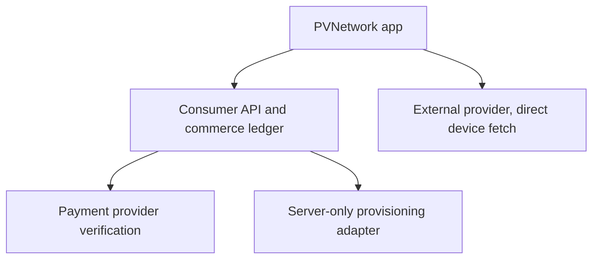
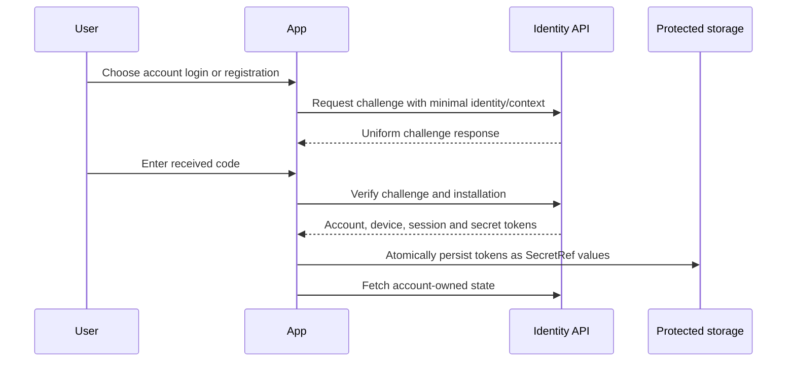
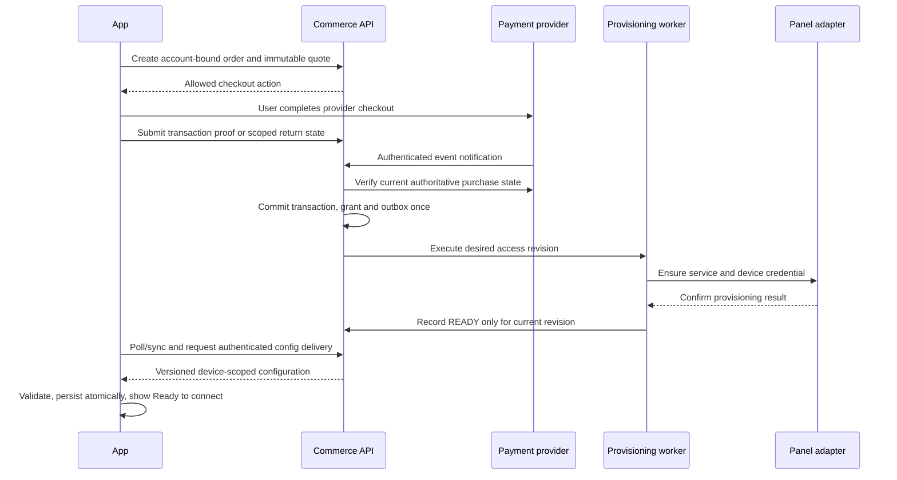

# PVNetwork — Backend, Store & Subscriptions

Date: **2026-11-06** (UTC). Workstream: **CHAT 05**.

Status: **preflight specification; proposed contracts, not a deployed backend**.

| Item | Inspected value |
|---|---|
| Application repository | `DashSaman/PVN-amirrezagol` |
| Application baseline | `78dcd4511dbb830a999cc8c1796f2a38f88587e8` |
| Coordination branch / revision | `docs/preflight-2026-11-06` / `ed21086e3e74772ab4dc31825eb87336f917fd67` |
| Referenced panel source | `DashSaman/PV-NativePanel`, public, `main` at `0527e96100034ed13ca481976234648335551e93` |
| Delivery branch | `prep/2026-11-06/05-backend-commerce`, created from the application baseline above |
| Exclusive changed file | `docs/preflight-2026-11-06/05-backend-commerce.md` |
| Intended PR target | `main`; do not merge as part of this task |
| Evidence boundary | Repository source and official documentation; no production, customer, payment-console or live financial-system access |

## 1. Executive decision

**پیشنهاد اجرایی:** اپ عمومی و استفاده از کانفیگ‌های خارجی رایگان و بدون حساب PVNetwork باقی بماند. خرید سرویس PVNetwork از یک لایهٔ تجاری مستقل عبور کند که پرداخت را سمت سرور تأیید می‌کند، حق دسترسی را ثبت می‌کند و سپس کانفیگ را تحویل می‌دهد. اتصال خارجی نباید به ورود، وضعیت خرید یا دسترس‌پذیری سرور PVNetwork وابسته شود.

**وضعیت واقعی:** مدل‌های اولیهٔ حساب و حق دسترسی در کد اپ وجود دارند؛ وجود این مدل‌ها به‌معنی آماده‌بودن فروشگاه نیست. قراردادهای `/v1/...` این سند همگی **PROPOSED** هستند. هیچ آدرس دامنه، درگاه پرداخت، قیمت، شناسهٔ محصول فروشگاه یا توکن مشتری از روی حدس تعیین نشده است.

### 1.1 Scope and evidence vocabulary

- **OBSERVED:** read in pinned source. This does not establish deployment or safe consumer access.
- **DOCUMENTED:** a historical repository claim, not independently rerun here.
- **VERIFIED:** a specific check actually performed in this preflight, named with its scope.
- **PROPOSED:** a normative design for implementers, subject to the listed product/provider dependencies.
- **UNKNOWN:** no adequate evidence. **BLOCKED:** a dependency prevents the stated integration/release.

The newer coordination contract scopes this work to one report. Older instructions to update shared ledgers, restart protocol research or continue unrelated implementation do not apply to this bounded assignment. Research V1/V2 completion is historical context, not commerce readiness. [R01] [R02]

### 1.2 Recommended architecture and alternatives

| Approach | Benefit | Material problem | Decision |
|---|---|---|---|
| Put the existing panel's operator credentials/API directly in the app | Few apparent integration steps | Exposes control-plane privilege; cannot establish per-customer ownership, Store verification or isolated guest mode | Reject |
| Add a consumer commerce facade with server-only panel adapters | Reuses existing provisioning while owning identity, billing, reconciliation and stable app contracts | Requires an adapter capability audit and a durable ledger | **Recommended engineering proposal** |
| Replace the panel and build a new provisioning platform | Full control | Duplicates existing work and exceeds the preflight/sprint objective | Defer unless adapter evidence proves reuse impossible |

Implement the facade as a **modular backend with one transactional database and durable jobs/outbox first**. Separate deployable microservices are not required. Its proprietary implementation belongs in an approved private product/backend repository; the current repository is public. The final private location is a dependency, not an invented existing directory. [R01] [R03]



External provider credentials do not pass through B. The normal VPN data path is also separate from this commerce/control-plane diagram.

## 2. Repository truth and API inventory

### 2.1 Application evidence

The coordination branch differs from the inspected main by its `START_HERE.md` only. The recursive GitHub tree was non-truncated (1,594 entries). All 35 Kotlin/build/XML files under `apps/` and `core/` were fetched for a bounded source search. No consumer account HTTP client, purchase verifier, billing SDK integration or server route implementation was found in that inspected source set. This is a scoped negative finding, not a statement about every other owner repository.

| Evidence | State | What exists / implication |
|---|---|---|
| `app/PUBLIC_APP_DECISIONS.md`, §9–12 | DOCUMENTED | PVNaive backend is identified as `DashSaman/PV-NativePanel`; identity flow, billing choice, API ownership/session contract and policy URL remain proposed or blocked. [R03] |
| `Account.kt`, lines 9–33 | OBSERVED | `Account` and `AccountSession` exist; access token is a `SecretRef`. No registration, refresh-token family, provider identity or logout implementation. [R04] |
| `DeviceRegistration.kt`, lines 8–23 | OBSERVED | Opaque device ID, timestamps and revoked flag; no server enforcement or service-specific device binding. [R05] |
| `Entitlement.kt`, lines 7–55 | OBSERVED | Only ACTIVE/EXPIRED/REVOKED; no entitlement/service ID, period/revision, grace, pending or freshness. `null` quota means unlimited; `isActiveAt` does not check quota exhaustion. [R06] |
| `AccountContractTest.kt`; `EntitlementContractTest.kt` | OBSERVED test definitions | Tests cover model invariants, not authentication, HTTP, payments or provisioning. They were not executed in this documentation task. [R07] [R07a] |
| `PVProfile.kt`, lines 25–61 | OBSERVED | `origin=SUBSCRIPTION` does not identify whether a source is PVNetwork or external. Add typed ownership metadata; never classify ownership by a hostname or display name. [R08] |
| `SecretStore.kt`, lines 14–28; Android `Storage.kt` | OBSERVED | Existing secret-storage boundary can be reused; app-private profile metadata is separate from protected secret material. No new raw-token field belongs in canonical models. [R09] [R09a] |
| Desktop `SubscriptionSupport.kt`, lines 20–99, 112–155 | OBSERVED | Direct subscription retrieval exists. URL is stored as text in the registry; HTTP is accepted; redirects are followed. Escaping separators is not encryption. Migrate reusable URLs into `SecretStore`, mask display and validate redirects. [R10] |
| Desktop `Main.kt`, lines 164, 188, 822 | OBSERVED | Absolute “no data collected / secrets encrypted” copy and full URL rendering require correction when commercial data handling is introduced. Coordinate text/UX with CHAT 04; do not modify its files here. [R11] |
| `docs/M-P2_PUBLIC_APPS_VALIDATION.md` | DOCUMENTED | Historical Android/Windows build evidence; explicitly no physical Android validation or Store readiness. Its older “no subscription URLs” statement is superseded by the newer desktop source above. [R12] |
| Agent State Validation run `42265814098` at inspected main | VERIFIED metadata read | GitHub reports success for the research-state workflow. This is not a backend, payment, device or Store test. [R13] |

### 2.2 Referenced panel and real routes

**OBSERVED:** `DashSaman/PV-NativePanel` is accessible and public. Its inspected main commit is `0527e96100034ed13ca481976234648335551e93`; the Git commit identifies tree `4acaafbe131773fd3e8c9e70ddb2a4ef3692b741`. The bounded inventory contains 808 tree entries. The following claims come from route registration, handler selection and request/response structs at that pin. No live service was called; deployed host, deployed revision and runtime behavior remain UNKNOWN.

The useful existing surface is a **staff/reseller provisioning panel**, with token-based subscription delivery. It is not the proposed consumer storefront facade. In particular, route declarations and `Ready` flags alone are insufficient: `server.go` starts with a 501 handler, conditionally binds real handlers, then applies customer-handler overrides. [B01] [B02] [B05] [B16]

| Capability | Real source route / wire shape | Audience and integration limit |
|---|---|---|
| Login | `POST /api/v1/auth/login`; JSON fields `email`, `password`, `totp_code`; success has `status`, `actor_id`, `role`, `expires_at`, `absolute_expires_at`, plus session/CSRF cookies | Supported roles are owner/admin/operator/auditor/reseller. No consumer role or Register route in the inspected catalog. This is not the email-OTP/bearer flow proposed in §5. [B02] `login`, lines 269–300; [B03] lines 12–31 |
| Logout / refresh / current principal | `POST /api/v1/auth/logout`, `POST /api/v1/auth/refresh`, `GET /api/v1/me`; logout returns `status:logged_out`; refresh returns status and expiry fields; `/me` returns `principal` | Secure HttpOnly SameSite Strict session cookie; unsafe methods require CSRF cookie/header and origin validation. Refresh is labeled Public in the route catalog but still requires session cookie/CSRF in its handler. No consumer mobile refresh-token JSON contract is established. [B03] lines 33–93; [B04] lines 16–37, 79–125 |
| Operational plans | `GET /api/v1/plans`, `POST /api/v1/plans`; GET wraps `plans`; `PlanPreset` contains name, quota bytes, validity, start/reset policies, concurrency/IP limits, groups/tags, enabled state and sort order | GET owner/admin/reseller; POST owner/admin. The DTO/create handler has no sale price/currency, Store SKU, offer or order fields. It is a service preset, not a ready retail catalog. [B01] lines 78–79; [B06] lines 228–305; [B07] lines 25–41 |
| Privileged provisioning | `POST /api/v1/users`; owner-only `/api/v1/customers` surface also exists. Input includes username, optional password/generation, plan, quota/unlimited, validity, groups/tags, hold. Create requires `Idempotency-Key`; response includes user, service term, runtime credential, usage capability, subscription path and possibly generated password | Panel session/CSRF and operator role required. Credential-bearing result must stay inside a protected adapter; no purchase receipt is validated by this operation. [B01] lines 44–58; [B05] lines 9–14; [B06] lines 110–149; [B14] lines 15–47 |
| Operational renew | `POST /api/v1/users/{id}/renew`; modes `renew_current`, `renew_plan`, `custom`, `next_plan`, optional plan/quota/validity; response wraps `renewal` | Owner/admin/reseller. Creates a new service term, rebinds the existing runtime credential and projects the subscription; result explicitly reports no credential rotation/subscription reissue. The inspected HTTP handler does **not** require an idempotency key. This cannot be called blindly after a payment retry. [B06] lines 203–225; [B08] lines 14–33, 68–136 |
| Volume / time / lifecycle | Customer/user service update, `volume/add`, `validity/extend`, suspend/resume/revoke and subscription/password rotation routes have mapped handlers | Administrative primitives, not checkout, refund or verified entitlement operations. The facade must supply ownership, economic-event dedupe and desired-state reconciliation. Reset/renew mapping requires an explicit period policy. [B01] lines 44–71; [B05] lines 16–41 |
| Subscription delivery | `GET /sub/{token}`, `/s/{token}`, `/api/v1/subscriptions/{token}` and `/api/v1/subscriptions/{token}/info`; info includes username/status/available, quota/expiry/start policy, `usage_available`, subscription/account URLs, and conditional `direct_uri` | Possession of the token is authorization. These URLs and returned URI are credentials; no customer token belongs in this report. Path/content negotiation distinguishes account page from machine payload. This can support an explicit local subscription import, but does not establish ownership of a retail purchase. [B09] lines 12–75; [B10] lines 17–85 |
| Usage | Subscription-info optionally adds `used_bytes`, `remaining_bytes` and display labels after successful accounting composition | Omitted/unavailable accounting is UNKNOWN, not zero/unlimited. **`GET /api/v1/subscriptions/{token}/usage` is declared but has no matching handler binding in the inspected dispatcher/overrides; source control flow leaves it at 501 `not_implemented`.** This is a source deduction, not a captured HTTP response. [B01] line 33; [B02] `NewServer`, `notImplemented`; [B05]; [B09] lines 66–105 |
| Connection sessions | `GET /api/v1/users/{id}/sessions`, `DELETE /api/v1/users/{id}/sessions/{sessionId}`; list returns sessions and observation time; delete calls a configured session controller | Owner/admin/reseller. The list uses a 90-second stale threshold; controller absence/failure returns 503. Connection-session handling is not installation registration, hardware identity or proof of per-device credential enforcement. [B01] lines 70–71; [B11] lines 11–108 |
| OpenAPI inventory | Source implements `GET /api/v1/openapi.json`, OpenAPI 3.1, selected ready-route inventory and cookie security metadata | Generic 200 descriptions without concrete request/error/response schemas; not a sufficient versioned consumer API specification. The generator is source evidence, not a fetched live spec. [B12] lines 16–68 |

**Specific adapter caveats:**

- `GET /plans` hardcodes `reset_enforcement_available:false`, while the customer package declares `PeriodicResetEnforcementAvailable=true`. Resolve the contradictory capability signal and prove actual period/node behavior before advertising quota reset. [B06] lines 228–239; [B07] line 14.
- Panel parameters named `quota_gb` are not automatically this report's decimal-GB fixture: the customer package defines a GiB constant of `1073741824`. The adapter must verify the exact conversion function used by each chosen mutation, preserve byte-level values and reject unrepresentable terms rather than silently rounding. [B07] line 10.
- The proposed prepaid rule preserves the running period and schedules a non-overlapping renewal. Existing panel renewal creates/rebinds a new term; equivalence to that business rule is **not** established. Test start policy, remaining usage, late meter events and retries before mapping it. [B08]
- `FEATURE_MATRIX.md` and `docs/API_FA.md` contain older readiness/bug claims that differ from current handlers. For example, session/OpenAPI handlers and buffered commit-before-success logic now exist in source. Record these as freshness conflicts; neither an older document nor a newer handler proves deployment or a security fix by itself. [B02] `finalize`, lines 464–471; [B11] [B12] [B13] [B15]
- Pool-aware subscription rendering is present, but no live retail mapping for net-melli, CIP, pool availability/prices or the proposed 15-minute per-device lease was verified. Distinct product facets in §3 remain proposals. [B10] `fleetSubscriptionNodes`, lines 91–161.

**Not established by the inspected catalog and handler set:** consumer Register, retail Purchase/orders/checkout, Google/Apple receipt verification, commerce Entitlement/Sync, consumer support tickets, Store refund webhooks, persistent consumer-device identity, or an account-to-purchase migration contract. These are gaps in the available integration evidence, not a claim that no private implementation exists anywhere. Keep the app plan's backend/billing dependency blocked until a staging contract and its ownership are supplied. [B01] [B05] [B16] [R03]

### 2.3 Source-supported integration conclusion

Use any verified panel endpoints only behind a least-privilege adapter and only after staging proves their behavior. Do not reuse a panel admin login as a consumer login. Do not infer a public shopping API from an operator CRUD route, a documentation example, or a subscription-download URL. Public consumer base URL, production deployment revision, supported payment gateway, Store product mappings, webhooks, customer-migration mechanism and customer ownership model must each be evidenced separately.

## 3. Product and ownership model

### 3.1 Three independent concepts

1. **External subscription source:** a locally stored URL/file/QR import from another provider. It is not a PVNetwork purchase or entitlement.
2. **Commercial subscription:** the billing relationship and renewal lifecycle for a PVNetwork service. Store-managed recurring subscriptions and prepaid fixed-term purchases have different rules.
3. **Config delivery:** a versioned set of credentials/profiles for a purchased service, applied locally. Delivered configuration is not proof of tunnel connectivity.

Never call all three `Subscription` in shared interfaces. Use `ExternalSubscriptionSource`, `CommercialSubscription` and `ConfigDelivery` respectively.

### 3.2 Composable product attributes

These are **PROPOSED catalog semantics** derived from the requested product scope, not an observed live catalog or a claim that every combination is available.

| Product attribute | Values | Meaning |
|---|---|---|
| `connectivity_class` | `STANDARD`, `DOMESTIC_CONTINGENCY` | Regular service or an explicitly described net-melli access design |
| `location_mode` | `SINGLE`, `MULTI` | One permitted location pool or a selectable group |
| `service_tier` | `STANDARD`, `CIP` | Normal pool or an operator-defined priority pool/policy |
| `location_pool_ids` | Nonempty opaque IDs | Real provisionable pools; country is descriptive metadata, not an identity |
| `preferred_pool_id` | Optional member of the same list | Preferred route/pool, including a separately identified CIP pool |
| `quality_policy_id` | Optional versioned server policy | Only present when enforced and measurable; never infer bandwidth/SLA from the word CIP |
| `protocol_capability_ids` | Exact release-gated capability IDs | Coordinates with CHAT 03; a catalog entry cannot claim an unverified engine/platform combination |

| User-facing family | Attribute example |
|---|---|
| سرویس معمولی | `STANDARD + SINGLE + STANDARD` |
| نت ملی | `DOMESTIC_CONTINGENCY + SINGLE + STANDARD` |
| مولتی‌لوکیشن | `STANDARD + MULTI + STANDARD` |
| نت ملی مولتی‌لوکیشن | `DOMESTIC_CONTINGENCY + MULTI + STANDARD` |
| نت ملی CIP مولتی‌لوکیشن | `DOMESTIC_CONTINGENCY + MULTI + CIP` |

Two pools can both have country `US` while one is a normal pool and the other is CIP. They must have different IDs; flag/country matching must not collapse them. The exact locations, quotas, prices and priority policy await the real panel catalog. No availability during a national connectivity restriction, 24-hour infrastructure guarantee or minimum speed is implied by these attributes.

### 3.3 Guest mode is a product boundary

- First launch offers **Import / Continue without account**. External import, local profile management, connection, latency testing and provider refresh have no PVNetwork login or paid-entitlement prerequisite.
- No automatic guest account, cloud profile inventory, device registration, PVNetwork sync request, telemetry ID or external-profile upload is created by using guest mode.
- External refresh goes directly from the device to the user-selected provider. The provider necessarily sees that request; the app must not claim that no network party can see it.
- Opening the PVNetwork catalog/help or deliberately submitting a support request is a separate network action. It never attaches external profile data. General app updates may use normal distribution mechanisms.
- Logging in or out, deleting a PVNetwork account, service expiry, refund or backend outage must leave external profiles and their secrets intact. Disconnect only the PVNetwork-owned session/binding affected by revocation.
- A single installation may contain PVNetwork-owned and external profiles simultaneously. Namespace IDs and storage ownership; a server tombstone can delete only a PVNetwork-owned entity.
- Optional cross-device cloud backup of external profiles is **out of scope and disabled**, including on sign-in. A future end-to-end encryption design requires its own explicit decision and privacy review.

## 4. Data Models — proposed persistence and wire semantics

### 4.1 Persistence entities

All tables below are **PROPOSED**. PK means primary key, FK means foreign key, UQ means unique constraint. Account ownership must be enforced in queries, not merely in UI routes.

| Entity | Required fields / keys | Invariants and purpose |
|---|---|---|
| `User` | `user_id PK`, `status`, `created_at`, `deleted_at?` | Human identity; no VPN credentials, payment secrets or hardware identifiers |
| `AuthIdentity` | `identity_id PK`, `user_id FK`, `kind`, protected `subject`, `verified_at`; UQ(kind, normalized subject) | Email OTP is the proposed initial method. Normalization must not merge distinct mailbox local parts or use Gmail-specific dot rules globally |
| `Account` | `account_id PK`, `status`, `created_at` | Commercial ownership; one personal account per verified user initially |
| `AccountMembership` | `(account_id,user_id) UQ`, `role=OWNER` | Future household/team support is not enabled by this schema alone |
| `AuthSession` | `session_id PK`, `account_id FK`, `device_id FK`, hashed access/refresh values, `family_id`, `auth_time`, expiries, `revoked_at?` | Rotating refresh family; token values never enter audit/logging tables |
| `Device` | `device_id PK`, `account_id FK`, random `installation_id`, platform, optional user label, timestamps, status; UQ(account_id, installation_id) | No IMEI, MAC, Android advertising ID or cross-account fingerprint |
| `Product` | `product_id PK`, facets from §3.2, public descriptions, `status` | Defines a service family; does not store a customer's purchase |
| `PlanVersion` | `(plan_id,revision) PK`, `product_id FK`, exact quota/period/device/pool/renewal terms | Immutable once quoted; new terms require a new revision |
| `Offer` | `offer_id PK`, plan revision FK, `provider`, channel, Store product/base-plan/offer mapping or gateway price, availability, policy revision | A purchasable SKU for a channel; unknown mappings mean unavailable, not placeholder sale |
| `Order` | `order_id PK`, `account_id FK`, immutable offer/price/terms snapshot, `client_purchase_id`, intent NEW/RENEW, target service?, payment and fulfillment state; UQ(account_id, client_purchase_id) | One commercial intent. No client-supplied final price, quota, expiry or paid flag |
| `PaymentAttempt` | `attempt_id PK`, order FK, provider, environment, merchant scope, protected provider reference, status | Multiple attempts may exist after conclusive failure; an ambiguous attempt must be reconciled before another checkout |
| `CommercialSubscription` | `subscription_id PK`, account FK, provider/environment, protected stable purchase-chain reference, auto-renew flag, provider lifecycle state, paid/grace boundaries | Distinct from the local external-subscription URL; one provider chain belongs to exactly one account |
| `PaymentTransaction` | `transaction_id PK`, subscription/order FK, immutable `assigned_service_id FK`, unique provider economic-event key, reported price/source, settled amount/currency nullable with explicit reconciliation state, verified state, effective dates, verification time | One economic event funds one service in v1; relationally enforce the same service on its grants. Do not fabricate settled money from catalog price. Hosted-gateway grants require verified exact amount/currency; Store settlement reporting may remain pending. A renewal is a new economic event even when its Google token is unchanged |
| `EntitlementGrant` | `grant_id PK`, service FK, transaction FK, period/effective range, granted quota/features, revoked_at?; UQ(transaction_id, grant_kind) | Append-only grant/reversal audit; FK must match transaction.assigned_service_id. Changing a service ID cannot duplicate a benefit. Future multi-service bundles need an explicit conserved allocation model |
| `ServiceInstance` | `service_id PK`, account FK, plan revision FK, provisioning state, backend reference, active period | A customer's actual provisioned service; many customers can buy the same plan |
| `EntitlementProjection` | `entitlement_id PK`, service FK, current state, access decision/reason, time/quota/device/pool policy, monotonic revision, observed_at | Server-computed projection; not editable by the client |
| `UsagePeriod` | `period_id PK`, service FK, starts_at, ends_at, limit kind/value, reset policy, status | Shared across included locations unless a clearly priced plan says otherwise |
| `MeterEvent` | PK(source_id, source_epoch, sequence), service/period FK, byte delta, recorded_at, source_observed_at | Authenticated source; deduplicated accounting, bounded corrections and counter-reset handling |
| `ServiceDeviceBinding` | `(service_id,device_id) UQ`, credential reference/version, revoked_at?, lease expiry | Separate registered-device limit from concurrent tunnel sessions; node-side enforcement is mandatory |
| `ConfigRevision` / `ConfigDelivery` | service FK, revision, device FK, secure payload reference, digest, expires_at, applied/rejected state | Config payload is secret. App acknowledges local application separately from server provisioning |
| `ProviderEventInbox` | UQ(provider,environment,merchant_scope,event_id), received_at, verification state, protected payload reference | Durable receipt before acknowledging webhooks; not a grant table |
| `OutboxJob` | job_id PK, aggregate/version, operation key UQ, attempts, next_attempt_at, result | Atomic with ledger changes; retries produce one effect even if delivery is repeated |
| `RefundCase` | refund_id PK, transaction FK, amount, reason, provider status, disposition, decision audit | Refund pending is not the same as refunded; no false “money returned” UI |
| `SupportTicket` | ticket_id PK, account FK nullable, optional protected reply email, category, sanitized message/diagnostics, related own order/service IDs | No unsolicited external configuration collection or raw attachment upload |
| `DeletionRequest` | request_id PK, account FK, status, requested/completed times, retention policy ref | Revokes identity/device access; retains only explicitly justified minimal financial/tombstone records |

### 4.2 Money, quota, time and renewal invariants

- **Money:** ISO currency code + nonnegative integer minor units encoded as a decimal JSON string; never a binary float. Gateway currency semantics must be confirmed. If settlement is IRR and the UI displays toman, apply the explicit 10:1 display conversion and label both; never send an ambiguous `amount` in “toman”. Store prices displayed to users come from the Store product SDK; an unmapped or mismatching offer cannot be purchased.
- **Provider monetary units:** adapters preserve original units/source and convert explicitly; Apple's signed transaction price is expressed in thousandths of the currency unit, not this API's minor-unit amount. Google recurring plan price is not automatically a tax-inclusive settled charge. Unavailable settlement data stays UNKNOWN until provider financial reconciliation; it must not be invented from the UI price. [S05] [S09a]
- **Bytes:** nonnegative 64-bit integer represented as a decimal JSON string. UI must state decimal GB or binary GiB consistently. A decimal 20 GB fixture means `20000000000` bytes, not a live package. Upload/download accounting direction is a plan/server policy, never guessed from client traffic.
- **Unknown is not unlimited:** quota is a discriminated union: METERED, UNLIMITED or UNKNOWN. Missing usage is UNKNOWN, not zero. Expiry is FINITE, NEVER or UNKNOWN. `null` in a legacy response is insufficient to decide which; adapters must use documented provider semantics.
- **Time:** RFC 3339 UTC timestamps ending in `Z`; validity is `[starts_at, expires_at)`. At the exact expiry boundary, paid access ends unless a verified provider grace boundary or a newer grant applies. Client wall-clock changes cannot mint access.
- **Versioning:** plan revisions and financial snapshots are immutable. Entitlement/config revisions are monotonic per service; tombstones prevent an old sync response from resurrecting revoked access.
- **Renewal:** fixed-term direct prepaid renewal schedules a new non-overlapping period at `max(current_expires_at, verified_paid_at)` by default, preserving the running period's remaining quota. This is a proposal to ratify, not existing business behavior. No automatic carry-over, immediate quota reset or top-up is implied. A separately priced top-up/upgrade requires an explicit offer and settlement policy.
- **Store-managed renewal:** provider-verified billing periods and replacement rules win; do not calculate a new month by adding 30 days or treating a Store management action as a purchase. Automatic renewal notifications create/dedupe their own economic events without a new app order.
- **Cancellation:** disabling future renewal does not revoke the already-paid period. Refund, revoke, account hold, grace, expiry and cancellation are separate states.
- **Multi-location quota:** count authenticated usage at one nominated accounting boundary for each service. Do not add local TUN totals, panel totals and node totals together. Dedupe repeated meter events; an epoch change/counter decrease is not negative usage or free quota. Late events update their original period, not the next one. Unknown/stale readings retain a visible timestamp and do not invent renewed access.

### 4.3 Migration from the existing canonical models

Preserve `SecretRef` and the existing model packages. Add explicit `UserId`, `AccountId`, `ServiceId`, `EntitlementId`, provider ownership, freshness and period types. Add refresh-token references/session ID to the account repository's protected session boundary, not to UI state. Add a new versioned entitlement snapshot with explicit unknown/unlimited/time states before connecting a network parser to `Entitlement.kt`.

Do not map missing server quota to the existing `trafficQuotaBytes=null` because that currently yields `hasUnlimitedTraffic=true`. Do not use `isActiveAt()` alone to authorize a metered connection. Preserve existing tests as compatibility evidence and add behavioral cases for exhausted quota, unknown values, revoked device, grace, clock skew and out-of-order revisions. [R04] [R05] [R06] [R07]

For local sources, add `owner_kind=PVNETWORK|EXTERNAL|LOCAL_MANUAL`, `account_id?`, `service_id?`, `source_id`, `config_version?`, and `url_secret_ref?` to a typed source/binding model. Do not overload `PVProfile.extensions` with an unvalidated account authorization claim. Migrate the desktop plaintext URL once into protected storage, atomically replace the registry with references, remove the old secret-bearing registry/backups where controlled, and preserve external profiles on rollback. [R08] [R10]

## 5. API Specification — PROPOSED consumer contract v1

**Every route in this section is proposed. None is represented as an existing PVNetwork/PVNaive endpoint.** Production base URL is UNKNOWN. `https://commerce.pvnetwork.invalid` is reserved for documentation and must not be configured as a working service. Mocks use an in-process transport and never call a production hostname.

### 5.1 Common rules

- HTTPS only. JSON UTF-8. Public API version `/v1`; internal provider/admin routes use a separate authenticated boundary and are never app endpoints.
- JSON object properties are required unless marked `?` in the type notation below. Requests reject unknown fields. Responses may add non-security fields; unknown state/discriminator values map to UNKNOWN/unavailable rather than ACTIVE.
- `Id`: opaque ASCII string, 1–96 characters, pattern `[A-Za-z0-9_:-]+`; it is not an authorization credential. `Decimal`: `0` or a nonzero decimal digit followed by digits, at most signed-64-bit maximum for bytes/money. `Time`: RFC 3339 UTC `Z`. `Revision`: positive decimal string; server compares numerically.
- `limit` defaults to 20 and is 1–100; cursors are opaque and bound to account, filter, snapshot and endpoint. An absent field is not interchangeable with a null field.
- Authenticated routes infer account from the bearer session; there is no caller-selected `account_id` authorization shortcut. Foreign/missing resource IDs return the same `404 RESOURCE_NOT_FOUND`.
- Every response includes a non-secret request ID. Successful JSON responses are `Envelope<T>` except `204`; errors are `Problem`. Tokens, receipts, config payloads and personal responses use `Cache-Control: no-store`; suppress HTTP-client/body/access logging. Application-controlled protected persistence is explicitly separate from intermediary HTTP caching.
- `Idempotency-Key` is required for marked mutations: random 16–128 ASCII characters, stable per logical request, never containing account email or tokens. Scope it to authenticated account + operation (or pre-auth installation/challenge for auth). Same key and semantic body returns the original status/body and operation ID; a changed body returns `409 IDEMPOTENCY_KEY_REUSED`. Current status comes from GET, not the replayed receipt.
- Non-auth mutation replay records live at least seven days; durable transaction/grant uniqueness and `client_purchase_id` tombstones outlive this HTTP window under the approved retention policy. Auth operations are exceptions: challenge creation can replay only its existing unexpired challenge; verify/refresh may recover secret responses only under the 60-second rules in §6 and must recheck current session/device/account revocation. No seven-day token-bearing response cache is permitted. Completed logout may replay its non-secret 204 result using the previously authenticated operation identity.
- Authorization-lease replay is also bounded by its original expiry and current device/account revocation. Delete cached signed values at expiry while retaining a non-secret idempotency tombstone; the old key then returns `410 AUTHORIZATION_LEASE_EXPIRED`. Renewal uses a new logical request/key and never extends an old signed value through replay.
- Maximum JSON request body: 64 KiB, payment-proof requests 256 KiB, at most 20 proofs per restore. Configuration payloads use the dedicated delivery route with a 2 MiB decompressed ceiling. These are proposed bounds; changes require a contract revision.
- `ClientContext.distribution`, language, IP address and a client-supplied country are hints, not permission to bypass Store policy. A release's compiled billing capabilities intersect with server-approved policy. Unknown storefront/program eligibility disables regional external-payment features.

```typescript
// Normative transport notation inside this report; not shipped code.
type Id = string;
type Decimal = string;
type Revision = string;
type Time = string;
type Platform = "ANDROID" | "IOS" | "WINDOWS" | "MACOS" | "LINUX";
type Distribution = "PLAY" | "APP_STORE" | "DIRECT";
type Provider = "GOOGLE_PLAY" | "APPLE" | "WEB_GATEWAY";
type Envelope<T> = {
  data: T;
  meta: { request_id: Id; server_time: Time; contract_version: "1" };
};
type Page<T> = { items: T[]; next_cursor: string | null; snapshot_id: Id };
type Problem = {
  type: "about:blank";
  title: string;
  status: number;
  code: string; // Closed registry in section 9; never raw upstream text.
  request_id: Id;
  retryable: boolean;
  retry_after_seconds?: number;
  field_errors?: { field: string; code: string }[]; // Never submitted values.
};
type ClientContext = {
  platform: Platform;
  distribution: Distribution;
  app_version: string; // 1..32 characters.
  locale: "fa-IR" | "en-US";
};
type UserView = { user_id: Id; email: string; email_verified: boolean };
type AccountView = { account_id: Id; status: "ACTIVE" | "SUSPENDED" | "DELETING" };
type DeviceView = {
  device_id: Id;
  platform: Platform;
  label: string | null;
  registered_at: Time;
  last_seen_at: Time | null;
  state: "ACTIVE" | "REVOKING" | "REVOKED";
};
type Challenge = {
  challenge_id: Id;
  expires_at: Time;
  resend_after: Time;
  delivery: "EMAIL";
};
type RegisterRequest = {
  email: string; // Valid email, max 254 characters; no provider-specific rewriting.
  accepted_terms_version: Id;
  acknowledged_privacy_version: Id;
  client: ClientContext;
};
type LoginRequest = { email: string; client: ClientContext };
type VerifyChallengeRequest = {
  code: string; // Exactly six ASCII digits; not a stored password.
  installation_id: Id; // Random per installation, not a hardware identifier.
  device_label?: string; // 1..80 characters after validation.
};
type SessionResult = {
  user: UserView;
  account: AccountView;
  device: DeviceView;
  session_id: Id;
  token_type: "Bearer";
  access_token: string; // Secret transport field; immediately store as SecretRef.
  expires_in: 600;
  refresh_token: string; // Secret; never canonical/UI state.
  refresh_expires_at: Time;
  authenticated_at: Time;
};
type RefreshRequest = { session_id: Id; refresh_token: string };
type LogoutRequest = { scope: "CURRENT_SESSION" | "ALL_SESSIONS" };
type DeviceRegisterRequest = {
  installation_id: Id; platform: Platform; label?: string;
};
type Operation = {
  operation_id: Id;
  state: "PENDING" | "RUNNING" | "SUCCEEDED" | "FAILED" | "NEEDS_REVIEW";
  result_resource: {
    kind: "ORDER" | "CONFIG_DELIVERY" | "RESTORE" | "DEVICE";
    id: Id;
    path: string; // Corresponding GET route below; never a secret URL.
  } | null;
  error_code: string | null;
  retry_after_seconds: number | null;
};
```

### 5.2 Authentication and device operations

`A` means bearer session required; `G` means guest permitted; `I` means idempotency key required. Sensitive account operations require `authenticated_at` within five minutes; refreshing a token does not reset this time.

| Operation / proposed route | Auth | Exact request | Success | Main behavior/errors |
|---|---|---|---|---|
| Register: `POST /v1/auth/register` | G, I | `RegisterRequest` | `202 Envelope<Challenge>` | Published legal-version IDs required. No account until OTP proves ownership. Same response shape/timing for an existing address; successful verification signs into that verified identity without creating a duplicate account |
| Login: `POST /v1/auth/login` | G, I | `LoginRequest` | `202 Envelope<Challenge>` | Uniform response for unknown/existing email. No registration side effect. Rate-limit delivery independently from HTTP idempotency |
| Verify: `POST /v1/auth/challenges/{challenge_id}/verify` | G, I | `VerifyChallengeRequest` | `200 Envelope<SessionResult>` | Consume challenge atomically; create/reuse the installation registration. Failure `401 OTP_INVALID_OR_EXPIRED`; attempt cap produces `429 AUTH_RATE_LIMITED` |
| Refresh: `POST /v1/auth/refresh` | refresh secret, I | `RefreshRequest` | `200 Envelope<SessionResult>` | Atomic rotation; checks session, account and device revocation; replay semantics §6. `401 SESSION_REVOKED/REFRESH_REPLAY` |
| Logout: `POST /v1/auth/logout` | A, I | `LogoutRequest` | `204` | Revoke current session or all sessions. ALL requires recent authentication. Repeated completed logout with that operation's valid replay proof returns 204; unrelated invalid bearer returns 401 |
| Current identity: `GET /v1/me` | A | No body | `200 Envelope<{user:UserView;account:AccountView;device:DeviceView}>` | Never includes refresh tokens, panel credentials or payment proof |
| List devices: `GET /v1/devices` | A | Optional `cursor`, `limit` | `200 Envelope<Page<DeviceView>>` | Account-owned registrations only |
| Device detail: `GET /v1/devices/{device_id}` | A | No body | `200 Envelope<DeviceView>` | Owned resource for a completed revoke operation; no credential material |
| Register device: `POST /v1/devices` | A, I | `DeviceRegisterRequest` | `201 Envelope<DeviceView>` | UQ(account,installation). Existing registration returns `200` with same ID. Identity registration is not a paid service-device allocation |
| Revoke device: `POST /v1/devices/{device_id}/revoke` | A, I, recent auth | Empty object | `202 Envelope<Operation>` | Revoke its sessions immediately; queue all its PVNetwork credential/session invalidations. Foreign ID 404; no silent eviction of another device |
| Operation status: `GET /v1/operations/{operation_id}` | A | No body | `200 Envelope<Operation>` | Owner scoped; includes reconciliation jobs, not provider secrets |

An authenticated device can have no paid service. Service device limits are checked atomically at config binding/activation, not at guest import or account login. A user at the service limit receives `409 DEVICE_LIMIT_REACHED` and can explicitly revoke a named owned device.

### 5.3 Catalog, purchase and renew contracts

```typescript
type Money = { currency: string; amount_minor: Decimal };
type ProductFacets = {
  connectivity_class: "STANDARD" | "DOMESTIC_CONTINGENCY";
  location_mode: "SINGLE" | "MULTI";
  service_tier: "STANDARD" | "CIP";
  location_pool_ids: Id[];
  preferred_pool_id: Id | null;
  quality_policy_id: Id | null;
};
type QuotaTerms =
  | { kind: "METERED"; limit_bytes: Decimal; accounting: "UPLOAD_PLUS_DOWNLOAD" }
  | { kind: "UNLIMITED"; accounting: "UPLOAD_PLUS_DOWNLOAD" };
type Term =
  | { kind: "FIXED_SECONDS"; duration_seconds: number; starts_on: "VERIFIED_PAYMENT" }
  | { kind: "PROVIDER_PERIOD"; provider_period_label: string };
type Offer = {
  offer_id: Id; revision: Revision; plan_id: Id; plan_revision: Revision;
  product_id: Id; title: string; facets: ProductFacets;
  quota: QuotaTerms; term: Term;
  renewal_kind: "PREPAID" | "AUTO_RENEWING";
  exclusive_group_id: Id;
  max_registered_devices: number; max_concurrent_sessions: number;
  terms_version: Id; protocol_capability_ids: Id[];
  provider: Provider;
  purchase_enabled: boolean; disabled_reason: string | null;
  direct_price: Money | null;
  store_product_id: string | null;
  store_base_plan_id: string | null;
  store_offer_id: string | null;
};
type BillingContext = {
  billing_context_id: Id; policy_revision: Revision; expires_at: Time;
  allowed_providers: Provider[];
  policy_mode: "DISABLED" | "CONSUMPTION_ONLY" | "NATIVE_ONLY"
    | "DIRECT_CHECKOUT" | "APPROVED_REGIONAL_PROGRAM";
  program_id: Id | null; // Owned policy-registry ID, not a client-selected exception.
  storefront_scope_id: Id | null;
  provider_combination: "NONE" | "NATIVE_ONLY" | "EXTERNAL_ONLY" | "NATIVE_AND_EXTERNAL";
  required_disclosure_id: Id | null;
  reporting_policy_id: Id | null;
  combination_committed_until: Time | null;
};
type PlansResult = Page<Offer> & { billing_context: BillingContext };
type CreateOrderRequest = {
  offer_id: Id; offer_revision: Revision;
  billing_context_id: Id; client_purchase_id: Id;
};
type RenewRequest = CreateOrderRequest & { expected_entitlement_revision: Revision };
type CheckoutAction =
  | { kind: "NONE" }
  | { kind: "GOOGLE_PLAY"; product_id: string; base_plan_id: string;
      offer_id: string | null; obfuscated_account_id: string }
  | { kind: "APPLE"; product_id: string; app_account_token: string } // UUID.
  | { kind: "HOSTED_GATEWAY"; https_url: string; expires_at: Time;
      return_state: string }; // Secret scoped state, never entitlement proof.
type OrderView = {
  order_id: Id; client_purchase_id: Id; intent: "NEW" | "RENEW";
  service_id: Id | null; offer_id: Id; offer_revision: Revision;
  payment_state: "AWAITING_PAYMENT" | "PENDING" | "VERIFYING" | "VERIFIED"
    | "DECLINED" | "REFUND_PENDING" | "REFUNDED" | "PARTIALLY_REFUNDED" | "REVERSED";
  fulfillment_state: "NOT_STARTED" | "QUEUED" | "PROVISIONING" | "READY"
    | "RETRYING" | "NEEDS_REVIEW" | "REVOKED";
  quoted_price: Money | null; // Null for Store-native quote; Store SDK owns display.
  terms_version: Id; checkout_expires_at: Time;
  checkout_action: CheckoutAction;
  entitlement_id: Id | null; config_version: Revision | null;
  retry_after_seconds: number | null; next_action: string;
};
type StoreProof =
  | { provider: "GOOGLE_PLAY"; purchase_token: string }
  | { provider: "APPLE"; signed_transaction: string };
type ConfirmPaymentRequest = StoreProof
  | { provider: "WEB_GATEWAY"; return_state: string };
type RestoreRequest = {
  provider: "GOOGLE_PLAY" | "APPLE";
  client_restore_id: Id; proofs: StoreProof[]; // 1..20, all matching provider.
};
type RestoreResult = {
  restore_id: Id; client_restore_id: Id;
  state: "PROCESSING" | "COMPLETE";
  items: {
    proof_index: number; // Original zero-based index; never the proof itself.
    state: "PENDING" | "RESTORED" | "ALREADY_PRESENT" | "REJECTED" | "NEEDS_REVIEW";
    service_id: Id | null; // Only a service owned by this account.
    entitlement_id: Id | null;
    error_code: string | null;
  }[];
};
```

`WEB_GATEWAY` is a placeholder **interface category**, not a selected vendor. `app_account_token` is an account-bound UUID unrelated to email or VPN credentials. `obfuscated_account_id` is generated by the backend from a nonreversible, namespaced account mapping. Neither is a bearer token. The client obtains Google offer tokens from current Store SDK product details; a string from an untrusted backend response must not substitute for that SDK result.

| Operation / proposed route | Auth | Exact request | Success | Main behavior/errors |
|---|---|---|---|---|
| List Plans: `GET /v1/plans` | G | `platform`, `distribution`, `locale`; optional `cursor`, `limit` | `200 Envelope<PlansResult>` | Hints validated against deployed build policy. Context lifetime 10 min. Missing legal/SKU/provider setup returns unavailable offers, never a payable placeholder |
| Purchase: `POST /v1/orders` | A, I | `CreateOrderRequest` | `201 Envelope<OrderView>` | Server snapshots offer/terms, ownership and provider context; checks current sale availability. `409 OFFER_CHANGED/ALREADY_ENTITLED/PURCHASE_IN_PROGRESS`; `403 PURCHASE_CHANNEL_NOT_ALLOWED` |
| Order status: `GET /v1/orders/{order_id}` | A | No body | `200 Envelope<OrderView>` | Current authoritative payment and provisioning states, separately |
| Submit proof/return: `POST /v1/orders/{order_id}/payment-confirmations` | A, I | `ConfirmPaymentRequest` | `202 Envelope<Operation>` | Persists proof securely for server verification. Returning from a browser or client SDK success cannot directly set VERIFIED |
| Renew: `POST /v1/services/{service_id}/renewals` | A, I | `RenewRequest` | `201 Envelope<OrderView>` | Same payment pipeline; service remains unchanged before verified grant. Concurrent revision mismatch `409 REVISION_CONFLICT`. Already auto-renewing service: `409 STORE_MANAGED_RENEWAL`, with native manage-subscription UI action |
| Restore: `POST /v1/billing/restores` | A, I | `RestoreRequest` | `202 Envelope<Operation>` | All proofs must match the declared provider. Verify account binding, current status and grants; never create a new charge or reset quota. `409 PURCHASE_ACCOUNT_CONFLICT/OWNERSHIP_RECOVERY_REQUIRED` |
| Restore result: `GET /v1/billing/restores/{restore_id}` | A | No body | `200 Envelope<RestoreResult>` | One indexed result per submitted proof. Verification/grant is atomic per proof; one rejected item does not roll back another valid restored purchase. Foreign purchase IDs/details never appear |

Purchase requires a verified PVNetwork account; guest use remains fully available. This is a proposed initial choice to make cross-device restore and ownership explicit. Do not charge first and require an unannounced account afterward.

Restore validates batch shape/provider before accepting the job. Once accepted, ownership/proof errors are per-item results; duplicate proofs resolve to the same funded service. Operation SUCCEEDED means the batch finished processing, not that every proof was restored. Its typed result points to the GET restore resource, including failures/review items. Nonterminal restore/config operations may expose their result ID early, but clients follow only the declared resource kind and route.

For v1, one active/new-pending service per `exclusive_group_id` per account is the default. The backend locks that group when creating an order. A separate deliberate multi-instance offer is out of scope. A new client-generated key does not bypass an already pending checkout. Switching products/providers in a group needs a reviewed upgrade/migration policy; v1 returns a manage/recovery action instead of creating overlapping subscriptions.

Store auto-renewal is managed with native Store subscription-management UI. The client cannot call Renew to fabricate an extra Store period. Prepaid renewal is exposed only when the chosen provider has a verified purchase mechanism for that offer. No subscription cancellation/refund endpoint accepts a client claim that cancellation/refund has already happened.

### 5.4 Entitlement, usage, delivery and sync contracts

```typescript
type Expiry =
  | { kind: "FINITE"; expires_at: Time }
  | { kind: "NEVER" }
  | { kind: "UNKNOWN" };
type QuotaView =
  | { kind: "METERED"; limit_bytes: Decimal; used_bytes: Decimal | null;
      remaining_bytes: Decimal | null; period_id: Id }
  | { kind: "UNLIMITED"; used_bytes: Decimal | null; period_id: Id }
  | { kind: "UNKNOWN"; period_id: Id | null };
type EntitlementView = {
  entitlement_id: Id; service_id: Id; plan_id: Id; plan_revision: Revision;
  state: "PENDING" | "ACTIVE" | "GRACE" | "EXPIRED" | "REVOKED"
    | "SUSPENDED" | "QUOTA_EXHAUSTED" | "UNKNOWN";
  access_decision: "ALLOW" | "DENY" | "UNKNOWN";
  reason_code: string; starts_at: Time | null; expiry: Expiry;
  quota: QuotaView; features: string[]; location_pool_ids: Id[];
  device_limit: number; concurrent_session_limit: number;
  revision: Revision; observed_at: Time; policy_revision: Revision;
  authorization_valid_until: Time | null;
  config_version: Revision | null;
};
type ServiceView = {
  service_id: Id; product_id: Id; plan_id: Id; plan_revision: Revision;
  entitlement_id: Id; provider: Provider;
  subscription_state: "PREPAID" | "ACTIVE" | "CANCEL_AT_PERIOD_END"
    | "GRACE" | "HOLD" | "PAUSED" | "EXPIRED" | "REVOKED" | "UNKNOWN";
  auto_renew: boolean; paid_through_at: Time | null; grace_until: Time | null;
  fulfillment_state: OrderView["fulfillment_state"];
};
type UsageView = {
  service_id: Id; quota: QuotaView; period_starts_at: Time | null;
  period_ends_at: Time | null; upload_bytes: Decimal | null;
  download_bytes: Decimal | null;
  observed_at: Time | null; freshness: "FRESH" | "STALE" | "UNKNOWN";
  source: "PVNETWORK_METER"; revision: Revision;
};
type ConfigRequest = {
  device_id: Id; supported_format_ids: string[];
  known_config_version?: Revision;
};
type ConfigDelivery = {
  delivery_id: Id; service_id: Id; device_id: Id;
  entitlement_revision: Revision; config_version: Revision;
  format_id: string; expires_at: Time;
  download_path: string; payload_sha256: string; // Both scoped to this delivery.
};
type ConfigApplyRequest = {
  config_version: Revision; result: "APPLIED" | "REJECTED";
  reason_code?: string; // Safe allowlisted code; never parser exception text.
};
type LeaseRequest = { device_id: Id; expected_entitlement_revision: Revision };
type AuthorizationLease = {
  lease_id: Id; service_id: Id; device_id: Id; period_id: Id;
  entitlement_revision: Revision; issued_at: Time; expires_at: Time;
  signed_authorization: string; // Secret, bounded device/service credential.
};
type SyncRequest = {
  cursor?: string; limit?: number;
  known_schema_version: 1;
};
type Tombstone = {
  entity: "PV_SERVICE" | "PV_ENTITLEMENT" | "PV_CONFIG" | "DEVICE";
  id: Id; revision: Revision;
};
type SyncPage = {
  snapshot_id: Id; mode: "FULL" | "DELTA";
  account: AccountView;
  devices: DeviceView[]; services: ServiceView[]; entitlements: EntitlementView[];
  config_refs: { service_id: Id; config_version: Revision }[];
  tombstones: Tombstone[];
  next_cursor: string | null; has_more: boolean;
  checkpoint_cursor: string | null;
};
```

| Operation / proposed route | Auth | Exact request | Success | Main behavior/errors |
|---|---|---|---|---|
| Services: `GET /v1/services` | A | Optional `cursor`, `limit` | `200 Envelope<Page<ServiceView>>` | Account-owned purchased services only |
| Entitlement: `GET /v1/entitlements` | A | Optional `service_id`, `cursor`, `limit` | `200 Envelope<Page<EntitlementView>>` | No guest or external-provider authorization gate; unknown fields cannot widen access |
| Entitlement detail: `GET /v1/entitlements/{entitlement_id}` | A | No body | `200 Envelope<EntitlementView>` | The server's access decision and freshness are distinct from tunnel connection state |
| Usage: `GET /v1/services/{service_id}/usage` | A | Optional `period_id`; omitted means current period | `200 Envelope<UsageView>` | Only authoritative PVNetwork metering. External traffic totals remain local |
| Prepare config: `POST /v1/services/{service_id}/config-deliveries` | A, I | `ConfigRequest` | `201 Envelope<ConfigDelivery>` or `202 Envelope<Operation>` | Require `device_id == session.device_id`, then check service ownership, slot limit, exact capabilities, latest entitlement and provisioning. No ready payload while access is unverified |
| Delivery metadata: `GET /v1/config-deliveries/{delivery_id}` | A, same bound device | No body | `200 Envelope<ConfigDelivery>` | Async operation result resolves here; recheck ownership/device and expiry. A metadata GET never renews delivery TTL |
| Download config: `GET /v1/config-deliveries/{delivery_id}/payload` | A, same bound device | No body | `200`, negotiated payload media type | Delivery lifetime 5 min; current entitlement/device checked again. Same device may retry within TTL after lost response. No public bearer URL; `410 DELIVERY_EXPIRED`, `403 ACCESS_REVOKED` |
| Acknowledge config: `POST /v1/config-deliveries/{delivery_id}/ack` | A, I, same device | `ConfigApplyRequest` | `204` | APPLIED means locally validated and atomically persisted; not CONNECTED. REJECTED keeps valid last-known-good data, subject to current rights |
| Issue/renew authorization lease: `POST /v1/services/{service_id}/authorization-leases` | A, I | `LeaseRequest` | `201 Envelope<AuthorizationLease>` | Same session device, READY binding, current revision and verified access required. No monetary grant or quota reset. `409 REVISION_CONFLICT/ENTITLEMENT_NOT_ACTIVE`; protect the signed value as a secret |
| Sync: `POST /v1/sync` | A | `SyncRequest` | `200 Envelope<SyncPage>` | Logically read-only; no uploaded profiles, secrets, URLs, domains, hashes, usage totals or imported-source lists |

Config formats are negotiated by an allowlist owned with CHAT 03; there is no arbitrary “execute JSON” format. The delivered payload contains only PVNetwork-issued service data and credentials. Signature/digest verification is separate from schema/engine validation. A digest alone is not an authenticity signature; TLS origin verification is mandatory, and any signed delivery format must use an approved library and rotated server keys.

`access_decision=ALLOW` requires a non-null, finite `authorization_valid_until`, no later than the verified paid/grace boundary and `observed_at + 15 minutes`. It is a display/cache bound, not a bearer credential. DENY/UNKNOWN never authorizes a connection. Actual access also requires the separate device-bound lease and current node quota/revocation checks; a JSON entitlement cannot be presented as proof to a VPN node.

Sync cursor semantics: no cursor starts a full snapshot; a completed checkpoint starts a delta snapshot. Paging tokens stay in one consistent snapshot and expire after 24 hours. `checkpoint_cursor` is returned only on the final page (`has_more=false`). Apply pages to a staging transaction; publish the snapshot and checkpoint atomically. A missing entity on an incomplete page is not deletion. Deletions require a tombstone or a successfully completed FULL replacement of the **PVNetwork namespace only**. A `410 SYNC_CURSOR_EXPIRED` starts a new full snapshot while preserving the last valid state until replacement succeeds.

### 5.5 Support and account deletion

```typescript
type SafeDiagnostics = {
  schema_version: 1;
  app_version: string; platform: Platform; os_major: string;
  engine_version_ids: string[];
  error_codes: string[]; // Allowlisted, <=20; no raw exception strings.
  network_type: "WIFI" | "CELLULAR" | "ETHERNET" | "OTHER" | "UNKNOWN";
  consent: true;
};
type SupportRequest = {
  category: "BILLING" | "PV_SERVICE" | "APP";
  message: string; // 1..4000 characters, client preview + server sanitization.
  service_id?: Id; order_id?: Id; diagnostics?: SafeDiagnostics;
} & (
  { mode: "ACCOUNT" } |
  { mode: "GUEST"; reply_email: string }
);
type TicketView = {
  ticket_id: Id; state: "RECEIVED" | "OPEN" | "WAITING_FOR_USER" | "CLOSED";
  created_at: Time; category: SupportRequest["category"];
};
type DeletionRequestBody = { acknowledged_billing_notice: true };
type DeletionReceipt = {
  deletion_request_id: Id; state: "ACCEPTED";
  requested_at: Time; completion_target_at: Time;
  retention_policy_version: Id;
};
```

| Operation / proposed route | Auth | Exact request | Success | Main behavior/errors |
|---|---|---|---|---|
| Help: `GET /v1/support/articles` | G | `locale`; optional `cursor`, `limit` | `200 Envelope<Page<{article_id:Id;title:string;body_markdown:string}>>` | Static/bundled help remains available offline. No active HTML, tracker or checkout steering hidden in support content |
| Support: `POST /v1/support/tickets` | A for ACCOUNT; G for GUEST; I | `SupportRequest` | `202 Envelope<TicketView>` | Guest mode only allows category APP and no service/order IDs. No account creation. Replies go to the voluntarily supplied email through the support workflow; this preflight sends none |
| Ticket status: `GET /v1/support/tickets/{ticket_id}` | A | No body | `200 Envelope<TicketView>` | Only owning account; guest tickets have no unauthenticated lookup by guessable ID |
| Delete account: `POST /v1/account/deletion-requests` | A, I, recent auth | `DeletionRequestBody` | `202 Envelope<DeletionReceipt>` | Durable request then revoke sessions/device bindings; clear local PVNetwork material. Repeated requests cannot duplicate jobs. Preserve external sources |

Guest support has its own delivery/abuse limits; it must not be silently linked to a subsequently registered account merely because the email matches. Attachments, screenshots, raw logs and configuration uploads are disabled in v1. Detect and reject obvious secret-bearing content with `422 SENSITIVE_CONTENT_REJECTED`; a detector is defense in depth, not permission to accept external config fields.

Account deletion is not Store subscription cancellation. Before confirmation show provider-specific cancellation/management instructions and retained-record terms, but do not force the user to buy, contact an agent or keep the account merely because a subscription exists. After accepting deletion, do not let a later renewal/webhook recreate the account or issue credentials. Retain only the lawful minimal transaction-binding tombstone needed to handle outstanding financial obligations and prevent receipt reassignment. Provide an owned HTTPS web deletion resource; its actual URL and retention policy remain dependencies. [S12] [S13]

## 6. Authentication Flow

Email OTP is an **engineering proposal**, not a discovered panel capability. Delivery availability, domain, abuse service and account recovery must pass staging before enabling registration. Passkeys can follow without changing commerce ownership IDs; no panel-admin password is solicited from a customer.



Proposed defaults and required failure behavior:

1. Six-digit cryptographically random OTP, five-minute expiry, at most five verification attempts per challenge; resend no sooner than 60 seconds. Layer per-identity/device/IP rate limits and response-timing normalization without logging the code/address. Hash low-entropy OTPs with a server-secret keyed construction; database-only hashing is insufficient against offline guessing. A successful verify may replay its identical encrypted SessionResult for 60 seconds only with the same challenge, body, key and installation, and only while that session/account/device remains active. The consumed challenge authorizes no new session. After that recovery window return `409 AUTH_RESULT_EXPIRED`; an expired unconsumed challenge returns the generic OTP error. Replaying an expired challenge-creation request returns `410 CHALLENGE_EXPIRED` and does not send another code.
2. Opaque random access/refresh tokens with at least 256 bits of entropy. Access lifetime 10 min; refresh family absolute lifetime 30 days from login. Store token lookup values as keyed hashes; key material is in a managed secret boundary. Server sessions check account/device revocation on every authenticated action.
3. Refresh is single-flight per client session. Consume predecessor and create successor atomically. The same refresh token + same idempotency key + same device/session can recover the identical successor for 60 seconds after a lost response. Store the recovery response encrypted for only that window; hashes alone cannot reconstruct the successor. Any other reuse of a consumed token revokes the family and returns `REFRESH_REPLAY`.
4. A client session-generation counter guards every asynchronous login/refresh/config result. A response for the old generation/account cannot restore secrets after logout or overwrite a newer account. Secret creation + session reference replacement is transactional; remove an abandoned predecessor only after successor persistence is durable.
5. Local logout immediately disconnects the app-managed PVNetwork tunnel, clears current account session/config secrets and local personal caches, and preserves external material. Online CURRENT_SESSION logout revokes that session; ALL_SESSIONS revokes all identity sessions. Neither action promises an automatic Store cancellation or destroys the paid service record.
6. **Identity logout, device revocation and VPN credential revocation are different guarantees.** Explicit device revoke invalidates sessions and server-side PVNetwork credential bindings. Already-issued credentials require data-plane rejection/termination. Offline local logout must report that server revocation is unconfirmed; never retain a reusable refresh token simply to promise a later logout request. Short token/credential lifetimes bound the remaining risk.
7. Service credentials must be per device if device-specific revocation is advertised. A shared account-wide password cannot satisfy that claim. Reinstall creates a new installation identity; show recovery/revoke choices instead of silent displacement.
8. Account recovery changes identity verification, not purchase ownership. Changing email retains account ID. Cross-account purchase transfers are not self-service in v1; recovery requires audited ownership evidence and does not reveal another user's email.

### 6.1 Offline and control-plane outage policy

PROPOSED baseline: a paid-service authorization lease is at most **15 minutes**, capped by verified entitlement/grace expiry. While control plane and nodes communicate, revocation propagation target is at most **5 minutes**; a disconnected node may accept only the remainder of the signed/verified lease, never indefinitely. These are acceptance targets, not proven current panel behavior. If the panel cannot enforce them, the capability is blocked.

The lease endpoint issues a signed, short-lived authorization bound to service, device, quota period and entitlement revision. A supported signing library enforces issuer, data-plane audience, key ID/rotation, issued/not-before/expiry times and signature; the node also proves possession of that device's credential. Node integration may use an equivalent server-maintained authorization record with the same finite expiry if a protocol cannot carry the token. The capability test must identify the actual mechanism. New connections and established tunnels must cease authorization at the lease deadline unless renewal was verified; an app-only timer is insufficient. Renew with a fresh logical request five minutes before expiry, with bounded retry, without modifying the funded period. Never replay an expired lease as a new one. Short leases intentionally trade paid-service outage tolerance for bounded revocation; D10 must be ratified and proven before sale.

The app uses server time plus monotonic elapsed time for the lease, never a rolled-back wall clock; a reboot without trustworthy continuity requires revalidation. Display cached usage/expiry with their original `observed_at` even after the lease becomes stale, but do not extend paid authorization. A new or pending purchase has no offline grace. A current explicit revocation overrides any older cache. Longer domestic-contingency offline access would weaken the maximum revocation delay and requires a separate, explicit policy decision and node test; it is not inferred from the product name.

External profiles have **no PVNetwork lease**. Their cached configurations remain usable when PVNetwork is unreachable, subject to the external provider/network's own availability. Refreshing a remote external subscription still requires reaching that provider.

## 7. Billing Flow and automatic configuration activation

### 7.1 State ownership



Automatic activation means the app imports/applies the purchased configuration after verification and provisioning, without asking the user to copy a secret link. It does **not** bypass OS VPN permission, silently replace a running external tunnel, or label an untested data path CONNECTED. Connection follows the user's explicit action or an already approved auto-connect preference.

### 7.2 Payment verification adapters

| Adapter | Required verification and source |
|---|---|
| Google Play | Query `purchases.subscriptionsv2.get` for subscriptions; use the appropriate current one-time-product API if that product type is explicitly adopted. Check app/package, expected product/base plan, test-vs-production, account mapping, ownership, current entitlement and pending state. Client `PURCHASED` alone is insufficient. New eligible purchases are acknowledged after benefit delivery; ordinary renewals are not acknowledged again. [S03] [S04] [S05] |
| Apple | Use StoreKit 2 plus server-side signed transaction/renewal verification with Apple's supported library. Validate certificate/signature, environment, bundle/app identity, product, account UUID, current expiry/revocation and transaction lineage. Notifications V2 require validated signed payloads; merely decoding JWS is not verification. `finish()` follows enabled service/delivery, not a local success animation. [S06] [S07] [S08] [S09] |
| Hosted web gateway | **PROPOSED adapter; vendor UNKNOWN.** Server creates the checkout from the stored quote; validate merchant, order, currency, exact minor-unit amount and final settlement/capture status through the provider's authenticated verification API. Signed callback plus server verification is required according to that gateway's real contract. A return URL, screenshot, browser status or client-supplied reference cannot prove payment |

Google acknowledgement deadlines are product-specific: new ordinary subscriptions generally have a three-day window; prepaid plans shorter than a week require acknowledgement within half their duration, while week-or-longer prepaid plans have three days. The adapter computes the actual deadline and alerts well before it. Pending purchases grant no access. Provider-confirmed grace preserves entitlement until its verified deadline; account hold removes it. Do not invent a generic local grace period. [S04]

Apple `appAccountToken` binds the purchase to an opaque account UUID. The backend chooses this before checkout and verifies the returned value. For both providers, a missing historical binding requires an audited recovery process; “first user to submit the receipt wins” is prohibited. [S07]

### 7.3 Independent deduplication identities

| Layer | Required key / behavior |
|---|---|
| HTTP mutation | `(account_id, operation, Idempotency-Key)` plus semantic request digest; stable original operation receipt |
| Commercial intent | `(account_id, client_purchase_id)`; persists beyond short HTTP replay retention |
| Provider message | `(provider, environment, merchant_or_app_scope, event_id)`; Apple uses validated `notificationUUID`, Google authenticated Pub/Sub message identity. Repeated messages still recheck needed provider state without regranting [S08] [S08a] [S10] |
| Purchase lineage / ownership | Google purchase-token lineage (including replacements) and Apple original transaction lineage are each bound once to an account; encrypted raw references plus keyed lookup hashes |
| Economic event | For the proposed Apple auto-renewing subscription scope, bind `(environment,bundle_id,originalTransactionId,webOrderLineItemId)` to the verified purchase/renewal benefit; separately dedupe receipt representations by `transactionId`. Restore can present a different transaction representation and must not become a fresh funded period. For Google, use `(environment,package_name,verified line-item latestSuccessfulOrderId,productId)` for each successful subscription order/item. If a supported product lacks a reliable economic-event identity, stop automatic grant and reconcile; never use message arrival time or one long-lived purchase token for all renewals. [S05] [S09a] [S09b] |
| Benefit | `(transaction_id,grant_kind)` unique, with immutable transaction-to-service assignment; changing service ID cannot reuse one payment to grant another service |
| Provisioning | `(service_id,device_id,desired_access_revision,operation_kind)`; look up before retry if downstream result is ambiguous |
| Quota period | `(service_id,period_start,period_policy_revision)`; duplicate renewal events cannot reset quota twice |

Purchase tokens/transaction lineage and per-renewal order IDs serve different purposes. Keep all four layers—message, lineage, financial event and benefit—separate. Restore reconciles already-funded periods; it never treats a changed restored transaction representation as another payment. A Store replacement must revoke/supersede its previous ownership grant consistently without deleting the audit history. A purchase proof already applied to another order of the same account returns its existing safe resource or `PAYMENT_ALREADY_APPLIED`, not another grant; cross-account cases return a generic conflict. Apple v1 product scope is auto-renewing service subscriptions; consumable top-ups/non-renewing products require a new explicit mapping before enablement.

### 7.4 Atomic processing, stale workers and reconciliation

1. Validate a notification's transport/signature, persist its inbox record, then acknowledge delivery. Do not acknowledge an event that was never durably saved. Invalid authentication cannot schedule a financial mutation. Rate-limit malformed input; preserve only sanitized failure metadata.
2. Capture the subscription's reconciliation generation **before** requesting authoritative provider state. Enforce identity, product, environment and account binding. At commit, lock the aggregate and compare that captured generation; if any other reconciliation advanced it while the network request was in flight, discard/refetch the stale read. Advance the generation atomically with the accepted projection. A delayed GRACE read cannot overwrite a later HOLD decision merely by obtaining a new local revision. Serialize provider read-and-apply with a fenced coordinator when needed; provider ordering/version fields may be used only after their semantics are verified. Append verified financial facts, grant/reversal, projection, desired access revision and outbox in one transaction. Terminal refund tombstones remain authoritative even when a provider's read is temporarily stale.
3. A worker reconciles desired service/device state, not an unbounded sequence of “add quota” calls. A reread before mutation alone is insufficient: commit READY with a database compare-and-swap on the expected desired revision, and fence the downstream access mutation/credential issuance with that revision. The panel must atomically reject an older revision, or credentials must carry an authorization generation that the data plane checks against the current generation before accepting traffic. Revocation advances the generation before a stale job can grant access. A serialized local queue alone cannot fence an already-delayed remote request. If neither downstream strategy is supportable, mark revocation-safe provisioning unsupported and block live sale of this contract.
4. If downstream provisioning succeeded but its reply was lost, query by stable operation/customer reference. If the panel cannot support a reliable lookup/idempotency mapping, mark `NEEDS_REVIEW`; do not retry a create blindly. An adapter capability gap is a blocker, not permission to create duplicates.
5. Multi-location provisioning records readiness per required pool. Define the minimum useful pool set in plan terms. Do not advertise READY if required paid capabilities are absent. A partial result may be a separately disclosed degraded state only under a ratified product policy; default is RETRYING/NEEDS_REVIEW.
6. The app polls the same order/operation using `Retry-After` and exponential backoff with jitter. When ready, it binds the current session device, follows the typed delivery resource, fetches the authenticated payload, validates format/capability/secret references, stages local data, commits atomically and sends APPLIED. Obtain a current authorization lease before connecting. A rejected new config preserves the old config only while the old rights remain valid.
7. Background reconciliation handles missed notifications and delayed callbacks. Proposed cadence: pending payments/jobs after 1, 5 and 15 minutes, then bounded exponential retry; active subscriptions at their next lifecycle boundary and a daily provider audit where rate limits permit. A timeout is UNKNOWN/PENDING, not DECLINED. Never start a second charge to “check whether the first worked”.
8. Internal provisioning target is 15 minutes. Failure starts an incident and customer-visible pending state; refund/compensation handling must occur before the provider acknowledgement deadline. A configured provider-specific refund policy is required before live checkout. Do not acknowledge/finish a purchase as delivered merely to suppress automatic refunds while the service is unusable.

### 7.5 Lifecycle and refund rules

| Event / condition | Financial and entitlement effect | App behavior |
|---|---|---|
| Payment pending / Ask to Buy / deferred approval | No new grant or offline grace | «پرداخت هنوز تأیید نشده است»; preserve existing independent service |
| Verified payment, provisioning pending | Record funded grant/obligation; readiness remains false | «پرداخت تأیید شد؛ سرویس در حال آماده‌سازی است»; status/retry/support, no repurchase prompt |
| Provider cancellation of future renewal | Set auto-renew false; preserve paid-through rights | Show end date and provider management action |
| Verified renewal | Append one new economic event/grant; apply provider or frozen prepaid-period rules | Refresh expiry/period once; no reimport duplication |
| Grace / hold | Honor provider-confirmed access during grace; deny on hold beyond applicable access end | Explain payment recovery action through allowed channel |
| Expiry or exhausted quota | Revoke that service's new access/active sessions according to enforcement contract | Clear reason and available renew/manage action; external profiles remain usable |
| Full refund/revocation/chargeback | Persist terminal fact and reverse affected grant; invalidate its credentials/access revision | Report verified provider result; do not revoke unrelated purchases |
| Partial refund | Record money adjustment; no guessed proportional time/quota change | `NEEDS_REVIEW` for entitlement disposition unless a versioned provider/product policy defines it |
| Refund pending | No claim that funds have returned; preserve current verified access unless provider also revoked it | «درخواست بازپرداخت در حال بررسی است» |
| Refund arrives before purchase event | Save a transaction tombstone; later paid callback cannot resurrect it | Fetch current state; no transient activation |
| Historical period refunded after a newer paid period | Reverse only the affected grant; recalculate remaining legitimate rights | Do not cancel the whole account by default |
| Explicit verified refund reversal | Separate corrective event and reconciliation | Never clear a revocation solely because an older ACTIVE snapshot arrives |
| Account deletion | Revoke identity/service bindings, prevent future automatic reactivation; financial cancellation/refund follows provider policy | Explain Store billing separately; keep external profiles |

A refund requester is not the refund authority. For Store purchases use provider-supported customer refund flows and verified refund events. For direct purchases, use an approved operator/automated policy with a durable idempotent refund operation. Keep no card PAN/CVV. Refund currency/amount must match verified captured funds; never refund more than the remaining refundable balance.

## 8. Current Google Play and Apple payment policy snapshot

**Official sources checked on 2026-11-06.** These are distribution rules, not proof of PVNetwork enrollment, a legal-entity determination or Store approval. Merchant country, launch storefronts and provider availability are UNKNOWN. Research date/timezone does not establish any of them. Recheck the selected program immediately before release; do not freeze a court-dependent regional exception into a worldwide rule.

### 8.1 Default and regional payment routes

| Distribution / region | Current source-supported rule | PVNetwork implementation decision |
|---|---|---|
| Google Play, default digital-service sale | Digital services sold in a Play app generally require Play Billing unless an applicable exception/program applies; purchase steering is restricted outside those conditions. A free app download does not exempt an in-app VPN subscription sale. [S01] | Recommend native Play Billing first if merchant/SKU eligibility is established. A hosted page or WebView does not automatically create an exception |
| Google Play, United States | US alternative-billing/external-link programs permit qualifying flows. The external-content-links program requires enrollment/approval and its APIs. Digital-purchase reporting and fees apply from **2026-10-01**; the later **2027-02-01** extension concerns successful app downloads, not VPN subscription transactions. Native billing may coexist under the US external-link program. [S15] [S15a] | Separate US program configuration, information screen/reporting/support and fee reconciliation. The court-dependent program must be rechecked before enablement |
| Google Play, EEA external offers | Enrollment/approval, external-offers APIs, reporting, disclosure and support/refund arrangements are required. Enrolled Play-managed apps **may not combine this program with Play Billing or user-choice billing**; the permitted in-app alternative is billing without user choice. [S16] | Model this as an exclusive program combination, not a web button added to a native Play paywall. If its external provider fails, disable purchase; no incompatible fallback |
| Apple App Store, default digital-service sale | Guideline 3.1.1 generally requires IAP to unlock digital services/features. [S02] | Recommend StoreKit/IAP for an in-app PVNetwork store, subject to publisher eligibility and VPN review |
| Apple App Store, United States | Guideline 3.1.1(a) does not require the external-link entitlement for US storefront purchase buttons/links/calls to action. [S02] | A US external-link design is possible; this does not by itself approve arbitrary embedded payment, other regions or a universal commission assumption |
| Apple App Store, European Union | Current changes effective **2026-10-01** permit alternatives/offers alongside IAP, with a **12-month commitment to the selected payment combination across EU storefronts**. Earlier EU addenda were superseded by **Attachment 14** of the Developer Program License Agreement. Current entitlement/API, reporting and customer-support requirements still apply. [S17] [S17a] | Assess the current agreement and approved combination. Unlike Google's EEA external-offers program, this arrangement can coexist with native IAP. Do not implement from a superseded addendum |
| Direct Android/desktop distribution | A build actually distributed outside Play/App Store needs a separately selected merchant/gateway, hosting, tax/refund and regional review; these dependencies are not established here | The proposed WEB_GATEWAY adapter may serve that approved distribution. This row grants no exemption to a Store-distributed build and makes no claim that any particular gateway is available |
| Other regional alternatives | No complete program review or PVNetwork enrollment was established for India, South Korea, Japan or any additional market in this preflight | Keep alternative checkout disabled there until a scoped official-policy/program review and owner selection. Do not extrapolate the US/EU rows |

**Engineering consequence:** `BillingContext` must name a versioned program, storefront scope, allowed provider combination, required disclosure/reporting policy and any commitment boundary. A single `external_checkout_allowed` boolean is inadequate. Resolve eligibility using the Store's supported storefront/eligibility facilities and server-held enrollment configuration; a client country hint, Persian language, timezone or VPN exit IP is insufficient. The backend may restrict compiled billing capabilities but cannot secretly enable a disallowed route. Do not hide purchase links in support articles, QR screens or renewal error messages.

For Apple EU combinations, Attachment 14 also requires IAP to be offered with at least equal prominence when alternatives appear together; age restrictions/parental gates apply to alternative options. Its 12-month election covers the specified payment combinations and actionable offers, with a separate exception for offers without actionable links. Validate those details in the actual UI and policy registry before enabling the program; the matrix is not a substitute for its full terms. [S17a]

### 8.2 Consumption-only / companion alternative

Google explicitly permits consumption-only apps to access services bought elsewhere. That mode has no products/services for purchase in the app; it cannot describe an operational in-app PVNetwork shop. Its FAQ distinguishes permitted informational communication from purchase navigation, so this report does not assert a blanket worldwide ban on every mention of an external price. A conservative no-purchase/no-checkout-link client is an optional product variant. [S14]

Apple's reader category does not list VPN service. Guideline 3.1.3(f) may support a free companion to a paid web service without purchases or purchase calls to action, but VPN classification is not preapproved. Multiplatform services under 3.1.3(b) have their own IAP condition. Treat either route as a review dependency, not an assured way to ship the requested internal shop. [S02]

**Recommendation, not a finalized business decision:** preserve guest external use everywhere; use native Store billing for the first approved Store commerce release; choose a distinct consumption-only release if merchant/backend prerequisites remain blocked. A direct-distribution store and approved regional alternatives can follow once their support/reporting obligations are implemented. Choosing consumption-only temporarily reduces the requested commerce scope and requires the product owner's recorded decision.

### 8.3 VPN, privacy, deletion and subscription presentation

Apple §5.4 requires an organization-enrolled VPN publisher, the prescribed VPN APIs, pre-use/purchase disclosure and strong restrictions on third-party use/disclosure of VPN user data. Google requires the VpnService declaration, applicable prominent disclosure/consent, encrypted device-to-endpoint traffic, and prohibits traffic manipulation for monetization. Audit payment/support SDK data independently of tunnel and imported-source data. [S02] [S11]

Apple account-creation apps must support account deletion in the app; Google requires an in-app deletion path and an outside-app request resource. Explain minimal justified retention and the separate Store cancellation process. Deletion must not leave an apparently active account or allow a later billing notification to recreate it silently. [S12] [S13]

Before checkout show the actual Store/localized price, term, recurring vs prepaid status, renewal/cancellation terms, quota/reset policy, device limits, policy links and the distinction between payment confirmation and service readiness. Provide restore and subscription management. This presentation is a proposed acceptance requirement; the exact localized Store disclosures and external-payment screens must be validated against the selected program before submission. Alternative-payment support/refunds cannot be delegated to a Store that did not process the transaction. [S16] [S17]

### 8.4 Release-critical decisions

- Identify the publisher/merchant legal entity, developer enrollment country, launch storefronts and actual provider availability; do not infer them from project language.
- Record native billing vs a consumption-only variant separately for Play and App Store. Record direct distribution as its own build/channel.
- For any regional alternative, approve the current agreement/program, required entitlement/APIs, billing combination, reporting/fees, support/refund owner and release UI before enabling checkout.
- Reconcile pricing and service terms with verified panel capabilities. Do not sell unsupported pool/traffic/device promises merely because a Store SKU can be created.
- Coordinate the privacy declarations, network/SDK data inventory and account deletion URLs with CHAT 06. No policy reading substitutes for sandbox, physical-device or Store review evidence.

## 9. Error Codes and client recovery

`Problem.code` is stable and localized client-side. `title` is safe generic text, not upstream response content. The HTTP status expresses request outcome, not proof of financial settlement. A 202 operation can later report a domain failure; the client must read its resource.

| HTTP | Code | Meaning / required recovery |
|---|---|---|
| 400 | `INVALID_REQUEST`, `UNKNOWN_FIELD`, `INVALID_CURSOR` | Fix request; never retry the same invalid body automatically |
| 401 | `AUTH_REQUIRED`, `SESSION_EXPIRED` | Refresh once when eligible, otherwise show optional sign-in. Do not break guest mode |
| 401 | `SESSION_REVOKED`, `REFRESH_REPLAY` | Clear affected identity secrets and pending callbacks; user must authenticate again |
| 401 | `OTP_INVALID_OR_EXPIRED` | Generic error without revealing account existence |
| 403 | `REAUTH_REQUIRED` | Complete fresh authentication; refresh alone is insufficient |
| 403 | `PURCHASE_CHANNEL_NOT_ALLOWED`, `STOREFRONT_NOT_ELIGIBLE` | Hide/disable the disallowed checkout; do not switch to hidden web payment |
| 403 | `ACCESS_REVOKED`, `DEVICE_REVOKED`, `ACCOUNT_SUSPENDED` | Stop only affected PVNetwork use; no silent fallback to another paid identity |
| 404 | `RESOURCE_NOT_FOUND` | Missing or foreign resource, same response |
| 409 | `IDEMPOTENCY_KEY_REUSED` | Same key, different semantics; fix caller, never duplicate an existing charge |
| 409 | `AUTH_RESULT_EXPIRED` | Secret-bearing authentication replay window ended; authenticate again rather than reconstructing/reissuing old tokens |
| 409 | `OFFER_CHANGED`, `BILLING_CONTEXT_EXPIRED` | Refresh catalog/terms, obtain user confirmation of new quote before a new order |
| 409 | `PURCHASE_IN_PROGRESS`, `ALREADY_ENTITLED`, `PAYMENT_ALREADY_APPLIED` | Resume existing owned order/manage subscription; no second checkout |
| 409 | `PURCHASE_ACCOUNT_CONFLICT`, `OWNERSHIP_RECOVERY_REQUIRED` | Restore cannot transfer ownership; safe recovery flow without other-account PII |
| 409 | `STORE_MANAGED_RENEWAL` | Use native provider manage/renew UI; not an extra web purchase |
| 409 | `REVISION_CONFLICT` | Fetch current owned state; do not apply stale renewal/config |
| 409 | `DEVICE_LIMIT_REACHED`, `CONCURRENT_LIMIT_REACHED` | Explicit owned-device/session recovery; do not evict arbitrary devices |
| 409 | `ENTITLEMENT_NOT_ACTIVE`, `QUOTA_EXHAUSTED`, `CONFIG_NOT_READY` | Render distinct reason; refresh/retry only when offered |
| 410 | `SYNC_CURSOR_EXPIRED`, `DELIVERY_EXPIRED`, `CHALLENGE_EXPIRED`, `AUTHORIZATION_LEASE_EXPIRED` | Full transactional sync, new delivery/challenge or a freshly verified lease request respectively; never restore deleted rights from cache |
| 413 | `PAYLOAD_TOO_LARGE` | Reject before parsing/decompression allocation |
| 422 | `PAYMENT_PROOF_INVALID`, `PRODUCT_MISMATCH`, `ENVIRONMENT_MISMATCH` | No grant; redact proof; safe support correlation only |
| 422 | `UNSUPPORTED_CONFIG_FORMAT`, `SENSITIVE_CONTENT_REJECTED` | Preserve local valid data; no raw error/payload upload |
| 426 | `CLIENT_UPGRADE_REQUIRED` | Supported-version message; no dynamic downloaded executable workaround |
| 429 | `RATE_LIMITED`, `AUTH_RATE_LIMITED` | Honor `Retry-After`; do not resend OTP/checkout in a loop |
| 503 | `DEPENDENCY_UNAVAILABLE`, `BILLING_VERIFIER_UNAVAILABLE`, `PROVISIONER_UNAVAILABLE` | Preserve known state; retry same operation with jitter. No granted access from an unverified payment |
| 500 | `INTERNAL_ERROR` | Safe request ID; no stack trace. Check existing order before retrying mutations |

User-visible payment states are not error synonyms. `PENDING` cannot become “payment failed” solely because a mobile request timed out; `REFUNDED` requires a provider-confirmed result. Core/VPN errors remain in the engine/connection domain and cannot alter monetary ledgers.

## 10. Security Requirements and external-data exclusion

### 10.1 Data that must not reach PVNetwork servers

This prohibition covers automatic sync, analytics, crash reports, support attachments, server-side “validation”, logs, backups and background diagnostics. It remains in force after the user logs in to PVNetwork.

| External/local data | Required handling |
|---|---|
| External subscription URL, full path, query, fragment, QR/share link, Authorization header or cookies | Device-only protected storage; direct provider request only; masked display |
| External VPN UUID/password, private key/PSK, authentication certificate, SSH key, token or raw engine configuration | Device-only protected secret boundary; never included in account DTOs |
| External server hostname/IP/port, SNI/host override, selected node/region, profile labels or provider name | Remain local; do not build an account-linked competitor/provider inventory |
| Hash/fingerprint of a URL, host, config, credential or imported list | Also prohibited; hashing does not make low-entropy identifiers anonymous |
| Browsing destinations, DNS queries, packet payloads, traffic contents, installed-app routing list or app-specific activity | No commerce/support upload or monetization; no traffic-derived analytics |
| Raw logs, exception text, clipboard history, screenshots, config files, subscription-response headers | No automatic upload. v1 support accepts only the safe diagnostic schema and deliberate sanitized text |
| External per-node latency/history and traffic usage/quota metadata | Local display only, with external-provider provenance and timestamp; no PVNetwork financial authority |

No API in §5 accepts an external URL or raw profile. Do not add a generic `/fetch-url`, `/validate-config`, `/sync-profiles` or server-side subscription proxy later under the guise of convenience. The on-device importer and local source updater are separate from `CommerceApi`.

### 10.2 Permitted minimum data and retention proposals

| Data | Purpose / recipient | Retention decision |
|---|---|---|
| Verified email, account ID | Sign-in/recovery and commercial ownership; first-party identity service | Account lifetime; delete on accepted deletion except justified minimum obligations |
| Random installation/device ID, platform, app version, optional label | Device/session revocation and compatibility | Active registration; proposed removal from ordinary operational tables within 30 days of revocation/deletion |
| PVNetwork order/SKU/provider transaction mapping | Verification, restore, refund and accounting | Exact legal retention period is BLOCKED pending publisher jurisdiction/provider requirements; minimize and segregate retained records |
| PVNetwork aggregate service bytes and period | Quota enforcement; first-party metering | Proposed detailed operational retention 30 days, then only justified aggregate/accounting records; no destination logs |
| Safe request ID, allowlisted error code, latency of API request | Reliability/security | Proposed 7 days; no request/response body, URL secrets, OTP or payment proof |
| Optional support email/message/allowlisted diagnostics | User-initiated support | Proposed 90 days after closure; deletion/access process required |
| Transient IP seen by API/gateway infrastructure | Delivery and rate limiting | Do not promise that infrastructure never sees it. Minimize logging, use short-lived rate-limit state; any retained security log needs a specified purpose and retention |

These durations are design defaults, not legal advice or an implemented retention policy. No third-party analytics SDK is approved. Review every payment/OTP/support processor and what it receives; operational necessity is not blanket permission to disclose VPN traffic or external configuration data. [R03] [R14] [S02] [S11]

### 10.3 Required controls

- Enforce ownership at every resource lookup, including nested service/order/config/device/support paths. Never put operator JWTs, API keys or panel Basic credentials in the binary. Use distinct server-only identities for provisioning, metering, billing verification and refunds.
- Separate sandbox and production by database/keys/queues/provider namespaces; production refuses test purchases and mocks. Prevent a shared transaction reference from crossing environments. Test builds must never grant production service.
- Store secrets with OS facilities on clients and managed key protection on servers. Exclude private tokens/configs from backups that would weaken protection. Protect database backups and key rotation; retain no PAN/CVV or credentials in the public repo.
- Limit OTP, login, guest support, config downloads and financial proof submission independently. Require recent authentication for destructive identity/device actions. Validate Unicode/lengths and authorization before echoing fields.
- Use app/universal HTTPS links for payment returns only after owned domains are verified. Bind return state to account, order, session and expiry; treat it only as a prompt to requery. If a custom-scheme fallback is unavoidable, it must carry no payment authority or secret configuration.
- Use platform TLS validation and allowlisted configured commerce hosts. Remote config may disable a bad feature, never downgrade TLS or silently enable new data collection/payment channels. No self-written cryptography or downloaded executable payment/config scripts.
- Direct external fetching must not forward PVNetwork auth headers/cookies to the external provider. Bound redirects, prohibit HTTPS downgrade, revalidate destination on each redirect, and block localhost/link-local/cloud-metadata destinations by default. A deliberate LAN source needs a local explicit advanced override; never enable it through a remote payload. Parser/decompression limits and no remote includes by default belong to CHAT 03's implementation.
- Sanitize diagnostics **before** network transmission; server validation is an additional layer. Block secret-bearing paste/import in support. Explicit consent allows only the allowlisted diagnostic fields, not uploading a raw config. No automatic screenshots/attachments.
- Account/device revocation, refund and catalog policy changes have actor/reason/revision audit records without credential values. Alert on payment/provider reconciliation lag, duplicate conflicts, outbox backlog, expired verification attempts and revocation lag using aggregate metrics.
- Node enforcement must prove actual quotas, expiry, concurrent limits and device revocation. UI badges and local checks are insufficient. If the panel cannot enforce a sold term, disable that offer instead of promising it.

## 11. Backend Dependencies and go/no-go gates

| ID | Dependency / accountable role | Current preflight state | Evidence needed before live use |
|---|---|---|---|
| D01 | Backend owner: identify actual deployed sales/provisioning system and revision | Source inventory is not deployment proof | Staging base URL, pinned deployment revision, schema and least-privilege test identity; no production secrets in this repo |
| D02 | Backend engineer: consumer identity/account ownership | Consumer flow absent from inspected app; panel roles are operational | OTP delivery/recovery, verified customer-to-panel mapping, ownership tests and revocation behavior |
| D03 | Backend engineer: provisioning/usage adapter | Capability-specific; see §2 | Staging create/read/update/revoke plus idempotency/read-after-ambiguous-result receipts; units, quota periods, per-device and node enforcement confirmed |
| D04 | Product owner: catalog and commercial rules | UNKNOWN live catalog | Real product/pool/SKU mapping, price/currency, fixed-vs-recurring terms, start time, quota reset/rollover, CIP policy and outage description |
| D05 | Publisher/billing owner: distribution and merchant setup | BLOCKED for sale | Chosen direct/Play/App Store channel; valid merchant/program enrollment, approved regions, sandbox products, bank/tax setup and owned return domains |
| D06 | Billing engineer: verification credentials and webhook infrastructure | No payment execution in this preflight | Secret-manager references, isolated sandbox, verified Google/Apple/gateway event ingestion, recovery/reconciliation receipts |
| D07 | Product/backend owner: refund and failure compensation | Proposed behavior only | Approved provider-specific policy, authority for automatic refund jobs, partial-refund handling and customer response times |
| D08 | Security/release owner: privacy and deletion | BLOCKED for public account launch | Owned privacy/deletion URLs, accurate data inventory, processor review, jurisdiction-specific retention and deletion tests |
| D09 | CHAT 03 / platform engineer: delivered config capability | Depends on exact platform/engine | Typed supported-format IDs, parser tests, local transaction/rollback, actual device/tunnel receipt |
| D10 | Backend/platform engineer: offline/revocation promise | Proposed 15-min lease / 5-min connected propagation | Real node tests, account/device credential separation and product acceptance of outage tradeoff |
| D11 | Product/repository owner: private commercial implementation location | Not selected here | Authorized private repo/module and ownership; public preflight may contain interfaces, not private credentials or unreleased proprietary runtime code |

### 11.1 Enablement policy

- **GO now:** refine public contracts, produce deterministic local mocks, implement guest-source isolation and local privacy fixes, and build consumer UI states against the mock transport after cross-report reconciliation.
- **GO for staging only:** adapter mapping with a separately supplied test tenant and sandbox products; payment, refund and provisioning simulation using provider sandbox facilities.
- **NO-GO for real sales:** until D01–D08, the relevant D09 capability, **mandatory D10** and an approved D11 implementation location are evidenced. The proposed authorization contract relies on bounded node enforcement even if marketing never mentions it. Keep purchase disabled with an honest unavailable state, not a fake successful checkout.
- **NO-GO for a Store exception:** until the exact regional program and build UI are reviewed and enrolled where required. No VPN IP, language or hidden remotely toggled button can establish eligibility.

No dependency is resolved by copying customer data or operator credentials into the mobile app. Historical infrastructure reports and old live URLs are not permission to probe or mutate production.

## 12. Interfaces and Mock Contract

### 12.1 Shared client interface

The following interface reuses the transport types from §5. It is a text contract for later implementation; no production client or mock server is claimed in this PR.

```typescript
interface CommerceApi {
  register(input: RegisterRequest, key: string): Promise<Envelope<Challenge>>;
  login(input: LoginRequest, key: string): Promise<Envelope<Challenge>>;
  verify(challengeId: Id, input: VerifyChallengeRequest, key: string): Promise<Envelope<SessionResult>>;
  refresh(input: RefreshRequest, key: string): Promise<Envelope<SessionResult>>;
  logout(input: LogoutRequest, key: string): Promise<void>;
  listPlans(context: ClientContext, cursor?: string, limit?: number): Promise<Envelope<PlansResult>>;
  purchase(input: CreateOrderRequest, key: string): Promise<Envelope<OrderView>>;
  renew(serviceId: Id, input: RenewRequest, key: string): Promise<Envelope<OrderView>>;
  getOrder(orderId: Id): Promise<Envelope<OrderView>>;
  submitPayment(orderId: Id, input: ConfirmPaymentRequest, key: string): Promise<Envelope<Operation>>;
  restore(input: RestoreRequest, key: string): Promise<Envelope<Operation>>;
  getRestore(restoreId: Id): Promise<Envelope<RestoreResult>>;
  getOperation(operationId: Id): Promise<Envelope<Operation>>;
  entitlements(serviceId?: Id, cursor?: string): Promise<Envelope<Page<EntitlementView>>>;
  usage(serviceId: Id, periodId?: Id): Promise<Envelope<UsageView>>;
  requestConfig(serviceId: Id, input: ConfigRequest, key: string): Promise<Envelope<ConfigDelivery | Operation>>;
  getConfigDelivery(deliveryId: Id): Promise<Envelope<ConfigDelivery>>;
  downloadConfig(deliveryId: Id): Promise<Uint8Array>; // Secret bytes; bounded decoder.
  acknowledgeConfig(deliveryId: Id, input: ConfigApplyRequest, key: string): Promise<void>;
  issueLease(serviceId: Id, input: LeaseRequest, key: string): Promise<Envelope<AuthorizationLease>>;
  sync(input: SyncRequest): Promise<Envelope<SyncPage>>;
  support(input: SupportRequest, key: string): Promise<Envelope<TicketView>>;
}
```

The real transport owns auth headers and secret-to-`SecretRef` conversion; UI sees a repository result, never raw `SessionResult`. Define typed success/failure/pending repository results in Kotlin commonMain. `ExternalSourceRepository` must have no dependency on `CommerceApi`, PVNetwork sessions or its telemetry.

### 12.2 Server-only adapter contract

These are proposed ports, **not invented panel HTTP endpoints**. Existing panel routes must be mapped individually with capability flags and staging evidence.

```typescript
type AdapterCapabilities = {
  stable_customer_reference: boolean;
  idempotent_provisioning: boolean;
  lookup_after_ambiguous_result: boolean;
  authoritative_usage_periods: boolean;
  per_device_credentials: boolean;
  revoke_active_sessions: boolean;
  expiry_quota_enforcement: boolean;
  revision_fenced_authorization: boolean;
  bounded_authorization_leases: boolean;
};
type ProvisionCommand = {
  operation_id: Id; service_id: Id; device_id: Id;
  desired_revision: Revision; plan_id: Id; plan_revision: Revision;
  location_pool_ids: Id[];
  entitlement_valid_until: Time; // Paid/grace boundary, not a 15-minute lease.
  authorization_lease_max_seconds: 900;
  quota_allocation: {
    allocation_id: Id; period_id: Id; allocation_revision: Revision;
    starts_at: Time; ends_at: Time; terms: QuotaTerms;
  }; // Shared by all devices and included pools, never allocated per device.
};
type ProvisionResult =
  | { state: "READY"; external_reference: Id; applied_revision: Revision;
      protected_config_reference: Id }
  | { state: "PENDING" | "UNKNOWN" | "FAILED"; code: string };
type RevokeResult =
  | { state: "REVOKED"; applied_revision: Revision }
  | { state: "PENDING" | "UNKNOWN" | "FAILED"; code: string };
type MeterDelta = {
  source_id: Id; source_epoch: Id; sequence: Decimal;
  service_id: Id; period_id: Id; source_observed_at: Time;
  upload_delta_bytes: Decimal; download_delta_bytes: Decimal;
};
type MeterBatch = {
  events: MeterDelta[]; next_cursor: string | null;
  complete_through: Time | null; // Null means completeness is unknown.
};
interface ProvisioningPort {
  capabilities(): Promise<AdapterCapabilities>;
  ensure(command: ProvisionCommand): Promise<ProvisionResult>;
  lookupProvisioning(operationId: Id): Promise<ProvisionResult>;
  lookupRevocation(operationId: Id): Promise<RevokeResult>;
  revoke(serviceId: Id, deviceId: Id, desiredRevision: Revision, operationId: Id): Promise<RevokeResult>;
  readUsage(serviceId: Id, periodId: Id, cursor?: string): Promise<MeterBatch>;
}
```

The facade maps protected provider credentials into this port server-side; it never returns `external_reference` or `protected_config_reference` as a client authority. `capabilities()` defaults to false unless proven. UNKNOWN means ambiguous remote outcome, not success. REVOKED requires a confirmed applied authorization revision and the bounded active-session invalidation behavior; it must never reuse READY as a synonym for access granted.

`ensure` attaches a device/pool to the existing authoritative quota allocation. Replaying ensure, adding a device/location or updating grace/lease/revision **must preserve consumed bytes**. Only a separately authorized new period/allocation transition may create a fresh quota. This port chooses immutable delta events at one nominated metering boundary; batches may repeat events, but the ledger dedupes `(source_id, source_epoch, sequence)`. A panel exposing absolute counters needs a durable adapter baseline and proven epoch/reset semantics before converting to these deltas. Never mix absolute samples with deltas or sum duplicate accounting boundaries. Cursors are stable per service/period; a missing watermark remains UNKNOWN/STALE in the consumer UsageView. All nodes must enforce the one shared remaining allowance; copying the full remaining quota independently to each pool is not enforcement.

### 12.3 Deterministic mock behavior

Mock mode is **in-process, test-only and visibly labeled**. It has an injected clock fixed initially at `2026-11-06T12:00:00Z`; all IDs contain `_mock_`. No real email/SMS, Store SDK checkout, browser payment, webhook, panel, DNS lookup or production network call occurs. Never register documentation SKUs in a real merchant console as a side effect.

Mock defaults: guest with zero account/service data; account fixtures are created only by a test setup. A mock purchase remains AWAITING_PAYMENT until an explicit test-control event advances it. There is no timer that automatically makes every payment succeed. Test controls are not exposed as HTTP endpoints in release builds.

| Required contract scenario | Input / setup | Deterministic response / assertion |
|---|---|---|
| Register | `email=user@example.invalid`, legal versions `terms_mock_1`, `privacy_mock_1`, Android/DIRECT context | 202 Challenge `challenge_mock_1`, expires 12:05Z, resend 12:01Z; no account before explicit test OTP verification |
| Login | Existing fixture account, same email/context | 202 same-shaped challenge; unknown email response is indistinguishable; login does not create an account |
| Logout | CURRENT_SESSION and stable key | 204; replay 204; old session/late response cannot restore secrets; external fixture remains |
| List Plans | Android/DIRECT | One synthetic Standard + MULTI + CIP offer, 20 decimal GB, fixed 2,592,000 seconds, two distinct pool IDs; entirely fixture-only price/mapping |
| Purchase | Offer/revision/context + `purchase_mock_1` | 201 OrderView AWAITING_PAYMENT/NOT_STARTED; retry returns same order; changed body same key gives 409 |
| Renew | Existing prepaid service revision `4` | New order targets same service; original quota/expiry unchanged until explicit verified grant; stale revision returns 409 |
| Usage | Known service; next sample unavailable | 200 UNKNOWN or STALE with original observation; no invented zero or unlimited quota |
| Entitlement | Verified/ready fixture below | 200 with explicit METERED quota, expiry and bounded authorization; no provider receipt in response |
| Sync | Account with two PV services and one local external source | Only PV-owned services/entitlements/tombstones appear; external source does not appear in request or response |
| Support | GUEST + APP + `reply@example.invalid`, sanitized text | 202 TicketView; no account/device registration; reject config paste and unowned order reference |

**Complete synthetic OrderView response** — not a captured server response, catalog or real price:

```json
{
  "data": {
    "order_id": "order_mock_1",
    "client_purchase_id": "purchase_mock_1",
    "intent": "NEW",
    "service_id": null,
    "offer_id": "offer_mock_1",
    "offer_revision": "1",
    "payment_state": "AWAITING_PAYMENT",
    "fulfillment_state": "NOT_STARTED",
    "quoted_price": {"currency": "USD", "amount_minor": "100"},
    "terms_version": "terms_mock_1",
    "checkout_expires_at": "2026-11-06T12:10:00Z",
    "checkout_action": {"kind": "NONE"},
    "entitlement_id": null,
    "config_version": null,
    "retry_after_seconds": null,
    "next_action": "MOCK_WAIT_FOR_TEST_EVENT"
  },
  "meta": {
    "request_id": "request_mock_1",
    "server_time": "2026-11-06T12:00:00Z",
    "contract_version": "1"
  }
}
```

**Complete synthetic EntitlementView response** after explicit verified-payment and provisioning test events:

```json
{
  "data": {
    "entitlement_id": "entitlement_mock_1",
    "service_id": "service_mock_1",
    "plan_id": "plan_mock_1",
    "plan_revision": "1",
    "state": "ACTIVE",
    "access_decision": "ALLOW",
    "reason_code": "ENTITLEMENT_ACTIVE",
    "starts_at": "2026-11-06T12:00:00Z",
    "expiry": {"kind": "FINITE", "expires_at": "2026-12-06T12:00:00Z"},
    "quota": {
      "kind": "METERED",
      "limit_bytes": "20000000000",
      "used_bytes": "1000000000",
      "remaining_bytes": "19000000000",
      "period_id": "period_mock_1"
    },
    "features": ["CIP_POOL_ACCESS"],
    "location_pool_ids": ["pool_mock_us_standard", "pool_mock_us_cip"],
    "device_limit": 2,
    "concurrent_session_limit": 1,
    "revision": "4",
    "observed_at": "2026-11-06T12:00:00Z",
    "policy_revision": "1",
    "authorization_valid_until": "2026-11-06T12:15:00Z",
    "config_version": "1"
  },
  "meta": {
    "request_id": "request_mock_2",
    "server_time": "2026-11-06T12:00:00Z",
    "contract_version": "1"
  }
}
```

The fake USD value above demonstrates minor-unit transport only. It is not a business price. No bearer token, payment proof, customer identifier, real node address or real subscription URL is present in these fixtures.

### 12.4 Required adversarial acceptance cases

These are future implementation gates, not executed runtime tests in this PR.

| ID | Scenario | Required result |
|---|---|---|
| AT01 | Guest import/connection while all PVNetwork hosts fail | No PVNetwork request required; cached external source stays intact |
| AT02 | Account login/logout/delete while external tunnel is selected | External secrets/config unchanged; account state does not disconnect that tunnel |
| AT03 | Two devices submit one Store proof; multiple different provider notifications | One economic transaction and grant; consistent ownership |
| AT04 | Provider renewal reuses Google purchase token but has new successful order identity | Exactly one new period/grant; initial transaction not reapplied |
| AT05 | Provider verification commits, HTTP response is lost, replay after seven-day HTTP retention | Original intent/transaction uniqueness still prevents a second charge/grant |
| AT06 | Payment verified; worker crashes after remote create but before local READY | Lookup/reconcile same operation; no second user/credential/allocation |
| AT07 | Refund or device revoke races a provisioning worker | New desired revision wins; old worker cannot deliver/enable access |
| AT08 | Refund arrives before paid event; old ACTIVE snapshot arrives later | Tombstone survives; no resurrection; newer independent valid grant preserved |
| AT09 | Partial refund, duplicate refund, refund reversal | Money journal correct; explicit policy/review governs benefits; no guessed proportional reset |
| AT10 | User cancels future renewal, goes through grace then hold | Current paid/grace access remains until verified boundary; hold/expiry denies affected service |
| AT11 | Quota exhausted but expiry still in future | No false ACTIVE authorization; UI differentiates quota from time |
| AT12 | Duplicate, out-of-order, restarted-meter and late old-period usage | No double counting or free reset; one accounting boundary; original period attribution |
| AT13 | Large byte counters, unknown quota, unknown expiry | Decimal strings preserve precision; UNKNOWN never becomes unlimited/never-expiring |
| AT14 | Return URL says success but provider says pending/failed | No new grant, no fake activation; same order remains pollable |
| AT15 | Restore under another account; change email; delete and recreate account | No transfer by email or first receipt claimant; retained binding protects ownership |
| AT16 | Refresh response lost; simultaneous refresh; response after logout/account switch | Defined 60-second successor recovery only; replay revokes family; generation guard rejects late result |
| AT17 | Device wall-clock rollback or reboot with stale paid lease | No extension beyond trusted lease; external mode unaffected |
| AT18 | Sync fails halfway, cursor expires, older response arrives after tombstone | Atomic snapshot application; no disappearance/resurrection or external deletion |
| AT19 | Malformed config, wrong format/device, redirect to metadata host, oversized compressed data | Reject safely, no credential forwarding/execution; valid authorized previous config preserved |
| AT20 | HTTP logs/crash/support/backup scan contains fake external secrets seeded by test | Zero external secret/URL/domain/hash transmission; safe diagnostic allowlist only |
| AT21 | Storefront/program eligibility unknown or spoofed distribution hint | External checkout remains unavailable; compiled capabilities cannot be expanded remotely |
| AT22 | Google acknowledgement deadline for short prepaid plan; Apple unfinished transaction across restart | Provider-specific deadline/replay behavior, no false delivery acknowledgement |
| AT23 | Price/catalog changes after quote, repeated purchase from another platform | Frozen terms respected; changed quote requires consent; exclusive group prevents accidental overlap |
| AT24 | Node disconnected during revocation, active tunnel exceeds quota/expiry | Enforced declared lease/session limit with measured maximum delay; no UI-only security claim |
| AT25 | Older provider GRACE read returns after newer HOLD reconciliation commits | Generation compare-and-swap rejects/refetches old read; no reactivation from arrival order |
| AT26 | Add device/location, retry ensure or update grace within the same quota period | Same allocation/period and consumed bytes; quota cannot multiply or reset |
| AT27 | Async config completes; restore batch mixes valid, duplicate and foreign proofs | Typed result routes retrieve metadata/outcomes; one atomic result per proof; no raw proof or foreign account data |
| AT28 | Same economic transaction targets a different service; lease expires on an active tunnel | Transaction-to-service constraint prevents extra grant; node terminates at verified lease deadline |

## 13. Implementation Tickets

All tickets are **PROPOSED**, unimplemented by this report. Coordinate canonical type ownership with CHAT 03/04/06 before merging implementation. Paths marked NEW are targets, not claims that files exist. `com/pvnetwork` is the actual existing package path; older plan examples omit `com`.

| Ticket / priority | Owner and exact target | Depends on | Acceptance / bounded result |
|---|---|---|---|
| BC01 P0 | Backend owner: staging contract/capability mapping; NEW `docs/api/panel-adapter-evidence.md` in approved implementation repo | D01, D03 | Pin deployed/source revisions, enumerate each supported operation and auth scope; sanitized synthetic captures only; prove units, ownership, retry lookup and revocation; mark unsupported capabilities false |
| BC02 P0 | KMP owner: existing `core/foundation/src/commonMain/kotlin/com/pvnetwork/core/account/Account.kt`, `entitlement/Entitlement.kt`, `entitlement/DeviceRegistration.kt`; NEW `entitlement/EntitlementSnapshot.kt`, `subscription/SourceOwnership.kt` | Cross-report model agreement | Explicit instance IDs/unknown states/revisions and protected session refs; no widening legacy nullable semantics; AT02/11/13/17 |
| BC03 P0 | API owner: NEW `docs/api/commerce-v1.openapi.yaml` and schema fixtures, initially generated from §5 in private implementation repo or explicitly approved contract location | BC02, D04 | All request/response/status/error unions formally validated; strict ownership/schema rules; fixture examples match schemas; no mock/live host confusion |
| BC04 P0 | KMP owner: NEW `core/foundation/src/commonMain/kotlin/com/pvnetwork/core/commerce/CommerceRepository.kt`, `CommerceApi.kt`, and `commonTest/.../commerce/MockCommerceApi.kt` | BC02, BC03 | Injectable mock clock and transitions for all ten requested operations; no real network/checkout; explicit disabled/pending/recovery UI results |
| BC05 P0 | Identity engineer: NEW private-backend `src/identity/`, `src/devices/`; KMP protected session repository | BC01, BC03, D02 | OTP/session rotation/recent auth, device ownership, logout generation guards and recovery; AT15/16/17; no operator-login reuse |
| BC06 P0 | Billing engineer: NEW private-backend `src/commerce/orders/`, `src/commerce/ledger/`, `src/commerce/outbox/` and migrations | BC01, BC03, D04 | Immutable quotes, economic-event/grant uniqueness, exclusive purchase group, durable jobs and revision fencing; AT03–09/14/23 |
| BC07 P0 | Provider engineer: NEW private-backend `src/billing/google/`, `src/billing/apple/`, `src/billing/web/` for the selected channel only | BC06, D05–D07 | Authenticated verification/events, account binding, refund/restore/reconciliation; provider sandbox receipts; AT03/04/08–10/15/22 |
| BC08 P0 | Backend adapter owner: NEW private-backend `src/provisioning/pvnaive/` or actual selected panel adapter | BC01, BC06, D03 | Idempotent desired-state reconciliation, per-device secrets, current-revision readiness, revoke/lookup/partial failure; AT06/07/24 |
| BC09 P0 | Metering engineer: NEW private-backend `src/metering/`, `src/entitlements/` | BC06, BC08 | One declared meter boundary, period dedupe, unknown/freshness states, late-event handling and node limits; AT10–13/24 |
| BC10 P0 | Platform/source owner: desktop `apps/desktop/src/main/kotlin/com/pvnetwork/desktop/SubscriptionSupport.kt`, `Main.kt`; shared source store; Android `Storage.kt` integration | BC02; CHAT 03/04 coordination | Protect URL secrets, mask UI, constrain redirect/header behavior; keep guest repository independent; AT01/02/19/20 |
| BC11 P0 | KMP/platform owner: NEW `core/foundation/src/commonMain/kotlin/com/pvnetwork/core/commerce/SyncRepository.kt`, `ConfigDeliveryRepository.kt`; platform secure persistence adapters | BC03, BC05, BC08, CHAT 03 formats | Atomic sync/config apply, current-session device binding, tombstones, retry and last-known-good; AT07/17–19 |
| BC12 P0 | Android billing/UI owner: NEW `apps/android/src/main/kotlin/com/pvnetwork/client/commerce/`; Android build dependency changes only after selected provider | BC04–BC11, D05 | Visible truthful pending/ready/error states, price from correct source, restoration and allowed management; no external checkout on ineligible build |
| BC13 P0 | Privacy/support owner: NEW approved `app/DATA_INVENTORY.md`, `docs/SUPPORT_RUNBOOK.md`; private-backend deletion/support handlers | BC05, BC07, D08 | In-app/web deletion, no financial resurrection, explicit retention; safe support and no external-config egress; AT02/15/20 |
| BC14 P0 | QA/release owner: NEW contract/sandbox suite and isolated CI secrets in private repo; coordinate CHAT 06 | BC03–BC13 | Execute all applicable AT cases, keep mock/contract/sandbox/device evidence separate, verify disabled sale when dependencies fail |
| BC15 P1 | iOS owner: actual future `apps/ios` host/StoreKit layer and approved Network Extension integration | Android contract stable, D05 Apple, CHAT 06 | Same commercial identity/entitlement semantics, restore/finish/deletion and verified storefront policy; no claim iOS app exists now |
| BC16 P1 | Product/backend owner: plan upgrades/top-ups/partial-refund and longer outage policy | D04, D07, D10; BC07–BC09 | Explicit terms, provider mapping and cross-channel settlement tests before enabling; no silent extra billing |

### 13.1 Dependency order and the five highest-value tasks

The six-day implementation target is not a promise of backend credentials, provider approval or Store acceptance. Within that target, prioritize:

1. **BC01:** determine the actual backend contract/capabilities in an isolated test environment; this prevents building against fabricated endpoints.
2. **BC02 + BC03:** freeze IDs, explicit unknown states and formal API schemas before independent UI/backend work diverges.
3. **BC04 + BC10:** make guest mode and deterministic purchase/error UI demonstrable while fixing URL-secret storage.
4. **BC06 + BC07:** implement the selected provider's verification, grant ledger and replay/refund/restore tests.
5. **BC08 + BC09 + BC11:** prove verified purchase → enforced service → atomic config delivery, including revocation and quota.

BC05 and D05–D08 run in parallel with schema/mock work. BC12 waits for the real selected billing path, not merely a green mock. BC14 gates enablement. If external dependencies remain unavailable, deliver the useful guest/client work and a visibly disabled commerce path; report commerce integration as blocked.

## 14. Handoff status, decisions and verification boundary

### 14.1 DONE / OPEN / BLOCKED

| State | Scope |
|---|---|
| **DONE — this preflight** | Pinned application/panel source inventory; separation of real routes from proposals; data/auth/billing/config/sync/support contracts; current official Store-policy review; external-data exclusions; deterministic mock specification; 28 future acceptance scenarios; 16 implementation tickets |
| **OPEN — owner decisions** | First sale channel and storefronts; merchant/publisher eligibility; actual retail catalog and pool mapping; prepaid start/renew/reset rules; refund/compensation policy; OTP/recovery provider; private implementation repository; 15-minute lease/outage tradeoff |
| **BLOCKED — live commerce integration** | No evidenced deployed consumer API contract, isolated staging credentials, verified Store/gateway setup, production webhook/verification receipts or demonstrated quota/device/lease enforcement for the proposed contract |
| **Independent work can proceed** | Guest source isolation, protected URL migration, canonical schemas, mock UI/recovery states and formal contract fixtures; none requires inventing a successful real payment |

The five implementation priorities are explicitly ordered in §13.1. CHAT 07 should reconcile this report with CHAT 03's source/engine ownership and format IDs, CHAT 04's optional-account/payment states, and CHAT 06's platform/privacy/release gates. Do not copy a proposed API name into client configuration and label Task 15/16 integrated.

### 14.2 Decision register for reconciliation

| Decision | Recommended starting position | Decision owner / unresolved evidence |
|---|---|---|
| Consumer identity | Verified email OTP; one personal commercial account; guest external use independent | Product + identity owner; email delivery/recovery and migration remain unresolved |
| Sales channel | Native billing for an approved Store commerce release; direct checkout only in an approved direct/regional configuration | Publisher + product; merchant entity, programs and actual SKUs unknown |
| First-term / prepaid renewal | Start at verified payment; schedule renewal after current paid period, preserving its usage | Product + panel owner must ratify and prove adapter mapping; panel renewal does not establish equivalence |
| Meter/device policy | One service-wide allocation across included pools; separate installation and concurrent-session limits | Metering + platform owner; no assumed HWID or pool-local multiplication of quota |
| Revocation / outage | Finite 15-minute lease; connected propagation target 5 minutes; established tunnels included | Backend + product; mandatory node test and explicit outage tradeoff, especially net-melli products |
| Refund / failure | Provider-authoritative money events, explicit compensation for paid-but-unprovisioned orders | Billing/support owner; authority, deadlines and partial-refund policy unknown |
| Data and code ownership | External configs stay local; minimal first-party commerce data; implementation in approved private location | Privacy/repository owner; retention, deletion URLs and private repo selection required |

### 14.3 Checks and limitations

| Check actually performed | Result / scope |
|---|---|
| Pinned source and current branch reads | Application and delivery branch both at the baseline before the documentation commit; coordination and panel pins verified independently |
| Independent contract review | Six material consistency gaps corrected and re-reviewed: stale provider reads, quota allocation identity, async result retrieval, revoke lookup, mandatory lease enforcement and one-payment/one-service grant uniqueness |
| Markdown/reference/fixture validation | PASS: 55 reference definitions resolve; 11 fenced blocks balanced; both complete JSON fixtures parse; all ten requested operation groups, 28 acceptance IDs and 16 ticket IDs present; no unfinished markers or trailing whitespace |
| Public-content screening | Reviewed synthetic examples and destination allowlist; automated credential-pattern check found no credential-shaped literal. This is a bounded document check, not a repository-wide secret audit |
| Runtime, provider or device tests | NOT RUN. No app/backend build, payment/OTP delivery, staging purchase, refund, node session, physical device or Store submission was executed |

The 28 AT cases are requirements for later implementation; none is represented as an executed payment, integration, node or physical-device test here. No panel customer, merchant console, production service or financial record was modified. No live subscription URL, token or customer fixture is included. Repository delivery is confined to this report on the dedicated branch; the independent PR targets `main` and must not be merged by this workstream.

## 15. Evidence register

All application links below pin `78dcd4511dbb830a999cc8c1796f2a38f88587e8`, except the separately pinned coordination source. All panel links pin `0527e96100034ed13ca481976234648335551e93`. Line/function locations appear next to the claims. Official policy pages were accessed on **2026-11-06** and can change; these references are not claims of Store approval.

### 15.1 Application and coordination sources

| Ref | Source |
|---|---|
| [R01] | Coordination `START_HERE.md`, workstream/branch/exclusive-file rules |
| [R02] | `AGENTS_LATEST.md`, research completion and public-app handoff context |
| [R03] | `app/PUBLIC_APP_DECISIONS.md`, especially §9–12 |
| [R04] | Canonical `account/Account.kt` |
| [R05] | Canonical `entitlement/DeviceRegistration.kt` |
| [R06] | Canonical `entitlement/Entitlement.kt` |
| [R07] / [R07a] | Entitlement / account model contract-test source; not executed here |
| [R08] | Canonical `profile/PVProfile.kt` |
| [R09] / [R09a] | `security/SecretStore.kt` / Android `Storage.kt` |
| [R10] | Desktop `SubscriptionSupport.kt` |
| [R11] | Desktop `Main.kt` |
| [R12] | `docs/M-P2_PUBLIC_APPS_VALIDATION.md`, historical validation limits |
| [R13] | Existing Agent State Validation run at inspected main; unrelated to billing runtime |
| [R14] | `app/PUBLIC_APP_MASTER_REQUIREMENTS.md`, product/account/store/privacy requirements |
| [R15] | Existing public-mobile-client plan, API/billing work dependencies |

[R01]: https://github.com/DashSaman/PVN-amirrezagol/blob/ed21086e3e74772ab4dc31825eb87336f917fd67/docs/preflight-2026-11-06/START_HERE.md
[R02]: https://github.com/DashSaman/PVN-amirrezagol/blob/78dcd4511dbb830a999cc8c1796f2a38f88587e8/AGENTS_LATEST.md
[R03]: https://github.com/DashSaman/PVN-amirrezagol/blob/78dcd4511dbb830a999cc8c1796f2a38f88587e8/app/PUBLIC_APP_DECISIONS.md
[R04]: https://github.com/DashSaman/PVN-amirrezagol/blob/78dcd4511dbb830a999cc8c1796f2a38f88587e8/core/foundation/src/commonMain/kotlin/com/pvnetwork/core/account/Account.kt
[R05]: https://github.com/DashSaman/PVN-amirrezagol/blob/78dcd4511dbb830a999cc8c1796f2a38f88587e8/core/foundation/src/commonMain/kotlin/com/pvnetwork/core/entitlement/DeviceRegistration.kt
[R06]: https://github.com/DashSaman/PVN-amirrezagol/blob/78dcd4511dbb830a999cc8c1796f2a38f88587e8/core/foundation/src/commonMain/kotlin/com/pvnetwork/core/entitlement/Entitlement.kt
[R07]: https://github.com/DashSaman/PVN-amirrezagol/blob/78dcd4511dbb830a999cc8c1796f2a38f88587e8/core/foundation/src/commonTest/kotlin/com/pvnetwork/core/entitlement/EntitlementContractTest.kt
[R07a]: https://github.com/DashSaman/PVN-amirrezagol/blob/78dcd4511dbb830a999cc8c1796f2a38f88587e8/core/foundation/src/commonTest/kotlin/com/pvnetwork/core/account/AccountContractTest.kt
[R08]: https://github.com/DashSaman/PVN-amirrezagol/blob/78dcd4511dbb830a999cc8c1796f2a38f88587e8/core/foundation/src/commonMain/kotlin/com/pvnetwork/core/profile/PVProfile.kt
[R09]: https://github.com/DashSaman/PVN-amirrezagol/blob/78dcd4511dbb830a999cc8c1796f2a38f88587e8/core/foundation/src/commonMain/kotlin/com/pvnetwork/core/security/SecretStore.kt
[R09a]: https://github.com/DashSaman/PVN-amirrezagol/blob/78dcd4511dbb830a999cc8c1796f2a38f88587e8/apps/android/src/main/kotlin/com/pvnetwork/client/Storage.kt
[R10]: https://github.com/DashSaman/PVN-amirrezagol/blob/78dcd4511dbb830a999cc8c1796f2a38f88587e8/apps/desktop/src/main/kotlin/com/pvnetwork/desktop/SubscriptionSupport.kt
[R11]: https://github.com/DashSaman/PVN-amirrezagol/blob/78dcd4511dbb830a999cc8c1796f2a38f88587e8/apps/desktop/src/main/kotlin/com/pvnetwork/desktop/Main.kt
[R12]: https://github.com/DashSaman/PVN-amirrezagol/blob/78dcd4511dbb830a999cc8c1796f2a38f88587e8/docs/M-P2_PUBLIC_APPS_VALIDATION.md
[R13]: https://github.com/DashSaman/PVN-amirrezagol/actions/runs/42265814098
[R14]: https://github.com/DashSaman/PVN-amirrezagol/blob/78dcd4511dbb830a999cc8c1796f2a38f88587e8/app/PUBLIC_APP_MASTER_REQUIREMENTS.md
[R15]: https://github.com/DashSaman/PVN-amirrezagol/blob/78dcd4511dbb830a999cc8c1796f2a38f88587e8/docs/superpowers/plans/2026-08-29-public-mobile-client.md

### 15.2 Panel source references

| Ref | Source |
|---|---|
| [B01] | Primary route inventory |
| [B02] | Server dispatcher, login, authorization middleware and commit buffering |
| [B03] | Roles, cookies and CSRF validation |
| [B04] | Logout/refresh/current-principal handlers |
| [B05] | Customer handler overrides |
| [B06] | Product/customer/plan/renew HTTP handlers |
| [B07] | Plan preset model and reset/byte-unit constants |
| [B08] | Operational renewal DTO and service implementation |
| [B09] | Token-protected subscription-info JSON and usage composition |
| [B10] | Subscription rendering and pool-aware delivery |
| [B11] | Connection-session list/kill handlers |
| [B12] | OpenAPI inventory generator |
| [B13] | Historical feature matrix; freshness limitations described in §2 |
| [B14] | Privileged customer-create input and operation |
| [B15] | Historical Persian API documentation; not a current runtime receipt |
| [B16] | Additional product route registration and ready-flag overrides |

[B01]: https://github.com/DashSaman/PV-NativePanel/blob/0527e96100034ed13ca481976234648335551e93/internal/httpapi/routes.go
[B02]: https://github.com/DashSaman/PV-NativePanel/blob/0527e96100034ed13ca481976234648335551e93/internal/httpapi/server.go
[B03]: https://github.com/DashSaman/PV-NativePanel/blob/0527e96100034ed13ca481976234648335551e93/internal/httpapi/auth.go
[B04]: https://github.com/DashSaman/PV-NativePanel/blob/0527e96100034ed13ca481976234648335551e93/internal/httpapi/auth_handlers.go
[B05]: https://github.com/DashSaman/PV-NativePanel/blob/0527e96100034ed13ca481976234648335551e93/internal/httpapi/customer_extra_routes.go
[B06]: https://github.com/DashSaman/PV-NativePanel/blob/0527e96100034ed13ca481976234648335551e93/internal/httpapi/customer_product.go
[B07]: https://github.com/DashSaman/PV-NativePanel/blob/0527e96100034ed13ca481976234648335551e93/internal/customer/product.go
[B08]: https://github.com/DashSaman/PV-NativePanel/blob/0527e96100034ed13ca481976234648335551e93/internal/customer/renewal.go
[B09]: https://github.com/DashSaman/PV-NativePanel/blob/0527e96100034ed13ca481976234648335551e93/internal/httpapi/subscription_info.go
[B10]: https://github.com/DashSaman/PV-NativePanel/blob/0527e96100034ed13ca481976234648335551e93/internal/httpapi/subscription.go
[B11]: https://github.com/DashSaman/PV-NativePanel/blob/0527e96100034ed13ca481976234648335551e93/internal/httpapi/customer_sessions.go
[B12]: https://github.com/DashSaman/PV-NativePanel/blob/0527e96100034ed13ca481976234648335551e93/internal/httpapi/openapi.go
[B13]: https://github.com/DashSaman/PV-NativePanel/blob/0527e96100034ed13ca481976234648335551e93/FEATURE_MATRIX.md
[B14]: https://github.com/DashSaman/PV-NativePanel/blob/0527e96100034ed13ca481976234648335551e93/internal/customer/product_create.go
[B15]: https://github.com/DashSaman/PV-NativePanel/blob/0527e96100034ed13ca481976234648335551e93/docs/API_FA.md
[B16]: https://github.com/DashSaman/PV-NativePanel/blob/0527e96100034ed13ca481976234648335551e93/internal/httpapi/customer_product_routes.go

### 15.3 Official payment, security and privacy sources

| Ref | Official source / relevant scope |
|---|---|
| [S01] | Google Play Payments policy, §§2, 4, 8–9 |
| [S02] | Apple App Review Guidelines, §§3.1.1, 3.1.1(a), 3.1.3, 5.1.1, 5.4 |
| [S03] | Google Play Billing security and server verification |
| [S04] | Google subscription lifecycle, pending/grace/hold/acknowledgement |
| [S05] | Android Publisher `purchases.subscriptionsv2` schema and successful line-item order identity |
| [S06] | Apple App Store Server Library and verification guidance |
| [S07] | Apple `appAccountToken` account association |
| [S08] / [S08a] | Apple Notifications V2 / `notificationUUID` |
| [S09] / [S09a] / [S09b] | StoreKit transaction finish / transaction data types and units / restore transaction identity |
| [S10] | Google RTDN message/reference semantics |
| [S11] | Google VpnService policy |
| [S12] / [S13] | Apple / Google account-deletion requirements |
| [S14] | Google Payments FAQ, consumption-only and communication |
| [S15] / [S15a] | Current Google US policy updates / external-content-links enrollment |
| [S16] | Google EEA external offers eligibility and prohibited billing combinations |
| [S17] / [S17a] | Apple EU current payment options / Developer Program License Agreement Attachment 14 |

[S01]: https://support.google.com/googleplay/android-developer/answer/9858738?hl=en
[S02]: https://developer.apple.com/app-store/review/guidelines/
[S03]: https://developer.android.com/google/play/billing/security
[S04]: https://developer.android.com/google/play/billing/lifecycle/subscriptions
[S05]: https://developers.google.com/android-publisher/api-ref/rest/v3/purchases.subscriptionsv2
[S06]: https://developer.apple.com/documentation/appstoreserverapi/simplifying-your-implementation-by-using-the-app-store-server-library
[S07]: https://developer.apple.com/documentation/AppStoreServerNotifications/appAccountToken
[S08]: https://developer.apple.com/documentation/AppStoreServerNotifications/receiving-app-store-server-notifications
[S08a]: https://developer.apple.com/documentation/appstoreservernotifications/notificationuuid
[S09]: https://developer.apple.com/documentation/storekit/transaction/finish()
[S09a]: https://developer.apple.com/documentation/appstoreservernotifications/transaction-data-types
[S09b]: https://developer.apple.com/documentation/appstoreserverapi/transactionid
[S10]: https://developer.android.com/google/play/billing/rtdn-reference
[S11]: https://support.google.com/googleplay/android-developer/answer/12564964?hl=en
[S12]: https://developer.apple.com/support/offering-account-deletion-in-your-app/
[S13]: https://support.google.com/googleplay/android-developer/answer/13327111?hl=en
[S14]: https://support.google.com/googleplay/android-developer/answer/10281818?hl=en
[S15]: https://support.google.com/googleplay/android-developer/answer/15582165?hl=en
[S15a]: https://support.google.com/googleplay/android-developer/answer/16470497?hl=en
[S16]: https://support.google.com/googleplay/android-developer/answer/14372887?hl=en
[S17]: https://developer.apple.com/support/payment-options-on-the-app-store-in-the-eu
[S17a]: https://developer.apple.com/support/terms/apple-developer-program-license-agreement/

